# Action Tree — Export Control Compliance System

## Mermaid Code

```mermaid
graph TD
    Root["Export Control Compliance System"]

    Root --> M1["Denied Party Screening"]
    Root --> M2["Item Classification"]
    Root --> M3["License & Exemption Engine"]
    Root --> M4["Deemed Export & Tech Transfer"]
    Root --> M5["Customs & Shipping Compliance"]

    M1 --> A1["Run Real-Time Watchlist Screening"]
    M1 --> A2["Evaluate Fuzzy Match Score"]
    M1 --> A3["Resolve False Positive Alert"]
    M1 --> A4["Block Specially Designated National"]

    M2 --> B1["Classify Product ECCN Number"]
    M2 --> B2["Determine ITAR vs EAR Jurisdiction"]
    M2 --> B3["Assign Harmonized Tariff HS Code"]
    M2 --> B4["Submit CCATS Government Request"]

    M3 --> C1["Check Country Control Chart Matrix"]
    M3 --> C2["Validate EAR License Exception"]
    M3 --> C3["Submit BIS SNAP-R Application"]
    M3 --> C4["Track License Quota Remaining Value"]

    M4 --> D1["Audit Foreign Employee Nationality"]
    M4 --> D2["Set Cloud Source Code Access Rules"]
    M4 --> D3["Issue Deemed Export License Request"]
    M4 --> D4["Log Technical Data Transfers"]

    M5 --> E1["Place Automated ERP Compliance Hold"]
    M5 --> E2["Generate EEI Data for AES Portal"]
    M5 --> E3["Verify End-User Statement (BIS-711)"]
    M5 --> E4["File Voluntary Self-Disclosure Report"]
```

## Module Description | Mô tả Module

| # | Module | Description | Actions |
|---|--------|-------------|---------|
| 1 | Denied Party Screening (DPS) | Real-time automated screening against OFAC, BIS, EU, and UN sanctioned entity watchlists with fuzzy-matching algorithm. | Run Real-Time Watchlist Screening, Evaluate Fuzzy Match Score, Resolve False Positive Alert, Block Specially Designated National |
| 2 | Item Classification (ECCN/HS) | Classification decision engine assigning Export Control Classification Numbers (ECCN), ITAR USML categories, and HS tariff codes. | Classify Product ECCN Number, Determine ITAR vs EAR Jurisdiction, Assign Harmonized Tariff HS Code, Submit CCATS Government Request |
| 3 | License & Exemption Engine | Automated Commerce Country Chart evaluator, EAR license exception validator, BIS SNAP-R application manager, and license quota tracker. | Check Country Control Chart Matrix, Validate EAR License Exception, Submit BIS SNAP-R Application, Track License Quota Remaining Value |
| 4 | Deemed Export & Tech Transfer | Controls foreign national employee access to export-controlled technology, source code repositories, and technical specs. | Audit Foreign Employee Nationality, Set Cloud Source Code Access Rules, Issue Deemed Export License Request, Log Technical Data Transfers |
| 5 | Customs & Shipping Compliance | ERP sales order compliance hold lock, Census Automated Export System (AES) EEI filing generator, End-User Statement reviewer, and VSD manager. | Place Automated ERP Compliance Hold, Generate EEI Data for AES Portal, Verify End-User Statement (BIS-711), File Voluntary Self-Disclosure Report |
