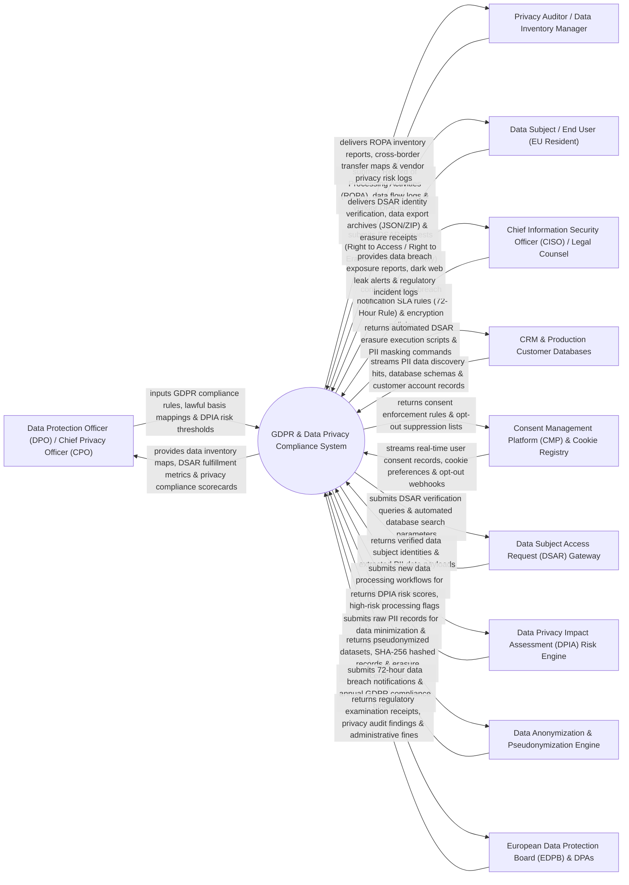

# Context Diagram — GDPR & Data Privacy Compliance System

## Mermaid Code

## Actor & Interaction Table | Bảng Actor & Tương tác

| # | Actor | Actor Type | Data Sent TO System | Data Received FROM System | Notes |
|---|-------|------------|---------------------|---------------------------|-------|
| 1 | Data Protection Officer (DPO) / Chief Privacy Officer (CPO) | Primary | GDPR compliance rules, lawful basis mappings (Art 6), Data Privacy Impact Assessment (DPIA) risk thresholds, ROPA schemas. | Data inventory maps, DSAR fulfillment metrics, privacy compliance scorecards, cross-border data transfer logs. | DPO overseeing enterprise GDPR compliance, data protection governance, and privacy audits. |
| 2 | Privacy Auditor / Data Inventory Manager | Primary | Record of Processing Activities (ROPA) updates, data flow diagrams, vendor Data Processing Agreement (DPA) audits. | ROPA inventory reports, cross-border data transfer maps, vendor privacy risk logs, privacy audit trails. | Privacy manager mapping PII data lineage, updating ROPA registries, and auditing third-party vendors. |
| 3 | Data Subject / End User (EU Resident) | Primary | Data Subject Access Requests (DSAR: Art 15 Access, Art 17 Erasure/Right to be Forgotten, Art 16 Rectification), identity proofs. | DSAR identity verification prompts, compiled personal data export archives (JSON/ZIP format), erasure completion receipts. | Individual EU resident exercising statutory GDPR data privacy rights through self-service portals. |
| 4 | Chief Information Security Officer (CISO) / Legal Counsel | Primary | Data breach incident notification SLA rules (72-Hour Rule), PII encryption standards, security breach assessments. | Data breach exposure reports, dark web PII leak alerts, regulatory incident logs, breach notification templates. | Security officer managing data breach response and ensuring compliance with 72-hour DPA notification SLAs. |
| 5 | CRM & Production Customer Databases | Supporting | PII data discovery hits (Emails, IP Addresses, Credit Cards, SSNs), database schemas, customer records. | Automated DSAR erasure execution scripts (`DELETE FROM customers`), PII masking and pseudonymization commands. | Enterprise databases (Salesforce, PostgreSQL, Snowflake) holding production PII data subject to GDPR. |
| 6 | Consent Management Platform (CMP) & Cookie Registry | Supporting | Real-time cookie consent preferences (OneTrust API), opt-out webhooks, consent withdrawal timestamps. | Consent enforcement rules, opt-out suppression lists, cookie banner policy updates. | CMP platform capturing web/mobile user consent preferences and cookie tracking opt-outs. |
| 7 | Data Subject Access Request (DSAR) Gateway | Supporting | Verified data subject identities, extracted PII data payloads, database search match counts. | DSAR verification queries, automated cross-database PII search parameters, export packaging jobs. | DSAR automation engine orchestrating automated PII search and retrieval across enterprise IT systems. |
| 8 | Data Privacy Impact Assessment (DPIA) Risk Engine | Supporting | DPIA risk scores, high-risk data processing flags (e.g., biometric processing, AI profiling), mitigation controls. | New data processing workflow parameters, system architecture diagrams, data sensitivity tags. | Risk engine scoring privacy risks associated with new high-risk data processing activities (GDPR Art 35). |
| 9 | Data Anonymization & Pseudonymization Engine | Supporting | Pseudonymized datasets, k-anonymity compliance logs, cryptographic SHA-256 hashed records, erasure certificates. | Raw PII records for data minimization, pseudonymization seed keys, automated deletion execution payloads. | Engine performing data minimization, tokenization, k-anonymity, and irreversible cryptographic data erasure. |
| 10 | European Data Protection Board (EDPB) & DPAs | Supporting / Regulatory | Regulatory examination notices, compliance audit findings, statutory administrative fines (up to 4% global turnover). | 72-hour data breach notifications, annual GDPR compliance binders, DPO registration files. | EU Data Protection Authorities (CNIL, ICO, DPC) supervising statutory GDPR compliance and enforcing fines. |

## System Boundary Description | Mô tả Phạm vi Hệ thống

The **GDPR & Data Privacy Compliance System** is an enterprise data privacy governance, automated DSAR fulfillment, Record of Processing Activities (ROPA), DPIA risk scoring, consent enforcement, and 72-hour data breach notification platform designed for global privacy laws (GDPR, CCPA, CPRA).

**Inside System Scope:**
- Automated Data Subject Access Request (DSAR) portal fulfilling Right to Access (Art 15) and Right to Erasure / Right to be Forgotten (Art 17).
- Automated PII Data Discovery & ROPA Inventory mapping data flows across cloud databases and third-party SaaS tools.
- Data Privacy Impact Assessment (DPIA) workflow engine evaluating high-risk processing (GDPR Art 35).
- Consent Management Platform (CMP) integration enforcing opt-in/opt-out consent across web, mobile, and CRM channels.
- 72-Hour Data Breach Incident Management tracking statutory regulatory notification SLAs to Data Protection Authorities.

**Outside System Scope:**
- Direct physical security guarding of corporate data centers (handled by Data Center Security Teams).
- Direct physical destruction of paper customer files (handled by Certified Shredding Vendors).
- Direct legal representation before European Courts of Justice (handled by External EU Privacy Counsel).
