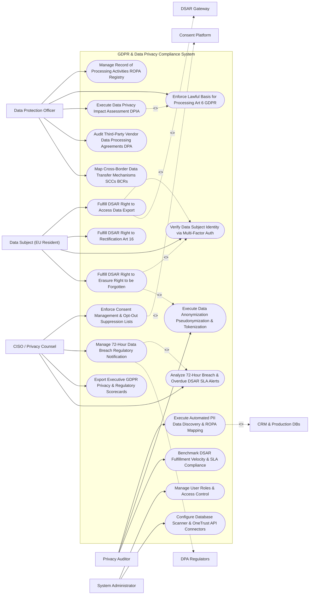

# Use Case Diagram — GDPR & Data Privacy Compliance System

## Mermaid Code

## Actor Table | Bảng Actor

| # | Actor | Actor Type | Role Description | Related Use Cases |
|---|-------|------------|------------------|-------------------|
| 1 | Data Protection Officer | Primary | DPO managing ROPA registries, lawful basis mappings, DPIA risk assessments, vendor DPAs, and cross-border transfers. | UC01, UC03, UC10, UC11, UC13 |
| 2 | Privacy Auditor | Primary | Internal auditor executing PII data discovery, verifying ROPA lineage, inspecting pseudonymization, and tracking DSAR SLAs. | UC02, UC09, UC14 |
| 3 | Data Subject | Primary | EU resident submitting DSAR access requests, rectification updates, and Right to Erasure requests. | UC05, UC06, UC07, UC08 |
| 4 | CISO / Privacy Counsel | Primary | Security executive managing consent enforcement, 72-hour breach notifications, privacy scorecards, and breach alerts. | UC04, UC12, UC15, UC18 |
| 5 | System Administrator | Primary | IT admin managing user security roles, database scanner credentials, and OneTrust CMP API keys. | UC16, UC17 |
| 6 | CRM & Production DBs | System (Secondary) | Production databases (Salesforce, PostgreSQL, Snowflake) scanned for PII and executing deletion scripts. | UC02 |
| 7 | DSAR Gateway | System (Secondary) | Automation engine searching cross-system databases and packaging personal data export files. | UC05 |
| 8 | Consent Platform | System (Secondary) | CMP service (OneTrust) streaming cookie consent preferences and user opt-out lists. | UC04 |
| 9 | DPA Regulators | System (Secondary) | EU Data Protection Authorities (CNIL, ICO, DPC) receiving 72-hour breach notifications. | UC12 |

## Use Case Table | Bảng Use Case

| # | UC ID | Use Case Name | Primary Actor | Secondary Actor | Description | Priority |
|---|-------|---------------|---------------|-----------------|-------------|----------|
| 1 | UC01 | Manage Record of Processing Activities ROPA Registry | DPO | None | Maintains centralized GDPR Article 30 ROPA registry detailing data categories, purposes, recipients, and retention periods. | Critical |
| 2 | UC02 | Execute Automated PII Data Discovery & ROPA Mapping | Auditor | CRMDBs | Scans enterprise cloud databases and SaaS tools to auto-detect PII (Emails, Names, SSNs, IPs) and map data lineage. | Critical |
| 3 | UC03 | Enforce Lawful Basis for Processing Art 6 GDPR | DPO | None | Mapped lawful basis for processing (Consent, Contractual Necessity, Legitimate Interest, Legal Obligation) to every PII field. | Critical |
| 4 | UC04 | Enforce Consent Management & Opt-Out Suppression Lists | CISO | CMP | Integrates with OneTrust CMP to enforce user consent preferences and suppress marketing emails for opted-out users. | Critical |
| 5 | UC05 | Fulfill DSAR Right to Access Data Export | Subject | DSAR | Searches all connected databases, compiles all personal data held for a subject, and exports a secure ZIP/JSON archive. | Critical |
| 6 | UC06 | Fulfill DSAR Right to Rectification Art 16 | Subject | None | Allows data subjects to request correction of inaccurate personal data, propagating updates across connected IT systems. | High |
| 7 | UC07 | Verify Data Subject Identity via Multi-Factor Auth | Subject | None | Authenticates identity of DSAR requesters using multi-factor authentication (MFA) and ID document verification before data release. | Critical |
| 8 | UC08 | Fulfill DSAR Right to Erasure Right to be Forgotten | Subject | None | Executes automated deletion or irreversible anonymization of personal data across all production databases and backups. | Critical |
| 9 | UC09 | Execute Data Anonymization Pseudonymization & Tokenization | Auditor | None | Applies k-anonymity, pseudonymization, and SHA-256 tokenization to protect personal data used in analytics environments. | High |
| 10 | UC10 | Execute Data Privacy Impact Assessment DPIA | DPO | None | Conducts DPIA risk assessments (GDPR Art 35) for new high-risk processing activities (e.g., AI profiling, biometrics). | Critical |
| 11 | UC11 | Audit Third-Party Vendor Data Processing Agreements DPA | DPO | None | Audits third-party vendor DPAs, security certifications, and sub-processor lists to ensure GDPR compliance. | High |
| 12 | UC12 | Manage 72-Hour Data Breach Regulatory Notification | CISO | DPARegs | Tracks data breach incident evaluation, calculating PII impact and submitting formal DPA notifications within 72 hours. | Critical |
| 13 | UC13 | Map Cross-Border Data Transfer Mechanisms SCCs BCRs | DPO | None | Tracks international data transfers outside the EEA, enforcing Standard Contractual Clauses (SCCs) and Binding Corporate Rules. | High |
| 14 | UC14 | Benchmark DSAR Fulfillment Velocity & SLA Compliance | Auditor | None | Measures average DSAR fulfillment time (Target $< 30$ days), SLA breach percentage, and request volume trends. | High |
| 15 | UC15 | Export Executive GDPR Privacy & Regulatory Scorecards | CISO | None | Renders executive scorecards detailing active ROPA coverage %, DSAR SLA compliance %, DPIA risk scores, and DPA audit status. | High |
| 16 | UC16 | Manage User Roles & Access Control | Admin | None | Controls user login credentials, RBAC permissions, and DSAR fulfillment authorization scopes. | High |
| 17 | UC17 | Configure Database Scanner & OneTrust API Connectors | Admin | None | Configures API connection parameters for Snowflake, Salesforce, OneTrust, Zendesk, and Azure Blob Storage. | High |
| 18 | UC18 | Analyze 72-Hour Breach & Overdue DSAR SLA Alerts | CISO | None | Dispatches urgent notifications when a DSAR request exceeds 25 days or a data breach timer reaches 48 hours without notification. | High |

## Use Case Specification | Đặc tả Use Case

---

### UC02 — Execute Automated PII Data Discovery & ROPA Mapping

| Field | Detail |
|-------|--------|
| **UC ID** | UC02 |
| **Use Case Name** | Execute Automated PII Data Discovery & ROPA Mapping |
| **Actor(s)** | Primary: Privacy Auditor, Data Protection Officer   Secondary: CRM & Production Customer Databases |
| **Description** | Connects to enterprise databases, data lakes, and SaaS tools, executing automated PII pattern scanning to map personal data inventory and auto-update Record of Processing Activities (ROPA). |
| **Precondition** | 1. Database connection credentials (PostgreSQL, Snowflake, Salesforce API) are configured.   2. PII Regex pattern library (Emails, Names, Credit Cards, SSNs, IP Addresses) is active. |
| **Main Flow** | 1. Privacy Auditor initiates "Enterprise PII Discovery Scan" across Production Data Stores.   2. System dispatches automated database scanner jobs to target data repositories:   &nbsp;&nbsp;&nbsp;&nbsp; a. Target 1: Salesforce CRM (Customer Accounts).   &nbsp;&nbsp;&nbsp;&nbsp; b. Target 2: Snowflake Data Warehouse (`analytics_db`).   &nbsp;&nbsp;&nbsp;&nbsp; c. Target 3: AWS S3 Object Storage (`user-uploads-bucket`).   3. Scanner Engine executes regex pattern matching and ML column classification:   &nbsp;&nbsp;&nbsp;&nbsp; a. Scans 1,500 database tables and 500,000 files.   &nbsp;&nbsp;&nbsp;&nbsp; b. Identifies 45 PII Data Fields: `email_address` (99% confidence), `ip_address` (95%), `credit_card_num` (100%), `ssn_val` (100%).   4. System aggregates PII Data Lineage Map.   5. System compares discovered PII inventory against ROPA Registry (UC01):   &nbsp;&nbsp;&nbsp;&nbsp; a. Discovers Un-Documented PII Field: `ip_address` stored in `analytics_db.user_tracking` without ROPA documentation -> `UNMAPPED_PII_DISCOVERED`.   6. System generates ROPA Mapping Exception Alert and creates draft ROPA update entry for DPO review.   7. DPO reviews finding, assigns lawful basis (UC03), and publishes updated ROPA registry. |
| **Alternative Flow** | **AF1** — Automated Sensitive Data Classification: System classifies discovered PII into GDPR Article 9 Special Categories (Biometric, Health, Political data), enforcing elevated encryption controls. |
| **Exception Flow** | **EX1** — Scanner Connection Timeout: Database connection to legacy MySQL database times out; System logs connection error, flags database for manual credential check, and continues scanning remaining stores. |
| **Postcondition** | PII data inventory across all enterprise data stores is discovered, data lineage map updates, unmapped PII is flagged, and ROPA auto-updates. |
| **Business Rule** | **BR1**: Automated PII discovery scans MUST run at least monthly to ensure ROPA registries accurately reflect all production data stores. |

---

### UC05 — Fulfill DSAR Right to Access Data Export

| Field | Detail |
|-------|--------|
| **UC ID** | UC05 |
| **Use Case Name** | Fulfill DSAR Right to Access Data Export |
| **Actor(s)** | Primary: Data Subject (EU Resident)   Secondary: Data Subject Access Request (DSAR) Automation Gateway |
| **Description** | Receives statutory Data Subject Access Requests (GDPR Article 15), verifies subject identity, automatically compiles all personal data held across enterprise systems, and delivers an encrypted data export archive. |
| **Precondition** | 1. Data Subject submits DSAR request on Privacy Portal.   2. Data Subject identity is verified via MFA and ID document check (UC07). |
| **Main Flow** | 1. System receives verified DSAR Access Request `#DSAR-88412` for Subject `Jane Doe (email: jane.doe@company.com)`.   2. System initializes 30-Day GDPR Statutory Fulfillment SLA Timer.   3. System invokes DSAR Automation Gateway to search all connected data stores:   &nbsp;&nbsp;&nbsp;&nbsp; a. Salesforce CRM: Extracts contact profile, lead history, and communication logs.   &nbsp;&nbsp;&nbsp;&nbsp; b. Zendesk Support: Extracts support tickets, chat transcripts, and CSAT ratings.   &nbsp;&nbsp;&nbsp;&nbsp; c. Snowflake Analytics: Extracts web browsing events and order history.   &nbsp;&nbsp;&nbsp;&nbsp; d. OneTrust CMP: Extracts cookie consent preference logs.   4. System aggregates extracted personal data JSON payloads.   5. System executes Third-Party PII Redaction Filter:   &nbsp;&nbsp;&nbsp;&nbsp; a. Scans extracted support ticket text and redacts names/emails of other individuals to protect third-party privacy.   6. System packages compiled data into an encrypted password-protected ZIP archive containing JSON and CSV files.   7. System dispatches notification email to Jane Doe: *"Your GDPR Data Access Export #DSAR-88412 is ready for download."*   8. Subject logs into secure portal and downloads encrypted ZIP archive.   9. System logs DSAR fulfillment completion: `Fulfilled in 8 Days (SLA Compliant)`. |
| **Alternative Flow** | **AF1** — Complex Request SLA Extension: Subject requests multi-year unstructured email archives; System dispatches formal SLA extension notice to subject (Extending SLA by additional 60 days per Art 12(3)). |
| **Exception Flow** | **EX1** — Un-Verified Identity Rejection: Requester fails identity verification check (MFA code fails 3 times); System rejects request, notifying requester: "Identity Verification Failed - Access Request Rejected". |
| **Postcondition** | Personal data across all systems is searched, third-party PII is redacted, encrypted ZIP export is generated and delivered within 30-day SLA. |
| **Business Rule** | **BR1**: DSAR Right to Access exports MUST deliver all personal data held for the subject within the statutory 30-day GDPR deadline. |

---

### UC08 — Fulfill DSAR Right to Erasure (Right to be Forgotten)

| Field | Detail |
|-------|--------|
| **UC ID** | UC08 |
| **Use Case Name** | Fulfill DSAR Right to Erasure (Right to be Forgotten) |
| **Actor(s)** | Primary: Data Subject (EU Resident), Data Protection Officer   Secondary: CRM & Production Customer Databases |
| **Description** | Receives statutory Right to Erasure requests (GDPR Article 17), evaluates legal retention overrides (e.g., tax/financial retention laws), and executes automated deletion or irreversible anonymization across all databases. |
| **Precondition** | 1. Data Subject submits Right to Erasure request.   2. Data Subject identity is verified via MFA (UC07). |
| **Main Flow** | 1. System receives verified Erasure Request `#DSAR-88415` for Subject `Alex Smith (email: alex.smith@company.com)`.   2. System evaluates Legal Retention Overrides (GDPR Article 17(3)):   &nbsp;&nbsp;&nbsp;&nbsp; a. Check Tax/Accounting Law: Alex Smith has paid invoices from 2025 -> Financial accounting law requires 7-year invoice retention (`TAX_RETENTION_OVERRIDE`).   &nbsp;&nbsp;&nbsp;&nbsp; b. Decision: Retain financial transaction ledger; Erase all marketing, CRM, support, and web tracking data.   3. DPO approves partial erasure plan: `Erase Marketing & CRM | Anonymize Support | Retain Tax Invoices`.   4. System executes Automated Deletion Pipeline across connected databases:   &nbsp;&nbsp;&nbsp;&nbsp; a. Salesforce CRM: Deletes Contact `#00388412` and marketing subscription records.   &nbsp;&nbsp;&nbsp;&nbsp; b. OneTrust CMP: Deletes consent preferences and adds email to Opt-Out Suppression List (UC04).   &nbsp;&nbsp;&nbsp;&nbsp; c. Snowflake Analytics: Applies SHA-256 cryptographic anonymization (UC09) to web tracking logs, replacing email with un-reversible hash `e3b0c442...`.   5. System dispatches deletion execution webhooks to third-party SaaS vendors (HubSpot, Marketo, Zendesk).   6. System generates Cryptographic Certificate of Erasure `#CERT-ERASE-99412`, recording date, target databases, and retention overrides.   7. System dispatches Erasure Confirmation Email to Alex Smith with attached certificate. |
| **Alternative Flow** | **AF1** — Full Hard-Delete Execution: Subject has zero financial transactions or active contracts; System executes 100% hard-delete across all databases, backups, and SaaS tools. |
| **Exception Flow** | **EX1** — Active Litigation Hold Exemption: Subject is involved in active court litigation under legal hold (System #866); System blocks erasure, notifying DPO: "Erasure Request Overridden by Active Litigation Hold #MAT-88412". |
| **Postcondition** | Personal data is deleted or anonymized across databases, legal retention overrides are respected, and Certificate of Erasure is issued. |
| **Business Rule** | **BR1**: Right to Erasure executions MUST respect statutory tax and legal hold retention overrides while permanently deleting marketing and tracking PII. |

---

### UC10 — Execute Data Privacy Impact Assessment (DPIA)

| Field | Detail |
|-------|--------|
| **UC ID** | UC10 |
| **Use Case Name** | Execute Data Privacy Impact Assessment (DPIA) |
| **Actor(s)** | Primary: Data Protection Officer, Chief Information Security Officer   Secondary: DPIA Risk Engine |
| **Description** | Conducts formal Data Privacy Impact Assessments (GDPR Article 35) for new high-risk data processing activities (AI automated decisioning, biometric processing, large-scale profiling), mapping risk mitigations. |
| **Precondition** | 1. A new IT system, AI model, or marketing campaign involving personal data processing is proposed.   2. DPIA questionnaire template and risk scoring matrix are active. |
| **Main Flow** | 1. Product Manager initiates new feature proposal: `AI Customer Churn Prediction Engine` (System #968).   2. System triggers Automated DPIA Screening Checklist:   &nbsp;&nbsp;&nbsp;&nbsp; a. Screening 1: Does processing involve AI automated profiling? -> `YES`.   &nbsp;&nbsp;&nbsp;&nbsp; b. Screening 2: Does processing involve large-scale customer data? -> `YES`.   &nbsp;&nbsp;&nbsp;&nbsp; c. Screening Decision: 2 High-Risk Criteria Met -> `MANDATORY_DPIA_REQUIRED`.   3. DPO opens "DPIA Assessment Studio" and conducts formal DPIA evaluation across 4 stages:   &nbsp;&nbsp;&nbsp;&nbsp; a. Stage 1 (Processing Description): Identifies data types (Usage telemetry, support tickets, ARR).   &nbsp;&nbsp;&nbsp;&nbsp; b. Stage 2 (Necessity & Proportionality): Verifies lawful basis (Legitimate Interest - Art 6(1)(f)).   &nbsp;&nbsp;&nbsp;&nbsp; c. Stage 3 (Privacy Risk Identification): Evaluates risks (Model bias, unauthorized access, data leak).   &nbsp;&nbsp;&nbsp;&nbsp; d. Stage 4 (Mitigation Controls): Mandates SHA-256 anonymization of training datasets, RBAC access control, and 12-month model retraining.   4. DPIA Risk Engine computes Residual Privacy Risk Score: `Low Residual Risk` (Initial High Risk mitigated by controls).   5. DPO approves DPIA Assessment `#DPIA-2026-402` and signs digital clearance certificate.   6. System archives DPIA in compliance repository and unlocks project deployment. |
| **Alternative Flow** | **AF1** — High Residual Risk DPA Consultation: DPIA reveals un-mitigated high residual risk; System prompts DPO: "High Residual Risk - Prior Consultation with Data Protection Authority (Art 36) Required". |
| **Exception Flow** | **EX1** — Un-Approved High-Risk Launch Attempt: Product team attempts to deploy AI feature without completed DPIA; System blocks production deployment, sending alert to DPO and CISO. |
| **Postcondition** | DPIA risk assessment is conducted, privacy risks and mitigation controls are mapped, residual risk is scored, and DPO clearance is granted. |
| **Business Rule** | **BR1**: Processing activities involving AI profiling or large-scale sensitive data MUST complete a DPO-approved DPIA prior to production launch. |

---

### UC12 — Manage 72-Hour Data Breach Regulatory Notification

| Field | Detail |
|-------|--------|
| **UC ID** | UC12 |
| **Use Case Name** | Manage 72-Hour Data Breach Regulatory Notification |
| **Actor(s)** | Primary: CISO / Privacy Counsel, Data Protection Officer   Secondary: European Data Protection Board (EDPB) & DPA Regulators |
| **Description** | Tracks potential personal data breach security incidents, assessing PII exposure, starting the 72-hour countdown timer, and managing formal statutory notifications to Data Protection Authorities (GDPR Art 33). |
| **Precondition** | 1. Security incident involving potential PII exposure is detected by CISO or SIEM system.   2. Statutory 72-Hour DPA Notification Timer is configured. |
| **Main Flow** | 1. CISO logs Security Incident `#INC-2026-884`: `Database Backup Misconfiguration on AWS S3`.   2. System initializes Statutory 72-Hour GDPR DPA Notification Countdown Timer in database:   &nbsp;&nbsp;&nbsp;&nbsp; a. Incident Timestamp: `October 30, 2026 at 08:00 AM EST`.   &nbsp;&nbsp;&nbsp;&nbsp; b. Statutory Notification Deadline: `November 02, 2026 at 08:00 AM EST` (72 Hours).   3. Incident Response Team conducts PII Impact Assessment:   &nbsp;&nbsp;&nbsp;&nbsp; a. Affected Records: `15,000 EU Customer Records`.   &nbsp;&nbsp;&nbsp;&nbsp; b. Compromised Data Types: `Names, Email Addresses, Encrypted Passwords`.   &nbsp;&nbsp;&nbsp;&nbsp; c. Risk to Rights & Freedoms of Individuals: `MEDIUM_HIGH_RISK`.   4. System evaluates Regulatory Notification Requirement (GDPR Article 33): Risk to individuals > Low -> `MANDATORY_DPA_NOTIFICATION_REQUIRED`.   5. DPO and Legal Counsel draft Formal DPA Breach Notification Document using built-in EDPB template:   &nbsp;&nbsp;&nbsp;&nbsp; a. Nature of breach, categories of data, DPO contact details, likely consequences, and technical measures taken.   6. On `October 31, 2026 at 02:00 PM EST` (Timer at 30 Hours elapsed): DPO submits notification package to Lead DPA (CNIL / Irish DPC) via secure portal.   7. Lead DPA returns Confirmation Receipt `#DPA-INC-88412`.   8. System logs notification compliance: `Notified in 30 Hours (SLA Met - 42 Hours Remaining)`.   9. System evaluates GDPR Article 34 (Communication to Data Subjects): High risk -> System triggers automated email notification dispatch to all 15,000 affected customers. |
| **Alternative Flow** | **AF1** — No-Risk Breach Record: Incident affected 100% encrypted data where decryption keys were un-compromised; DPO determines "Unlikely to result in risk to individuals", logging internal breach record without DPA notification. |
| **Exception Flow** | **EX1** — 48-Hour SLA Warning Escalation: Breach timer reaches 48 hours without DPA notification submission; System dispatches urgent SMS alerts to CISO, DPO, and CEO to prevent fine-inducing SLA breaches. |
| **Postcondition** | Data breach PII impact is assessed, 72-hour notification payload is submitted to DPA, receipt is logged, and customer communications trigger if required. |
| **Business Rule** | **BR1**: Personal data breaches posing risk to individuals MUST be notified to Lead Data Protection Authorities within <= 72 hours of awareness. |
