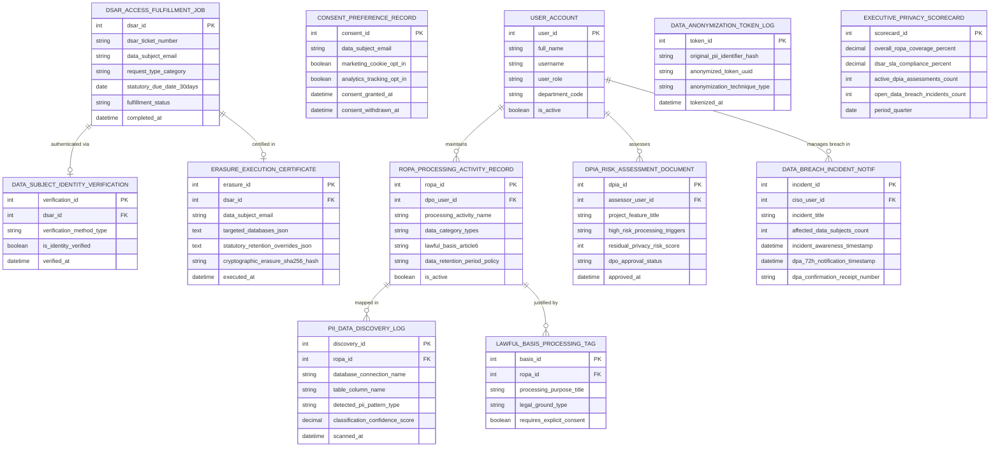

# Conceptual ERD — GDPR & Data Privacy Compliance System

## Mermaid Code

## Entity Description Table | Bảng mô tả Entity

| # | Entity Name | Vietnamese Name | Description | Key Attributes | Main Relationships |
|---|-------------|-----------------|-------------|----------------|-------------------|
| 1 | USER_ACCOUNT | Tài khoản Nguời dùng | System credentials and access roles for DPOs, privacy auditors, CISOs, and system admins. | `user_id`, `username`, `user_role`, `department_code` | Maintains `ROPA_PROCESSING_ACTIVITY_RECORD`, assesses `DPIA_RISK_ASSESSMENT_DOCUMENT`, manages breach in `DATA_BREACH_INCIDENT_NOTIF`. |
| 2 | ROPA_PROCESSING_ACTIVITY_RECORD | Bản ghi Hoạt động ROPA | GDPR Article 30 Record of Processing Activities (ROPA) entity tracking activity names, data categories, lawful bases, and retention policies. | `ropa_id`, `dpo_user_id`, `processing_activity_name`, `data_category_types`, `lawful_basis_article6`, `data_retention_period_policy` | Mapped in `PII_DATA_DISCOVERY_LOG`, justified by `LAWFUL_BASIS_PROCESSING_TAG`, maintained by `USER_ACCOUNT`. |
| 3 | PII_DATA_DISCOVERY_LOG | Nhật ký Discovery PII Database | Automated PII discovery log recording database names, table column names, detected PII pattern types, and scan confidence scores. | `discovery_id`, `ropa_id`, `database_connection_name`, `table_column_name`, `detected_pii_pattern_type`, `classification_confidence_score` | Belongs to `ROPA_PROCESSING_ACTIVITY_RECORD`. |
| 4 | LAWFUL_BASIS_PROCESSING_TAG | Tag Căn cứ Pháp lý Xử lý | GDPR Article 6 Lawful Basis tag entity storing processing purpose titles, legal grounds (Consent, Contract, Legitimate Interest), and consent requirement flags. | `basis_id`, `ropa_id`, `processing_purpose_title`, `legal_ground_type`, `requires_explicit_consent` | Belongs to `ROPA_PROCESSING_ACTIVITY_RECORD`. |
| 5 | CONSENT_PREFERENCE_RECORD | Bản ghi Preference Consent | End-user consent preference log tracking email, cookie opt-ins, analytics opt-outs, and consent timestamps. | `consent_id`, `data_subject_email`, `marketing_cookie_opt_in`, `analytics_tracking_opt_in`, `consent_granted_at` | Standalone consent preference entity. |
| 6 | DSAR_ACCESS_FULFILLMENT_JOB | Job Fulfill DSAR Quyền Truy cập | Data Subject Access Request (DSAR) fulfillment job tracking ticket numbers, request types (Access/Erasure/Rectification), 30-day statutory due dates, and status. | `dsar_id`, `dsar_ticket_number`, `data_subject_email`, `request_type_category`, `statutory_due_date_30days`, `fulfillment_status` | Authenticated via `DATA_SUBJECT_IDENTITY_VERIFICATION`, certified in `ERASURE_EXECUTION_CERTIFICATE`. |
| 7 | DATA_SUBJECT_IDENTITY_VERIFICATION | Xác minh Identity Data Subject | Data subject identity verification log recording verification methods (MFA / ID Document Check), verification status, and timestamps. | `verification_id`, `dsar_id`, `verification_method_type`, `is_identity_verified`, `verified_at` | Belongs to `DSAR_ACCESS_FULFILLMENT_JOB`. |
| 8 | ERASURE_EXECUTION_CERTIFICATE | Chứng nhận Erasure Quyền Xóa | Cryptographic certificate of erasure recording target databases deleted, statutory retention overrides respected, and SHA-256 execution hashes. | `erasure_id`, `dsar_id`, `data_subject_email`, `targeted_databases_json`, `statutory_retention_overrides_json`, `cryptographic_erasure_sha256_hash` | Belongs to `DSAR_ACCESS_FULFILLMENT_JOB`. |
| 9 | DATA_ANONYMIZATION_TOKEN_LOG | Nhật ký Token Anonymization | Data anonymization log mapping original PII hashes, anonymized token UUIDs, and tokenization techniques (k-anonymity, pseudonymization). | `token_id`, `original_pii_identifier_hash`, `anonymized_token_uuid`, `anonymization_technique_type` | Standalone privacy tokenization entity. |
| 10 | DPIA_RISK_ASSESSMENT_DOCUMENT | Tài liệu Đánh giá Risk DPIA | GDPR Article 35 Data Privacy Impact Assessment (DPIA) document tracking project titles, high-risk processing triggers, residual risk scores, and DPO sign-offs. | `dpia_id`, `assessor_user_id`, `project_feature_title`, `high_risk_processing_triggers`, `residual_privacy_risk_score`, `dpo_approval_status` | Assessed by `USER_ACCOUNT`. |
| 11 | DATA_BREACH_INCIDENT_NOTIF | Thông báo Incident Vi phạm Data | 72-hour data breach notification log tracking affected data subject counts, incident awareness timestamps, 72-hour DPA submission timestamps, and confirmation numbers. | `incident_id`, `ciso_user_id`, `incident_title`, `affected_data_subjects_count`, `incident_awareness_timestamp`, `dpa_72h_notification_timestamp`, `dpa_confirmation_receipt_number` | Managed by `USER_ACCOUNT`. |
| 12 | EXECUTIVE_PRIVACY_SCORECARD | Scorecard Executive Privacy | Executive GDPR privacy scorecard aggregating ROPA coverage %, DSAR SLA compliance %, active DPIAs, and open breach incidents. | `scorecard_id`, `overall_ropa_coverage_percent`, `dsar_sla_compliance_percent`, `active_dpia_assessments_count`, `open_data_breach_incidents_count` | Standalone executive performance entity. |

## Relationship Description | Mô tả Quan hệ

| # | From Entity | Cardinality | To Entity | Label | Business Explanation |
|---|-------------|-------------|-----------|-------|----------------------|
| 1 | ROPA_PROCESSING_ACTIVITY_RECORD | 1 to 0..N | PII_DATA_DISCOVERY_LOG | mapped in | A ROPA processing record is mapped in automated PII discovery logs. |
| 2 | ROPA_PROCESSING_ACTIVITY_RECORD | 1 to 1..N | LAWFUL_BASIS_PROCESSING_TAG | justified by | A ROPA processing record is justified by Article 6 lawful basis tags. |
| 3 | DSAR_ACCESS_FULFILLMENT_JOB | 1 to 1 | DATA_SUBJECT_IDENTITY_VERIFICATION | authenticated via | A DSAR fulfillment job is authenticated via identity verification. |
| 4 | DSAR_ACCESS_FULFILLMENT_JOB | 1 to 0..1 | ERASURE_EXECUTION_CERTIFICATE | certified in | A DSAR erasure job is certified in a cryptographic erasure certificate. |
| 5 | USER_ACCOUNT | 1 to 0..N | ROPA_PROCESSING_ACTIVITY_RECORD | maintains | A DPO user account maintains ROPA processing activity records. |
| 6 | USER_ACCOUNT | 1 to 0..N | DPIA_RISK_ASSESSMENT_DOCUMENT | assesses | A DPO user account assesses DPIA risk assessment documents. |
| 7 | USER_ACCOUNT | 1 to 0..N | DATA_BREACH_INCIDENT_NOTIF | manages breach in | A CISO user account manages data breach incident notifications. |
