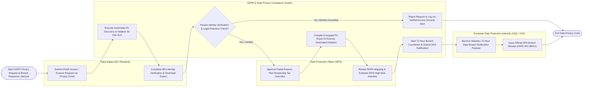

# Swimlane Diagram — GDPR & Data Privacy Compliance System

## Mermaid Code

## Flow Description | Mô tả luồng

| Lane | Actor | Role in Flow |
|------|-------|-------------|
| 1 | Data Subject (EU Resident) | Submits Data Subject Access Requests (DSAR: Access, Erasure, Rectification) via self-service privacy portals, completes MFA identity verification, and downloads compiled personal data export ZIP archives. |
| 2 | Data Protection Officer (DPO) | Maintains Record of Processing Activities (ROPA), conducts Data Privacy Impact Assessments (DPIA), evaluates statutory tax retention overrides, and approves partial erasure execution plans. |
| 3 | GDPR & Data Privacy Compliance System | Scans enterprise databases for PII data discovery, tracks 30-day statutory DSAR SLA timers, verifies requester identity via MFA, redacts third-party PII, compiles data exports, executes database erasure scripts, enforces OneTrust consent opt-outs, and manages 72-hour data breach notification timers. |
| 4 | European Data Protection Authority (CNIL / ICO) | Receives statutory 72-hour data breach notifications (GDPR Art 33), evaluates breach severity, and issues official DPA confirmation receipts. |
