# Action Tree — GDPR & Data Privacy Compliance System

## Mermaid Code

```mermaid
graph TD
    Root["GDPR & Data Privacy Compliance System"]

    Root --> M1["ROPA Registry & Automated PII Discovery"]
    Root --> M2["Consent Management & Lawful Basis Engine"]
    Root --> M3["Automated DSAR Access & Rectification"]
    Root --> M4["Right to Erasure & Anonymization Engine"]
    Root --> M5["Data Privacy Impact Assessment DPIA"]
    Root --> M6["72-Hour Data Breach & DPA Scorecards"]

    M1 --> A11["Maintain Centralized Record of Processing Activities (ROPA Art 30)"]
    M1 --> A12["Execute Automated PII Discovery Scans across Production DBs & SaaS"]
    M1 --> A13["Map PII Data Lineage & Identify Un-Documented Database Fields"]
    M1 --> A14["Classify GDPR Article 9 Special Category Sensitive Data"]

    M2 --> A21["Map Article 6 Lawful Basis (Consent, Contract, Legitimate Interest)"]
    M2 --> A22["Integrate Consent Management Platform (OneTrust CMP API)"]
    M2 --> A23["Enforce Web Cookie Opt-In / Opt-Out Preference Registries"]
    M2 --> A24["Synchronize Opt-Out Suppression Lists to Marketing Platforms"]

    M3 --> A31["Process Self-Service DSAR Access Requests (GDPR Article 15)"]
    M3 --> A32["Verify Data Subject Identity using MFA & ID Document Check"]
    M3 --> A33["Extract & Package Personal Data into Encrypted Password ZIP Files"]
    M3 --> A34["Redact Third-Party PII Data from Support Transcripts & Files"]

    M4 --> A41["Execute Automated DSAR Right to Erasure Requests (Article 17)"]
    M4 --> A42["Evaluate Tax & Legal Hold Retention Overrides prior to Deletion"]
    M4 --> A43["Apply SHA-256 Pseudonymization, Tokenization & k-Anonymity"]
    M4 --> A44["Issue Cryptographic Certificates of Erasure with Execution Hashes"]

    M5 --> A51["Conduct Data Privacy Impact Assessments (DPIA Article 35)"]
    M5 --> A52["Trigger Mandatory DPIAs for AI Profiling & Biometric Features"]
    M5 --> A53["Map Privacy Risk Mitigations & Compute Residual Privacy Scores"]
    M5 --> A54["Audit Third-Party Vendor Data Processing Agreements (DPAs)"]

    M6 --> A61["Initialize Statutory 72-Hour Data Breach Countdown Timers (Art 33)"]
    M6 --> A62["Submit Formal Electronic Breach Notifications to Lead DPA Regulators"]
    M6 --> A63["Dispatch Customer Data Breach Exposure Communications (Art 34)"]
    M6 --> A64["Export Executive GDPR Compliance, DSAR SLA & Risk Scorecards"]
```

## Module Description | Mô tả Module

| # | Module | Description | Actions |
|---|--------|-------------|---------|
| 1 | ROPA Registry & Automated PII Discovery | Maintains Article 30 ROPA registries, runs automated PII scanner jobs across cloud databases, maps data lineage, and classifies Article 9 sensitive data. | Maintain Record of Processing Activities (ROPA), Execute Automated PII Discovery Scans, Map PII Data Lineage, Classify Article 9 Sensitive Data. |
| 2 | Consent Management & Lawful Basis Engine | Maps Article 6 lawful processing grounds, integrates with OneTrust CMP, enforces cookie opt-ins/opt-outs, and syncs suppression lists to marketing. | Map Article 6 Lawful Processing Grounds, Integrate OneTrust CMP API, Enforce Cookie Opt-In/Opt-Out Preferences, Synchronize Opt-Out Suppression Lists. |
| 3 | Automated DSAR Access & Rectification | Fulfills Article 15 access requests, verifies requester MFA identity, aggregates PII payloads into encrypted ZIP archives, and redacts third-party data. | Process DSAR Access Requests (Article 15), Verify Data Subject Identity via MFA, Package Personal Data into Encrypted ZIP Files, Redact Third-Party PII from Files. |
| 4 | Right to Erasure & Anonymization Engine | Executes Article 17 Right to Erasure deletion scripts, evaluates tax/legal hold retention overrides, applies SHA-256 tokenization, and issues erasure certificates. | Execute DSAR Right to Erasure (Article 17), Evaluate Tax & Legal Hold Retention Overrides, Apply SHA-256 Tokenization & Anonymization, Issue Certificates of Erasure. |
| 5 | Data Privacy Impact Assessment DPIA | Conducts Article 35 DPIA risk assessments, triggers mandatory reviews for AI profiling features, maps risk mitigations, and audits third-party vendor DPAs. | Conduct Data Privacy Impact Assessments (DPIA), Trigger Mandatory DPIAs for AI Profiling, Map Privacy Risk Mitigations & Residual Scores, Audit Vendor Data Processing Agreements. |
| 6 | 72-Hour Data Breach & DPA Scorecards | Initializes 72-hour breach timers, dispatches formal DPA notifications, sends customer breach notices, and exports executive privacy scorecards. | Initialize Statutory 72-Hour Breach Countdown Timers, Submit Breach Notifications to Lead DPA Regulators, Dispatch Customer Breach Exposure Notifications, Export Executive GDPR Scorecards. |
