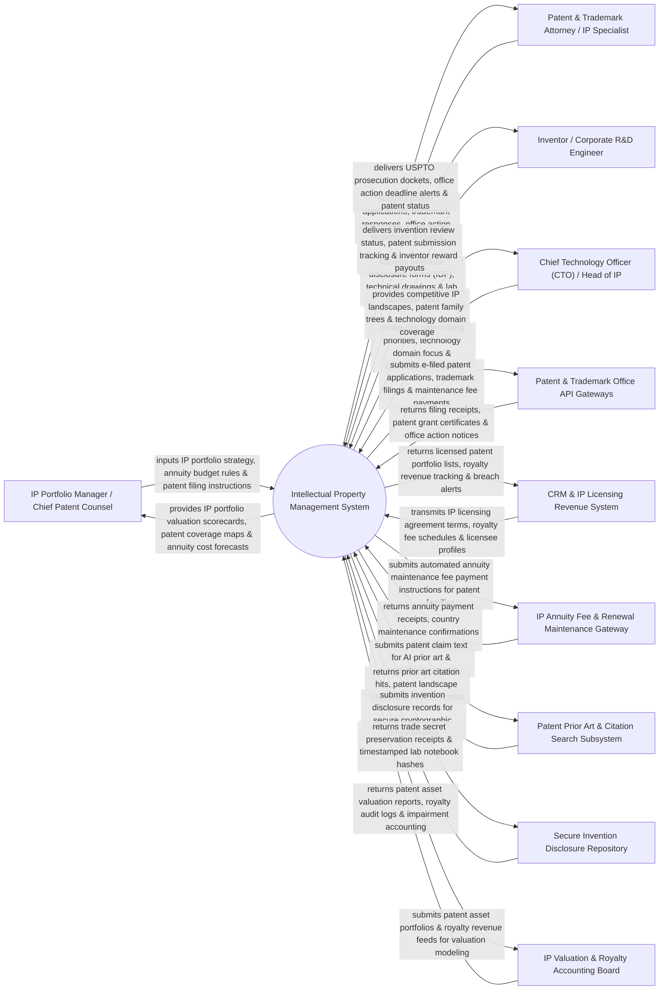

# Context Diagram — Intellectual Property Management System

## Mermaid Code

## Actor & Interaction Table | Bảng Actor & Tương tác

| # | Actor | Actor Type | Data Sent TO System | Data Received FROM System | Notes |
|---|-------|------------|---------------------|---------------------------|-------|
| 1 | IP Portfolio Manager / Chief Patent Counsel | Primary | IP portfolio filing strategy, patent annuity budget limits, prosecution directives, foreign filing instructions (PCT). | IP portfolio valuation scorecards, patent country coverage maps, annuity cost forecasts, patent decay analytics. | Chief Patent Counsel managing corporate IP strategy, patent budgets, and global portfolio maintenance. |
| 2 | Patent & Trademark Attorney / IP Specialist | Primary | Patent application drafts, trademark class selections, office action responses, patent claim amendments. | USPTO prosecution dockets, office action response deadline alerts, patent grant status notices, docket calendars. | Specialist IP attorney managing patent prosecution, office action responses, and trademark registrations. |
| 3 | Inventor / Corporate R&D Engineer | Primary | Invention Disclosure Forms (IDF), technical architecture drawings, lab notebook links, co-inventor details. | Invention review status updates, patent application submission tracking, inventor incentive award payouts. | R&D engineer or researcher submitting new technical inventions for patent review and patentability assessment. |
| 4 | Chief Technology Officer (CTO) / Head of IP | Primary | Patent filing priority guidelines, core technology domain targets, competitive IP defense goals. | Competitive IP landscape analytics, patent family tree graphs, technology domain coverage heatmaps, IP ROI. | Executive evaluating corporate technology IP protection, patent barriers, and competitive moat strength. |
| 5 | Patent & Trademark Office API Gateways | Supporting | Patent filing receipts, official office action notices (USPTO / EPO / WIPO), patent grant certificates, allowance notices. | Electronic patent applications (XML/PDF), trademark registration filings, maintenance fee payment tokens. | International patent office gateways (USPTO PAIR, European Patent Office, WIPO PCT) handling patent filings. |
| 6 | CRM & IP Licensing Revenue System | Supporting | Outbound IP licensing agreement terms, licensee account profiles, royalty fee schedules, contract IDs. | Licensed patent portfolio lists, royalty revenue tracking, licensing milestone triggers, breach warnings. | CRM and revenue system managing IP monetization, technology licensing agreements, and royalty collections. |
| 7 | IP Annuity Fee & Renewal Maintenance Gateway | Supporting | Annuity payment receipts, country patent maintenance confirmations (CPA Global / Computer Packages), fee logs. | Automated annuity maintenance fee payment instructions, global patent family renewal schedules. | Global annuity service paying country-specific patent maintenance fees to keep granted patents active. |
| 8 | Patent Prior Art & Citation Search Subsystem | Supporting | Patent prior art search hits, classification cluster maps, citation networks, AI patentability novelty scores. | Patent claim text streams, technical keyword search queries, IPC/CPC classification codes. | Patent search database (Derwent / Google Patents) searching global prior art and patent literature. |
| 9 | Secure Invention Disclosure Repository | Supporting | Cryptographic timestamping receipts, trade secret vault hashes, lab notebook immutable logs. | Invention disclosure document binaries, technical schematics, inventor signature tokens. | Secure vault preserving un-patented trade secrets, lab notebooks, and pre-filing invention disclosures. |
| 10 | IP Valuation & Royalty Accounting Board | Supporting / Regulatory | Patent asset valuation models (Income/Market Approach), royalty audit guidelines, GAAP asset impairment rules. | Patent portfolio asset valuations, royalty audit reports, GAAP IP asset capitalization logs. | Corporate finance board evaluating IP asset valuations, patent amortizations, and royalty revenue audits. |

## System Boundary Description | Mô tả Phạm vi Hệ thống

The **Intellectual Property Management System** is an enterprise IP portfolio, invention disclosure intake, patent prosecution docketing, prior art search, annuity fee maintenance, and IP licensing tracking platform designed to protect corporate innovations.

**Inside System Scope:**
- Invention Disclosure Form (IDF) intake workflow for corporate R&D engineers and inventor incentive awards.
- Integration with USPTO, EPO, and WIPO APIs for electronic patent e-filing and automated prosecution docketing.
- Automated office action deadline calculation enforcing statutory response windows (e.g., 3-Month USPTO Response).
- Global patent annuity maintenance fee management with CPA Global integration to prevent accidental patent lapses.
- IP licensing contract tracking monitoring royalty revenue streams and patent portfolio monetization.

**Outside System Scope:**
- Direct physical technical prototyping of R&D hardware inventions (handled by R&D Prototyping Labs).
- Direct physical examination of patent applications by government patent examiners (handled by USPTO Patent Examiners).
- Direct legal representation in federal patent infringement jury trials (handled by Trial Litigation Counsel).
