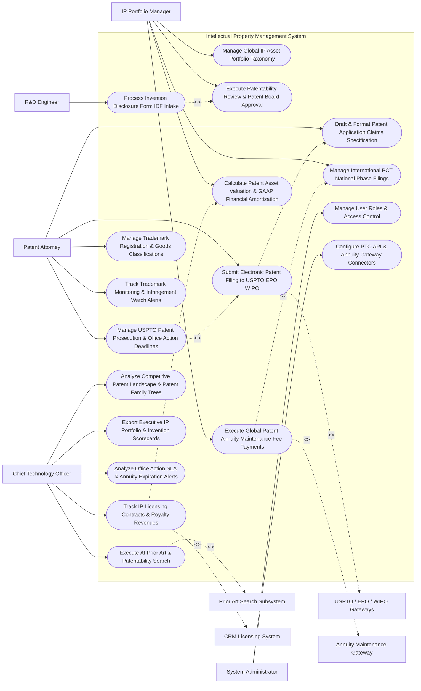

# Use Case Diagram — Intellectual Property Management System

## Mermaid Code

## Actor Table | Bảng Actor

| # | Actor | Actor Type | Role Description | Related Use Cases |
|---|-------|------------|------------------|-------------------|
| 1 | IP Portfolio Manager | Primary | Chief patent counsel managing portfolio taxonomy, patentability reviews, PCT national phase filings, and annuity payments. | UC01, UC03, UC07, UC10, UC14 |
| 2 | Patent Attorney | Primary | IP attorney drafting claim specifications, submitting USPTO filings, tracking office action deadlines, and managing trademarks. | UC04, UC06, UC08, UC09, UC11 |
| 3 | R&D Engineer | Primary | Corporate inventor submitting Invention Disclosure Forms (IDF), technical drawings, and lab notebook links. | UC02 |
| 4 | Chief Technology Officer | Primary | Executive reviewing prior art searches, IP licensing revenues, competitive patent landscapes, and portfolio scorecards. | UC05, UC12, UC13, UC15, UC18 |
| 5 | System Administrator | Primary | IT admin managing user security roles, USPTO e-filing API credentials, and annuity gateway tokens. | UC16, UC17 |
| 6 | USPTO / EPO / WIPO Gateways | System (Secondary) | Patent office gateways processing electronic patent filings and streaming prosecution dockets. | UC06 |
| 7 | Prior Art Search Subsystem | System (Secondary) | Patent database engine searching global prior art, citations, and IPC classification codes. | UC05 |
| 8 | Annuity Maintenance Gateway | System (Secondary) | Global annuity service (CPA Global) paying country-specific patent maintenance fees. | UC10 |
| 9 | CRM Licensing System | System (Secondary) | Enterprise CRM managing IP licensing agreements, royalty fee streams, and licensee accounts. | UC12 |

## Use Case Table | Bảng Use Case

| # | UC ID | Use Case Name | Primary Actor | Secondary Actor | Description | Priority |
|---|-------|---------------|---------------|-----------------|-------------|----------|
| 1 | UC01 | Manage Global IP Asset Portfolio Taxonomy | Manager | None | Configures IP asset classification schemas (Patents, Trademarks, Copyrights, Trade Secrets) across technology domains. | Critical |
| 2 | UC02 | Process Invention Disclosure Form IDF Intake | Inventor | None | Captures R&D invention disclosures, co-inventors, technical architecture, and cryptographic timestamping. | Critical |
| 3 | UC03 | Execute Patentability Review & Patent Board Approval | Manager | None | Evaluates submitted IDFs for technical novelty, commercial value, and patent filing approval. | High |
| 4 | UC04 | Draft & Format Patent Application Claims Specification | Attorney | None | Formats patent specification documents, independent/dependent claims, background, and figure drawings. | Critical |
| 5 | UC05 | Execute AI Prior Art & Patentability Search | CTO | PriorArt | Uses AI NLP to search global patent literature (USPTO, EPO, WIPO) for prior art citations and novelty scoring. | Critical |
| 6 | UC06 | Submit Electronic Patent Filing to USPTO EPO WIPO | Attorney | PTO | Transmits XML/PDF patent application packages to patent office gateways, obtaining official application serial numbers. | Critical |
| 7 | UC07 | Manage International PCT National Phase Filings | Manager | None | Manages Patent Cooperation Treaty (PCT) timeline triggers and dispatches national phase filings across target countries. | High |
| 8 | UC08 | Manage USPTO Patent Prosecution & Office Action Deadlines | Attorney | None | Parses USPTO office actions (Rejections/Allowances), calculating statutory response deadlines (3-Month Rule). | Critical |
| 9 | UC09 | Manage Trademark Registration & Goods Classifications | Attorney | None | Files trademark registration applications, managing Nice Classification goods/services codes and specimen proofs. | High |
| 10 | UC10 | Execute Global Patent Annuity Maintenance Fee Payments | Manager | Annuity | Automates patent family annuity renewal schedules (3.5, 7.5, 11.5 Year USPTO fees) via CPA Global API. | Critical |
| 11 | UC11 | Track Trademark Monitoring & Infringement Watch Alerts | Attorney | None | Scrapes global trademark registries for unauthorized third-party trademark filings matching corporate brands. | High |
| 12 | UC12 | Track IP Licensing Contracts & Royalty Revenues | CTO | Licensing | Tracks patent licensing agreements, fee schedules, licensee audit rights, and recurring royalty collections. | Critical |
| 13 | UC13 | Analyze Competitive Patent Landscape & Patent Family Trees | CTO | None | Visualizes competitive patent filing activity, patent family tree graphs, and technology domain moats. | High |
| 14 | UC14 | Calculate Patent Asset Valuation & GAAP Financial Amortization | Manager | None | Computes patent asset monetary valuations and GAAP amortization schedules for financial balance sheet reporting. | High |
| 15 | UC15 | Export Executive IP Portfolio & Invention Scorecards | CTO | None | Renders executive scorecards detailing active patent count, granted patents %, royalty revenue, and annuity spend. | High |
| 16 | UC16 | Manage User Roles & Access Control | Admin | None | Controls user login credentials, RBAC permissions, and confidential trade secret vault access rights. | High |
| 17 | UC17 | Configure PTO API & Annuity Gateway Connectors | Admin | None | Configures API connection parameters for USPTO EFS-Web, EPO Online, WIPO ePCT, and CPA Global. | High |
| 18 | UC18 | Analyze Office Action SLA & Annuity Expiration Alerts | CTO | None | Dispatches urgent notifications when a USPTO office action response is due in 14 days or an annuity fee is unpaid. | High |

## Use Case Specification | Đặc tả Use Case

---

### UC02 — Process Invention Disclosure Form (IDF) Intake

| Field | Detail |
|-------|--------|
| **UC ID** | UC02 |
| **Use Case Name** | Process Invention Disclosure Form (IDF) Intake |
| **Actor(s)** | Primary: Inventor / Corporate R&D Engineer   Secondary: Secure Invention Disclosure Repository |
| **Description** | Captures technical invention disclosures from R&D engineers, verifying co-inventor contribution percentages, technical schematics, lab notebook links, and applying cryptographic timestamping. |
| **Precondition** | 1. R&D engineer has developed a novel technical innovation.   2. Cryptographic timestamping and invention disclosure vault are online. |
| **Main Flow** | 1. Engineer opens "Invention Disclosure Portal".   2. Engineer inputs Invention Parameters:   &nbsp;&nbsp;&nbsp;&nbsp; a. Invention Title: `"Sub-Millisecond Neural Network Inference Acceleration on Edge Hardware"`.   &nbsp;&nbsp;&nbsp;&nbsp; b. Technical Domain: `Artificial Intelligence / Semiconductor Architecture`.   &nbsp;&nbsp;&nbsp;&nbsp; c. Detailed Description: Technical problem solved, novel algorithm details, and performance benchmarks.   &nbsp;&nbsp;&nbsp;&nbsp; d. Co-Inventors & Attribution: `John Doe (60% Contribution)`, `Sarah Jenkins (40% Contribution)`.   &nbsp;&nbsp;&nbsp;&nbsp; e. Attached Files: `Architecture_Diagram.pdf`, `Benchmark_Results.csv`, `Lab_Notebook_Ref_#884`.   3. System checks Public Disclosure Status: Was invention publicly presented? -> `NO_PUBLIC_DISCLOSURE`.   4. System applies Cryptographic Timestamp & SHA-256 Hash to document package:   &nbsp;&nbsp;&nbsp;&nbsp; a. Generates digital proof-of-conception receipt for first-inventor-to-file legal protection.   5. System submits IDF Record `#IDF-2026-88412` to Patent Committee Queue.   6. System dispatches confirmation email to inventors and triggers UC03 (Execute Patentability Review). |
| **Alternative Flow** | **AF1** — Trade Secret Protection Track: Patent Committee determines invention is best protected as an un-patented trade secret; System archives IDF in Trade Secret Cryptographic Vault with restricted access. |
| **Exception Flow** | **EX1** — Prior Public Disclosure Warning: Engineer indicates invention was published at an academic conference 11 months ago; System flags `GRACE_PERIOD_WARNING` (USPTO 1-Year Grace Period expiring in 30 days). |
| **Postcondition** | Invention Disclosure Form is submitted, SHA-256 proof-of-conception timestamp is applied, and record routes to Patent Committee. |
| **Business Rule** | **BR1**: Invention disclosures MUST apply cryptographic timestamping to establish verifiable proof of conception dates. |

---

### UC05 — Execute AI Prior Art & Patentability Search

| Field | Detail |
|-------|--------|
| **UC ID** | UC05 |
| **Use Case Name** | Execute AI Prior Art & Patentability Search |
| **Actor(s)** | Primary: Chief Technology Officer, Patent Attorney   Secondary: Patent Prior Art & Citation Search Subsystem |
| **Description** | Uses AI NLP models to search global patent databases (USPTO, EPO, WIPO, Google Patents) and academic literature to identify prior art citations and calculate an AI Patentability Novelty Score. |
| **Precondition** | 1. Invention Disclosure Form (IDF) text and proposed claims are submitted (UC02).   2. Patent search database API (Derwent / Google Patents API) is active. |
| **Main Flow** | 1. User opens "AI Prior Art & Patentability Studio" for Disclosure `#IDF-88412`.   2. System extracts Technical Feature Keywords & Claim Boundaries from IDF text.   3. System constructs AI Multi-Database Search Query:   &nbsp;&nbsp;&nbsp;&nbsp; a. International Patent Classes (IPC): `G06N 3/063 (Neural Network Hardware Implementation)`.   &nbsp;&nbsp;&nbsp;&nbsp; b. Vector Semantic Search: Evaluates dense vector embeddings against 100M+ global patent documents.   4. Prior Art Search Subsystem executes query and returns Prior Art Citation Results:   &nbsp;&nbsp;&nbsp;&nbsp; a. Citation 1: `US Patent US11884120B2 (NVIDIA Corp)` -> `82% Feature Overlap`.   &nbsp;&nbsp;&nbsp;&nbsp; b. Citation 2: `EPO Application EP3884120A1 (Google LLC)` -> `65% Feature Overlap`.   5. System computes AI Patentability Novelty Score:   &nbsp;&nbsp;&nbsp;&nbsp; a. Novelty Score: `78 / 100` (`HIGH_PATENTABILITY_POTENTIAL`).   &nbsp;&nbsp;&nbsp;&nbsp; b. Novel Element Identified: `Dynamic Quantization Pipeline in Claim 3 is un-cited in prior art`.   6. System renders Prior Art Landscape Map, highlighting overlapping claims and novel patentable features.   7. Patent Attorney uses prior art report to draft non-infringing patent claims (UC04). |
| **Alternative Flow** | **AF1** — High Overlap Rejection Alert: AI search returns a 98% feature overlap with an existing granted patent; System flags `CRITICAL_PRIOR_ART_BLOCK`, recommending against filing to save costs. |
| **Exception Flow** | **EX1** — Search Database API Timeout Error: Google Patents API times out; System falls back to local patent index cache, completing search and flagging partial dataset warning. |
| **Postcondition** | Prior art citations and feature overlaps are identified, AI Novelty Score (0-100) is calculated, and landscape map renders. |
| **Business Rule** | **BR1**: Patent applications MUST undergo automated AI prior art searches before incurring patent office filing fees. |

---

### UC08 — Manage USPTO Patent Prosecution & Office Action Deadlines

| Field | Detail |
|-------|--------|
| **UC ID** | UC08 |
| **Use Case Name** | Manage USPTO Patent Prosecution & Office Action Deadlines |
| **Actor(s)** | Primary: Patent & Trademark Attorney   Secondary: Patent & Trademark Office API Gateways (USPTO PAIR / Center API) |
| **Description** | Ingests official patent office action notices, parses examiner rejections (35 U.S.C. 102/103), auto-calculates statutory response deadlines (3-Month Rule), and tracks prosecution dockets. |
| **Precondition** | 1. Patent application is filed with USPTO (UC06).   2. USPTO Private PAIR / Patent Center API webhook integration is active. |
| **Main Flow** | 1. System receives automated electronic notification from USPTO Patent Center API.   2. System ingests Official Document: `Non-Final Office Action (App #18/884,120)`.   3. System parses Office Action Text:   &nbsp;&nbsp;&nbsp;&nbsp; a. Mailing Date: `October 15, 2026`.   &nbsp;&nbsp;&nbsp;&nbsp; b. Rejection Grounds: `35 U.S.C. 103 Obviousness Rejection over US11884120B2`.   &nbsp;&nbsp;&nbsp;&nbsp; c. Rejected Claims: `Claims 1-5 Rejected`, `Claims 6-10 Allowed`.   4. System auto-calculates Statutory Response Deadlines:   &nbsp;&nbsp;&nbsp;&nbsp; a. Statutory Response Deadline (3-Month Rule): `January 15, 2027`.   &nbsp;&nbsp;&nbsp;&nbsp; b. Maximum Extended Deadline (6-Month Cap): `April 15, 2027` (Requires Extension Fees).   5. System logs USPTO Prosecution Docket Entry `#DOC-88412` and assigns response task to Lead Patent Attorney.   6. System dispatches docket alert: *"USPTO Office Action Received: App #18/884,120 - Response due Jan 15, 2027 (Claims 6-10 Allowed)"*.   7. Attorney drafts claim amendment response (UC04) and files response prior to statutory deadline. |
| **Alternative Flow** | **AF1** — Notice of Allowance & Issue Fee Payment: System receives USPTO Notice of Allowance; System logs 3-month issue fee deadline, prompting attorney to submit issue fee payment. |
| **Exception Flow** | **EX1** — Overdue Office Action Response SLA Warning: Response deadline is within 14 days and no draft exists; System triggers UC18 (Analyze Office Action SLA Alerts), escalating alert to Chief Patent Counsel. |
| **Postcondition** | Office action details and examiner rejections are parsed, 3-month statutory response deadlines are docketed, and attorney alerts trigger. |
| **Business Rule** | **BR1**: Ingested patent office actions MUST automatically docket 3-month statutory response deadlines with automated 30/14/7-day advance warning alerts. |

---

### UC10 — Execute Global Patent Annuity Maintenance Fee Payments

| Field | Detail |
|-------|--------|
| **UC ID** | UC10 |
| **Use Case Name** | Execute Global Patent Annuity Maintenance Fee Payments |
| **Actor(s)** | Primary: IP Portfolio Manager, Chief Patent Counsel   Secondary: IP Annuity Fee & Renewal Maintenance Gateway (CPA Global API) |
| **Description** | Manages global country-specific patent family maintenance fee renewal schedules (USPTO 3.5/7.5/11.5 year fees, EPO annual annuities), executing automated payments to prevent patent lapses. |
| **Precondition** | 1. Granted patents are cataloged in portfolio (UC01).   2. CPA Global / Computer Packages API annuity management integration is active. |
| **Main Flow** | 1. System runs monthly global patent annuity evaluation job.   2. System identifies Upcoming Patent Annuities due in next 90 days across global patent families:   &nbsp;&nbsp;&nbsp;&nbsp; a. Patent Family `#PAT-FAM-402` (`AI Chip Architecture`):   &nbsp;&nbsp;&nbsp;&nbsp; &nbsp;&nbsp;&nbsp;&nbsp; i. US Patent #US11884120B2: 7.5 Year Maintenance Fee Due `Dec 15, 2026` (`$3,700.00 Fee`).   &nbsp;&nbsp;&nbsp;&nbsp; &nbsp;&nbsp;&nbsp;&nbsp; ii. European Patent #EP3884120B1: 5th Year Annuity Due `Jan 30, 2027` (`€1,200.00 Fee`).   &nbsp;&nbsp;&nbsp;&nbsp; &nbsp;&nbsp;&nbsp;&nbsp; iii. Japan Patent #JP6884120B2: 6th Year Renewal Due `Feb 15, 2027` (`¥85,000 Fee`).   3. System checks Portfolio Pruning Decisions (UC01): Patent Family #PAT-FAM-402 is tagged `MAINTAIN_ACTIVE`.   4. System transmits automated payment instructions payload to CPA Global API.   5. CPA Global API executes fee payments to USPTO, EPO, and JPO patent offices.   6. CPA Global API returns Payment Confirmation Receipts:   &nbsp;&nbsp;&nbsp;&nbsp; a. US Maintenance Receipt: `USPTO Confirmation #RF-88412` -> Granted until 2030.   7. System logs annuity payment expenditure ($5,150.00 total) and updates patent active status. |
| **Alternative Flow** | **AF1** — Strategic Patent Pruning / Abandonment: IP Portfolio Manager reviews low-value patent family and tags as `PRUNE_ABANDON`; System suppresses annuity payment, allowing patent to expire gracefully and saving $12,000. |
| **Exception Flow** | **EX1** — Surcharge Window Warning: Maintenance window enters 6-month grace period (requires surcharge fee); System flags `ANGL_SURCHARGE_PERIOD`, dispatching urgent payment instruction to prevent abandonment. |
| **Postcondition** | Global patent annuity schedules are evaluated, approved renewals are paid via CPA Global API, receipts are logged, and patent expiration dates update. |
| **Business Rule** | **BR1**: Patent maintenance fees MUST be evaluated 90 days in advance of statutory due dates to allow portfolio pruning reviews prior to payment. |

---

### UC12 — Track IP Licensing Contracts & Royalty Revenues

| Field | Detail |
|-------|--------|
| **UC ID** | UC12 |
| **Use Case Name** | Track IP Licensing Contracts & Royalty Revenues |
| **Actor(s)** | Primary: Chief Technology Officer, IP Portfolio Manager   Secondary: CRM & IP Licensing Revenue System |
| **Description** | Tracks outbound and inbound IP technology licensing contracts, patent portfolio usage rights, licensee audit rights, and recurring royalty revenue collections to measure IP monetization. |
| **Precondition** | 1. Executed IP licensing contracts exist in CRM/CLM systems.   2. Royalty fee structures (e.g., 3.5% of Net Sales) and reporting periods are defined. |
| **Main Flow** | 1. User opens "IP Licensing & Royalty Revenue Management Console".   2. User selects Active Licensing Contract: `#LIC-2026-402 (Licensee: TechCorp Inc)`.   3. System displays Licensing Parameters:   &nbsp;&nbsp;&nbsp;&nbsp; a. Licensed Patent Portfolio: `Patent Family #PAT-FAM-402 (AI Semiconductor Patents)`.   &nbsp;&nbsp;&nbsp;&nbsp; b. Royalty Structure: `3.5% Net Sales Rate` | `Minimum Annual Royalty (MAR): $250,000.00`.   &nbsp;&nbsp;&nbsp;&nbsp; c. Reporting Frequency: `Quarterly Royalty Reports Due 30 Days Post-Quarter`.   4. System ingests Q3 Royalty Report submitted by Licensee TechCorp Inc:   &nbsp;&nbsp;&nbsp;&nbsp; a. Net Sales Reported: `$10,000,000.00`.   &nbsp;&nbsp;&nbsp;&nbsp; b. Calculated Royalty Fee ($3.5\%$): `$350,000.00`.   5. System verifies Minimum Royalty Threshold: $350,000 >= MAR ($250k) -> `ROYALTY_COMPLIANT`.   6. System generates Royalty Payment Invoice `#INV-ROY-884` ($350,000.00) and syncs to Accounts Receivable ERP.   7. System updates IP Portfolio Revenue Scorecard (UC15), tracking cumulative portfolio royalty income ($1.2M YTD). |
| **Alternative Flow** | **AF1** — Royalty Audit Trigger Execution: Licensee reported sales drop 40% without explanation; System triggers "Licensee Royalty Audit Right Clause", tasking an external forensic accountant to audit licensee books. |
| **Exception Flow** | **EX1** — Overdue Royalty Payment Warning: Licensee fails to submit quarterly royalty payment by due date; System flags `ROYALTY_PAYMENT_DEFAULT`, sending breach notice alert to IP Counsel. |
| **Postcondition** | Royalty report is verified, royalty invoice is generated, revenue is credited to IP portfolio monetization, and audit logs update. |
| **Business Rule** | **BR1**: IP licensing agreements MUST automatically calculate royalty fee compliance against contractual minimum annual royalty (MAR) thresholds. |
