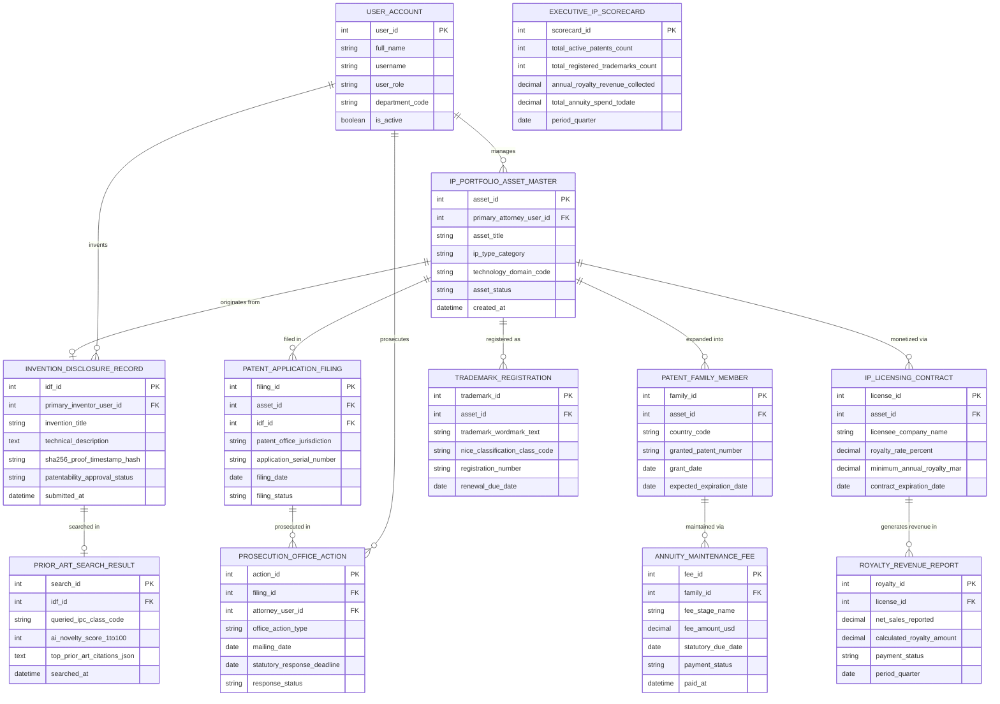

# Conceptual ERD — Intellectual Property Management System

## Mermaid Code

## Entity Description Table | Bảng mô tả Entity

| # | Entity Name | Vietnamese Name | Description | Key Attributes | Main Relationships |
|---|-------------|-----------------|-------------|----------------|-------------------|
| 1 | USER_ACCOUNT | Tài khoản Nguời dùng | System credentials and access roles for IP portfolio managers, patent attorneys, R&D inventors, CTOs, and admins. | `user_id`, `username`, `user_role`, `department_code` | Manages `IP_PORTFOLIO_ASSET_MASTER`, invents `INVENTION_DISCLOSURE_RECORD`, prosecutes `PROSECUTION_OFFICE_ACTION`. |
| 2 | IP_PORTFOLIO_ASSET_MASTER | Master Asset IP Portfolio | Central IP asset record tracking asset title, IP type (Patent/Trademark/Trade Secret), technology domain, and active status. | `asset_id`, `primary_attorney_user_id`, `asset_title`, `ip_type_category`, `technology_domain_code`, `asset_status` | Originated from `INVENTION_DISCLOSURE_RECORD`, filed in `PATENT_APPLICATION_FILING`, expanded into `PATENT_FAMILY_MEMBER`, registered as `TRADEMARK_REGISTRATION`, monetized via `IP_LICENSING_CONTRACT`, managed by `USER_ACCOUNT`. |
| 3 | INVENTION_DISCLOSURE_RECORD | Bản ghi Invention Disclosure (IDF) | Invention Disclosure Form (IDF) record capturing invention title, technical description, SHA-256 proof timestamp, and approval status. | `idf_id`, `primary_inventor_user_id`, `invention_title`, `sha256_proof_timestamp_hash`, `patentability_approval_status` | Originates `IP_PORTFOLIO_ASSET_MASTER`, searched in `PRIOR_ART_SEARCH_RESULT`, invented by `USER_ACCOUNT`. |
| 4 | PRIOR_ART_SEARCH_RESULT | Kết quả Tìm kiếm Prior Art | AI patentability and prior art search result log recording IPC class codes, AI novelty scores (1-100), and prior art citations JSON. | `search_id`, `idf_id`, `queried_ipc_class_code`, `ai_novelty_score_1to100`, `top_prior_art_citations_json` | Belongs to `INVENTION_DISCLOSURE_RECORD`. |
| 5 | PATENT_APPLICATION_FILING | Nộp Đơn Bằng sáng chế | Patent office filing record tracking application serial numbers, patent office jurisdictions (USPTO/EPO/WIPO), filing dates, and status. | `filing_id`, `asset_id`, `idf_id`, `patent_office_jurisdiction`, `application_serial_number`, `filing_date`, `filing_status` | Belongs to `IP_PORTFOLIO_ASSET_MASTER`, prosecuted in `PROSECUTION_OFFICE_ACTION`. |
| 6 | PROSECUTION_OFFICE_ACTION | Office Action Tranh tụng Bằng sáng chế | USPTO office action prosecution log tracking action types (35 U.S.C. 102/103 rejections), mailing dates, and 3-month statutory response deadlines. | `action_id`, `filing_id`, `attorney_user_id`, `office_action_type`, `mailing_date`, `statutory_response_deadline` | Belongs to `PATENT_APPLICATION_FILING`, prosecuted by `USER_ACCOUNT`. |
| 7 | PATENT_FAMILY_MEMBER | Thành viên Họ Bằng sáng chế | International patent family member record tracking country code, granted patent number, grant date, and expected expiration date. | `family_id`, `asset_id`, `country_code`, `granted_patent_number`, `grant_date`, `expected_expiration_date` | Belongs to `IP_PORTFOLIO_ASSET_MASTER`, maintained via `ANNUITY_MAINTENANCE_FEE`. |
| 8 | ANNUITY_MAINTENANCE_FEE | Phí Duy trì Niên nhiễm Patent | Global patent maintenance fee renewal record tracking fee stage (3.5/7.5/11.5 Yr), fee amounts USD, statutory due dates, and payment status. | `fee_id`, `family_id`, `fee_stage_name`, `fee_amount_usd`, `statutory_due_date`, `payment_status` | Belongs to `PATENT_FAMILY_MEMBER`. |
| 9 | TRADEMARK_REGISTRATION | Đăng ký Nhãn hiệu Thương mại | Trademark registration record tracking wordmark text, Nice Classification class codes, registration numbers, and renewal due dates. | `trademark_id`, `asset_id`, `trademark_wordmark_text`, `nice_classification_class_code`, `registration_number`, `renewal_due_date` | Belongs to `IP_PORTFOLIO_ASSET_MASTER`. |
| 10 | IP_LICENSING_CONTRACT | Hợp đồng Li-xăng IP | IP technology licensing agreement record tracking licensee company name, royalty rate %, minimum annual royalty (MAR), and expiration dates. | `license_id`, `asset_id`, `licensee_company_name`, `royalty_rate_percent`, `minimum_annual_royalty_mar`, `contract_expiration_date` | Belongs to `IP_PORTFOLIO_ASSET_MASTER`, generates revenue in `ROYALTY_REVENUE_REPORT`. |
| 11 | ROYALTY_REVENUE_REPORT | Báo cáo Doanh thu Li-xăng Royalty | Quarterly licensee royalty revenue report tracking net sales reported, calculated royalty amounts $, and payment status. | `royalty_id`, `license_id`, `net_sales_reported`, `calculated_royalty_amount`, `payment_status`, `period_quarter` | Belongs to `IP_LICENSING_CONTRACT`. |
| 12 | EXECUTIVE_IP_SCORECARD | Scorecard Executive IP | Executive IP portfolio scorecard aggregating active patent counts, registered trademarks, annual royalty revenue, and annuity spend to date. | `scorecard_id`, `total_active_patents_count`, `total_registered_trademarks_count`, `annual_royalty_revenue_collected`, `total_annuity_spend_todate` | Standalone executive performance entity. |

## Relationship Description | Mô tả Quan hệ

| # | From Entity | Cardinality | To Entity | Label | Business Explanation |
|---|-------------|-------------|-----------|-------|----------------------|
| 1 | IP_PORTFOLIO_ASSET_MASTER | 1 to 0..1 | INVENTION_DISCLOSURE_RECORD | originates from | An IP portfolio asset originates from an Invention Disclosure Record. |
| 2 | IP_PORTFOLIO_ASSET_MASTER | 1 to 0..N | PATENT_APPLICATION_FILING | filed in | An IP portfolio asset is filed in patent application filings. |
| 3 | IP_PORTFOLIO_ASSET_MASTER | 1 to 0..N | PATENT_FAMILY_MEMBER | expanded into | An IP portfolio asset is expanded into international patent family members. |
| 4 | IP_PORTFOLIO_ASSET_MASTER | 1 to 0..N | TRADEMARK_REGISTRATION | registered as | An IP portfolio asset is registered as trademark registrations. |
| 5 | IP_PORTFOLIO_ASSET_MASTER | 1 to 0..N | IP_LICENSING_CONTRACT | monetized via | An IP portfolio asset is monetized via IP licensing contracts. |
| 6 | INVENTION_DISCLOSURE_RECORD | 1 to 0..1 | PRIOR_ART_SEARCH_RESULT | searched in | An invention disclosure record is searched in prior art search results. |
| 7 | PATENT_APPLICATION_FILING | 1 to 0..N | PROSECUTION_OFFICE_ACTION | prosecuted in | A patent application filing is prosecuted in office action logs. |
| 8 | PATENT_FAMILY_MEMBER | 1 to 0..N | ANNUITY_MAINTENANCE_FEE | maintained via | A patent family member is maintained via annuity fee payments. |
| 9 | IP_LICENSING_CONTRACT | 1 to 0..N | ROYALTY_REVENUE_REPORT | generates revenue in | An IP licensing contract generates revenue in quarterly royalty reports. |
| 10 | USER_ACCOUNT | 1 to 0..N | IP_PORTFOLIO_ASSET_MASTER | manages | A patent counsel user account manages IP portfolio assets. |
| 11 | USER_ACCOUNT | 1 to 0..N | INVENTION_DISCLOSURE_RECORD | invents | An R&D engineer user account invents invention disclosure records. |
| 12 | USER_ACCOUNT | 1 to 0..N | PROSECUTION_OFFICE_ACTION | prosecutes | A patent attorney user account prosecutes office action responses. |
