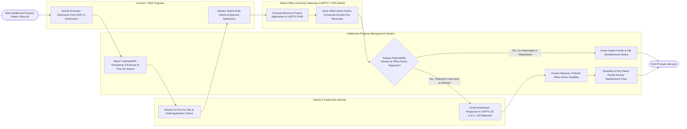

# Swimlane Diagram — Intellectual Property Management System

## Mermaid Code

## Flow Description | Mô tả luồng

| Lane | Actor | Role in Flow |
|------|-------|-------------|
| 1 | Inventor / R&D Engineer | Submits technical Invention Disclosure Forms (IDF), attaches schematics, receives SHA-256 proof-of-conception timestamps, reviews claim drafts, and approves patent filings. |
| 2 | Patent & Trademark Attorney | Analyzes AI prior art search results, drafts patent application claim specifications, amends claims in response to USPTO examiner rejections (35 U.S.C. 102/103), and files office action responses. |
| 3 | Intellectual Property Management System | Applies cryptographic timestamps to IDFs, executes AI prior art vector searches across 100M+ global patents, calculates AI Novelty Scores (0-100), dockets statutory 3-month USPTO office action deadlines, and automates global patent family annuity fee payments via CPA Global API. |
| 4 | Patent Office & Annuity Gateways (USPTO / CPA Global) | Ingests electronic XML/PDF patent applications (USPTO PAIR / EPO Online), issues official office action notices, processes issue fees, and executes global country patent maintenance fee payments. |
