# Action Tree — Intellectual Property Management System

## Mermaid Code

```mermaid
graph TD
    Root["Intellectual Property Management System"]

    Root --> M1["Invention Disclosure & Cryptographic Vault"]
    Root --> M2["AI Prior Art Search & Novelty Engine"]
    Root --> M3["Patent Application Drafting & E-Filing"]
    Root --> M4["USPTO Prosecution & Docketing Engine"]
    Root --> M5["Global Patent Annuities & CPA Integration"]
    Root --> M6["IP Licensing, Royalty Revenue & Scorecards"]

    M1 --> A11["Process Invention Disclosure Form (IDF) Intake for Corporate R&D"]
    M1 --> A12["Apply SHA-256 Cryptographic Timestamps for Proof-of-Conception"]
    M1 --> A13["Track Co-Inventor Attribution Percentages & Incentive Award Payouts"]
    M1 --> A14["Archive Un-Patented Technical Schematics in Trade Secret Vault"]

    M2 --> A21["Execute AI Vector Semantic Prior Art Searches (USPTO, EPO, WIPO)"]
    M2 --> A22["Calculate AI Patentability Novelty Scores (Scale 0 to 100)"]
    M2 --> A23["Identify Prior Art Feature Overlaps & Un-Cited Novel Claims"]
    M2 --> A24["Generate Interactive Competitive Patent Landscape Cluster Maps"]

    M3 --> A31["Draft Independent & Dependent Patent Application Claim Specifications"]
    M3 --> A32["Format Application Packages into XML/PDF Standards for E-Filing"]
    M3 --> A33["Transmit Electronic Patent Applications to USPTO PAIR & EPO Online"]
    M3 --> A34["Manage International PCT National Phase Filing Timelines (30 Months)"]

    M4 --> A41["Ingest USPTO Electronic Office Action Notices & Examiner Rejections"]
    M4 --> A42["Auto-Calculate Statutory 3-Month Office Action Response Deadlines"]
    M4 --> A43["Draft Claim Amendments in Response to 35 U.S.C. 102/103 Rejections"]
    M4 --> A44["Trigger 14-Day Overdue Office Action Response SLA Warning Alerts"]

    M5 --> A51["Schedule Global Patent Family Annuity Maintenance Fees (3.5/7.5/11.5 Yr)"]
    M5 --> A52["Transmit Automated Renewal Payment Instructions to CPA Global API"]
    M5 --> A53["Execute Strategic Patent Family Pruning to Save Maintenance Costs"]
    M5 --> A54["Track Trademark Registrations, Nice Classes & Infringement Watch Alerts"]

    M6 --> A61["Track Outbound IP Licensing Contracts, MAR Thresholds & Royalty Rates"]
    M6 --> A62["Verify Quarterly Licensee Royalty Reports & Invoice Royalty Receivables"]
    M6 --> A63["Calculate Patent Asset Valuation & GAAP Amortization Schedules"]
    M6 --> A64["Export Executive IP Portfolio Value, Active Patent & ROMI Scorecards"]
```

## Module Description | Mô tả Module

| # | Module | Description | Actions |
|---|--------|-------------|---------|
| 1 | Invention Disclosure & Cryptographic Vault | Captures IDF submissions from R&D, applies SHA-256 proof-of-conception timestamps, tracks inventor incentive awards, and vaults trade secrets. | Process Invention Disclosure Form (IDF) Intake, Apply SHA-256 Cryptographic Timestamps, Track Co-Inventor Attribution & Incentive Payouts, Archive Schematics in Trade Secret Vault. |
| 2 | AI Prior Art Search & Novelty Engine | Runs AI vector semantic prior art searches across 100M+ global patents, computes AI Novelty Scores (0-100), and renders landscape maps. | Execute AI Vector Semantic Prior Art Searches, Calculate AI Patentability Novelty Scores, Identify Prior Art Overlaps & Novel Claims, Generate Competitive Patent Landscape Maps. |
| 3 | Patent Application Drafting & E-Filing | Formats claim specifications, builds XML/PDF application packages, submits electronic filings to USPTO/EPO/WIPO, and tracks PCT national phase deadlines. | Draft Patent Application Claim Specifications, Format XML/PDF E-Filing Packages, Transmit Filings to USPTO PAIR & EPO Online, Manage International PCT National Phase Timelines. |
| 4 | USPTO Prosecution & Docketing Engine | Ingests USPTO office actions, auto-calculates 3-month statutory response deadlines, tracks claim amendments, and dispatches 14-day SLA warning alerts. | Ingest USPTO Electronic Office Actions, Auto-Calculate Statutory 3-Month Response Deadlines, Draft Claim Amendments to Rejections, Trigger 14-Day Office Action SLA Alerts. |
| 5 | Global Patent Annuities & CPA Integration | Schedules global patent family annuity fees (USPTO/EPO/JPO), executes automated renewal payments via CPA Global API, and tracks trademark watch alerts. | Schedule Global Patent Family Maintenance Fees, Transmit Payment Instructions to CPA Global API, Execute Strategic Patent Family Pruning, Track Trademark Registrations & Watch Alerts. |
| 6 | IP Licensing, Royalty Revenue & Scorecards | Tracks IP licensing agreements, verifies licensee quarterly royalty reports, computes patent asset valuations, and exports executive IP scorecards. | Track IP Licensing Contracts & MAR Thresholds, Verify Licensee Royalty Reports & Invoice Receivables, Calculate Patent Asset Valuation & Amortization, Export Executive IP Scorecards. |
