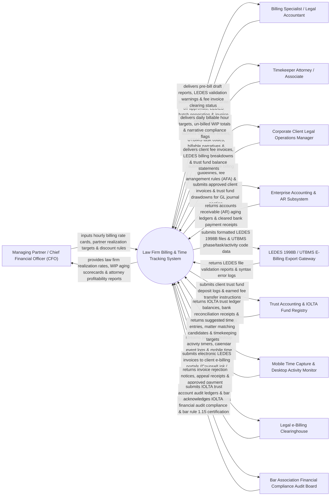

# Context Diagram — Law Firm Billing & Time Tracking System

## Mermaid Code

## Actor & Interaction Table | Bảng Actor & Tương tác

| # | Actor | Actor Type | Data Sent TO System | Data Received FROM System | Notes |
|---|-------|------------|---------------------|---------------------------|-------|
| 1 | Managing Partner / Chief Financial Officer (CFO) | Primary | Hourly rate cards, timekeeper billing tier rules, partner realization targets, client fee discount thresholds, AFAs. | Law firm realization rates (Billed vs Collected), Work-In-Progress (WIP) aging scorecards, attorney profitability reports. | Managing partner governing firm financial strategy, hourly billing rates, and fee realization metrics. |
| 2 | Billing Specialist / Legal Accountant | Primary | Pre-bill draft edits, fee write-down approvals, LEDES batch invoice dispatches, trust fund drawdown requests. | Pre-bill draft reports, LEDES syntax validation warnings, fee invoice clearing status, AR collection logs. | Legal billing specialist preparing monthly pre-bills, auditing narratives, and generating LEDES invoices. |
| 3 | Timekeeper Attorney / Associate | Primary | Daily time entries (hours/tenths), UTBMS task/activity codes, billable activity narratives, client expense receipts. | Daily billable hour progress, un-billed WIP totals, block billing violation flags, time entry targets. | Attorney or paralegal logging billable hours, selecting UTBMS codes, and writing billing narratives. |
| 4 | Corporate Client Legal Operations Manager | Primary | Corporate billing guidelines, Alternative Fee Arrangements (AFA caps), rate negotiation terms, invoice payment approvals. | Itemized fee invoices, LEDES billing breakdowns, trust account balance statements, AFA budget tracking. | Client legal operations manager reviewing LEDES fee invoices against corporate billing rules. |
| 5 | Enterprise Accounting & AR Subsystem | Supporting | Accounts receivable (AR) aging ledgers, cleared bank payment receipts, general ledger chart of accounts. | Approved client invoices, accounts receivable journal entries, trust fund earned fee transfer logs. | Law firm ERP accounting system managing general ledger, accounts receivable, and partner distributions. |
| 6 | LEDES 1998B / UTBMS E-Billing Export Gateway | Supporting | LEDES file validation reports, 1998B format syntax error logs, UTBMS code compliance receipts. | Formatted LEDES 1998B text files, UTBMS phase/task/activity code data, timekeeper tax IDs. | Technical export gateway parsing and validating electronic legal fee invoices in LEDES standard. |
| 7 | Trust Accounting & IOLTA Fund Registry | Supporting | IOLTA trust ledger balances, monthly bank reconciliation receipts, trust compliance validation tags. | Client retainer trust deposits, earned fee transfer instructions, client trust ledger entries. | Bank trust accounting subsystem managing Interest on Lawyers' Trust Accounts (IOLTA) compliance. |
| 8 | Mobile Time Capture & Desktop Activity Monitor | Supporting | Passive desktop application timers (Word/Email timers), calendar event logs, mobile app time entries. | Suggested time entries, matter matching candidates, daily billable time gap alerts. | Desktop and mobile time capture tool automatically tracking work on legal documents and emails. |
| 9 | Legal e-Billing Clearinghouse | Supporting | Invoice rejection notices, line-item reduction appeals, approved payment clearance tokens. | Electronic LEDES invoices, UTBMS line-item details, supporting expense receipt PDF attachments. | E-billing portal (CounselLink, TyMetrix 360, Bridgeway) auditing and approving law firm invoices for clients. |
| 10 | Bar Association Financial Compliance Audit Board | Supporting / Regulatory | IOLTA trust accounting compliance rules, Bar Rule 1.15 audit guidelines, ethics audit directives. | IOLTA trust account audit ledgers, trust balance reconciliation reports, bar compliance certifications. | Regulatory bar association enforcing strict ethical rules (ABA Model Rule 1.15) on client trust funds. |

## System Boundary Description | Mô tả Phạm vi Hệ thống

The **Law Firm Billing & Time Tracking System** is an enterprise legal timekeeping, UTBMS coding, LEDES 1998B e-billing, pre-bill review, IOLTA trust accounting, and realization analytics platform built for law firms and legal departments.

**Inside System Scope:**
- Passive desktop/mobile time capture converting Word documents, emails, and calendar events into draft time entries.
- Uniform Task-Based Management System (UTBMS) coding and narrative compliance engine checking for block billing.
- Interactive pre-bill (proforma) review workflow allowing billing partners to apply fee write-downs and write-offs.
- Electronic fee invoice generation in LEDES 1998B and LEDES XML standards for e-billing clearinghouses.
- ABA Model Rule 1.15 compliant IOLTA trust account ledger preventing un-earned trust fund co-mingling.

**Outside System Scope:**
- Direct physical check printing for vendor expenses (handled by Law Firm Accounts Payable).
- Direct physical court appearance representation (handled by Trial Attorneys).
- Direct physical processing of credit card merchant payments (handled by Legal Merchant Payment Processors).
