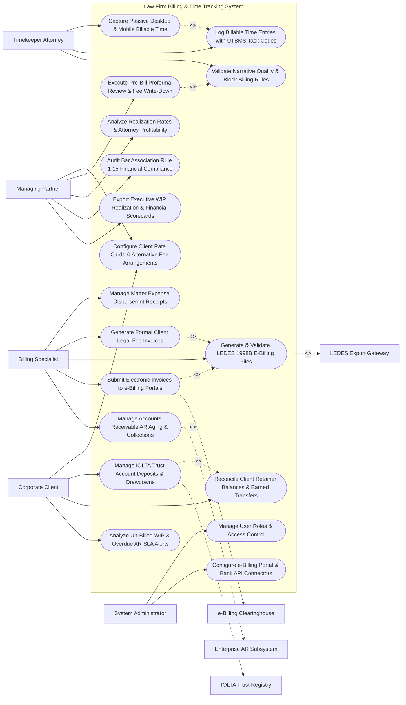

# Use Case Diagram — Law Firm Billing & Time Tracking System

## Mermaid Code

## Actor Table | Bảng Actor

| # | Actor | Actor Type | Role Description | Related Use Cases |
|---|-------|------------|------------------|-------------------|
| 1 | Managing Partner | Primary | CFO/Partner setting rate cards, conducting pre-bill reviews, analyzing realization, and monitoring profitability scorecards. | UC01, UC05, UC12, UC14, UC15 |
| 2 | Billing Specialist | Primary | Legal accountant managing expense receipts, generating client fee invoices, exporting LEDES files, and collecting AR. | UC06, UC07, UC08, UC09, UC13 |
| 3 | Timekeeper Attorney | Primary | Associate/Partner converting desktop activity into time entries, applying UTBMS codes, and writing billing narratives. | UC02, UC03, UC04 |
| 4 | Corporate Client | Primary | Legal ops client negotiating rate cards, depositing trust retainers, and reviewing LEDES billing statements. | UC01, UC10, UC11, UC18 |
| 5 | System Administrator | Primary | IT admin managing user security roles, e-billing portal API credentials, and bank gateway tokens. | UC16, UC17 |
| 6 | LEDES Export Gateway | System (Secondary) | Technical gateway formatting and validating LEDES 1998B text files and UTBMS phase/task codes. | UC08 |
| 7 | IOLTA Trust Registry | System (Secondary) | Bank trust accounting subsystem managing Interest on Lawyers' Trust Accounts (IOLTA) compliance. | UC10 |
| 8 | e-Billing Clearinghouse | System (Secondary) | E-billing clearinghouse portal (CounselLink/TyMetrix) auditing LEDES invoices against client billing rules. | UC09 |
| 9 | Enterprise AR Subsystem | System (Secondary) | Law firm ERP accounting system tracking accounts receivable aging ledgers and cleared bank payments. | UC13 |

## Use Case Table | Bảng Use Case

| # | UC ID | Use Case Name | Primary Actor | Secondary Actor | Description | Priority |
|---|-------|---------------|---------------|-----------------|-------------|----------|
| 1 | UC01 | Configure Client Rate Cards & Alternative Fee Arrangements | Partner | None | Sets timekeeper hourly rate cards (Partner/Associate rates), capped fee arrangements, and blended rates. | Critical |
| 2 | UC02 | Capture Passive Desktop & Mobile Billable Time | Attorney | None | Automatically converts desktop activity (Word edits, Outlook emails, Zoom calls) into suggested billable time entries. | Critical |
| 3 | UC03 | Log Billable Time Entries with UTBMS Task Codes | Attorney | None | Captures billable hours (in 10th-of-an-hour increments), attaching Uniform Task-Based Management System (UTBMS) codes. | Critical |
| 4 | UC04 | Validate Narrative Quality & Block Billing Rules | Attorney | None | Audits time entry narratives against corporate billing rules, flagging block billing and vague descriptors. | Critical |
| 5 | UC05 | Execute Pre-Bill Proforma Review & Fee Write-Down | Partner | None | Renders monthly pre-bills (proformas), allowing partners to apply fee write-downs, write-offs, and narrative edits. | Critical |
| 6 | UC06 | Manage Matter Expense Disbursemnt Receipts | Billing | None | Logs billable client expense disbursements (filing fees, expert fees, deposition travel) with attached PDF receipts. | High |
| 7 | UC07 | Generate Formal Client Legal Fee Invoices | Billing | None | Compiles approved time entries and expenses into formal PDF legal fee invoices with itemized breakdowns. | Critical |
| 8 | UC08 | Generate & Validate LEDES 1998B E-Billing Files | Billing | LEDES | Formats fee invoices into LEDES 1998B and LEDES XML standards, validating syntax and UTBMS codes. | Critical |
| 9 | UC09 | Submit Electronic Invoices to e-Billing Portals | Billing | Clearinghouse | Dispatches electronic LEDES invoices to client e-billing portals (CounselLink, TyMetrix 360), tracking clearance. | Critical |
| 10 | UC10 | Manage IOLTA Trust Account Deposits & Drawdowns | Client | IOLTA | Manages client retainer deposits in Interest on Lawyers' Trust Accounts (IOLTA), enforcing strict non-co-mingling rules. | Critical |
| 11 | UC11 | Reconcile Client Retainer Balances & Earned Transfers | Client | None | Reconciles earned fees against client trust retainers, executing automated trust-to-operating bank transfers upon billing. | High |
| 12 | UC12 | Analyze Realization Rates & Attorney Profitability | Partner | None | Computes law firm realization metrics (Billed Realization % and Billed vs Collected Realization %) per attorney and matter. | Critical |
| 13 | UC13 | Manage Accounts Receivable AR Aging & Collections | Billing | AR | Tracks AR aging buckets (30/60/90/120+ Days), dispatches payment reminders, and logs cleared client payments. | High |
| 14 | UC14 | Audit Bar Association Rule 1 15 Financial Compliance | Partner | None | Audits IOLTA trust ledgers against ABA Model Rule 1.15 compliance, ensuring individual client sub-ledger zero-overdrafts. | High |
| 15 | UC15 | Export Executive WIP Realization & Financial Scorecards | Partner | None | Renders executive financial scorecards detailing un-billed Work-In-Progress (WIP), realization %, and partner profits. | High |
| 16 | UC16 | Manage User Roles & Access Control | Admin | None | Controls user login credentials, RBAC permissions, and billing rate visibility clearances. | High |
| 17 | UC17 | Configure e-Billing Portal & Bank API Connectors | Admin | None | Configures API connectors for CounselLink, TyMetrix, CPA Global, and law firm operating/trust bank accounts. | High |
| 18 | UC18 | Analyze Un-Billed WIP & Overdue AR SLA Alerts | Client | None | Dispatches urgent warning alerts when matter WIP exceeds $50,000 or an invoice remains un-billed for 60 days. | High |

## Use Case Specification | Đặc tả Use Case

---

### UC02 — Capture Passive Desktop & Mobile Billable Time

| Field | Detail |
|-------|--------|
| **UC ID** | UC02 |
| **Use Case Name** | Capture Passive Desktop & Mobile Billable Time |
| **Actor(s)** | Primary: Timekeeper Attorney, Associate   Secondary: Mobile Time Capture & Desktop Activity Monitor |
| **Description** | Automatically monitors desktop and mobile application activity (Microsoft Word document edits, Outlook email drafting, Teams calls), converting active durations into suggested billable time entries matched to legal matters. |
| **Precondition** | 1. Desktop activity monitoring agent is running on attorney's workstation.   2. Active matter registry and client codes are synchronized. |
| **Main Flow** | 1. Attorney works on workstation for 3.5 hours:   &nbsp;&nbsp;&nbsp;&nbsp; a. Edits `Litigation_Brief_Acme.docx` for 1 hour 42 mins.   &nbsp;&nbsp;&nbsp;&nbsp; b. Drafts 3 emails to opposing counsel regarding Matter `#MAT-88412` (`Acme vs. Nexus`) for 48 mins.   &nbsp;&nbsp;&nbsp;&nbsp; c. Attends Teams Video Deposition for 1 hour.   2. Passive Activity Monitor captures window titles, file paths, and active durations.   3. System runs AI Matter Matching Algorithm:   &nbsp;&nbsp;&nbsp;&nbsp; a. Matches `Litigation_Brief_Acme.docx` to Matter `#MAT-88412` (`Acme Corp Patent Dispute`).   &nbsp;&nbsp;&nbsp;&nbsp; b. Suggests UTBMS Task Code: `L330 (Depositions)` for Teams call.   4. System renders "Suggested Billable Time Panel" at 5:00 PM:   &nbsp;&nbsp;&nbsp;&nbsp; a. Entry 1: 1.7 Hours (`1 hr 42 mins` rounded to 10th-hr) -> Draft Brief.   &nbsp;&nbsp;&nbsp;&nbsp; b. Entry 2: 0.8 Hours -> Email Correspondence.   &nbsp;&nbsp;&nbsp;&nbsp; c. Entry 3: 1.0 Hour -> Deposition Attendance.   5. Attorney reviews suggested entries, adjusts narrative text, and clicks "Approve All Time Entries".   6. System logs 3.5 billable hours into active Work-In-Progress (WIP) ledger. |
| **Alternative Flow** | **AF1** — Mobile Voice Time Entry: Attorney on travel speaks voice memo into mobile app: *"Log 0.5 hours for Acme matter reviewing settlement counter-offer"*; Mobile app uses AI speech-to-text to create draft entry. |
| **Exception Flow** | **EX1** — Un-Matched Activity Warning: Monitor captures 1.2 hours of editing an un-tagged document `Document1.docx`; System prompts attorney: "Unassigned Time (1.2 Hrs) - Select Matter to Assign Time Entry". |
| **Postcondition** | Passive desktop/mobile activity is converted into structured time entries (in 10th-hr increments), assigned UTBMS codes, and logged in WIP ledger. |
| **Business Rule** | **BR1**: Billable time entries MUST be recorded in tenths of an hour ($0.1 \text{ hr} = 6 \text{ minutes}$) increments. |

---

### UC05 — Execute Pre-Bill Proforma Review & Fee Write-Down

| Field | Detail |
|-------|--------|
| **UC ID** | UC05 |
| **Use Case Name** | Execute Pre-Bill Proforma Review & Fee Write-Down |
| **Actor(s)** | Primary: Managing Partner, Billing Specialist   Secondary: Enterprise Accounting & AR Subsystem |
| **Description** | Generates monthly pre-bill (proforma) draft reports for billing partners, allowing partners to review un-billed time entries, edit narratives, and apply fee write-downs or write-offs prior to invoicing. |
| **Precondition** | 1. Timekeeper attorneys have logged time entries for the billing period (UC03).   2. Monthly billing cycle is initiated. |
| **Main Flow** | 1. Billing Specialist initiates monthly proforma run for Client `#CLI-402` (`Acme Corporation`).   2. System compiles Pre-Bill Proforma Draft Report `#PRO-2026-88412`:   &nbsp;&nbsp;&nbsp;&nbsp; a. Total Un-Billed Time (WIP): 120 Hours (`$96,000.00` at standard rate).   &nbsp;&nbsp;&nbsp;&nbsp; b. Total Expenses: `$4,500.00` (Deposition Transcripts).   &nbsp;&nbsp;&nbsp;&nbsp; c. Total Proforma Gross Value: `$100,500.00`.   3. Billing Partner Sarah Jenkins opens "Interactive Proforma Review Desk".   4. Partner reviews time entry line items and applies Write-Down Adjustments:   &nbsp;&nbsp;&nbsp;&nbsp; a. Entry #42 (Junior Associate 8.0 hrs researching basic precedent): Partner applies Write-Down of -$1,200.00 (Adjusts billable time from 8.0 hrs to 4.0 hrs) -> `COURTESY_DISCOUNT`.   &nbsp;&nbsp;&nbsp;&nbsp; b. Entry #88 (Duplicate internal conference): Partner applies Write-Off of -$600.00 (100% write-off) -> `NON_BILLABLE_WRITE_OFF`.   5. Partner edits narrative on Line 15 to improve clarity for corporate client audit.   6. System recalculates Adjusted Net Proforma Value:   &nbsp;&nbsp;&nbsp;&nbsp; a. Gross WIP: `$96,000.00`.   &nbsp;&nbsp;&nbsp;&nbsp; b. Total Write-Downs & Write-Offs: `-$1,800.00`.   &nbsp;&nbsp;&nbsp;&nbsp; c. Net Invoicable Fee: `$94,200.00` + Expenses `$4,500.00` = `$98,700.00`.   7. Partner clicks "Approve Proforma for Final Invoicing".   8. System updates Proforma Status to `APPROVED` and triggers UC07 (Generate Formal Invoices) and UC08 (LEDES Export). |
| **Alternative Flow** | **AF1** — Hold Time for Future Billing: Partner marks 15 hours of WIP as `HOLD_FOR_NEXT_MONTH`, deferring billing on specific tasks until motion outcome is decided. |
| **Exception Flow** | **EX1** — Excessive Partner Write-Off Threshold Alert: Total write-downs on matter exceed 25% of gross WIP ($> \$24\text{k}$ write-down); System alerts CFO, requiring CFO co-approval before proforma release. |
| **Postcondition** | Pre-bill proforma is reviewed, fee write-downs and narrative edits are applied, net invoicable total is calculated, and proforma approves for invoicing. |
| **Business Rule** | **BR1**: Pre-bill write-downs and write-offs MUST be categorized with business justification codes for realization tracking. |

---

### UC08 — Generate & Validate LEDES 1998B E-Billing Files

| Field | Detail |
|-------|--------|
| **UC ID** | UC08 |
| **Use Case Name** | Generate & Validate LEDES 1998B E-Billing Files |
| **Actor(s)** | Primary: Billing Specialist   Secondary: LEDES 1998B / UTBMS E-Billing Export Gateway |
| **Description** | Converts approved client fee invoices into electronic LEDES 1998B / LEDES XML standard text files, validating UTBMS task codes, timekeeper classifications, and syntax rules prior to e-billing submission. |
| **Precondition** | 1. Pre-bill proforma is approved (UC05).   2. Corporate client requires LEDES e-billing format (`LEDES 1998B`). |
| **Main Flow** | 1. Billing Specialist selects Approved Invoice `#INV-2026-88412` and clicks "Generate LEDES 1998B Export".   2. System retrieves invoice data and builds LEDES 1998B pipe-delimited data structure:   &nbsp;&nbsp;&nbsp;&nbsp; a. Header Fields: `INVOICE_DATE|INVOICE_NUMBER|CLIENT_ID|LAW_FIRM_TIN`.   &nbsp;&nbsp;&nbsp;&nbsp; b. Line Item Fields: `LINE_ITEM_NUMBER|EXP/FEE/COUN_TASK_CODE|LINE_ITEM_DATE|LINE_ITEM_RATE|LINE_ITEM_UNITS|LINE_ITEM_ADJ_AMT|LINE_ITEM_TOTAL|TIMEKEEPER_ID|LINE_ITEM_DESCRIPTION|LAW_FIRM_MATTER_ID`.   3. System dispatches LEDES payload to LEDES Export Gateway for Validation:   &nbsp;&nbsp;&nbsp;&nbsp; a. Syntax Check: 24 Pipe fields per line -> `VALID`.   &nbsp;&nbsp;&nbsp;&nbsp; b. UTBMS Code Check: All fee lines contain valid UTBMS Task Codes (e.g., `L110`, `L330`) -> `VALID`.   &nbsp;&nbsp;&nbsp;&nbsp; c. Timekeeper Mapping Check: All timekeepers assigned valid UTBMS Classification Codes (`PT` for Partner, `AT` for Associate) -> `VALID`.   4. Gateway returns Validation Status: `LEDES_VALIDATION_PASSED (0 Syntax Errors)`.   5. System compiles final text file `INV_2026_88412_Acme.ledes` (Size: 45 KB).   6. System triggers UC09 (Submit Electronic Invoices to e-Billing Portals), dispatching file to client clearinghouse. |
| **Alternative Flow** | **AF1** — LEDES XML 2.0 Export Generation: Corporate client requires modern LEDES XML 2.0 format; System generates XML schema file, validating against LEDES XML XSD schema rules. |
| **Exception Flow** | **EX1** — Missing UTBMS Code Syntax Error: Line Item #14 is missing UTBMS Task Code; LEDES Gateway flags `SYNTAX_ERROR_LINE_14`, blocking file export until Billing Specialist selects valid task code. |
| **Postcondition** | Invoice is formatted into pipe-delimited LEDES 1998B text file, UTBMS code compliance is validated, and file is ready for e-billing portal submission. |
| **Business Rule** | **BR1**: E-billing invoices MUST pass automated LEDES 1998B syntax and UTBMS code validation rules prior to portal dispatch. |

---

### UC10 — Manage IOLTA Trust Account Deposits & Drawdowns

| Field | Detail |
|-------|--------|
| **UC ID** | UC10 |
| **Use Case Name** | Manage IOLTA Trust Account Deposits & Drawdowns |
| **Actor(s)** | Primary: Corporate Client, Billing Specialist, Managing Partner   Secondary: Trust Accounting & IOLTA Fund Registry |
| **Description** | Manages client retainer deposits in Interest on Lawyers' Trust Accounts (IOLTA), maintaining individual client sub-ledgers, enforcing strict non-co-mingling rules (ABA Rule 1.15), and executing earned fee drawdowns. |
| **Precondition** | 1. Client deposits un-earned retainer funds into law firm IOLTA trust bank account.   2. IOLTA trust accounting ledger and bank reconciliation system are active. |
| **Main Flow** | 1. Client Acme Corporation deposits `$50,000.00` retainer check into Law Firm IOLTA Trust Bank Account.   2. Billing Specialist logs Trust Deposit in IOLTA Sub-Ledger:   &nbsp;&nbsp;&nbsp;&nbsp; a. Client Sub-Ledger: `Acme Corporation (Client #CLI-402)`.   &nbsp;&nbsp;&nbsp;&nbsp; b. Trust Deposit Amount: `$50,000.00`.   &nbsp;&nbsp;&nbsp;&nbsp; c. Funds Status: `UN-EARNED_TRUST_FUNDS` (Cannot be used for firm operating expenses).   3. Law firm completes billable litigation work in October (UC07 Invoice Net Value: `$35,000.00`).   4. Upon final invoice approval (UC07), Billing Specialist executes Trust Drawdown Request:   &nbsp;&nbsp;&nbsp;&nbsp; a. Drawdown Amount: `$35,000.00` (Equal to earned fee invoice).   5. System checks Sub-Ledger Trust Balance: Available Trust Balance `$50,000.00` >= Drawdown `$35,000.00` -> `DRAWDOWN_APPROVED`.   6. System generates Electronic Trust-to-Operating Transfer Instruction:   &nbsp;&nbsp;&nbsp;&nbsp; a. Transfer `$35,000.00` from IOLTA Trust Account to Firm Operating Account.   7. System updates Trust Sub-Ledger Balance: `Remaining Acme Trust Balance = $15,000.00`.   8. System attaches Trust Account Balance Statement to client monthly invoice. |
| **Alternative Flow** | **AF1** — Automated Retainer Replenishment Alert: Acme trust balance drops to $15,000 (below $20,000 minimum threshold); System auto-generates "Retainer Replenishment Request" for $35,000. |
| **Exception Flow** | **EX1** — Insufficient Trust Sub-Ledger Overdraft Attempt: Billing Specialist attempts to draw down $40,000 when sub-ledger balance is $30,000; System blocks drawdown (`403 Prohibited`), preventing overdraft on client trust funds. |
| **Postcondition** | Client retainer deposit is logged in IOLTA sub-ledger, earned fee drawdown is executed, funds transfer to operating account, and trust balance updates. |
| **Business Rule** | **BR1**: IOLTA trust accounting MUST enforce strict individual client sub-ledger isolation, prohibiting overdrafts or co-mingling with firm operating funds. |

---

### UC12 — Analyze Realization Rates & Attorney Profitability

| Field | Detail |
|-------|--------|
| **UC ID** | UC12 |
| **Use Case Name** | Analyze Realization Rates & Attorney Profitability |
| **Actor(s)** | Primary: Managing Partner, Chief Financial Officer   Secondary: Enterprise Accounting & AR Subsystem |
| **Description** | Calculates law firm financial realization metrics (Billed Realization % and Billed vs. Collected Realization %), analyzing attorney billable efficiency, write-off impacts, and matter profitability. |
| **Precondition** | 1. Billable time, pre-bill write-downs, invoices, and collected payments are recorded in system. |
| **Main Flow** | 1. Managing Partner opens "Executive Financial Realization Dashboard" for Q3 Performance.   2. System retrieves Q3 Financial Data across all timekeepers and practice areas:   &nbsp;&nbsp;&nbsp;&nbsp; a. Gross Worked Time (WIP at Standard Rate): `$2,000,000.00`.   &nbsp;&nbsp;&nbsp;&nbsp; b. Pre-Bill Write-Downs & Discounts: `-$150,000.00`.   &nbsp;&nbsp;&nbsp;&nbsp; c. Net Billed Invoices: `$1,850,000.00`.   &nbsp;&nbsp;&nbsp;&nbsp; d. Un-Collectable AR Write-Offs: `-$50,000.00`.   &nbsp;&nbsp;&nbsp;&nbsp; e. Net Cash Collected: `$1,800,000.00`.   3. System calculates Realization Formulas:   &nbsp;&nbsp;&nbsp;&nbsp; a. Billed Realization Rate: $\frac{\text{Net Billed}}{\text{Gross Worked}} = \frac{\$1,850,000}{\$2,000,000} = 92.5\%$.   &nbsp;&nbsp;&nbsp;&nbsp; b. Collected Realization Rate: $\frac{\text{Net Collected}}{\text{Net Billed}} = \frac{\$1,800,000}{\$1,850,000} = 97.3\%$.   &nbsp;&nbsp;&nbsp;&nbsp; c. Overall Firm Realization Rate: $\frac{\text{Net Collected}}{\text{Gross Worked}} = \frac{\$1,800,000}{\$2,000,000} = 90.0\%$.   4. System renders Attorney Profitability Scorecard:   &nbsp;&nbsp;&nbsp;&nbsp; a. Partner Sarah Jenkins: 96% Realization ($850k collected / $885k worked) -> `HIGH_PERFORMER`.   &nbsp;&nbsp;&nbsp;&nbsp; b. Associate Mark Vance: 81% Realization ($240k collected / $296k worked - High write-downs) -> `UNDER_PERFORMING`.   5. Partner drills down into Associate Mark Vance's write-offs to identify training needs in legal research efficiency. |
| **Alternative Flow** | **AF1** — Alternative Fee Arrangement (AFA) Profitability Modeling: System models fixed-fee matter profitability, comparing fixed fee collected against actual hours worked to determine margin %. |
| **Exception Flow** | **EX1** — Low Realization Warning Alert: Practice area realization drops below 85%; System triggers alert to Managing Partner, flagging practice area for rate card review. |
| **Postcondition** | Billed and collected realization rates are computed, attorney profitability scorecards render, and financial write-down trends are highlighted. |
| **Business Rule** | **BR1**: Realization rate reporting MUST track both Billed Realization (WIP-to-Invoice) and Collected Realization (Invoice-to-Cash). |
