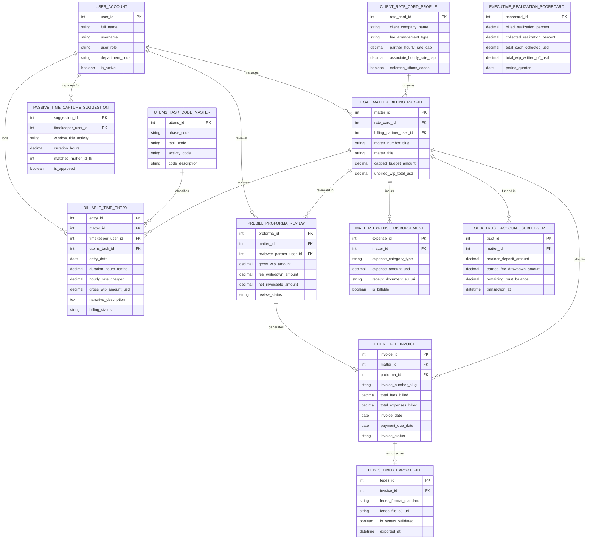

# Conceptual ERD — Law Firm Billing & Time Tracking System

## Mermaid Code

## Entity Description Table | Bảng mô tả Entity

| # | Entity Name | Vietnamese Name | Description | Key Attributes | Main Relationships |
|---|-------------|-----------------|-------------|----------------|-------------------|
| 1 | USER_ACCOUNT | Tài khoản Nguời dùng | System credentials and access roles for managing partners, billing specialists, timekeeper attorneys, and admins. | `user_id`, `username`, `user_role`, `department_code` | Manages `LEGAL_MATTER_BILLING_PROFILE`, captures for `PASSIVE_TIME_CAPTURE_SUGGESTION`, logs `BILLABLE_TIME_ENTRY`, reviews `PREBILL_PROFORMA_REVIEW`. |
| 2 | CLIENT_RATE_CARD_PROFILE | Profile Rate Card Khách hàng | Client fee agreement profile storing fee arrangement types (Hourly/AFA), rate caps, and UTBMS enforcement rules. | `rate_card_id`, `client_company_name`, `fee_arrangement_type`, `partner_hourly_rate_cap`, `enforces_utbms_codes` | Governs `LEGAL_MATTER_BILLING_PROFILE`. |
| 3 | LEGAL_MATTER_BILLING_PROFILE | Profile Billing Vụ việc | Master legal matter billing record tracking matter numbers, titles, budget caps, and un-billed Work-In-Progress (WIP) totals. | `matter_id`, `rate_card_id`, `billing_partner_user_id`, `matter_number_slug`, `matter_title`, `unbilled_wip_total_usd` | Governed by `CLIENT_RATE_CARD_PROFILE`, accrues `BILLABLE_TIME_ENTRY`, incurs `MATTER_EXPENSE_DISBURSEMENT`, reviewed in `PREBILL_PROFORMA_REVIEW`, billed in `CLIENT_FEE_INVOICE`, funded in `IOLTA_TRUST_ACCOUNT_SUBLEDGER`, managed by `USER_ACCOUNT`. |
| 4 | PASSIVE_TIME_CAPTURE_SUGGESTION | Gợi ý Time Capture Tự động | Suggested billable time entry generated by desktop/mobile activity monitor tracking window titles, durations, and matched matters. | `suggestion_id`, `timekeeper_user_id`, `window_title_activity`, `duration_hours`, `matched_matter_id_fk`, `is_approved` | Belongs to `USER_ACCOUNT`. |
| 5 | BILLABLE_TIME_ENTRY | Entry Thời gian Tự tính phí | Billable time entry record tracking timekeeper ID, UTBMS task code, duration (in 10ths of an hour), hourly rates, WIP amounts, and narratives. | `entry_id`, `matter_id`, `timekeeper_user_id`, `utbms_task_id`, `duration_hours_tenths`, `hourly_rate_charged`, `gross_wip_amount_usd`, `billing_status` | Belongs to `LEGAL_MATTER_BILLING_PROFILE`, classified by `UTBMS_TASK_CODE_MASTER`, logged by `USER_ACCOUNT`. |
| 6 | UTBMS_TASK_CODE_MASTER | Master Mã Task UTBMS | Master Uniform Task-Based Management System (UTBMS) code repository storing phase, task, and activity codes (e.g., `L110`, `L330`). | `utbms_id`, `phase_code`, `task_code`, `activity_code`, `code_description` | Classifies `BILLABLE_TIME_ENTRY`. |
| 7 | PREBILL_PROFORMA_REVIEW | Review Proforma Pre-Bill | Monthly pre-bill proforma review log recording gross WIP, partner fee write-downs, write-offs, net invoicable amounts, and status. | `proforma_id`, `matter_id`, `reviewer_partner_user_id`, `gross_wip_amount`, `fee_writedown_amount`, `net_invoicable_amount` | Belongs to `LEGAL_MATTER_BILLING_PROFILE`, generates `CLIENT_FEE_INVOICE`, reviewed by `USER_ACCOUNT`. |
| 8 | MATTER_EXPENSE_DISBURSEMENT | Chi phí Phát sinh Vụ việc | Client expense disbursement record tracking category (Filing Fee/Deposition Transcript), amounts, S3 receipt URIs, and billable status. | `expense_id`, `matter_id`, `expense_category_type`, `expense_amount_usd`, `receipt_document_s3_uri`, `is_billable` | Belongs to `LEGAL_MATTER_BILLING_PROFILE`. |
| 9 | CLIENT_FEE_INVOICE | Hóa đơn Phiên Pháp lý | Formal client legal fee invoice record tracking invoice number, total fees billed, total expenses billed, due dates, and payment status. | `invoice_id`, `matter_id`, `proforma_id`, `invoice_number_slug`, `total_fees_billed`, `total_expenses_billed`, `invoice_status` | Belongs to `LEGAL_MATTER_BILLING_PROFILE`, generated from `PREBILL_PROFORMA_REVIEW`, exported as `LEDES_1998B_EXPORT_FILE`. |
| 10 | LEDES_1998B_EXPORT_FILE | File Export LEDES 1998B | Electronic legal fee invoice export log tracking LEDES 1998B text file URIs, syntax validation flags, and export timestamps. | `ledes_id`, `invoice_id`, `ledes_format_standard`, `ledes_file_s3_uri`, `is_syntax_validated`, `exported_at` | Belongs to `CLIENT_FEE_INVOICE`. |
| 11 | IOLTA_TRUST_ACCOUNT_SUBLEDGER | Sổ phụ Account Trust IOLTA | Client retainer trust account sub-ledger recording deposit amounts, earned fee drawdowns, remaining trust balances, and timestamps. | `trust_id`, `matter_id`, `retainer_deposit_amount`, `earned_fee_drawdown_amount`, `remaining_trust_balance` | Belongs to `LEGAL_MATTER_BILLING_PROFILE`. |
| 12 | EXECUTIVE_REALIZATION_SCORECARD | Scorecard Executive Realization | Executive realization scorecard aggregating billed realization %, collected realization %, cash collected $, and WIP write-offs $. | `scorecard_id`, `billed_realization_percent`, `collected_realization_percent`, `total_cash_collected_usd`, `total_wip_written_off_usd` | Standalone executive performance entity. |

## Relationship Description | Mô tả Quan hệ

| # | From Entity | Cardinality | To Entity | Label | Business Explanation |
|---|-------------|-------------|-----------|-------|----------------------|
| 1 | CLIENT_RATE_CARD_PROFILE | 1 to 0..N | LEGAL_MATTER_BILLING_PROFILE | governs | A client rate card profile governs legal matter billing profiles. |
| 2 | LEGAL_MATTER_BILLING_PROFILE | 1 to 0..N | BILLABLE_TIME_ENTRY | accrues | A legal matter billing profile accrues billable time entries. |
| 3 | LEGAL_MATTER_BILLING_PROFILE | 1 to 0..N | MATTER_EXPENSE_DISBURSEMENT | incurs | A legal matter billing profile incurs billable expense disbursements. |
| 4 | LEGAL_MATTER_BILLING_PROFILE | 1 to 0..N | PREBILL_PROFORMA_REVIEW | reviewed in | A legal matter billing profile is reviewed in monthly pre-bill proformas. |
| 5 | LEGAL_MATTER_BILLING_PROFILE | 1 to 0..N | CLIENT_FEE_INVOICE | billed in | A legal matter billing profile is billed in client fee invoices. |
| 6 | LEGAL_MATTER_BILLING_PROFILE | 1 to 0..N | IOLTA_TRUST_ACCOUNT_SUBLEDGER | funded in | A legal matter billing profile is funded in IOLTA trust account sub-ledgers. |
| 7 | UTBMS_TASK_CODE_MASTER | 1 to 0..N | BILLABLE_TIME_ENTRY | classifies | A UTBMS task code master classifies billable time entries. |
| 8 | PREBILL_PROFORMA_REVIEW | 1 to 1 | CLIENT_FEE_INVOICE | generates | An approved pre-bill proforma review generates a client fee invoice. |
| 9 | CLIENT_FEE_INVOICE | 1 to 0..1 | LEDES_1998B_EXPORT_FILE | exported as | A client fee invoice is exported as a LEDES 1998B text file. |
| 10 | USER_ACCOUNT | 1 to 0..N | LEGAL_MATTER_BILLING_PROFILE | manages | A managing partner user account manages legal matter billing profiles. |
| 11 | USER_ACCOUNT | 1 to 0..N | PASSIVE_TIME_CAPTURE_SUGGESTION | captures for | A timekeeper attorney user account captures passive desktop activity suggestions. |
| 12 | USER_ACCOUNT | 1 to 0..N | BILLABLE_TIME_ENTRY | logs | A timekeeper attorney user account logs billable time entries. |
| 13 | USER_ACCOUNT | 1 to 0..N | PREBILL_PROFORMA_REVIEW | reviews | A billing partner user account reviews monthly proforma pre-bills. |
