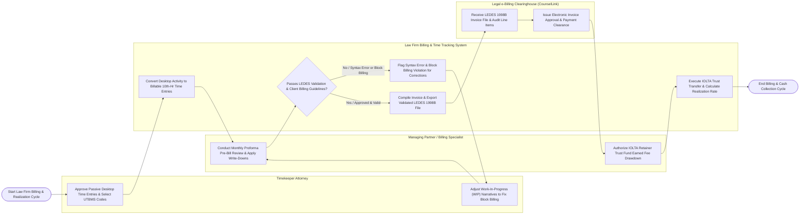

# Swimlane Diagram — Law Firm Billing & Time Tracking System

## Mermaid Code

## Flow Description | Mô tả luồng

| Lane | Actor | Role in Flow |
|------|-------|-------------|
| 1 | Timekeeper Attorney | Approves suggested passive desktop activity time entries, selects UTBMS task codes, records billable hours in 10th-of-an-hour increments, and adjusts narratives to resolve block billing flags. |
| 2 | Managing Partner / Billing Specialist | Conducts monthly pre-bill proforma reviews, applies fee write-downs and write-offs, authorizes formal invoice generation, and approves IOLTA retainer trust fund earned fee drawdowns. |
| 3 | Law Firm Billing & Time Tracking System | Converts desktop window activity into billable time entries, validates narratives against corporate billing rules, compiles itemized invoices, formats pipe-delimited LEDES 1998B text files, executes IOLTA trust-to-operating bank transfers, and computes law firm realization rates. |
| 4 | Legal e-Billing Clearinghouse (CounselLink) | Receives electronic LEDES 1998B fee invoices via REST APIs, audits UTBMS line items against client rate caps, and issues electronic invoice approval and payment clearance tokens. |
