# Action Tree — Law Firm Billing & Time Tracking System

## Mermaid Code

```mermaid
graph TD
    Root["Law Firm Billing & Time Tracking System"]

    Root --> M1["Passive Time Capture & UTBMS Timekeeping"]
    Root --> M2["Rate Cards, AFAs & Narrative Quality Audit"]
    Root --> M3["Proforma Pre-Bill Review & Write-Downs"]
    Root --> M4["LEDES 1998B E-Billing & Portal Integration"]
    Root --> M5["IOLTA Trust Accounting & Rule 1.15 Ledger"]
    Root --> M6["Realization Rates, AR Aging & Financial Scorecards"]

    M1 --> A11["Convert Passive Desktop Application Activity into Billable Time Entries"]
    M1 --> A12["Record Billable Time in Tenth-of-an-Hour Increments (0.1 Hr = 6 Mins)"]
    M1 --> A13["Attach Uniform Task-Based Management System (UTBMS) Task Codes"]
    M1 --> A14["Capture Mobile Voice Memos & Auto-Generate Draft Time Logs"]

    M2 --> A21["Configure Client-Specific Hourly Rate Cards & Alternative Fee Arrangements"]
    M2 --> A22["Enforce Corporate Billing Rules (Prohibit Block Billing & Administrative Fees)"]
    M2 --> A23["Validate Billing Narrative Quality & Trigger Clarity Improvement Warnings"]
    M2 --> A24["Track Client Capped Budget Limits & Trigger Over-Budget Warning Alerts"]

    M3 --> A31["Compile Monthly Pre-Bill Proforma Reports for Billing Partners"]
    M3 --> A32["Apply Fee Write-Downs & Courtesy Discounts to Work-In-Progress (WIP)"]
    M3 --> A33["Apply Non-Billable Fee Write-Offs with Categorized Justification Codes"]
    M3 --> A34["Hold Select WIP Entries for Future Billing Cycles upon Partner Approval"]

    M4 --> A41["Format Client Fee Invoices into LEDES 1998B & LEDES XML Standard Files"]
    M4 --> A42["Validate LEDES Pipe-Delivered Syntax & UTBMS Code Integrity"]
    M4 --> A43["Submit Electronic LEDES Invoices to e-Billing Portals (CounselLink / TyMetrix)"]
    M4 --> A44["Track e-Billing Rejection Notices & Process Line-Item Reduction Appeals"]

    M5 --> A51["Manage Client Retainer Deposits in Interest on Lawyers' Trust Accounts (IOLTA)"]
    M5 --> A52["Enforce Strict ABA Model Rule 1.15 Individual Client Sub-Ledger Isolation"]
    M5 --> A53["Execute Automated Trust-to-Operating Bank Transfers for Earned Invoices"]
    M5 --> A54["Generate Monthly IOLTA Bank Balance Statements & Retainer Top-Up Requests"]

    M6 --> A61["Calculate Billed & Collected Realization Rates per Attorney & Matter"]
    M6 --> A62["Track Accounts Receivable (AR) Aging Buckets (30 / 60 / 90 / 120+ Days)"]
    M6 --> A63["Audit Partner Profitability & Fixed-Fee Matter Margin Performance"]
    M6 --> A64["Export Executive Law Firm WIP, Realization & AR Financial Scorecards"]
```

## Module Description | Mô tả Module

| # | Module | Description | Actions |
|---|--------|-------------|---------|
| 1 | Passive Time Capture & UTBMS Timekeeping | Converts desktop activity into 10th-hr time entries, attaches UTBMS task codes, and captures mobile voice time memos. | Convert Desktop Activity into Time Entries, Record Time in Tenth-of-an-Hour Increments, Attach UTBMS Task Codes, Capture Mobile Voice Time Memos. |
| 2 | Rate Cards, AFAs & Narrative Quality Audit | Configures client rate cards/AFAs, enforces corporate billing rules prohibiting block billing, audits narratives, and tracks budget caps. | Configure Client Rate Cards & AFAs, Enforce Corporate Billing Rules, Validate Billing Narrative Quality, Track Client Capped Budget Limits. |
| 3 | Proforma Pre-Bill Review & Write-Downs | Renders monthly pre-bills, allows partners to apply write-downs/write-offs with justification codes, and holds WIP for future cycles. | Compile Monthly Pre-Bill Proforma Reports, Apply Fee Write-Downs & Courtesy Discounts, Apply Non-Billable Write-Offs, Hold WIP Entries for Future Cycles. |
| 4 | LEDES 1998B E-Billing & Portal Integration | Formats invoices into LEDES 1998B text files, validates syntax, submits e-bills to CounselLink/TyMetrix, and tracks line-item appeals. | Format Invoices into LEDES 1998B Standard, Validate LEDES Pipe Syntax & UTBMS Codes, Submit Electronic LEDES Invoices to Portals, Track e-Billing Rejections & Appeals. |
| 5 | IOLTA Trust Accounting & Rule 1.15 Ledger | Manages client retainer deposits in IOLTA trust accounts, enforces ABA Rule 1.15 sub-ledger isolation, and executes earned fee transfers. | Manage Client IOLTA Retainer Deposits, Enforce ABA Rule 1.15 Sub-Ledger Isolation, Execute Trust-to-Operating Bank Transfers, Generate Retainer Top-Up Requests. |
| 6 | Realization Rates, AR Aging & Financial Scorecards | Computes billed/collected realization rates, tracks AR aging buckets (30-120+ days), audits partner profitability, and exports scorecards. | Calculate Billed & Collected Realization Rates, Track Accounts Receivable AR Aging Buckets, Audit Partner Profitability Performance, Export Executive Financial Scorecards. |
