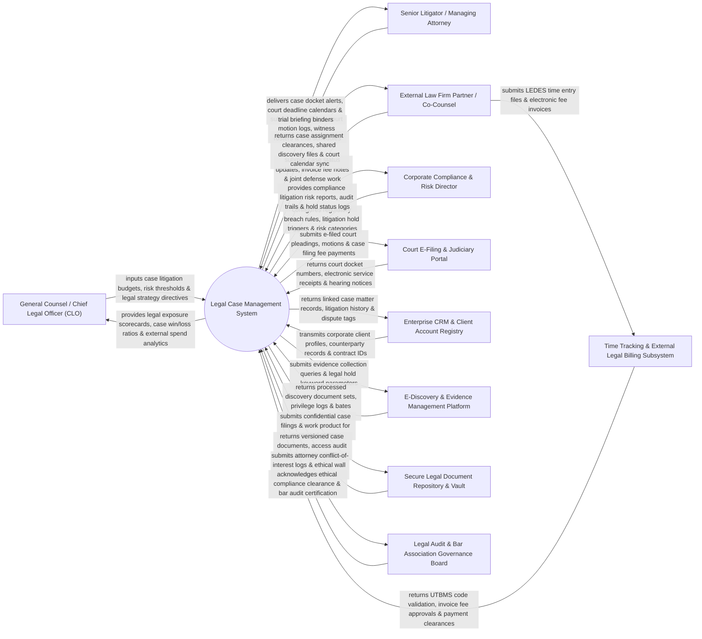

# Context Diagram — Legal Case Management System

## Mermaid Code

## Actor & Interaction Table | Bảng Actor & Tương tác

| # | Actor | Actor Type | Data Sent TO System | Data Received FROM System | Notes |
|---|-------|------------|---------------------|---------------------------|-------|
| 1 | General Counsel / Chief Legal Officer (CLO) | Primary | Litigation budget limits, financial exposure risk thresholds, external counsel allocation rules. | Legal exposure scorecards, litigation win/loss ratios, external legal spend analytics, matter portfolio summaries. | Chief Legal Officer overseeing corporate litigation strategy, financial risk, and external legal spend. |
| 2 | Senior Litigator / Managing Attorney | Primary | Court pleadings, motion filings, witness rosters, trial strategy notes, task assignments. | Case docket alerts, court deadline calendars (Rules of Civil Procedure), trial briefing binders. | Lead attorney managing active litigation matters, court appearances, and trial preparation. |
| 3 | External Law Firm Partner / Co-Counsel | Primary | External case status notes, electronic fee invoices (LEDES format), joint defense work product. | Case assignment clearances, shared discovery files, court calendar synchronization, matter budgets. | External outside counsel collaborating on active court cases and submitting legal invoices. |
| 4 | Corporate Compliance & Risk Director | Primary | Regulatory violation logs, litigation hold triggers, risk category classifications. | Compliance litigation risk reports, litigation hold compliance status logs, matter audit trails. | Compliance officer tracking regulatory investigations, internal audits, and litigation hold enforcement. |
| 5 | Court E-Filing & Judiciary Portal | Supporting | Court docket numbers, electronic service of process receipts, judge assignment notices, hearing dates. | Electronic court pleadings (PDF/A format), motions, case filing fee payment tokens. | Government judiciary portal handling electronic court filings and issuing official court dockets. |
| 6 | Enterprise CRM & Client Account Registry | Supporting | Corporate client master profiles, counterparty entity records, linked commercial contract IDs. | Linked legal matter records, historical dispute logs, pending litigation risk tags. | Enterprise CRM synchronizing corporate client records and tracking active litigation disputes. |
| 7 | E-Discovery & Evidence Management Platform | Supporting | Processed discovery document sets, privilege logs, Bates-stamped evidence files, search hit counts. | Evidence collection parameters, custodian lists, legal hold search keyword queries. | E-discovery platform processing digital evidence, custodian emails, and document review sets. |
| 8 | Time Tracking & External Legal Billing Subsystem | Supporting | UTBMS task code validation rules, LEDES 1998B fee invoice format rules, billing rate caps. | Approved LEDES fee invoices, timekeeper rate compliance reports, payment authorization logs. | Legal e-billing subsystem auditing outside counsel invoices against UTBMS billing guidelines. |
| 9 | Secure Legal Document Repository & Vault | Supporting | Encrypted file binary streams, document version histories, access audit logs, check-out locks. | Confidential case briefs, motion drafts, client communications, secure download tokens. | Encrypted legal document repository securing confidential work product and attorney-client communications. |
| 10 | Legal Audit & Bar Association Governance Board | Supporting / Regulatory | Ethical wall rules, attorney conflict-of-interest check standards, bar association audit guidelines. | Conflict-of-interest check logs, ethical wall isolation verifications, bar compliance audit reports. | Regulatory body enforcing conflict-of-interest checks, ethical walls, and legal professional standards. |

## System Boundary Description | Mô tả Phạm vi Hệ thống

The **Legal Case Management System** is an enterprise legal matter management, court e-filing, conflict-of-interest checking, e-billing audit, and litigation hold tracking platform designed to manage court cases, arbitration, and regulatory inquiries.

**Inside System Scope:**
- Centralized matter tracking managing case dockets, parties, judges, motion calendars, and court deadlines.
- Automated attorney conflict-of-interest checking across corporate entities, counterparties, and affiliates.
- Integration with Court E-Filing portals for electronic submission of pleadings, motions, and service of process.
- LEDES/UTBMS e-billing audit engine validating outside counsel invoices against corporate billing guidelines.
- Ethical wall governance isolating confidential case files between internal legal teams and outside partners.

**Outside System Scope:**
- Direct physical attendance at court trials (handled by Trial Attorneys in physical courtrooms).
- Direct physical hosting of government court databases (handled by Judicial Information Systems).
- Direct physical execution of police search warrants (handled by Law Enforcement Agencies).
