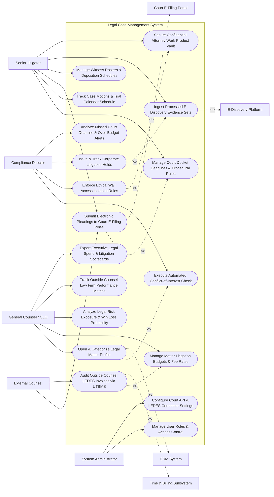

# Use Case Diagram — Legal Case Management System

## Mermaid Code

## Actor Table | Bảng Actor

| # | Actor | Actor Type | Role Description | Related Use Cases |
|---|-------|------------|------------------|-------------------|
| 1 | General Counsel / CLO | Primary | Chief Legal Officer managing legal risk exposure, outside counsel allocations, matter budgets, and litigation scorecards. | UC01, UC09, UC13, UC14, UC15 |
| 2 | Senior Litigator | Primary | Managing litigator opening cases, tracking court dockets, filing motions, preparing witnesses, and managing evidence. | UC03, UC04, UC05, UC06, UC07, UC11 |
| 3 | External Counsel | Primary | Outside law firm partner submitting electronic pleadings, filing motions, and uploading LEDES fee invoices. | UC05, UC08 |
| 4 | Compliance Director | Primary | Compliance officer overseeing conflict checks, ethical wall isolation rules, litigation holds, and risk alerts. | UC02, UC10, UC12, UC18 |
| 5 | System Administrator | Primary | IT admin managing user security roles, court e-filing API credentials, and LEDES validation rules. | UC16, UC17 |
| 6 | Court E-Filing Portal | System (Secondary) | Government court portal handling electronic document filing, court service, and docket updates. | UC05 |
| 7 | E-Discovery Platform | System (Secondary) | Digital discovery engine processing evidence sets, custodian emails, and privilege logs. | UC07 |
| 8 | Time & Billing Subsystem | System (Secondary) | Legal e-billing subsystem parsing LEDES 1998B files and auditing UTBMS task codes. | UC08 |
| 9 | CRM System | System (Secondary) | Enterprise CRM supplying client account profiles and counterparty relationship records. | UC01 |

## Use Case Table | Bảng Use Case

| # | UC ID | Use Case Name | Primary Actor | Secondary Actor | Description | Priority |
|---|-------|---------------|---------------|-----------------|-------------|----------|
| 1 | UC01 | Open & Categorize Legal Matter Profile | CLO | CRM System | Opens new legal matter records, categorizing by litigation type (Patent, Employment, Commercial), parties, and court jurisdiction. | Critical |
| 2 | UC02 | Execute Automated Conflict-of-Interest Check | Compliance | None | Scans corporate databases, subsidiaries, counterparties, and adverse parties to detect attorney conflict of interest before opening. | Critical |
| 3 | UC03 | Manage Court Docket Deadlines & Procedural Rules | Litigator | None | Auto-calculates procedural court filing deadlines based on Federal/State Rules of Civil Procedure (e.g., Motion to Dismiss = 21 Days). | Critical |
| 4 | UC04 | Track Case Motions & Trial Calendar Schedule | Litigator | None | Tracks motion hearing dates, judge oral argument schedules, pre-trial conferences, and trial calendar events. | High |
| 5 | UC05 | Submit Electronic Pleadings to Court E-Filing Portal | Litigator | Court Portal | Formats, signs, and dispatches electronic PDF/A court pleadings and motions to government court e-filing portals. | Critical |
| 6 | UC06 | Manage Witness Rosters & Deposition Schedules | Litigator | None | Maintains fact/expert witness contact rosters, deposition transcripts, video exhibits, and subpoena issuance dates. | High |
| 7 | UC07 | Ingest Processed E-Discovery Evidence Sets | Litigator | E-Discovery | Ingests Bates-stamped discovery document sets, privilege logs, and search hit reports from e-discovery platforms. | High |
| 8 | UC08 | Audit Outside Counsel LEDES Invoices via UTBMS | ExtCounsel | Billing Subsys | Parses outside law firm LEDES 1998B fee invoices, auditing UTBMS codes (Phase/Task/Activity) against rate caps. | Critical |
| 9 | UC09 | Manage Matter Litigation Budgets & Fee Rates | CLO | None | Sets approved matter litigation budgets, negotiated law firm hourly rates, capped fee caps, and alternative fee arrangements (AFAs). | High |
| 10 | UC10 | Enforce Ethical Wall Access Isolation Rules | Compliance | None | Establishes restricted security barriers (ethical walls) blocking specific internal attorneys from accessing conflicted case files. | Critical |
| 11 | UC11 | Secure Confidential Attorney Work Product Vault | Litigator | None | Encrypts attorney-client communications, legal strategy memos, and draft briefs in a secure legal document vault. | High |
| 12 | UC12 | Issue & Track Corporate Litigation Holds | Compliance | None | Dispatches automated litigation hold notices to corporate custodians, tracking digital acknowledgments and preservation compliance. | Critical |
| 13 | UC13 | Analyze Legal Risk Exposure & Win Loss Probability | CLO | None | Computes financial exposure risk values ($Exposure = \text{Potential Loss} \times \text{Loss Prob \%}$) and litigation outcome predictions. | High |
| 14 | UC14 | Track Outside Counsel Law Firm Performance Metrics | CLO | None | Measures law firm win/loss records, invoice accuracy, average cost per matter, and timeliness metrics. | High |
| 15 | UC15 | Export Executive Legal Spend & Litigation Scorecards | CLO | None | Renders executive scorecards detailing active litigation count, total legal exposure $, outside counsel spend, and budget variance. | High |
| 16 | UC16 | Manage User Roles & Access Control | Admin | None | Controls user login credentials, RBAC permissions, and legal matter visibility scopes. | High |
| 17 | UC17 | Configure Court API & LEDES Connector Settings | Admin | None | Manages API endpoints for court e-filing portals (Federal ECF / State Courts), LEDES parsers, and e-discovery connectors. | High |
| 18 | UC18 | Analyze Missed Court Deadline & Over-Budget Alerts | Compliance | None | Dispatches urgent notifications when a court filing deadline is within 48 hours or a matter exceeds 90% of budget. | High |

## Use Case Specification | Đặc tả Use Case

---

### UC02 — Execute Automated Conflict-of-Interest Check

| Field | Detail |
|-------|--------|
| **UC ID** | UC02 |
| **Use Case Name** | Execute Automated Conflict-of-Interest Check |
| **Actor(s)** | Primary: Corporate Compliance & Risk Director, General Counsel   Secondary: CRM System |
| **Description** | Scans enterprise databases, corporate subsidiaries, parent entities, adverse counterparties, and active/closed litigation matters to detect potential attorney ethical conflicts of interest before opening a new matter. |
| **Precondition** | 1. New legal matter profile draft is created with prospective client/matter names and adverse party entities.   2. Corporate entity database and past case history logs are indexed in search repository. |
| **Main Flow** | 1. User initiates new legal matter creation for prospective dispute: `Acme Corp vs. Nexus Technologies`.   2. User inputs Adverse Party Entities: `Nexus Technologies Inc`, `Nexus Microdevices Subsidiary`, `John Smith (Key Executive)`.   3. System triggers Automated Conflict-of-Interest Search Engine.   4. Search Engine executes fuzzy matching and phonetic search across:   &nbsp;&nbsp;&nbsp;&nbsp; a. Active & Closed Case Matters Database (Last 10 Years).   &nbsp;&nbsp;&nbsp;&nbsp; b. Corporate Client & Counterparty Registry (CRM).   &nbsp;&nbsp;&nbsp;&nbsp; c. Outside Counsel & Expert Witness Conflict Logs.   5. System detects potential conflict hit:   &nbsp;&nbsp;&nbsp;&nbsp; a. Conflict Hit #1: `Nexus Microdevices` was represented by lead litigator Attorney Sarah Jenkins in 2024 (Patent Matter #MAT-402).   &nbsp;&nbsp;&nbsp;&nbsp; b. Conflict Level: `DIRECT_ADVERSE_PARTY_CONFLICT`.   6. System generates Conflict Evaluation Report and places new matter status on `CONFLICT_REVIEW_HOLD`.   7. Compliance Director reviews conflict report and evaluates ethics rules (ABA Model Rule 1.7):   &nbsp;&nbsp;&nbsp;&nbsp; a. Option A: Decline representation / representation blocked (`CONFLICT_REJECTED`).   &nbsp;&nbsp;&nbsp;&nbsp; b. Option B: Approve representation subject to UC10 (Enforce Ethical Wall Access Isolation Rules) isolating Attorney Sarah Jenkins.   8. Compliance Director selects Option B, attaches signed Conflict Waiver PDF, and activates Ethical Wall isolation. |
| **Alternative Flow** | **AF1** — Zero Conflict Clearance: Search engine returns zero matching conflict hits across all entity databases; System marks matter as `CONFLICT_CLEARED` and unlocks full matter creation. |
| **Exception Flow** | **EX1** — Incomplete Entity Data Error: User attempts conflict check without providing adverse party tax ID or corporate registration number; System blocks check, requiring full entity verification. |
| **Postcondition** | Conflict-of-interest check is executed, conflict hits are evaluated under ethics rules, matter is cleared or blocked, and ethical wall rules are logged. |
| **Business Rule** | **BR1**: Every new legal matter MUST pass an automated conflict-of-interest check and obtain formal compliance clearance before legal work commences. |

---

### UC05 — Submit Electronic Pleadings to Court E-Filing Portal

| Field | Detail |
|-------|--------|
| **UC ID** | UC05 |
| **Use Case Name** | Submit Electronic Pleadings to Court E-Filing Portal |
| **Actor(s)** | Primary: Senior Litigator, External Law Firm Partner   Secondary: Court E-Filing & Judiciary Portal (Federal ECF / State Court APIs) |
| **Description** | Validates, formats, digitally signs, and dispatches electronic PDF/A court pleadings, motions, and exhibits to state/federal court e-filing portals, receiving official court docket receipts. |
| **Precondition** | 1. Legal pleading document (e.g., `Motion_for_Summary_Judgment.pdf`) is finalized and approved in system.   2. Court E-Filing API credentials (ECF/CM credentials) and court bar registration numbers are active. |
| **Main Flow** | 1. Litigator opens "Court E-Filing Desk" for Matter `#MAT-88412` (`Acme Corp vs. Nexus Technologies`).   2. Litigator selects Target Court Jurisdiction: `U.S. District Court, Southern District of New York (SDNY)`.   3. Litigator attaches Pleading Package:   &nbsp;&nbsp;&nbsp;&nbsp; a. Main Pleading: `Motion for Summary Judgment (PDF/A Format)`.   &nbsp;&nbsp;&nbsp;&nbsp; b. Supporting Document: `Declaration of Expert Witness (PDF/A)`.   &nbsp;&nbsp;&nbsp;&nbsp; c. Exhibit A: `Technical Specifications PDF (Bates Range ACME-00100 to 00150)`.   4. System validates Document Technical Compliance:   &nbsp;&nbsp;&nbsp;&nbsp; a. Format Check: PDF/A-1b compliant -> `VALID`.   &nbsp;&nbsp;&nbsp;&nbsp; b. File Size Check: Total package 18 MB <= Court limit 50 MB -> `VALID`.   &nbsp;&nbsp;&nbsp;&nbsp; c. Redaction Check: Social Security Numbers and financial accounts redacted -> `VERIFIED`.   5. Litigator signs document using Cryptographic Bar Certificate Digital Signature.   6. Litigator clicks "Submit Electronic Filing to SDNY Court".   7. System transmits HTTPS REST API payload to Federal CM/ECF E-Filing Gateway.   8. Court Gateway accepts filing, issues Official Court Electronic Receipt:   &nbsp;&nbsp;&nbsp;&nbsp; a. Court Docket Entry #: `Docket Item #42`.   &nbsp;&nbsp;&nbsp;&nbsp; b. Filing Timestamp: `October 30, 2026 at 04:45:12 PM EST`.   &nbsp;&nbsp;&nbsp;&nbsp; c. Electronic Notice of Service (NEF) generated for all counsel of record.   9. System attaches court receipt to matter file, updates docket calendar (UC03), and sends confirmation email to litigation team. |
| **Alternative Flow** | **AF1** — Automated Service of Process: System dispatches certified electronic service of process copies directly to registered opposing counsel via e-service APIs simultaneously with court filing. |
| **Exception Flow** | **EX1** — Court Portal E-Filing Rejection: Court gateway rejects filing due to invalid bar registration number; System flags `FILING_REJECTED_COURT`, notifying litigator to update bar credentials before midnight deadline. |
| **Postcondition** | Pleading package is validated, digitally signed, submitted to court e-filing portal, official court docket receipt is issued, and calendar updates. |
| **Business Rule** | **BR1**: Electronic court filings MUST be formatted as PDF/A compliant documents with verified PII redaction prior to e-filing submission. |

---

### UC08 — Audit Outside Counsel LEDES Invoices via UTBMS

| Field | Detail |
|-------|--------|
| **UC ID** | UC08 |
| **Use Case Name** | Audit Outside Counsel LEDES Invoices via UTBMS |
| **Actor(s)** | Primary: External Law Firm Partner, General Counsel / CLO   Secondary: Time Tracking & External Legal Billing Subsystem |
| **Description** | Ingests and audits electronic law firm fee invoices formatted in LEDES 1998B standard, validating Uniform Task-Based Management System (UTBMS) task codes against approved matter budgets and rate caps. |
| **Precondition** | 1. Approved matter fee agreement (hourly rate caps, block billing prohibitions, UTBMS rules) is active (UC09).   2. External law firm uploads LEDES 1998B text file (`invoice_OCT2026.ledes`). |
| **Main Flow** | 1. External Law Firm uploads LEDES fee file `invoice_OCT2026.txt` (Invoice Total: `$75,000.00`).   2. System parses LEDES 1998B file structure:   &nbsp;&nbsp;&nbsp;&nbsp; a. Extracts header parameters: Law Firm Tax ID, Invoice Date, Matter ID (`#MAT-88412`).   &nbsp;&nbsp;&nbsp;&nbsp; b. Extracts 120 individual line-item time entries.   3. System executes Automated Billing Rules Audit Engine against corporate billing guidelines:   &nbsp;&nbsp;&nbsp;&nbsp; a. Rule 1 (Hourly Rate Cap): Senior Partner rate $850/hr <= Approved Cap $850/hr -> `COMPLIANT`.   &nbsp;&nbsp;&nbsp;&nbsp; b. Rule 2 (Block Billing Check): Line 42 combines 3 tasks into single 4-hour entry without UTBMS split -> `VIOLATION` (-$1,200.00 reduction).   &nbsp;&nbsp;&nbsp;&nbsp; c. Rule 3 (Prohibited Expense Check): Line 88 charges $150.00 for internal photocopies (prohibited) -> `VIOLATION` (-$150.00 deduction).   &nbsp;&nbsp;&nbsp;&nbsp; d. Rule 4 (UTBMS Code Validation): Task Code `L330` (Depositions) matches valid litigation phase -> `COMPLIANT`.   4. System calculates Invoice Adjustment Summary:   &nbsp;&nbsp;&nbsp;&nbsp; a. Original Invoiced Amount: `$75,000.00`.   &nbsp;&nbsp;&nbsp;&nbsp; b. Total Automated Audit Deductions: `-$1,350.00`.   &nbsp;&nbsp;&nbsp;&nbsp; c. Recommended Approved Amount: `$73,650.00`.   5. System routes audited invoice summary to General Counsel for final approval.   6. General Counsel approves adjusted invoice amount `$73,650.00`.   7. System updates Matter Spent Budget (+ $73,650.00) and dispatches approved LEDES clearing payload to Accounts Payable for disbursement. |
| **Alternative Flow** | **AF1** — Law Firm Appeal Workflow: Outside law firm receives audit deduction notification; Law firm submits time entry breakdown clarification; General Counsel accepts appeal, restoring $1,200.00 deduction. |
| **Exception Flow** | **EX1** — Over-Budget Invoice Rejection: Invoiced amount exceeds total approved matter budget cap ($100,000 budget exhausted); System blocks invoice processing, requiring CLO budget increase (UC09) first. |
| **Postcondition** | LEDES invoice is parsed, UTBMS code compliance is audited, non-compliant line items are deducted, and approved invoice clears for payment. |
| **Business Rule** | **BR1**: Outside counsel fee invoices MUST be submitted in valid LEDES format and pass automated UTBMS rule audits before manager approval. |

---

### UC10 — Enforce Ethical Wall Access Isolation Rules

| Field | Detail |
|-------|--------|
| **UC ID** | UC10 |
| **Use Case Name** | Enforce Ethical Wall Access Isolation Rules |
| **Actor(s)** | Primary: Corporate Compliance & Risk Director   Secondary: Secure Legal Document Repository & Vault |
| **Description** | Establishes strict security barriers (ethical walls / information barriers) blocking conflicted internal attorneys, paralegals, or outside partners from accessing specific legal matter files. |
| **Precondition** | 1. Conflict-of-interest check identifies a conflicted attorney requiring isolation (UC02).   2. Matter ID and isolated user IDs are specified. |
| **Main Flow** | 1. Compliance Director opens "Ethical Wall Security Administration Console".   2. Director selects Target Matter: `#MAT-88412 (Acme Corp vs. Nexus Technologies)`.   3. Director configures Ethical Wall Isolation Parameters:   &nbsp;&nbsp;&nbsp;&nbsp; a. Restricted Attorney (Conflicted User): `Attorney Sarah Jenkins (User ID: #USR-402)`.   &nbsp;&nbsp;&nbsp;&nbsp; b. Reason for Isolation: `Prior representation of adverse party Nexus Microdevices in 2024`.   &nbsp;&nbsp;&nbsp;&nbsp; c. Isolation Scope: `Complete Access Block (Documents, Dockets, Emails, Calendar Events, Search Index)`.   4. Director clicks "Activate Ethical Wall Security Barrier".   5. System updates Access Control Lists (ACL) in real time:   &nbsp;&nbsp;&nbsp;&nbsp; a. Document Vault: Revokes file permissions for User `#USR-402` across all matter sub-folders.   &nbsp;&nbsp;&nbsp;&nbsp; b. Search Indexer: Excludes matter `#MAT-88412` from global search results for User `#USR-402`.   &nbsp;&nbsp;&nbsp;&nbsp; c. Email Distribution: Removes User `#USR-402` from matter notification lists.   6. System generates Ethical Wall Certification Document, requiring Attorney Sarah Jenkins to digitally acknowledge non-participation.   7. User `#USR-402` logs into portal; Matter `#MAT-88412` is entirely invisible in workspace.   8. System logs immutable compliance security audit trail: `ETHICAL_WALL_ACTIVE_USER_402_MATTER_88412`. |
| **Alternative Flow** | **AF1** — Ethical Wall Deactivation: Matter closes and confidentiality restrictions lapse; Compliance Director deactivates ethical wall, archiving security logs. |
| **Exception Flow** | **EX1** — Unauthorized Ethical Wall Breach Attempt: Isolated attorney attempts to open direct document URL for restricted matter; System blocks access (`403 Forbidden`), triggers security breach alert, and notifies Compliance. |
| **Postcondition** | Ethical wall security barrier is activated, document/search access is blocked for isolated user, and compliance audit logs update. |
| **Business Rule** | **BR1**: Ethical wall security barriers MUST enforce absolute access isolation across documents, search indices, and email lists for designated conflicted attorneys. |

---

### UC12 — Issue & Track Corporate Litigation Holds

| Field | Detail |
|-------|--------|
| **UC ID** | UC12 |
| **Use Case Name** | Issue & Track Corporate Litigation Holds |
| **Actor(s)** | Primary: Corporate Compliance Director, Senior Litigator   Secondary: E-Discovery & Evidence Management Platform |
| **Description** | Dispatches legally binding litigation hold notices to corporate data custodians upon anticipation of litigation, tracking electronic sign-off acknowledgments and enforcing automated email/file preservation. |
| **Precondition** | 1. Litigation or regulatory inquiry is filed or reasonably anticipated.   2. Custodian employee list (e.g., Executive Team, Product Engineers) is defined. |
| **Main Flow** | 1. Compliance Director opens "Litigation Hold Management Studio".   2. Director creates Litigation Hold Notice for Matter `#MAT-88412`:   &nbsp;&nbsp;&nbsp;&nbsp; a. Hold Title: `Preservation Notice - Nexus Technologies Patent Dispute`.   &nbsp;&nbsp;&nbsp;&nbsp; b. Custodian Target List: `25 Key Employees (CFO, VP Engineering, Lead Architects)`.   &nbsp;&nbsp;&nbsp;&nbsp; c. Preservation Scope: `All Emails, Instant Messages, Design Documents relating to "Nexus Patent #884" from Jan 2023 to Present`.   &nbsp;&nbsp;&nbsp;&nbsp; d. Mandatory Compliance Directive: `"Do NOT delete, overwrite, or auto-archive any responsive documents"`.   3. Director clicks "Issue Legal Litigation Hold Notice".   4. System dispatches trackable email and portal notifications to all 25 custodians.   5. System integrates with Microsoft 365 / Google Workspace API to apply Automated In-Place Legal Hold:   &nbsp;&nbsp;&nbsp;&nbsp; a. Places Exchange email mailboxes and OneDrive folders of custodians on immutable litigation hold, suppressing automated deletion.   6. Custodian John Doe receives notice, clicks "Review & Acknowledge Hold", and inputs digital signature.   7. System updates Custodian Compliance Matrix: `John Doe - ACKNOWLEDGED (Oct 30 at 02:15 PM)`.   8. System dispatches automated escalation reminders to un-acknowledged custodians after 48 hours.   9. System renders real-time Litigation Hold Compliance Dashboard (23 of 25 Custodians Acknowledged - 92% Compliance). |
| **Alternative Flow** | **AF1** — Periodic Re-Certification Audit: Every 90 days, System dispatches automated re-certification prompts to all active custodians, verifying continued document preservation compliance. |
| **Exception Flow** | **EX1** — Custodian Employee Departure Trigger: Custodian on active legal hold submits resignation in HR system; System alerts Compliance immediately to preserve workstation hard drive prior to exit. |
| **Postcondition** | Litigation hold notice is issued, in-place electronic mailbox preservation is applied via API, custodian acknowledgments are tracked, and compliance audit logs update. |
| **Business Rule** | **BR1**: Issuing a litigation hold MUST automatically trigger in-place electronic data preservation on custodian email and storage accounts. |
