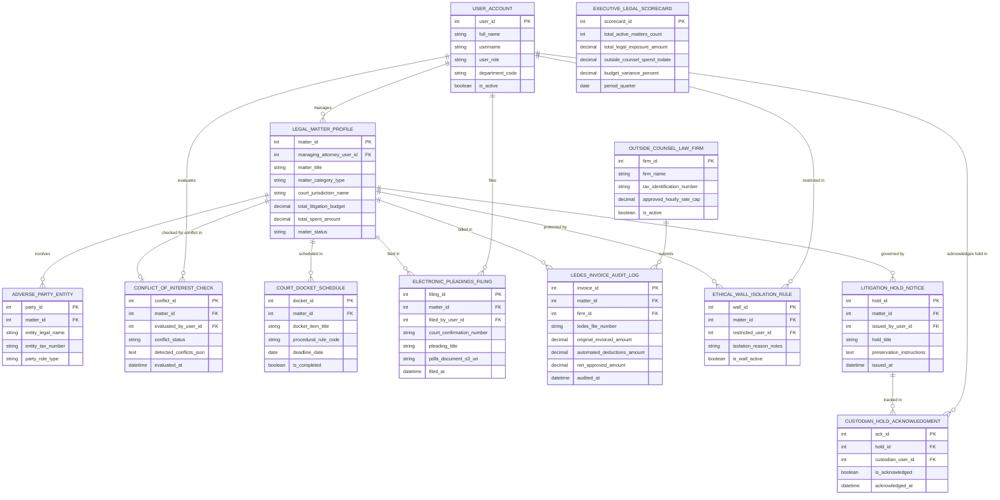

# Conceptual ERD — Legal Case Management System

## Mermaid Code

## Entity Description Table | Bảng mô tả Entity

| # | Entity Name | Vietnamese Name | Description | Key Attributes | Main Relationships |
|---|-------------|-----------------|-------------|----------------|-------------------|
| 1 | USER_ACCOUNT | Tài khoản Nguời dùng | System credentials and access roles for general counsel, litigators, compliance directors, and admins. | `user_id`, `username`, `user_role`, `department_code` | Manages `LEGAL_MATTER_PROFILE`, evaluates `CONFLICT_OF_INTEREST_CHECK`, files `ELECTRONIC_PLEADINGS_FILING`, restricted in `ETHICAL_WALL_ISOLATION_RULE`. |
| 2 | LEGAL_MATTER_PROFILE | Profile Vụ việc Pháp lý | Central legal matter record tracking case title, category, court jurisdiction, budget, spent amount, and status. | `matter_id`, `managing_attorney_user_id`, `matter_title`, `matter_category_type`, `court_jurisdiction_name`, `total_litigation_budget`, `matter_status` | Involves `ADVERSE_PARTY_ENTITY`, checked in `CONFLICT_OF_INTEREST_CHECK`, scheduled in `COURT_DOCKET_SCHEDULE`, filed in `ELECTRONIC_PLEADINGS_FILING`, billed in `LEDES_INVOICE_AUDIT_LOG`, protected by `ETHICAL_WALL_ISOLATION_RULE`, governed by `LITIGATION_HOLD_NOTICE`. |
| 3 | ADVERSE_PARTY_ENTITY | Entity Bên Đối đầu | Adverse party entity record storing company legal names, tax identification numbers, and party roles (Plaintiff/Defendant). | `party_id`, `matter_id`, `entity_legal_name`, `entity_tax_number`, `party_role_type` | Belongs to `LEGAL_MATTER_PROFILE`. |
| 4 | CONFLICT_OF_INTEREST_CHECK | Kiểm tra Xung đột Lợi ích | Automated conflict-of-interest check log recording conflict evaluation status (`CLEARED/REJECTED`), detected hits JSON, and timestamps. | `conflict_id`, `matter_id`, `evaluated_by_user_id`, `conflict_status`, `detected_conflicts_json`, `evaluated_at` | Belongs to `LEGAL_MATTER_PROFILE`, evaluated by `USER_ACCOUNT`. |
| 5 | COURT_DOCKET_SCHEDULE | Lịch Docket Tòa án | Procedural court docket deadline schedule tracking rule codes, target deadlines, and completion flags. | `docket_id`, `matter_id`, `docket_item_title`, `procedural_rule_code`, `deadline_date`, `is_completed` | Belongs to `LEGAL_MATTER_PROFILE`. |
| 6 | ELECTRONIC_PLEADINGS_FILING | Nộp Đơn Tranh tụng Điện tử | Electronic court filing record tracking court confirmation numbers, pleading titles, PDF/A document S3 URIs, and timestamps. | `filing_id`, `matter_id`, `filed_by_user_id`, `court_confirmation_number`, `pleading_title`, `pdfa_document_s3_uri`, `filed_at` | Belongs to `LEGAL_MATTER_PROFILE`, filed by `USER_ACCOUNT`. |
| 7 | OUTSIDE_COUNSEL_LAW_FIRM | Công ty Luật Bên ngoài | Outside law firm vendor profile storing firm legal name, tax ID, approved hourly rate caps, and active status. | `firm_id`, `firm_name`, `tax_identification_number`, `approved_hourly_rate_cap`, `is_active` | Submits `LEDES_INVOICE_AUDIT_LOG`. |
| 8 | LEDES_INVOICE_AUDIT_LOG | Nhật ký Audit Hóa đơn LEDES | Outside counsel fee invoice audit log tracking LEDES file numbers, original invoiced amounts, automated UTBMS deductions, and net approved $. | `invoice_id`, `matter_id`, `firm_id`, `ledes_file_number`, `original_invoiced_amount`, `automated_deductions_amount`, `net_approved_amount` | Belongs to `LEGAL_MATTER_PROFILE` and `OUTSIDE_COUNSEL_LAW_FIRM`. |
| 9 | ETHICAL_WALL_ISOLATION_RULE | Quy tắc Bức tường Đạo đức | Ethical wall security rule restricting conflicted internal attorneys from accessing specific legal matter files and search index. | `wall_id`, `matter_id`, `restricted_user_id`, `isolation_reason_notes`, `is_wall_active` | Belongs to `LEGAL_MATTER_PROFILE`, restricts `USER_ACCOUNT`. |
| 10 | LITIGATION_HOLD_NOTICE | Thông báo Giữ hộ Pháp lý | Corporate litigation hold notice entity recording hold title, preservation instructions JSON, and issuance timestamps. | `hold_id`, `matter_id`, `issued_by_user_id`, `hold_title`, `preservation_instructions`, `issued_at` | Belongs to `LEGAL_MATTER_PROFILE`, tracked in `CUSTODIAN_HOLD_ACKNOWLEDGMENT`. |
| 11 | CUSTODIAN_HOLD_ACKNOWLEDGMENT | Xác nhận Giữ hộ của Custodian | Custodian employee legal hold acknowledgment log tracking digital signature status and acknowledgment timestamps. | `ack_id`, `hold_id`, `custodian_user_id`, `is_acknowledged`, `acknowledged_at` | Belongs to `LITIGATION_HOLD_NOTICE`, acknowledged by `USER_ACCOUNT`. |
| 12 | EXECUTIVE_LEGAL_SCORECARD | Scorecard Executive Pháp lý | Executive legal scorecard aggregating total active matters, total legal exposure $, outside counsel spend to date, and budget variance. | `scorecard_id`, `total_active_matters_count`, `total_legal_exposure_amount`, `outside_counsel_spend_todate`, `budget_variance_percent` | Standalone executive performance entity. |

## Relationship Description | Mô tả Quan hệ

| # | From Entity | Cardinality | To Entity | Label | Business Explanation |
|---|-------------|-------------|-----------|-------|----------------------|
| 1 | LEGAL_MATTER_PROFILE | 1 to 1..N | ADVERSE_PARTY_ENTITY | involves | A legal matter profile involves one or more adverse party entities. |
| 2 | LEGAL_MATTER_PROFILE | 1 to 0..1 | CONFLICT_OF_INTEREST_CHECK | checked for conflict in | A legal matter profile is checked for ethical conflicts of interest. |
| 3 | LEGAL_MATTER_PROFILE | 1 to 0..N | COURT_DOCKET_SCHEDULE | scheduled in | A legal matter profile is scheduled in procedural court dockets. |
| 4 | LEGAL_MATTER_PROFILE | 1 to 0..N | ELECTRONIC_PLEADINGS_FILING | filed in | A legal matter profile is filed in electronic court pleadings. |
| 5 | LEGAL_MATTER_PROFILE | 1 to 0..N | LEDES_INVOICE_AUDIT_LOG | billed in | A legal matter profile is billed in outside counsel LEDES invoices. |
| 6 | LEGAL_MATTER_PROFILE | 1 to 0..N | ETHICAL_WALL_ISOLATION_RULE | protected by | A legal matter profile is protected by ethical wall isolation rules. |
| 7 | LEGAL_MATTER_PROFILE | 1 to 0..N | LITIGATION_HOLD_NOTICE | governed by | A legal matter profile is governed by corporate litigation hold notices. |
| 8 | OUTSIDE_COUNSEL_LAW_FIRM | 1 to 0..N | LEDES_INVOICE_AUDIT_LOG | submits | An outside law firm submits electronic LEDES fee invoices. |
| 9 | LITIGATION_HOLD_NOTICE | 1 to 1..N | CUSTODIAN_HOLD_ACKNOWLEDGMENT | tracked in | A litigation hold notice is tracked in custodian acknowledgments. |
| 10 | USER_ACCOUNT | 1 to 0..N | LEGAL_MATTER_PROFILE | manages | A managing attorney user account manages legal matter profiles. |
| 11 | USER_ACCOUNT | 1 to 0..N | CONFLICT_OF_INTEREST_CHECK | evaluates | A compliance director user account evaluates conflict check reports. |
| 12 | USER_ACCOUNT | 1 to 0..N | ELECTRONIC_PLEADINGS_FILING | files | A senior litigator user account files electronic court pleadings. |
| 13 | USER_ACCOUNT | 1 to 0..N | CUSTODIAN_HOLD_ACKNOWLEDGMENT | acknowledges hold in | A custodian employee user account acknowledges legal holds. |
