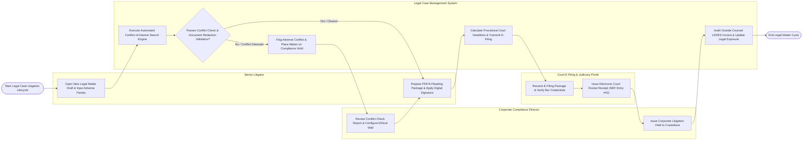

# Swimlane Diagram — Legal Case Management System

## Mermaid Code

## Flow Description | Mô tả luồng

| Lane | Actor | Role in Flow |
|------|-------|-------------|
| 1 | Senior Litigator | Opens new legal matter drafts, inputs adverse party entities, prepares PDF/A court pleading packages, applies digital signatures, and manages case dockets. |
| 2 | Corporate Compliance Director | Reviews automated conflict-of-interest evaluation reports, configures ethical wall isolation barriers for conflicted attorneys, and issues corporate litigation hold notices. |
| 3 | Legal Case Management System | Runs automated conflict search algorithms across historical matters and CRM entities, calculates procedural court deadlines (Rules of Civil Procedure), validates document PDF/A formatting and PII redactions, audits outside counsel LEDES fee invoices, and computes legal exposure $. |
| 4 | Court E-Filing & Judiciary Portal | Ingests electronic court filings via REST APIs (Federal ECF/CM), verifies attorney bar registration credentials, and issues electronic Notice of Electronic Filing (NEF) docket receipts. |
