# Action Tree — Legal Case Management System

## Mermaid Code

```mermaid
graph TD
    Root["Legal Case Management System"]

    Root --> M1["Legal Matter Intake & Conflict-of-Interest Check"]
    Root --> M2["Court Docketing & Procedural Rules Engine"]
    Root --> M3["Court E-Filing & Judiciary API Integration"]
    Root --> M4["LEDES E-Billing & Outside Counsel Audit"]
    Root --> M5["Ethical Wall Security & Work Product Vault"]
    Root --> M6["Litigation Hold & Legal Exposure Analytics"]

    M1 --> A11["Open New Legal Matter Profiles & Assign Managing Litigators"]
    M1 --> A12["Execute Automated Conflict-of-Interest Searches across Entity Databases"]
    M1 --> A13["Log Conflict-of-Interest Clearance Certificates & Ethics Board Approvals"]
    M1 --> A14["Link Corporate Client CRM Profiles & Adverse Counterparty Entities"]

    M2 --> A21["Calculate Procedural Court Deadlines via Rules of Civil Procedure"]
    M2 --> A22["Manage Motion Schedules, Pre-Trial Conferences & Trial Calendars"]
    M2 --> A23["Maintain Fact & Expert Witness Rosters, Subpoenas & Depositions"]
    M2 --> A24["Trigger 48-Hour Missed Court Deadline Warning Alerts"]

    M3 --> A31["Format & Validate PDF/A Compliant Pleading Packages & Exhibits"]
    M3 --> A32["Apply Cryptographic Attorney Bar Certificate Digital Signatures"]
    M3 --> A33["Transmit Electronic Filings to Federal ECF & State Court Portals"]
    M3 --> A34["Ingest Electronic Notice of Electronic Filing (NEF) Docket Receipts"]

    M4 --> A41["Ingest Outside Law Firm Fee Invoices in LEDES 1998B Standard Format"]
    M4 --> A42["Audit UTBMS Task, Phase & Activity Codes against Approved Rate Caps"]
    M4 --> A43["Flag Block Billing & Prohibited Photocopy/Travel Expense Lines"]
    M4 --> A44["Approve Audited LEDES Invoices & Clear Payables to Enterprise ERP"]

    M5 --> A51["Configure Ethical Wall Security Barriers to Isolate Conflicted Users"]
    M5 --> A52["Revoke Vault & Search Index Access Permissions for Restricted Staff"]
    M5 --> A53["Encrypt Attorney-Client Confidential Strategy Memos & Draft Briefs"]
    M5 --> A54["Log Immutable Ethical Wall Compliance Access Verification Trails"]

    M6 --> A61["Issue Automated Litigation Hold Notices to Corporate Custodians"]
    M6 --> A62["Apply In-Place Email & File Preservation Holds via M365 API"]
    M6 --> A63["Calculate Financial Legal Exposure ($Exposure = Potential Loss * Prob %)"]
    M6 --> A64["Export Executive Legal Spend, Win/Loss Ratio & Budget Scorecards"]
```

## Module Description | Mô tả Module

| # | Module | Description | Actions |
|---|--------|-------------|---------|
| 1 | Legal Matter Intake & Conflict-of-Interest Check | Opens legal matters, executes automated conflict checks across entity databases, logs ethics clearances, and links CRM records. | Open Legal Matter Profiles, Execute Automated Conflict Searches, Log Ethics Board Clearance Certificates, Link Corporate CRM Profiles & Adverse Entities. |
| 2 | Court Docketing & Procedural Rules Engine | Calculates procedural court deadlines, manages motion/trial calendars, tracks witness deposition rosters, and dispatches 48-hour deadline alerts. | Calculate Procedural Court Deadlines, Manage Motion & Trial Calendars, Maintain Witness Rosters & Depositions, Trigger Missed Court Deadline Alerts. |
| 3 | Court E-Filing & Judiciary API Integration | Formats PDF/A pleading packages, applies digital signatures, submits e-filings to court portals (Federal ECF), and ingests NEF receipts. | Format PDF/A Pleading Packages, Apply Bar Certificate Digital Signatures, Transmit E-Filings to Court Portals, Ingest Electronic Docket Receipts. |
| 4 | LEDES E-Billing & Outside Counsel Audit | Ingests LEDES 1998B invoices, audits UTBMS task codes against hourly rate caps, flags block billing, and clears approved invoices for AP payment. | Ingest LEDES 1998B Fee Invoices, Audit UTBMS Task Codes against Rate Caps, Flag Block Billing & Prohibited Expenses, Approve Audited Invoices to ERP. |
| 5 | Ethical Wall Security & Work Product Vault | Establishes ethical walls isolating conflicted staff, revokes vault/search access, encrypts work product, and logs compliance audit trails. | Configure Ethical Wall Security Barriers, Revoke Vault & Search Permissions for Restricted Staff, Encrypt Confidential Strategy Memos, Log Ethical Wall Access Trails. |
| 6 | Litigation Hold & Legal Exposure Analytics | Issues litigation hold notices to custodians, applies in-place M365 email preservation, computes legal exposure $, and exports scorecards. | Issue Corporate Litigation Hold Notices, Apply In-Place Email Preservation Holds via API, Calculate Financial Legal Exposure $, Export Executive Legal Scorecards. |
