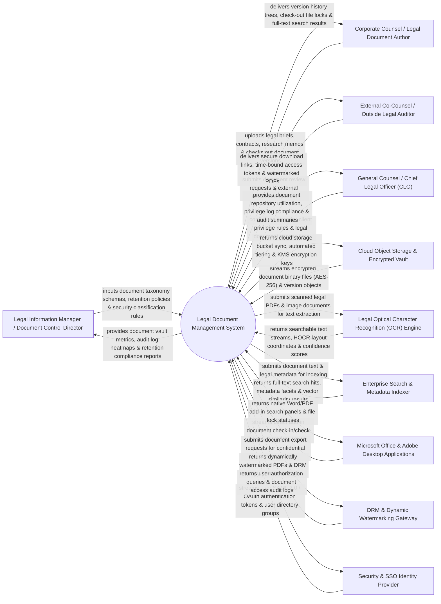

# Context Diagram — Legal Document Management System

## Mermaid Code

## Actor & Interaction Table | Bảng Actor & Tương tác

| # | Actor | Actor Type | Data Sent TO System | Data Received FROM System | Notes |
|---|-------|------------|---------------------|---------------------------|-------|
| 1 | Legal Information Manager / Document Control Director | Primary | Legal document taxonomy schemas, retention policy lifecycle rules, security classification levels, metadata field rules. | Document vault storage metrics, audit log heatmaps, retention compliance reports, document disposition logs. | Legal information professional managing document taxonomies, retention lifecycles, and vault security. |
| 2 | Corporate Counsel / Legal Document Author | Primary | Master legal document uploads (Briefs, Memos, Pleadings), document check-out locks, version notes. | Document version history trees, check-out file lock statuses, full-text search results, visual diff views. | Attorney creating, checking out, editing, and versioning legal briefs and confidential strategy documents. |
| 3 | External Co-Counsel / Outside Legal Auditor | Primary | Document review requests, disclosure queries, secure access token requests. | Secure time-bound download links, dynamically watermarked PDF files, view-only document previews. | External legal auditor or co-counsel accessing shared legal document vaults under strict time controls. |
| 4 | CLO | Primary | Attorney-client privilege classification rules, legal document security tiers, document retention authorization. | Document repository utilization, privilege log compliance scorecards, audit trail summaries, document ROMI. | Executive overseeing corporate legal document security, privilege protection, and audit compliance. |
| 5 | Cloud Object Storage & Encrypted Vault | Supporting | Encrypted document binary streams (AES-256 / AWS S3 / Azure Blob), versioned objects, storage class events. | Cloud storage bucket sync commands, KMS encryption key management requests, Glacier archival triggers. | Cloud object storage and Key Management Service (KMS) securing legal files at rest with AES-256 encryption. |
| 6 | Legal Optical Character Recognition (OCR) Engine | Supporting | Searchable text streams, HOCR layout coordinates, document language tags, OCR confidence scores. | Scanned image PDF files, legal exhibit image streams, OCR processing job queue items. | OCR service (ABBYY FineReader / AWS Textract) converting scanned paper legal briefs into searchable text. |
| 7 | Enterprise Search & Metadata Indexer | Supporting | Full-text search hit lists, metadata facet counts, vector semantic search embeddings, privilege log hits. | Document text streams, legal metadata fields (Bates number, Attorney, Date, Practice Area). | Enterprise search indexer (Elasticsearch / OpenSearch) enabling sub-second search across millions of legal pages. |
| 8 | Microsoft Office & Adobe Desktop Applications | Supporting | Direct desktop add-in check-in/check-out commands, active document saves, metadata edits. | Native Word/PDF add-in search panels, file lock statuses, document version history streams. | Desktop software (Word, Outlook, Adobe Acrobat) integrating with the legal DAM via native COM/VSTO add-ins. |
| 9 | DRM & Dynamic Watermarking Gateway | Supporting | Dynamically watermarked PDF files (User Name, Timestamp, IP Address watermark), DRM view-only flags. | Document export payloads, watermarking text parameters, copy-protection restriction rules. | DRM gateway applying dynamic security watermarks to exported PDF documents to prevent unauthorized leaks. |
| 10 | Security & SSO Identity Provider | Supporting | User authentication SAML 2.0 / OAuth 2.0 tokens, active directory legal group memberships. | User authorization queries, document access audit logs, single sign-on verification tokens. | Enterprise Identity Provider (Okta / Azure AD) authenticating legal staff and enforcing role-based access. |

## System Boundary Description | Mô tả Phạm vi Hệ thống

The **Legal Document Management System** is an enterprise legal document repository, AES-256 encrypted vault, legal OCR, full-text search indexer, version control, and DRM watermarking platform designed to protect attorney-client privilege.

**Inside System Scope:**
- Centralized AES-256 encrypted legal document repository supporting legal metadata taxonomies and practice areas.
- Automated legal OCR engine transforming scanned court filings and exhibit paper into searchable PDF/A documents.
- Full-text and vector semantic search indexing millions of legal document pages with sub-second retrieval.
- Document version control supporting exclusive check-out file locks, version rollback, and side-by-side visual diff.
- Dynamic DRM watermarking stamping user IP, email, and timestamp on exported PDF documents.

**Outside System Scope:**
- Direct physical destruction of paper files in shredding trucks (handled by Secure Shredding Vendors).
- Direct physical hosting of court clerk document archives (handled by Government Judiciary Systems).
- Direct physical printing of trial exhibit books on paper (handled by Commercial Print Houses).
