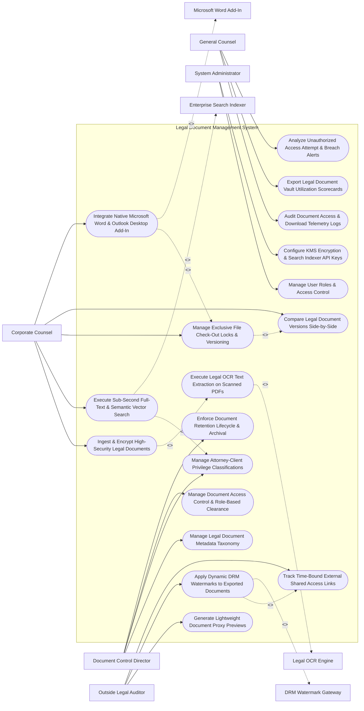

# Use Case Diagram — Legal Legal Document Management System

## Mermaid Code

## Actor Table | Bảng Actor

| # | Actor | Actor Type | Role Description | Related Use Cases |
|---|-------|------------|------------------|-------------------|
| 1 | Document Control Director | Primary | Legal information manager configuring metadata taxonomies, privilege classifications, access clearances, and retention rules. | UC01, UC06, UC07, UC13 |
| 2 | Corporate Counsel | Primary | Legal author uploading briefs, performing full-text searches, checking out files, editing in Word, and comparing revisions. | UC03, UC05, UC08, UC09, UC12 |
| 3 | Outside Legal Auditor | Primary | External auditor requesting time-bound shared links, viewing proxy previews, and receiving watermarked PDF exports. | UC04, UC10, UC11 |
| 4 | General Counsel | Primary | Executive monitoring document access audit logs, vault utilization scorecards, breach alerts, and privilege compliance. | UC14, UC15, UC18 |
| 5 | System Administrator | Primary | IT admin managing user security roles, KMS encryption keys, and search indexer API tokens. | UC16, UC17 |
| 6 | Legal OCR Engine | System (Secondary) | OCR processing service (ABBYY/Textract) converting scanned paper legal briefs into searchable PDF/A text. | UC02 |
| 7 | Enterprise Search Indexer | System (Secondary) | High-performance search engine (Elasticsearch) indexing text, metadata facets, and vector semantic embeddings. | UC05 |
| 8 | Microsoft Word Add-In | System (Secondary) | Native Word/Outlook COM add-in allowing attorneys to check in/out files directly within Microsoft Office. | UC12 |
| 9 | DRM Watermark Gateway | System (Secondary) | Security gateway stamping dynamic user IP/email watermarks on exported PDF documents. | UC10 |

## Use Case Table | Bảng Use Case

| # | UC ID | Use Case Name | Primary Actor | Secondary Actor | Description | Priority |
|---|-------|---------------|---------------|-----------------|-------------|----------|
| 1 | UC01 | Manage Legal Document Metadata Taxonomy | DocManager | None | Configures controlled legal metadata schemas (Matter ID, Practice Area, Author, Document Type, Jurisdiction). | Critical |
| 2 | UC02 | Execute Legal OCR Text Extraction on Scanned PDFs | Counsel | OCREngine | Processes scanned PDF legal filings and exhibit images using OCR to extract searchable text and HOCR layout. | Critical |
| 3 | UC03 | Ingest & Encrypt High-Security Legal Documents | Counsel | None | Uploads master legal documents into cloud vault with envelope AES-256 encryption at rest. | Critical |
| 4 | UC04 | Generate Lightweight Document Proxy Previews | Auditor | None | Automatically creates lightweight HTML5/PDF proxy preview renderings for fast in-browser document viewing. | High |
| 5 | UC05 | Execute Sub-Second Full-Text & Semantic Vector Search | Counsel | SearchIndexer | Searches millions of legal pages using Boolean full-text operators, metadata facets, and vector semantic similarity. | Critical |
| 6 | UC06 | Manage Attorney-Client Privilege Classifications | DocManager | None | Tags documents with privilege classifications (Attorney-Client Privilege, Work Product, Confidential), restricting access. | Critical |
| 7 | UC07 | Manage Document Access Control & Role-Based Clearance | DocManager | None | Configures granular role-based access permissions (RBAC) down to individual document and folder levels. | High |
| 8 | UC08 | Manage Exclusive File Check-Out Locks & Versioning | Counsel | None | Tracks document version trees (`v1.0`, `v1.1`), applies exclusive check-out file locks, and enables version rollback. | Critical |
| 9 | UC09 | Compare Legal Document Versions Side-by-Side | Counsel | None | Renders a visual diff tool highlighting text insertions, deletions, and formatting changes between document versions. | High |
| 10 | UC10 | Apply Dynamic DRM Watermarks to Exported Documents | Auditor | DRMGateway | Stamps dynamic user email, IP address, and timestamp watermarks on exported PDF files to prevent leaks. | Critical |
| 11 | UC11 | Track Time-Bound External Shared Access Links | Auditor | None | Dispatches secure, time-bound download links to external co-counsel with configurable expiration timers and view limits. | High |
| 12 | UC12 | Integrate Native Microsoft Word & Outlook Desktop Add-In | Counsel | DesktopApps | Operates a native COM/VSTO add-in inside Word and Outlook for direct file search, check-out, and version check-in. | Critical |
| 13 | UC13 | Enforce Document Retention Lifecycle & Archival | DocManager | None | Enforces statutory retention rules (e.g., Retain for 7 Years post-matter close), automating tiering to Glacier storage. | High |
| 14 | UC14 | Audit Document Access & Download Telemetry Logs | CLO | None | Maintains immutable audit logs recording every document view, edit, download, export, and deletion attempt. | Critical |
| 15 | UC15 | Export Legal Document Vault Utilization Scorecards | CLO | None | Renders executive scorecards detailing total vault storage bytes, document counts, search query velocity, and cost. | High |
| 16 | UC16 | Manage User Roles & Access Control | Admin | None | Controls user login credentials, RBAC permissions, and administrative system configuration rights. | High |
| 17 | UC17 | Configure KMS Encryption & Search Indexer API Keys | Admin | None | Manages KMS encryption key rotation, Elasticsearch cluster parameters, and OCR engine API tokens. | High |
| 18 | UC18 | Analyze Unauthorized Access Attempt & Breach Alerts | CLO | None | Dispatches urgent alert notifications when an unauthorized user attempts to open a privileged legal document. | High |

## Use Case Specification | Đặc tả Use Case

---

### UC02 — Execute Legal OCR Text Extraction on Scanned PDFs

| Field | Detail |
|-------|--------|
| **UC ID** | UC02 |
| **Use Case Name** | Execute Legal OCR Text Extraction on Scanned PDFs |
| **Actor(s)** | Primary: Corporate Counsel, Legal Document Author   Secondary: Legal Optical Character Recognition (OCR) Engine |
| **Description** | Ingests scanned image PDF court filings and paper exhibit scans, executing high-accuracy Legal OCR to extract searchable text, HOCR layout coordinates, and convert files into searchable PDF/A documents. |
| **Precondition** | 1. Scanned image PDF or exhibit TIFF file is uploaded (UC03).   2. Legal OCR engine (ABBYY FineReader / AWS Textract) is online. |
| **Main Flow** | 1. System receives scanned court filing PDF (`scanned_exhibit_motion.pdf` - 25 pages).   2. System dispatches document pages to Legal OCR Engine worker queue.   3. OCR Engine executes multi-pass image processing:   &nbsp;&nbsp;&nbsp;&nbsp; a. Deskew & De-noise: Straightens tilted scanned pages and removes background noise.   &nbsp;&nbsp;&nbsp;&nbsp; b. Optical Character Recognition: Extracts text characters, font styles, and line breaks across 25 pages.   &nbsp;&nbsp;&nbsp;&nbsp; c. HOCR Layout Extraction: Maps exact bounding box $(X, Y)$ coordinates for every word on the page.   &nbsp;&nbsp;&nbsp;&nbsp; d. Language Identification: Identifies English legal text + Latin legal phrases (`pro bo no`, `prima facie`).   4. OCR Engine generates Searchable PDF/A File (`scanned_exhibit_motion_searchable.pdf`), overlaying invisible text layer precisely over scanned image.   5. System passes extracted text stream to Enterprise Search Indexer (UC05) for real-time indexing.   6. Counsel opens document in web viewer; Counsel can now highlight, copy text, and search keywords directly inside the scanned image PDF. |
| **Alternative Flow** | **AF1** — Automated Handwriting & Stamp Recognition: OCR engine detects handwritten signatures and rubber stamp marks on legal contracts, tagging document as `"Contains Handwritten Annotations"`. |
| **Exception Flow** | **EX1** — Severely Corrupted Scan Warning: Scanned page resolution is $< 100 \text{ DPI}$ (unreadable); OCR engine flags `LOW_CONFIDENCE_OCR_WARNING` (Confidence: 35%), prompting user to re-scan page at 300 DPI. |
| **Postcondition** | Scanned PDF is converted to a searchable PDF/A file, extracted text is indexed for search, and HOCR word coordinates are mapped. |
| **Business Rule** | **BR1**: Scanned legal documents MUST undergo Legal OCR processing to generate searchable PDF/A files before indexing in the search repository. |

---

### UC05 — Execute Sub-Second Full-Text & Semantic Vector Search

| Field | Detail |
|-------|--------|
| **UC ID** | UC05 |
| **Use Case Name** | Execute Sub-Second Full-Text & Semantic Vector Search |
| **Actor(s)** | Primary: Corporate Counsel, General Counsel   Secondary: Enterprise Search & Metadata Indexer (Elasticsearch / Vector AI) |
| **Description** | Executes complex legal searches across millions of document pages in $< 1 \text{ second}$, supporting Boolean operators, metadata facet filters, Bates range queries, and vector semantic similarity. |
| **Precondition** | 1. Legal documents and metadata taxonomies are indexed in Elasticsearch/OpenSearch (UC01, UC02).   2. Attorney user holds valid security clearance for target practice area (UC07). |
| **Main Flow** | 1. Attorney opens "Enterprise Legal Search Studio".   2. Attorney inputs Complex Legal Query:   &nbsp;&nbsp;&nbsp;&nbsp; a. Search Terms: `"indemnification AND NOT 'gross negligence' AND 'data breach'"`.   &nbsp;&nbsp;&nbsp;&nbsp; b. Metadata Facets: `Practice Area: IP/Tech` | `Date Range: 2024 to 2026` | `Document Type: MSA`.   &nbsp;&nbsp;&nbsp;&nbsp; c. Privilege Filter: Exclude Attorney Work Product.   3. System dispatches search payload to Enterprise Search Indexer.   4. Search Indexer executes dual search pipeline:   &nbsp;&nbsp;&nbsp;&nbsp; a. Inverted Index Full-Text Search: Evaluates Boolean operators across text fields.   &nbsp;&nbsp;&nbsp;&nbsp; b. Vector Semantic Search: Evaluates dense vector embeddings to find conceptually similar clauses.   5. Search Indexer filters results based on User Access Control (UC07), suppressing documents where user lacks permission.   6. System compiles search response in `180 milliseconds` (Target: $< 1,000 \text{ ms}$).   7. System renders Search Results List (42 matching documents found) with highlighted keyword snippets, metadata badges, and relevance scores.   8. Attorney clicks Result #1 (`MSA_Acme_2025.pdf`); System opens dynamic preview (UC04) with search terms pre-highlighted in yellow. |
| **Alternative Flow** | **AF1** — Bates Number Range Search: Attorney searches by specific Bates numbers (`ACME-00100 TO ACME-00250`); Search indexer instantly retrieves exact document pages matching the Bates range. |
| **Exception Flow** | **EX1** — Privileged Document Search Suppression: Search query matches a highly confidential document protected by an Ethical Wall (UC06); System suppresses document from results list, maintaining secrecy. |
| **Postcondition** | Legal query evaluates across text and metadata in $< 1 \text{ second}$, access permissions are enforced, and snippet-highlighted results render. |
| **Business Rule** | **BR1**: Full-text legal search queries MUST enforce user role-based access permissions, filtering out unauthorized or privileged documents from search results. |

---

### UC08 — Manage Exclusive File Check-Out Locks & Versioning

| Field | Detail |
|-------|--------|
| **UC ID** | UC08 |
| **Use Case Name** | Manage Exclusive File Check-Out Locks & Versioning |
| **Actor(s)** | Primary: Corporate Counsel, Legal Document Author   Secondary: None |
| **Description** | Manages hierarchical legal document version trees (`v1.0`, `v1.1`, `v2.0`), applying exclusive check-out file locks to prevent editing collisions, and enabling version rollback and visual diff comparisons. |
| **Precondition** | 1. Master legal document exists in vault (UC03). |
| **Main Flow** | 1. Attorney opens legal document detail page for `Litigation_Brief_Summary.docx` (Current Version: `v1.0`).   2. Attorney clicks "Check Out Document for Edit".   3. System applies Exclusive File Lock:   &nbsp;&nbsp;&nbsp;&nbsp; a. Lock Status: `LOCKED_BY_SARAH_JENKINS`.   &nbsp;&nbsp;&nbsp;&nbsp; b. Lock Timestamp: `Oct 30, 2026 at 11:00 AM`.   &nbsp;&nbsp;&nbsp;&nbsp; c. Other users can view read-only previews but cannot edit or check out the file.   4. Attorney edits document in Microsoft Word using native desktop add-in (UC12).   5. Attorney completes edits and clicks "Check In New Version" in Word add-in.   6. System prompts for Version Classification & Notes:   &nbsp;&nbsp;&nbsp;&nbsp; a. Version Increment: `Major Version Upgrade (v2.0)` (or Minor `v1.1`).   &nbsp;&nbsp;&nbsp;&nbsp; b. Version Change Summary: *"Incorporated expert witness deposition quotes and updated legal precedent citations."*   7. System uploads modified file, creates Version Record `v2.0`, updates active production pointer to `v2.0`, and releases file lock.   8. System maintains complete historical version tree (`v1.0`, `v1.1`, `v2.0`), preserving all historical binary files.   9. System triggers UC09 (Compare Legal Document Versions Side-by-Side), displaying visual diff comparison between `v1.0` and `v2.0`. |
| **Alternative Flow** | **AF1** — Historical Version Rollback: Attorney discovers error in `v2.0`; Attorney clicks "Rollback to Version 1.0"; System sets active production pointer back to `v1.0` and logs version rollback audit entry. |
| **Exception Flow** | **EX1** — File Lock Editing Collision Error: Second attorney attempts to check out an already locked document; System displays notification "Document Locked: File is currently checked out by Sarah Jenkins (Locked 45 mins ago)". |
| **Postcondition** | Document version `v2.0` is checked in, file lock is released, version history tree updates, and visual diff comparison renders. |
| **Business Rule** | **BR1**: Checking out a legal document MUST apply an exclusive file lock, preventing concurrent editing overwrites until checked in. |

---

### UC10 — Apply Dynamic DRM Watermarks to Exported Documents

| Field | Detail |
|-------|--------|
| **UC ID** | UC10 |
| **Use Case Name** | Apply Dynamic DRM Watermarks to Exported Documents |
| **Actor(s)** | Primary: Outside Legal Auditor, Corporate Counsel   Secondary: DRM & Dynamic Watermarking Gateway |
| **Description** | Stamps dynamic user-specific security watermarks (user email, IP address, timestamp, confidentiality notice) on exported PDF files to prevent unauthorized leaks and trace source exposure. |
| **Precondition** | 1. User requests PDF document download or external share link (UC11).   2. DRM watermarking rules for document security tier are active. |
| **Main Flow** | 1. External Legal Auditor (`auditor@outsidefirm.com` - IP: `198.51.100.4`) requests download of confidential brief `Strategy_Memo_Confidential.pdf`.   2. System checks Document Security Classification: `RESTRICTED_CONFIDENTIAL` -> `WATERMARK_REQUIRED`.   3. System dispatches document export request payload to DRM Watermark Gateway.   4. DRM Gateway constructs Dynamic Overlay Watermark Text:   &nbsp;&nbsp;&nbsp;&nbsp; a. Line 1: `CONFIDENTIAL - ATTORNEY WORK PRODUCT`.   &nbsp;&nbsp;&nbsp;&nbsp; b. Line 2: `DOWNLOADED BY: auditor@outsidefirm.com`.   &nbsp;&nbsp;&nbsp;&nbsp; c. Line 3: `IP ADDRESS: 198.51.100.4 | DATE: 2026-10-30 14:30:00 EST`.   5. DRM Gateway applies diagonal semi-transparent red watermark text (30% opacity) across every page of the PDF.   6. DRM Gateway applies PDF DRM Security Restrictions:   &nbsp;&nbsp;&nbsp;&nbsp; a. Prevent Text Copy/Paste -> `ENABLED`.   &nbsp;&nbsp;&nbsp;&nbsp; b. Prevent Document Editing -> `ENABLED`.   &nbsp;&nbsp;&nbsp;&nbsp; c. Prevent Printing -> `ENABLED`.   7. System returns watermarked, DRM-protected PDF file to External Legal Auditor.   8. System logs document export telemetry event in immutable audit log (UC14). |
| **Alternative Flow** | **AF1** — Internal Clean Export Exemption: Lead Litigator with top clearance downloads document for court filing; System bypasses watermark overlay for official court e-filing submissions. |
| **Exception Flow** | **EX1** — Watermarking Engine Service Failure: DRM gateway worker is offline; System halts download, displaying "Export Delayed: Security Watermarking Engine Unavailable - Try Again Shortly". |
| **Postcondition** | Dynamic watermark text (Email, IP, Timestamp) is stamped across PDF pages, DRM copy protections are applied, and download telemetry logs. |
| **Business Rule** | **BR1**: Exported confidential legal documents MUST be stamped with dynamic user-specific watermarks to prevent unauthorized disclosure. |

---

### UC12 — Integrate Native Microsoft Word & Outlook Desktop Add-In

| Field | Detail |
|-------|--------|
| **UC ID** | UC12 |
| **Use Case Name** | Integrate Native Microsoft Word & Outlook Desktop Add-In |
| **Actor(s)** | Primary: Corporate Counsel, Legal Document Author   Secondary: Microsoft Office & Adobe Desktop Applications (Word / Outlook COM Add-In) |
| **Description** | Operates a native COM/VSTO add-in panel inside Microsoft Word and Outlook, enabling attorneys to search legal document vaults, check out files, save emails, and check in new versions directly within Office. |
| **Precondition** | 1. Enterprise Legal DAM Desktop Add-In is installed on attorney's workstation.   2. Attorney is authenticated via Single Sign-On (SSO / Azure AD). |
| **Main Flow** | 1. Attorney opens Microsoft Word 2026 on desktop workstation.   2. Attorney opens "Legal Document Manager Task Pane" inside Word (`Ribbon -> Legal DAM -> Open Task Pane`).   3. Task pane displays native search bar; Attorney types query: `"Patent Litigation Strategy Memo 2026"`.   4. Add-in calls Legal Search API (`GET /v1/documents/search`), rendering matching document results inside Word task pane.   5. Attorney selects document `Memo_v1.0.docx` and clicks "Check Out & Open in Word".   6. Add-in places exclusive file lock on document (UC08) and opens document content directly on Word canvas.   7. Attorney edits text in Word and clicks "Check In as New Version" on the add-in panel.   8. Add-in prompts for version change notes, uploads modified `.docx` binary stream to cloud vault (UC03), updates document version to `v2.0`, and releases file lock.   9. Attorney opens Microsoft Outlook, selects an email with attached exhibit, and clicks "Save Email & Attachments to Legal Matter #MAT-88412"; Add-in automatically archives email `.msg` file and attachments into legal vault. |
| **Alternative Flow** | **AF1** — Direct PDF Conversion in Word: Attorney clicks "Check In as Final PDF" in Word add-in; Add-in converts Word document to PDF/A format, signs PDF, and checks in PDF as final production copy. |
| **Exception Flow** | **EX1** — Offline Network Disconnection: Desktop workstation loses internet connection during Word edit; Add-in caches changes locally, auto-syncing checked-in version when connection restores. |
| **Postcondition** | Attorneys search, check out, edit, check in new versions, and archive emails directly within Microsoft Word and Outlook desktop applications. |
| **Business Rule** | **BR1**: The desktop Office add-in MUST support direct native file check-in/check-out and email archiving without requiring manual browser file downloads. |
