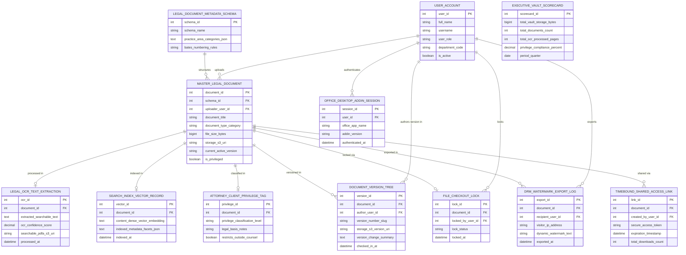

# Conceptual ERD — Legal Document Management System

## Mermaid Code

## Entity Description Table | Bảng mô tả Entity

| # | Entity Name | Vietnamese Name | Description | Key Attributes | Main Relationships |
|---|-------------|-----------------|-------------|----------------|-------------------|
| 1 | USER_ACCOUNT | Tài khoản Nguời dùng | System credentials and access roles for document control directors, corporate counsel, legal auditors, and admins. | `user_id`, `username`, `user_role`, `department_code` | Uploads `MASTER_LEGAL_DOCUMENT`, authors version in `DOCUMENT_VERSION_TREE`, locks `FILE_CHECKOUT_LOCK`, exports `DRM_WATERMARK_EXPORT_LOG`, authenticates `OFFICE_DESKTOP_ADDIN_SESSION`. |
| 2 | LEGAL_DOCUMENT_METADATA_SCHEMA | Schema Metadata Tài liệu Pháp lý | Controlled legal metadata schema definition entity storing practice area categories, document types, and Bates numbering rules. | `schema_id`, `schema_name`, `practice_area_categories_json`, `bates_numbering_rules` | Structures `MASTER_LEGAL_DOCUMENT`. |
| 3 | MASTER_LEGAL_DOCUMENT | Master Legal Document | Master legal document record tracking title, category type, file size, S3 URI, active version, and privilege status. | `document_id`, `schema_id`, `uploader_user_id`, `document_title`, `document_type_category`, `file_size_bytes`, `storage_s3_uri`, `is_privileged` | Structured by `LEGAL_DOCUMENT_METADATA_SCHEMA`, processed in `LEGAL_OCR_TEXT_EXTRACTION`, indexed in `SEARCH_INDEX_VECTOR_RECORD`, classified in `ATTORNEY_CLIENT_PRIVILEGE_TAG`, versioned in `DOCUMENT_VERSION_TREE`, locked via `FILE_CHECKOUT_LOCK`, exported in `DRM_WATERMARK_EXPORT_LOG`, shared via `TIMEBOUND_SHARED_ACCESS_LINK`. |
| 4 | LEGAL_OCR_TEXT_EXTRACTION | Kết quả OCR Text Pháp lý | Legal OCR text extraction record storing extracted searchable text, confidence score %, and searchable PDF/A S3 URIs. | `ocr_id`, `document_id`, `extracted_searchable_text`, `ocr_confidence_score`, `searchable_pdfa_s3_uri` | Belongs to `MASTER_LEGAL_DOCUMENT`. |
| 5 | SEARCH_INDEX_VECTOR_RECORD | Bản ghi Vector Search Index | Enterprise search index record storing content dense vector embeddings, indexed metadata facets JSON, and indexing timestamps. | `vector_id`, `document_id`, `content_dense_vector_embedding`, `indexed_metadata_facets_json`, `indexed_at` | Belongs to `MASTER_LEGAL_DOCUMENT`. |
| 6 | ATTORNEY_CLIENT_PRIVILEGE_TAG | Tag Privilege Luật sư Khách hàng | Attorney-client privilege classification record tracking privilege level (Work Product/Confidential), legal basis, and outside counsel restriction flags. | `privilege_id`, `document_id`, `privilege_classification_level`, `legal_basis_notes`, `restricts_outside_counsel` | Belongs to `MASTER_LEGAL_DOCUMENT`. |
| 7 | DOCUMENT_VERSION_TREE | Cây Version Tài liệu | Hierarchical document version tree record tracking version numbers (`v1.0`, `v2.0`), S3 version URIs, and version change summaries. | `version_id`, `document_id`, `author_user_id`, `version_number_slug`, `storage_s3_version_uri`, `version_change_summary` | Belongs to `MASTER_LEGAL_DOCUMENT`, authored by `USER_ACCOUNT`. |
| 8 | FILE_CHECKOUT_LOCK | Lock Check-Out File | Exclusive file check-out lock record tracking lock status (`LOCKED_BY_USER`), locking user ID, and lock timestamps. | `lock_id`, `document_id`, `locked_by_user_id`, `lock_status`, `locked_at` | Belongs to `MASTER_LEGAL_DOCUMENT`, locked by `USER_ACCOUNT`. |
| 9 | DRM_WATERMARK_EXPORT_LOG | Nhật ký Export Watermark DRM | DRM document export security log recording recipient user ID, visitor IP address, dynamic watermark text, and export timestamps. | `export_id`, `document_id`, `recipient_user_id`, `visitor_ip_address`, `dynamic_watermark_text`, `exported_at` | Belongs to `MASTER_LEGAL_DOCUMENT`, exported by `USER_ACCOUNT`. |
| 10 | TIMEBOUND_SHARED_ACCESS_LINK | Link Chia sẻ Giới hạn Thờigian | Time-bound external shared access link record storing secure tokens, expiration timestamps, and download counts. | `link_id`, `document_id`, `created_by_user_id`, `secure_access_token`, `expiration_timestamp`, `total_downloads_count` | Belongs to `MASTER_LEGAL_DOCUMENT`. |
| 11 | OFFICE_DESKTOP_ADDIN_SESSION | Session Add-In Office Desktop | Desktop Microsoft Word/Outlook COM add-in integration session tracking Office app names, add-in versions, and authentication timestamps. | `session_id`, `user_id`, `office_app_name`, `addin_version`, `authenticated_at` | Belongs to `USER_ACCOUNT`. |
| 12 | EXECUTIVE_VAULT_SCORECARD | Scorecard Executive Encrypted Vault | Executive legal document vault scorecard aggregating total storage bytes, document counts, OCR processed pages, and privilege compliance %. | `scorecard_id`, `total_vault_storage_bytes`, `total_documents_count`, `total_ocr_processed_pages`, `privilege_compliance_percent` | Standalone executive performance entity. |

## Relationship Description | Mô tả Quan hệ

| # | From Entity | Cardinality | To Entity | Label | Business Explanation |
|---|-------------|-------------|-----------|-------|----------------------|
| 1 | LEGAL_DOCUMENT_METADATA_SCHEMA | 1 to 0..N | MASTER_LEGAL_DOCUMENT | structures | A metadata schema structures master legal document records. |
| 2 | MASTER_LEGAL_DOCUMENT | 1 to 0..1 | LEGAL_OCR_TEXT_EXTRACTION | processed in | A master legal document is processed in Legal OCR text extractions. |
| 3 | MASTER_LEGAL_DOCUMENT | 1 to 0..1 | SEARCH_INDEX_VECTOR_RECORD | indexed in | A master legal document is indexed in search index vector records. |
| 4 | MASTER_LEGAL_DOCUMENT | 1 to 0..1 | ATTORNEY_CLIENT_PRIVILEGE_TAG | classified in | A master legal document is classified in privilege tags. |
| 5 | MASTER_LEGAL_DOCUMENT | 1 to 1..N | DOCUMENT_VERSION_TREE | versioned in | A master legal document is versioned in historical version records. |
| 6 | MASTER_LEGAL_DOCUMENT | 1 to 0..1 | FILE_CHECKOUT_LOCK | locked via | A master legal document is locked via an exclusive file check-out lock. |
| 7 | MASTER_LEGAL_DOCUMENT | 1 to 0..N | DRM_WATERMARK_EXPORT_LOG | exported in | A master legal document is exported in DRM watermark export logs. |
| 8 | MASTER_LEGAL_DOCUMENT | 1 to 0..N | TIMEBOUND_SHARED_ACCESS_LINK | shared via | A master legal document is shared via time-bound shared access links. |
| 9 | USER_ACCOUNT | 1 to 0..N | MASTER_LEGAL_DOCUMENT | uploads | A corporate counsel user account uploads master legal documents. |
| 10 | USER_ACCOUNT | 1 to 0..N | DOCUMENT_VERSION_TREE | authors version in | A legal document author user account creates version records. |
| 11 | USER_ACCOUNT | 1 to 0..N | FILE_CHECKOUT_LOCK | locks | A corporate counsel user account locks files during check-out. |
| 12 | USER_ACCOUNT | 1 to 0..N | DRM_WATERMARK_EXPORT_LOG | exports | An outside auditor user account exports watermarked PDF files. |
| 13 | USER_ACCOUNT | 1 to 0..N | OFFICE_DESKTOP_ADDIN_SESSION | authenticates | An attorney user account authenticates Microsoft Office desktop add-in sessions. |
