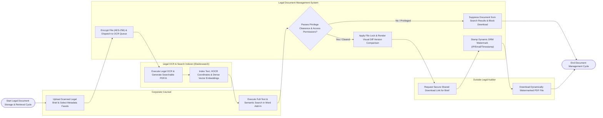

# Swimlane Diagram — Legal Document Management System

## Mermaid Code

## Flow Description | Mô tả luồng

| Lane | Actor | Role in Flow |
|------|-------|-------------|
| 1 | Corporate Counsel | Uploads scanned legal filings, selects metadata facets, executes sub-second full-text searches inside Microsoft Word add-in, checks out files, and compares version revisions. |
| 2 | Outside Legal Auditor | Requests secure time-bound shared download links, views HTML5 proxy previews, and downloads dynamically watermarked PDF files. |
| 3 | Legal Document Management System | Encrypts binary files at rest with AES-256, verifies attorney-client privilege classifications, enforces role-based access control, manages exclusive check-out file locks, stamps dynamic DRM watermarks on exports, and logs immutable audit trails. |
| 4 | Legal OCR & Search Indexer (Elasticsearch) | Converts scanned paper legal briefs into searchable PDF/A documents, extracts HOCR layout coordinates, and indexes text, metadata, and vector semantic embeddings for sub-second retrieval. |
