# Action Tree — Legal Document Management System

## Mermaid Code

```mermaid
graph TD
    Root["Legal Document Management System"]

    Root --> M1["Ingestion & AES-256 Encrypted Storage"]
    Root --> M2["Legal OCR Processing & Search Indexing"]
    Root --> M3["Sub-Second Full-Text & Vector Search"]
    Root --> M4["Version Control & Microsoft Office Add-In"]
    Root --> M5["Attorney-Client Privilege & DRM Watermarking"]
    Root --> M6["Audit Telemetry & Vault Lifecycle Scorecards"]

    M1 --> A11["Upload Master Legal Documents (PDF, DOCX, MSG, Scanned Exhibits)"]
    M1 --> A12["Encrypt Binary Files at Rest using AES-256 Envelope KMS Keys"]
    M1 --> A13["Manage Controlled Legal Metadata Taxonomies & Practice Areas"]
    M1 --> A14["Generate Lightweight HTML5/PDF Proxy Previews for Browser Viewing"]

    M2 --> A21["Execute Legal OCR Text Extraction on Scanned Court Filings (Textract)"]
    M2 --> A22["Generate Searchable PDF/A Files with Invisible Overlay Text Layers"]
    M2 --> A23["Map Exact HOCR Bounding Box Word Coordinates on Scanned Pages"]
    M2 --> A24["Index Legal Text & Metadata Facets into Elasticsearch Cluster"]

    M3 --> A31["Execute Sub-Second Full-Text Queries with Boolean Operators"]
    M3 --> A32["Execute Vector Semantic Similarity Search for Conceptual Legal Topics"]
    M3 --> A33["Filter Search Results by Bates Number Ranges & Date Intervals"]
    M3 --> A34["Pre-Highlight Keyword Matches inside Document Preview Canvas"]

    M4 --> A41["Manage Document Version Trees (v1.0, v1.1, v2.0) & Version Notes"]
    M4 --> A42["Apply Exclusive Check-Out File Locks to Prevent Editing Collisions"]
    M4 --> A43["Render Side-by-Side Visual Diff Comparisons for Legal Revisions"]
    M4 --> A44["Integrate Native COM Add-Ins inside Microsoft Word & Outlook"]

    M5 --> A51["Tag Documents with Attorney-Client Privilege & Work Product Flags"]
    M5 --> A52["Enforce Granular Role-Based Access Control (RBAC) Permissions"]
    M5 --> A53["Stamp Dynamic Security Watermarks (Email, IP, Date) on PDF Exports"]
    M5 --> A54["Issue Time-Bound External Shared Download Links with Access Expirations"]

    M6 --> A61["Maintain Immutable Audit Logs of Document Views, Edits & Exports"]
    M6 --> A62["Alert Security Teams on Unauthorized Privileged Access Attempts"]
    M6 --> A63["Enforce Document Retention Lifecycles & Archival to AWS Glacier"]
    M6 --> A64["Export Executive Legal Document Vault Storage & ROMI Scorecards"]
```

## Module Description | Mô tả Module

| # | Module | Description | Actions |
|---|--------|-------------|---------|
| 1 | Ingestion & AES-256 Encrypted Storage | Uploads legal documents, encrypts binary files at rest with AES-256 KMS keys, manages metadata taxonomies, and creates HTML5 proxy previews. | Upload Master Legal Documents, Encrypt Binary Files at Rest (AES-256), Manage Controlled Legal Metadata Taxonomies, Generate HTML5 Proxy Previews. |
| 2 | Legal OCR Processing & Search Indexing | Processes scanned filings using Legal OCR, generates searchable PDF/A files, maps HOCR word coordinates, and indexes text in Elasticsearch. | Execute Legal OCR Text Extraction, Generate Searchable PDF/A Files, Map HOCR Word Coordinates, Index Legal Text into Elasticsearch Cluster. |
| 3 | Sub-Second Full-Text & Vector Search | Executes sub-second full-text Boolean searches, runs dense vector semantic searches, filters by Bates numbers, and highlights keyword matches. | Execute Sub-Second Full-Text Queries, Execute Vector Semantic Search, Filter Results by Bates Number Ranges, Pre-Highlight Keyword Matches in Previews. |
| 4 | Version Control & Microsoft Office Add-In | Manages version trees (`v1.0`, `v2.0`), applies exclusive check-out file locks, renders visual diff comparisons, and operates native Word/Outlook add-ins. | Manage Document Version Trees, Apply Exclusive Check-Out File Locks, Render Side-by-Side Visual Diff Comparisons, Integrate Native Microsoft Word & Outlook Add-Ins. |
| 5 | Attorney-Client Privilege & DRM Watermarking | Tags documents with attorney-client privilege flags, enforces RBAC permissions, stamps dynamic DRM watermarks on exports, and dispatches shared links. | Tag Attorney-Client Privilege Flags, Enforce Granular RBAC Permissions, Stamp Dynamic Security Watermarks on PDF Exports, Issue Time-Bound Shared Download Links. |
| 6 | Audit Telemetry & Vault Lifecycle Scorecards | Logs immutable audit trails of document access, alerts on unauthorized breach attempts, enforces retention archival to Glacier, and exports scorecards. | Maintain Immutable Document Audit Logs, Alert Security on Unauthorized Access Attempts, Enforce Document Retention Archival to Glacier, Export Executive Legal Vault Scorecards. |
