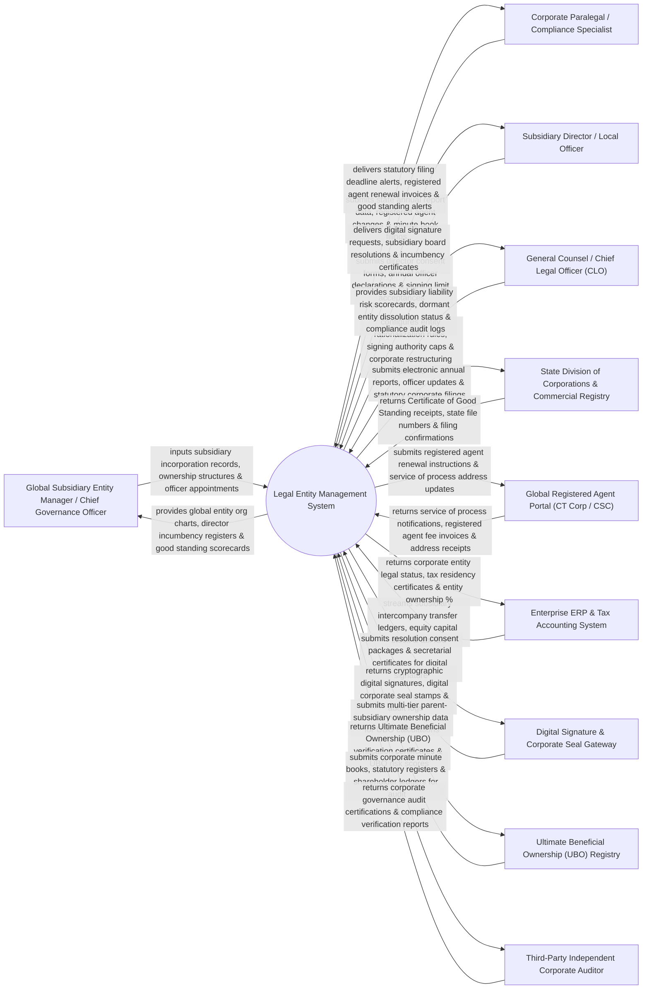

# Context Diagram — Legal Entity Management System

## Mermaid Code

## Actor & Interaction Table | Bảng Actor & Tương tác

| # | Actor | Actor Type | Data Sent TO System | Data Received FROM System | Notes |
|---|-------|------------|---------------------|---------------------------|-------|
| 1 | Global Subsidiary Entity Manager / Chief Governance Officer | Primary | Subsidiary incorporation records, ownership structures, officer appointments, charter documents. | Global entity org charts, director incumbency registers, good standing scorecards, corporate health metrics. | Senior legal operations manager maintaining global legal entity master records and corporate org trees. |
| 2 | Corporate Paralegal / Compliance Specialist | Primary | State annual report data, registered agent changes, minute book filings, franchise tax details. | Statutory filing deadline alerts, registered agent renewal invoices, Certificate of Good Standing receipts. | Paralegal managing day-to-day statutory filings, state registered agents, and annual report renewals. |
| 3 | Subsidiary Director / Local Officer | Primary | Director consent forms, annual officer declarations, signing limit acceptances, conflict disclosures. | Digital signature requests, subsidiary board resolutions, incumbency certificates, officer appointment logs. | Director or local officer accepting corporate appointments and signing annual governance consents. |
| 4 | CLO | Primary | Entity rationalization rules, signing authority caps, corporate restructuring policies, risk limits. | Subsidiary liability risk scorecards, dormant entity dissolution status, compliance audit logs, entity ROI. | Executive overseeing global corporate entity risk, subsidiary rationalization, and corporate governance. |
| 5 | State Division of Corporations & Commercial Registry | Supporting | Certificate of Good Standing receipts, state file numbers (Delaware SOS File #), filing confirmations. | Electronic annual reports, officer/director updates, registered agent changes, franchise tax payments. | State and national commercial registries (Delaware SOS, UK Companies House, KVK) receiving corporate filings. |
| 6 | Global Registered Agent Portal | Supporting | Service of process notifications, registered agent fee invoices, registered address receipts. | Registered agent renewal instructions, service of process forwarding rules, office address updates. | External registered agent platform (CT Corporation / CSC) maintaining statutory office addresses across jurisdictions. |
| 7 | Enterprise ERP & Tax Accounting System | Supporting | Subsidiary intercompany transfer ledgers, equity capital stock ledgers, tax identification numbers (EIN/VAT). | Corporate entity legal status, tax residency certificates, parent-subsidiary equity ownership percentages. | Enterprise accounting system (SAP / Oracle ERP) synchronizing subsidiary tax IDs and capital stock ledgers. |
| 8 | Digital Signature & Corporate Seal Gateway | Supporting | Cryptographic digital signatures, digital corporate seal stamps, signature verification audit logs. | Resolution consent packages, secretarial certificates, officer appointment documents for signature. | E-signature platform (DocuSign / Adobe Sign API) capturing legally binding signatures and applying digital corporate seals. |
| 9 | Ultimate Beneficial Ownership (UBO) Registry | Supporting | Ultimate Beneficial Ownership (UBO) verification certificates, UBO risk scores, transparency logs. | Multi-tier parent-subsidiary ownership data, direct shareholder lists, UBO calculation queries. | Regulatory registry calculating and verifying Ultimate Beneficial Owners (UBO) down to 10% or 25% thresholds. |
| 10 | Third-Party Independent Corporate Auditor | Supporting / Regulatory | Corporate governance audit certifications, compliance verification reports, audit opinion letters. | Corporate minute books, statutory registers, shareholder ledgers, director incumbency records. | Independent audit firm auditing corporate legal entity compliance, statutory registers, and minute books. |

## System Boundary Description | Mô tả Phạm vi Hệ thống

The **Legal Entity Management System** is an enterprise subsidiary entity management, corporate org chart visualization, Ultimate Beneficial Ownership (UBO) calculation, state annual report filing, and director incumbency platform.

**Inside System Scope:**
- Centralized global legal entity repository tracking parent-subsidiary equity ownership, jurisdiction, and status (`ACTIVE/DISSOLVED`).
- Automated multi-tiered org chart generator rendering interactive corporate ownership hierarchy trees.
- Integration with Delaware SOS and UK Companies House APIs for electronic annual report and statutory filings.
- Ultimate Beneficial Ownership (UBO) calculation engine computing natural person ownership down to 10%/25% thresholds.
- Director & Officer (D&O) incumbency tracking, issuing certified Incumbency Statements and Secretarial Certificates.

**Outside System Scope:**
- Direct physical hosting of annual general meetings in physical venues (handled by Event Operations).
- Direct physical custody of metal corporate seals and paper stock certificate books (handled by Vault Custodians).
- Direct physical court litigation of corporate veil-piercing lawsuits (handled by Litigation Counsel).
