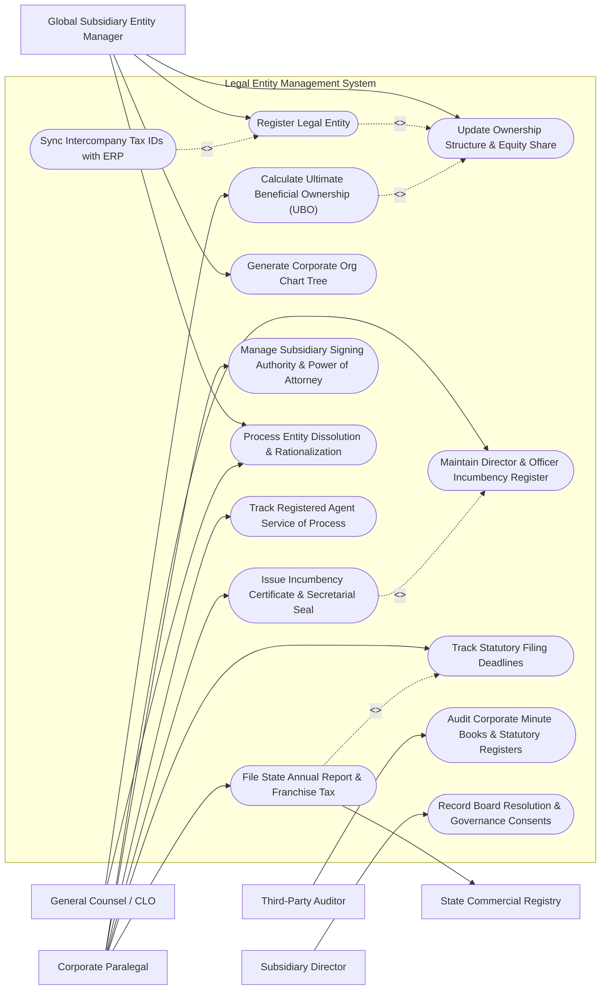

# Use Case Diagram — Legal Entity Management System

## Mermaid Code

## Actor Table | Bảng Actor

| # | Actor | Actor Type | Role Description | Related Use Cases |
|---|-------|------------|------------------|-------------------|
| 1 | Global Subsidiary Entity Manager | Primary | Manages global legal entity registrations, corporate ownership hierarchies, and subsidiary lifecycle. | UC01, UC02, UC07, UC10 |
| 2 | Corporate Paralegal | Primary | Maintains director incumbency registers, monitors statutory deadlines, files annual state reports, and tracks registered agent notices. | UC03, UC04, UC05, UC08, UC09, UC14 |
| 3 | Subsidiary Director | Primary | Signatory and officer approving board resolutions, annual consents, and signing authority delegations. | UC13 |
| 4 | General Counsel / CLO | Primary | Oversees corporate legal entity risk, entity rationalization, UBO regulatory compliance, and governance policies. | UC06, UC10 |
| 5 | State Commercial Registry | Secondary / System | State/national corporate filing portal receiving statutory annual reports and issuing certificates of good standing. | UC05 |
| 6 | Third-Party Auditor | Secondary | Audits statutory registers, minute books, shareholder ledgers, and governance compliance records. | UC11 |

## Use Case Table | Bảng Use Case

| # | UC ID | Use Case Name | Primary Actor | Secondary Actor | Description | Priority |
|---|-------|---------------|---------------|-----------------|-------------|----------|
| 1 | UC01 | Register Legal Entity | Global Entity Manager | ERP System | Registers a new subsidiary or joint venture entity including jurisdiction, charter, and EIN/tax ID. | High |
| 2 | UC02 | Update Ownership Structure & Equity Share | Global Entity Manager | None | Updates parent-subsidiary equity percentages, capital stock issuances, and voting rights. | High |
| 3 | UC03 | Maintain Director & Officer Incumbency Register | Corporate Paralegal | Subsidiary Director | Tracks active appointment dates, resignations, signing limits, and officer titles for subsidiaries. | High |
| 4 | UC04 | Track Statutory Filing Deadlines | Corporate Paralegal | None | Monitors automated calendar alerts for state annual reports, franchise tax due dates, and renewal filings. | High |
| 5 | UC05 | File State Annual Report & Franchise Tax | Corporate Paralegal | State Commercial Registry | Submits electronic annual report filings and tax payments directly to state filing portals. | High |
| 6 | UC06 | Calculate Ultimate Beneficial Ownership (UBO) | General Counsel / CLO | UBO Registry | Computes multi-tiered parent ownership percentages to identify natural person UBOs above regulatory thresholds. | High |
| 7 | UC07 | Generate Corporate Org Chart Tree | Global Entity Manager | None | Dynamically renders interactive vector organization charts illustrating legal entity ownership structures. | Medium |
| 8 | UC08 | Issue Incumbency Certificate & Secretarial Seal | Corporate Paralegal | Digital Seal Gateway | Generates certified Incumbency Statements bearing cryptographic digital corporate seals for banking/vendor setup. | High |
| 9 | UC09 | Manage Subsidiary Signing Authority & Power of Attorney | Corporate Paralegal | Subsidiary Director | Registers delegated signing thresholds, financial transaction caps, and Power of Attorney (POA) grants. | Medium |
| 10 | UC10 | Process Entity Dissolution & Rationalization | General Counsel / CLO | State Commercial Registry | Executes formal corporate entity unwinding, statutory merger, or voluntary dissolution workflows. | Medium |
| 11 | UC11 | Audit Corporate Minute Books & Statutory Registers | Third-Party Auditor | Corporate Paralegal | Provides read-only secure audit vault for external auditors inspecting statutory minute books and shareholder ledgers. | Low |
| 12 | UC12 | Sync Intercompany Tax IDs with ERP | Global Entity Manager | ERP Tax System | Synchronizes legal entity IDs, tax numbers, and statutory addresses with enterprise financial ERP. | Medium |
| 13 | UC13 | Record Board Resolution & Governance Consents | Subsidiary Director | Corporate Paralegal | Captures digital signature approvals for annual director consents and written board resolutions. | High |
| 14 | UC14 | Track Registered Agent Service of Process | Corporate Paralegal | Registered Agent Portal | Receives and routes statutory Service of Process (SOP) legal notices delivered to state registered agent offices. | High |

## Use Case Specification | Đặc tả Use Case

---

### UC01 — Register Legal Entity

| Field | Detail |
|-------|--------|
| **UC ID** | UC01 |
| **Use Case Name** | Register Legal Entity |
| **Actor(s)** | Primary: Global Subsidiary Entity Manager   Secondary: ERP System |
| **Description** | Allows the Entity Manager to create a new corporate entity record, record incorporation date, legal form (LLC, Corp, C-Corp), jurisdiction of formation, registered address, and capital structure. |
| **Precondition** | 1. Entity Manager is authenticated with Legal Entity Administrator credentials.   2. Articles of Incorporation/Charter documents are available in electronic format. |
| **Main Flow** | 1. Entity Manager selects "Create New Legal Entity".   2. System prompts for basic corporate information (Legal Name, Formation Jurisdiction, Entity Type, Incorporation Date).   3. Entity Manager inputs initial share capital stock, tax identification number (EIN/VAT), and registered agent details.   4. System validates entity name uniqueness and checks tax ID syntax.   5. Entity Manager uploads scanned charter and registration certificates.   6. System saves entity master record, assigns unique Legal Entity Identifier (LEI), and updates global legal org chart. |
| **Alternative Flow** | **AF1** — Foreign Subsidiary Branch: If entity is registered as a foreign branch rather than a subsidiary, system enables branch registration fields without equity capital shares.   **AF2** — ERP Auto-Sync: If ERP integration is active, system automatically pushes new Legal Entity ID and Tax ID to ERP Master Data repository. |
| **Exception Flow** | **EX1** — Duplicate Entity ID: If tax ID or state file number matches an existing registered entity, system blocks creation and prompts for duplicate review.   **EX2** — Invalid Jurisdiction Code: System rejects missing statutory state/country code and highlights required regulatory jurisdiction fields. |
| **Postcondition** | Entity record is stored in ACTIVE status and accessible in global corporate registry. |
| **Business Rule** | **BR1**: Every registered entity must have at least one designated jurisdiction of incorporation and a valid tax identification number within 30 days of registration. |

---

### UC05 — File State Annual Report & Franchise Tax

| Field | Detail |
|-------|--------|
| **UC ID** | UC05 |
| **Use Case Name** | File State Annual Report & Franchise Tax |
| **Actor(s)** | Primary: Corporate Paralegal   Secondary: State Commercial Registry |
| **Description** | Executes electronic submission of annual corporate compliance filings and statutory franchise tax payments to state commercial registries. |
| **Precondition** | 1. Annual report deadline is pending within the statutory window.   2. Current officer/director incumbency records are verified. |
| **Main Flow** | 1. Corporate Paralegal opens statutory compliance queue and selects pending state annual report.   2. System retrieves entity officer lists, registered agent details, and franchise tax calculation rules.   3. Paralegal reviews filing data and verifies principal place of business address.   4. Paralegal clicks "Submit State Filing".   5. System sends API payload to State Commercial Registry (e.g., Delaware SOS).   6. State Commercial Registry validates submission and issues electronic receipt with filing timestamp and state confirmation code.   7. System updates entity Good Standing status and sets next annual filing deadline. |
| **Alternative Flow** | **AF1** — Manual Filing Upload: If state registry lacks API integration, paralegal downloads filled state PDF form, submits via state portal manually, and uploads filing receipt into System. |
| **Exception Flow** | **EX1** — Registry API Connection Failure: System logs transmission error, retries twice, and alerts Paralegal if submission remains unconfirmed.   **EX2** — Tax Payment Rejection: If payment authorization fails, system flags filing status as "Filing Pending - Payment Error". |
| **Postcondition** | Filing receipt is archived in entity minute book and compliance status is updated to "Compliant / Good Standing". |
| **Business Rule** | **BR1**: Annual filings must be completed prior to state deadline to prevent entity penalty fees or loss of Good Standing status. |

---

### UC06 — Calculate Ultimate Beneficial Ownership (UBO)

| Field | Detail |
|-------|--------|
| **UC ID** | UC06 |
| **Use Case Name** | Calculate Ultimate Beneficial Ownership (UBO) |
| **Actor(s)** | Primary: General Counsel / CLO   Secondary: UBO Registry |
| **Description** | Automatically calculates multi-tiered equity ownership percentage trees down to ultimate natural person owners to satisfy anti-money laundering (AML) and FinCEN Corporate Transparency Act regulations. |
| **Precondition** | 1. Parent-subsidiary equity ownership relationships are populated in the system.   2. Regulatory UBO threshold rule (e.g., >= 25% or >= 10%) is defined. |
| **Main Flow** | 1. General Counsel selects target legal entity for UBO calculation.   2. System traverses multi-tiered ownership graph, multiplying share percentage down each corporate tier.   3. System identifies ultimate parent entities and natural person beneficial owners exceeding threshold.   4. System generates UBO Ownership Tree and list of qualified ultimate beneficial owners.   5. General Counsel reviews calculated UBO results and clicks "Approve UBO Certification".   6. System generates UBO Compliance Report for regulatory reporting. |
| **Alternative Flow** | **AF1** — Publicly Traded Parent Exception: If parent entity is a publicly traded company on a recognized exchange, system marks UBO calculation as "Exempt - Publicly Traded Enterprise". |
| **Exception Flow** | **EX1** — Circular Ownership Loop: If circular equity ownership between subsidiaries is detected, system halts recursive calculation, flags error, and alerts legal counsel. |
| **Postcondition** | Approved UBO summary record is stored and timestamped for regulatory inspection. |
| **Business Rule** | **BR1**: Any individual holding 25% or more direct or indirect voting interest must be disclosed in the regulatory UBO declaration. |

---

### UC07 — Generate Corporate Org Chart Tree

| Field | Detail |
|-------|--------|
| **UC ID** | UC07 |
| **Use Case Name** | Generate Corporate Org Chart Tree |
| **Actor(s)** | Primary: Global Subsidiary Entity Manager   Secondary: None |
| **Description** | Generates interactive, vector-graphic corporate organization trees depicting parent-subsidiary ownership hierarchies, ownership percentages, and entity jurisdictions. |
| **Precondition** | 1. Legal entities and ownership shares are defined in the repository. |
| **Main Flow** | 1. Entity Manager navigates to Org Chart Module.   2. Entity Manager selects root parent corporation and chooses display parameters (e.g., Effective Date, Ownership % threshold, Jurisdiction filtering).   3. System renders interactive hierarchy tree diagram displaying entity boxes, relationship lines, and ownership percentages.   4. Entity Manager expands/collapses branches or clicks individual entity nodes for details.   5. Entity Manager exports org chart in PDF/SVG format for board deck presentation. |
| **Alternative Flow** | **AF1** — Historical Date Org Chart: Entity Manager selects a past date, and system reconstructs the legal org chart as of that specific historical date. |
| **Exception Flow** | **EX1** — Unattached Floating Entity: If an entity lacks a designated parent, system displays it under an "Unassigned / Standalone Entities" section. |
| **Postcondition** | Vector org chart is rendered or exported with high-resolution layout. |
| **Business Rule** | **BR1**: Org charts must accurately reflect effective legal ownership percentages as registered in stock transfer ledgers. |

---

### UC08 — Issue Incumbency Certificate & Secretarial Seal

| Field | Detail |
|-------|--------|
| **UC ID** | UC08 |
| **Use Case Name** | Issue Incumbency Certificate & Secretarial Seal |
| **Actor(s)** | Primary: Corporate Paralegal   Secondary: Digital Seal Gateway |
| **Description** | Generates an official Certificate of Incumbency listing current directors and officers, applies digital corporate seal stamp, and routes for Corporate Secretary signature. |
| **Precondition** | 1. Entity director and officer incumbency register is current.   2. Digital corporate seal image and signing certificate are configured. |
| **Main Flow** | 1. Corporate Paralegal selects target entity and requests "Generate Certificate of Incumbency".   2. System retrieves active directors, officers, titles, and appointment dates.   3. System generates draft Incumbency Statement document with standard legal preamble.   4. Paralegal reviews officer list and clicks "Apply Digital Corporate Seal & Send for Signature".   5. System calls Digital Seal Gateway to stamp digital corporate seal onto PDF.   6. System routes document to Corporate Secretary for e-signature.   7. Upon signature, system archives certified Incumbency Statement in document repository. |
| **Alternative Flow** | **AF1** — Bank-Specific Incumbency Format: Paralegal selects custom bank resolution template required by commercial lender before sealing. |
| **Exception Flow** | **EX1** — Expired Director Term: System detects an officer whose term has expired and warns Paralegal to renew appointment before issuing incumbency. |
| **Postcondition** | Fully executed Certificate of Incumbency with digital seal is generated and logged in statutory register. |
| **Business Rule** | **BR1**: Incumbency certificates must only include directors and officers with active, unexpired appointments on file. |
