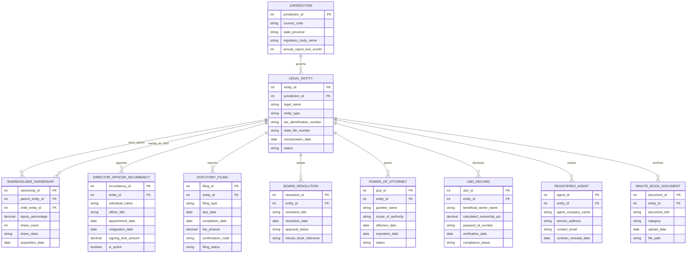

# Conceptual ERD — Legal Entity Management System

## Mermaid Code

## Entity Description Table | Bảng mô tả Entity

| # | Entity Name | Vietnamese Name | Description | Key Attributes | Main Relationships |
|---|-------------|-----------------|-------------|----------------|-------------------|
| 1 | JURISDICTION | Thẩm quyền Pháp lý | Stores country and state governance details, statutory bodies, and annual filing calendar rules. | jurisdiction_id, country_code, state_province | Governs many LEGAL_ENTITY. |
| 2 | LEGAL_ENTITY | Pháp nhân Doanh nghiệp | Master table for corporate legal entities, subsidiaries, joint ventures, and branches. | entity_id, legal_name, entity_type, tax_identification_number, status | Governed by JURISDICTION, owns SHAREHOLDER_OWNERSHIP. |
| 3 | SHAREHOLDER_OWNERSHIP | Sở hữu Cổ phần / Vốn góp | Tracks multi-tiered parent-subsidiary equity ownership percentages, share counts, and stock classes. | ownership_id, parent_entity_id, child_entity_id, equity_percentage | Belongs to parent LEGAL_ENTITY and child LEGAL_ENTITY. |
| 4 | DIRECTOR_OFFICER_INCUMBENCY | Ban Giám đốc & Cán bộ | Records corporate director and officer appointments, titles, signing authority caps, and incumbency periods. | incumbency_id, individual_name, officer_title, signing_limit_amount, is_active | Belongs to LEGAL_ENTITY. |
| 5 | STATUTORY_FILING | Hồ sơ Tuân thủ Định kỳ | Tracks state annual report filings, franchise tax payments, due dates, and state filing confirmation codes. | filing_id, filing_type, due_date, filing_status | Belongs to LEGAL_ENTITY. |
| 6 | BOARD_RESOLUTION | Nghị quyết Hội đồng Quản trị | Stores corporate board resolutions, written consents, meeting minutes references, and approval statuses. | resolution_id, resolution_title, resolution_date, approval_status | Belongs to LEGAL_ENTITY. |
| 7 | POWER_OF_ATTORNEY | Giấy Ủy quyền (POA) | Manages legal power of attorney grants, delegated signing authority, expiration dates, and restrictions. | poa_id, grantee_name, scope_of_authority, expiration_date | Belongs to LEGAL_ENTITY. |
| 8 | UBO_RECORD | Hồ sơ Chủ sở hữu Hưởng lợi | Stores calculated Ultimate Beneficial Ownership data for natural person owners to satisfy AML regulations. | ubo_id, beneficial_owner_name, calculated_ownership_pct, compliance_status | Belongs to LEGAL_ENTITY. |
| 9 | REGISTERED_AGENT | Đại diện Pháp lý Đăng ký | Tracks external registered agent companies, statutory office service addresses, and service of process routing. | agent_id, agent_company_name, service_address, contract_renewal_date | Belongs to LEGAL_ENTITY. |
| 10 | MINUTE_BOOK_DOCUMENT | Sổ Biên bản & Tài liệu | Digital archive for statutory minute book files, articles of incorporation, bylaws, and secretarial certificates. | document_id, document_title, category, file_path | Belongs to LEGAL_ENTITY. |

## Relationship Description | Mô tả Quan hệ

| # | From Entity | Cardinality | To Entity | Relationship Label | Business Explanation |
|---|-------------|-------------|-----------|-------------------|----------------------|
| 1 | JURISDICTION | one-to-many | LEGAL_ENTITY | governs | One jurisdiction governs multiple registered legal entities. |
| 2 | LEGAL_ENTITY | one-to-many | SHAREHOLDER_OWNERSHIP | owns_parent | A parent entity can hold equity stakes in multiple child subsidiaries. |
| 3 | LEGAL_ENTITY | one-to-many | SHAREHOLDER_OWNERSHIP | owned_as_child | A child entity can have equity owned by one or more parent shareholders. |
| 4 | LEGAL_ENTITY | one-to-many | DIRECTOR_OFFICER_INCUMBENCY | appoints | An entity appoints multiple directors and officers over time. |
| 5 | LEGAL_ENTITY | one-to-many | STATUTORY_FILING | requires | An entity must complete multiple recurring statutory filings. |
| 6 | LEGAL_ENTITY | one-to-many | BOARD_RESOLUTION | adopts | An entity adopts multiple board resolutions and written consents. |
| 7 | LEGAL_ENTITY | one-to-many | POWER_OF_ATTORNEY | grants | An entity grants power of attorney to officers or designated representatives. |
| 8 | LEGAL_ENTITY | one-to-many | UBO_RECORD | discloses | An entity discloses one or more ultimate beneficial owners. |
| 9 | LEGAL_ENTITY | one-to-many | REGISTERED_AGENT | retains | An entity retains a registered agent in each jurisdiction of operation. |
| 10 | LEGAL_ENTITY | one-to-many | MINUTE_BOOK_DOCUMENT | archives | An entity archives corporate charter documents and minute book records. |
