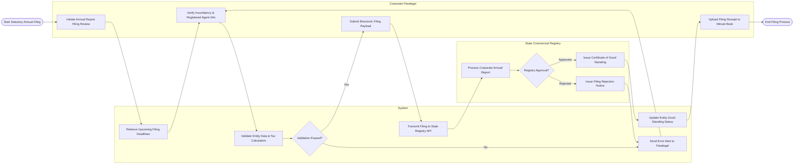

# Swimlane Diagram — Legal Entity Management System

## Mermaid Code

## Flow Description | Mô tả luồng

| Lane | Actor | Role in Flow |
|------|-------|-------------|
| 1 | Corporate Paralegal | Reviews upcoming state filing tasks, verifies active officer lists and registered agent addresses, triggers electronic filing transmission, and archives confirmation receipts. |
| 2 | System | Automates deadline tracking, computes statutory franchise tax fees, validates data integrity, handles API payloads to state portals, and updates internal legal entity health status. |
| 3 | State Commercial Registry | State authority platform that processes incoming corporate annual reports, validates fees, issues Certificate of Good Standing, or rejects invalid filings. |
