# Action Tree — Legal Entity Management System

## Mermaid Code

```mermaid
graph TD
    Root["Legal Entity Management System"]

    Root --> M1["Entity Master Registry"]
    Root --> M2["Org Chart & UBO Engine"]
    Root --> M3["Statutory Filing & Compliance"]
    Root --> M4["Governance & Incumbency"]
    Root --> M5["Document & Minute Book Repository"]

    M1 --> A1["Register New Legal Entity"]
    M1 --> A2["Edit Entity Charter Details"]
    M1 --> A3["Manage Registered Agent Info"]
    M1 --> A4["Track Entity Dissolution Status"]

    M2 --> B1["Generate Vector Org Chart"]
    M2 --> B2["Update Parent-Child Ownership %"]
    M2 --> B3["Calculate UBO Percentages"]
    M2 --> B4["Export Ownership Hierarchy PDF"]

    M3 --> C1["View Filing Calendar Deadlines"]
    M3 --> C2["Submit Electronic State Filing"]
    M3 --> C3["Record Franchise Tax Payment"]
    M3 --> C4["Fetch Certificate of Good Standing"]

    M4 --> D1["Appoint Director / Officer"]
    M4 --> D2["Record Board Resolution"]
    M4 --> D3["Manage Signing Authority Caps"]
    M4 --> D4["Issue Incumbency Certificate"]

    M5 --> E1["Upload Statutory Minute Book"]
    M5 --> E2["Apply Digital Corporate Seal"]
    M5 --> E3["Grant External Auditor Access"]
    M5 --> E4["Archive Power of Attorney Grants"]
```

## Module Description | Mô tả Module

| # | Module | Description | Actions |
|---|--------|-------------|---------|
| 1 | Entity Master Registry | Centralized global repository managing legal entity charters, state file numbers, tax IDs, and operational status. | Register New Legal Entity, Edit Entity Charter Details, Manage Registered Agent Info, Track Entity Dissolution Status |
| 2 | Org Chart & UBO Engine | Graphical hierarchy visualizer and regulatory Ultimate Beneficial Ownership (UBO) recursive calculation engine. | Generate Vector Org Chart, Update Parent-Child Ownership %, Calculate UBO Percentages, Export Ownership Hierarchy PDF |
| 3 | Statutory Filing & Compliance | Automated compliance calendar, state filing portal integration, and franchise tax tracking system. | View Filing Calendar Deadlines, Submit Electronic State Filing, Record Franchise Tax Payment, Fetch Certificate of Good Standing |
| 4 | Governance & Incumbency | Director and officer appointment register, signing authority cap controller, and board resolution tracking. | Appoint Director / Officer, Record Board Resolution, Manage Signing Authority Caps, Issue Incumbency Certificate |
| 5 | Document & Minute Book Repository | Cryptographically sealed digital vault for corporate minute books, articles of incorporation, and power of attorney grants. | Upload Statutory Minute Book, Apply Digital Corporate Seal, Grant External Auditor Access, Archive Power of Attorney Grants |
