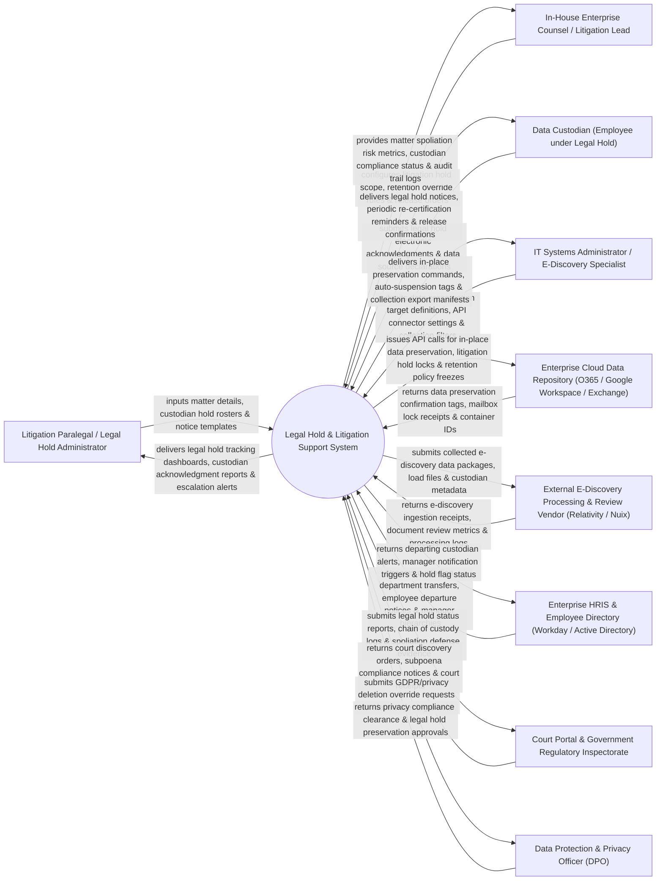

# Context Diagram — Legal Hold & Litigation Support System

## Mermaid Code

## Actor & Interaction Table | Bảng Actor & Tương tác

| # | Actor | Actor Type | Data Sent TO System | Data Received FROM System | Notes |
|---|-------|------------|---------------------|---------------------------|-------|
| 1 | Litigation Paralegal / Legal Hold Administrator | Primary | Matter details, custodian hold rosters, notice templates, escalation rules. | Legal hold tracking dashboards, custodian acknowledgment reports, escalation alerts. | Paralegal managing day-to-day legal hold notice distribution, custodian reminders, and tracking. |
| 2 | In-House Enterprise Counsel / Litigation Lead | Primary | Litigation hold scope, retention override rules, legal matter scope, release orders. | Matter spoliation risk metrics, custodian compliance status, audit trail logs, court reports. | Senior corporate attorney overseeing litigation matters, discovery scope, and spoliation risk. |
| 3 | Data Custodian (Employee under Legal Hold) | Primary | Electronic legal hold acknowledgments, data source declarations, departing employee surveys. | Legal hold notices, periodic re-certification reminders, hold release confirmations. | Employee possessing relevant electronic documents, emails, or files subject to legal hold. |
| 4 | IT Systems Administrator / E-Discovery Specialist | Primary | Data preservation target definitions, API connector settings, collection query filters. | In-place preservation commands, auto-suspension tags, collection export manifests. | IT engineer executing electronic data preservation rules across cloud repositories and email servers. |
| 5 | Enterprise Cloud Data Repository | Supporting | Data preservation confirmation tags, mailbox lock receipts, container IDs, file count logs. | API calls for in-place data preservation, litigation hold locks, retention policy freezes. | Enterprise cloud infrastructure (Office 365, Google Workspace, SharePoint) holding electronic evidence. |
| 6 | External E-Discovery Processing & Review Vendor | Supporting | E-discovery ingestion receipts, document review metrics, processing logs, bates-stamped files. | Collected e-discovery data packages, raw data load files, custodian metadata manifests. | External vendor (Relativity, Nuix) ingesting collected data for legal document review and production. |
| 7 | Enterprise HRIS & Employee Directory | Supporting | Custodian department transfers, employee departure notices, manager hierarchies, status. | Departing custodian alerts, manager notification triggers, active legal hold flags. | Core HR database (Workday / Active Directory) providing employee lifecycle updates to prevent data loss upon departure. |
| 8 | Court Portal & Government Regulatory Inspectorate | Supporting / Regulatory | Court discovery orders, subpoena compliance notices, judicial receipts, court filing orders. | Legal hold status reports, chain of custody logs, spoliation defense evidence, production compliance. | Federal/state court or regulatory body enforcing electronic discovery (EDRM) rules and subpoenas. |
| 9 | Data Protection & Privacy Officer (DPO) | Supporting / Regulatory | Privacy compliance clearance, legal hold preservation approvals, deletion override tokens. | GDPR/privacy deletion override requests for data under active legal hold. | Privacy officer ensuring legal hold data preservation overrides automated GDPR right-to-be-forgotten deletion. |

## System Boundary Description | Mô tả Phạm vi Hệ thống

The **Legal Hold & Litigation Support System** is an enterprise legal hold notification, custodian tracking, automated in-place electronic data preservation, retention policy auto-suspension, and e-discovery collection export platform.

**Inside System Scope:**
- Automated issuance and tracking of legal hold notices to relevant employee custodians.
- Real-time tracking of electronic custodian acknowledgments, reminder escalations, and re-certifications.
- Integration with Office 365 and Google Workspace APIs to execute in-place preservation and suspend auto-deletion rules.
- HRIS integration alerting legal teams when a custodian under active legal hold submits a resignation or departure notice.
- Generation of court-admissible audit trails, chain of custody logs, and defensible e-discovery export manifests.

**Outside System Scope:**
- Detailed document review coding, relevance tagging, and privilege redacting (handled by External E-Discovery Vendor).
- Direct physical hosting of corporate email servers (handled by Enterprise IT Cloud Infrastructure).
- Direct representation during court pre-trial conferences (handled by Litigation Counsel).
