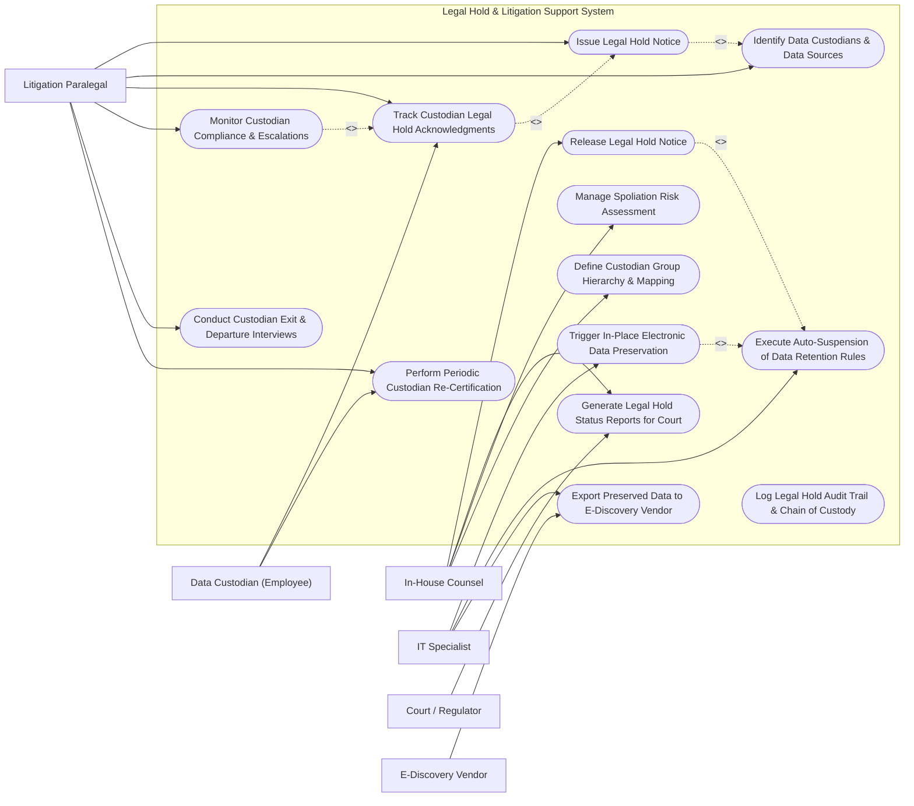

# Use Case Diagram — Legal Hold & Litigation Support System

## Mermaid Code

## Actor Table | Bảng Actor

| # | Actor | Actor Type | Role Description | Related Use Cases |
|---|-------|------------|------------------|-------------------|
| 1 | Litigation Paralegal | Primary | Creates legal hold notices, identifies custodians, tracks electronic acknowledgments, and conducts departure surveys. | UC01, UC02, UC03, UC06, UC08, UC14 |
| 2 | In-House Counsel | Primary | Defines litigation hold scope, releases legal holds, reviews spoliation risks, and signs court status reports. | UC07, UC11, UC12, UC13 |
| 3 | Data Custodian (Employee) | Primary | Employee subject to legal hold who receives notice, acknowledges hold duties, and periodically re-certifies compliance. | UC03, UC14 |
| 4 | IT Specialist | Primary | Executes technical in-place preservation, configures retention policy auto-suspension, and exports e-discovery packages. | UC04, UC05, UC10 |
| 5 | Court / Regulator | Supporting / Regulatory | Judicial body issuing discovery orders and reviewing legal hold compliance and chain of custody logs. | UC11 |
| 6 | E-Discovery Vendor | Secondary | Third-party vendor ingesting exported e-discovery data packages for legal document review and production. | UC10 |

## Use Case Table | Bảng Use Case

| # | UC ID | Use Case Name | Primary Actor | Secondary Actor | Description | Priority |
|---|-------|---------------|---------------|-----------------|-------------|----------|
| 1 | UC01 | Issue Legal Hold Notice | Litigation Paralegal | Custodian | Drafts and broadcasts formal legal hold notice requiring custodians to preserve relevant documents. | High |
| 2 | UC02 | Identify Data Custodians & Data Sources | Litigation Paralegal | HRIS System | Maps key custodians, department teams, email accounts, cloud drives, and devices subject to preservation. | High |
| 3 | UC03 | Track Custodian Legal Hold Acknowledgments | Custodian | Litigation Paralegal | Captures cryptographic digital signatures or click-through acknowledgments confirming receipt of hold notice. | High |
| 4 | UC04 | Trigger In-Place Electronic Data Preservation | IT Specialist | Cloud Data Repository | Issues automated API commands to Office 365 / Google Workspace to apply litigation holds on target mailboxes. | High |
| 5 | UC05 | Execute Auto-Suspension of Data Retention Rules | IT Specialist | Cloud Data Repository | Suspends automated purge/deletion schedules on target custodian data repositories to prevent spoliation. | High |
| 6 | UC06 | Monitor Custodian Compliance & Escalations | Litigation Paralegal | Custodian Manager | Monitors unacknowledged holds and automatically sends escalation reminders to non-responsive custodians and managers. | High |
| 7 | UC07 | Release Legal Hold Notice | In-House Counsel | IT Specialist | Formally lifts legal hold upon matter resolution and restores standard automated data retention/purge schedules. | High |
| 8 | UC08 | Conduct Custodian Exit & Departure Interviews | Litigation Paralegal | HRIS System | Triggers instant legal alert when a custodian under hold resigns, securing their laptop and preserving data before offboarding. | High |
| 9 | UC09 | Log Legal Hold Audit Trail & Chain of Custody | In-House Counsel | Court / Regulator | Maintains immutable, court-admissible audit logs of all hold notices, acknowledgments, and preservation API calls. | High |
| 10 | UC10 | Export Preserved Data to E-Discovery Vendor | IT Specialist | E-Discovery Vendor | Exports collected custodian data in EDRM standard format (native files + metadata load files) to review vendor. | Medium |
| 11 | UC11 | Generate Legal Hold Status Reports for Court | In-House Counsel | Court / Regulator | Compiles defensible legal hold compliance metrics and custodian tracking logs to satisfy court discovery motions. | Medium |
| 12 | UC12 | Manage Spoliation Risk Assessment | In-House Counsel | None | Evaluates potential data loss or deleted email risks, calculating spoliation exposure and defense strategies. | Medium |
| 13 | UC13 | Define Custodian Group Hierarchy & Mapping | In-House Counsel | HRIS System | Defines organizational custodian groups (e.g., Executive Team, R&D Engineers) for rapid hold deployment. | Low |
| 14 | UC14 | Perform Periodic Custodian Re-Certification | Custodian | Litigation Paralegal | Prompts custodians every 90 days to re-confirm their ongoing compliance with active long-term legal hold orders. | Medium |

## Use Case Specification | Đặc tả Use Case

---

### UC01 — Issue Legal Hold Notice

| Field | Detail |
|-------|--------|
| **UC ID** | UC01 |
| **Use Case Name** | Issue Legal Hold Notice |
| **Actor(s)** | Primary: Litigation Paralegal   Secondary: Data Custodian (Employee) |
| **Description** | Creates a new legal hold matter, defines preservation scope, selects custodian list, and broadcasts formal legal hold notice requiring custodians to preserve all relevant hard-copy and electronic files. |
| **Precondition** | 1. Litigation paralegal has Administrator access to Legal Hold platform.   2. New litigation, subpoena, or regulatory investigation is initiated. |
| **Main Flow** | 1. Paralegal selects "Create New Legal Hold Matter".   2. System prompts for matter metadata (Matter Name, Case Number, Primary Counsel, Preservation Scope Description).   3. Paralegal selects target custodians by searching employee directory or importing HRIS group.   4. System attaches standard legal hold notice template with custom instructions.   5. Paralegal reviews notice text and clicks "Issue & Broadcast Legal Hold".   6. System sends tracked email notifications with embedded unique acknowledgment links to all selected custodians.   7. System sets matter status to "ACTIVE - ACKNOWLEDGMENT PENDING". |
| **Alternative Flow** | **AF1** — Silent Hold (No Custodian Notice): If notice to custodian would risk data destruction, paralegal issues silent in-place IT preservation without emailing custodian. |
| **Exception Flow** | **EX1** — Invalid Custodian Email: If custodian email bounces, system immediately flags custodian record as "UNDELIVERABLE" and alerts Paralegal. |
| **Postcondition** | Legal hold notice is broadcasted and tracking matrix is activated. |
| **Business Rule** | **BR1**: Legal hold notices must be issued immediately upon reasonable anticipation of litigation to avoid court spoliation sanctions. |

---

### UC03 — Track Custodian Legal Hold Acknowledgments

| Field | Detail |
|-------|--------|
| **UC ID** | UC03 |
| **Use Case Name** | Track Custodian Legal Hold Acknowledgments |
| **Actor(s)** | Primary: Data Custodian (Employee)   Secondary: Litigation Paralegal |
| **Description** | Captures and logs binding electronic acknowledgments from custodians confirming they have read, understood, and complied with legal hold obligations. |
| **Precondition** | 1. Legal hold notice email has been delivered to custodian with unique secure link. |
| **Main Flow** | 1. Custodian clicks secure link in legal hold notice email.   2. System authenticates custodian via Corporate Single Sign-On (SSO).   3. System displays full legal hold notice text, preservation guidelines, and list of target data sources (Email, OneDrive, Laptop).   4. Custodian checks mandatory acknowledgment boxes confirming agreement not to delete or modify relevant files.   5. Custodian enters electronic signature and clicks "Submit Acknowledgment".   6. System timestamps submission, captures IP address/SSO identity token, and stores immutable acknowledgment record.   7. System updates custodian status in Paralegal Dashboard to "ACKNOWLEDGED". |
| **Alternative Flow** | **AF1** — Data Source Declaration: Custodian lists additional personal devices or non-standard cloud drives holding relevant files during acknowledgment flow. |
| **Exception Flow** | **EX1** — Refusal to Acknowledge: If custodian selects "I Refuse", system instantly alerts In-House Counsel and Custodian Manager for intervention. |
| **Postcondition** | Custodian acknowledgment is cryptographically logged and stored in legal audit trail. |
| **Business Rule** | **BR1**: Custodians must complete electronic acknowledgment within 5 business days of notice issuance. |

---

### UC04 — Trigger In-Place Electronic Data Preservation

| Field | Detail |
|-------|--------|
| **UC ID** | UC04 |
| **Use Case Name** | Trigger In-Place Electronic Data Preservation |
| **Actor(s)** | Primary: IT Specialist   Secondary: Cloud Data Repository |
| **Description** | Executes automated API integrations with enterprise cloud repositories (Office 365, Google Workspace) to lock target custodian data in-place without altering user workflow. |
| **Precondition** | 1. Legal hold matter is active and custodians are assigned.   2. API integration connectors to Office 365 / Exchange / SharePoint are active. |
| **Main Flow** | 1. System automatically extracts custodian email addresses and user UPNs.   2. System issues automated API call to Microsoft 365 Compliance Center / Google Vault API.   3. API applies In-Place Litigation Hold / Core eDiscovery Hold tag on custodian mailboxes, OneDrive folders, and Teams chat logs.   4. Cloud repository acknowledges API request and returns unique Preservation Search/Hold ID (e.g., `O365-HOLD-9921`).   5. System logs hold confirmation tag and displays green "PRESERVATION ACTIVE" indicator next to custodian profile.   6. IT Specialist verifies preservation status report. |
| **Alternative Flow** | **AF1** — On-Premises File Server Lock: System executes PowerShell script applying read-only access locks on legacy network file share folders. |
| **Exception Flow** | **EX1** — API Auth Token Expired: System detects authentication failure, logs alert, and prompts IT Specialist to re-authenticate cloud API credentials. |
| **Postcondition** | Custodian cloud data is locked in-place against permanent deletion. |
| **Business Rule** | **BR1**: In-place electronic preservation must execute within 2 hours of legal hold matter creation. |

---

### UC05 — Execute Auto-Suspension of Data Retention Rules

| Field | Detail |
|-------|--------|
| **UC ID** | UC05 |
| **Use Case Name** | Execute Auto-Suspension of Data Retention Rules |
| **Actor(s)** | Primary: IT Specialist   Secondary: Cloud Data Repository |
| **Description** | Overrides and suspends automated corporate data deletion schedules (e.g., 90-day auto-purge of deleted items) for custodians under active legal hold. |
| **Precondition** | 1. In-place data preservation hold is applied to target custodian accounts. |
| **Main Flow** | 1. System identifies automated retention policies (e.g., "Purge Exchange Recoverable Items after 30 days").   2. System sends rule suspension command to cloud data retention engine.   3. Retention engine places "Retention Hold" flag on custodian mailbox and document library.   4. Retention engine suppresses all automated background deletion timers and purge jobs for that specific user.   5. Any items deleted by custodian are secretly retained in invisible preservation hold folders (`Recoverable Items\Deletions`).   6. System logs retention suspension confirmation in immutable audit trail. |
| **Alternative Flow** | **AF1** — Department-Wide Hold: System suspends auto-deletion rules across an entire department network share during broad regulatory investigations. |
| **Exception Flow** | **EX1** — Storage Quota Exceeded: If preservation hold causes mailbox storage quota to cap out, system automatically expands mailbox archive quota without purging data. |
| **Postcondition** | Automated deletion schedules are suspended for all target custodian data stores. |
| **Business Rule** | **BR1**: Suspended retention rules shall remain frozen until formal written Legal Hold Release is executed by In-House Counsel. |

---

### UC07 — Release Legal Hold Notice

| Field | Detail |
|-------|--------|
| **UC ID** | UC07 |
| **Use Case Name** | Release Legal Hold Notice |
| **Actor(s)** | Primary: In-House Counsel   Secondary: IT Specialist |
| **Description** | Formally lifts legal hold upon litigation settlement or case dismissal, notifying custodians and instructing IT to restore standard data retention schedules. |
| **Precondition** | 1. Case is officially settled, dismissed, or statutory retention period has expired.   2. In-House Counsel authorizes legal hold release. |
| **Main Flow** | 1. In-House Counsel opens active legal hold matter and selects "Execute Legal Hold Release".   2. Counsel attaches court dismissal order or settlement agreement release justification.   3. System prompts for Release Type (Full Matter Release OR Partial Custodian Release).   4. Counsel signs digital release authorization.   5. System sends official Legal Hold Release Notification emails to custodians informing them hold duty is terminated.   6. System issues API calls to cloud repositories (Office 365 / Google Vault) lifting in-place litigation holds and restoring standard automated retention purge rules.   7. System updates matter status to "RELEASED & ARCHIVED". |
| **Alternative Flow** | **AF1** — Overlapping Hold Exception: If custodian is also under another active legal hold matter, system keeps in-place preservation active while releasing the specific matter tag. |
| **Exception Flow** | **EX1** — Unauthorized Release Attempt: System blocks release action if attempted by non-attorney user role. |
| **Postcondition** | Legal hold is released, custodians are notified, and standard data lifecycle retention is restored. |
| **Business Rule** | **BR1**: Data retention rules shall not be restored until system confirms custodian is not subject to any other active legal hold matters. |
