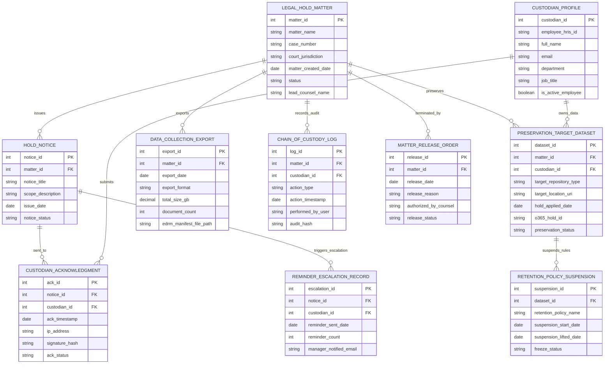

# Conceptual ERD — Legal Hold & Litigation Support System

## Mermaid Code

## Entity Description Table | Bảng mô tả Entity

| # | Entity Name | Vietnamese Name | Description | Key Attributes | Main Relationships |
|---|-------------|-----------------|-------------|----------------|-------------------|
| 1 | LEGAL_HOLD_MATTER | Vụ việc Phong tỏa Pháp lý | Master record for litigation matters, subpoenas, or regulatory investigations requiring data preservation. | matter_id, matter_name, case_number, status, lead_counsel_name | Issues HOLD_NOTICE; exported by DATA_COLLECTION_EXPORT; terminated by MATTER_RELEASE_ORDER. |
| 2 | CUSTODIAN_PROFILE | Hồ sơ Nhân sự Giữ chứng cứ (Custodian) | Stores employee custodian demographics, HRIS IDs, department info, and active employment status. | custodian_id, employee_hris_id, full_name, email, is_active_employee | Submits CUSTODIAN_ACKNOWLEDGMENT; owns PRESERVATION_TARGET_DATASET. |
| 3 | HOLD_NOTICE | Thông báo Phong tỏa Chứng cứ | Stores legal hold notice copy, preservation scopes, broadcast dates, and notice status. | notice_id, notice_title, scope_description, issue_date, notice_status | Belongs to LEGAL_HOLD_MATTER; sent to CUSTODIAN_ACKNOWLEDGMENT; triggers REMINDER_ESCALATION_RECORD. |
| 4 | CUSTODIAN_ACKNOWLEDGMENT | Xác nhận Đã nhận Thông báo (Ack) | Archives electronic custodian acknowledgments, timestamps, IP addresses, and cryptographic signature hashes. | ack_id, ack_timestamp, ip_address, signature_hash, ack_status | Belongs to HOLD_NOTICE and CUSTODIAN_PROFILE. |
| 5 | PRESERVATION_TARGET_DATASET | Tập Dữ liệu Phong tỏa Tại chỗ | Tracks in-place preservation targets (Office 365, Google Drive, Exchange), O365 hold IDs, and status. | dataset_id, target_repository_type, o365_hold_id, preservation_status | Belongs to LEGAL_HOLD_MATTER and CUSTODIAN_PROFILE; suspends RETENTION_POLICY_SUSPENSION. |
| 6 | RETENTION_POLICY_SUSPENSION | Tạm dừng Quy trình Xóa Dữ liệu | Records automated retention policy suspensions, freeze start dates, and unfreeze release timestamps. | suspension_id, retention_policy_name, suspension_start_date, freeze_status | Belongs to PRESERVATION_TARGET_DATASET. |
| 7 | DATA_COLLECTION_EXPORT | Xuất Dữ liệu E-Discovery | Stores metadata for exported e-discovery packages, EDRM XML load manifests, file sizes, and document counts. | export_id, export_date, total_size_gb, document_count, edrm_manifest_file_path | Belongs to LEGAL_HOLD_MATTER. |
| 8 | CHAIN_OF_CUSTODY_LOG | Nhật ký Chuỗi Quản lý Chứng cứ | Immutable audit log capturing all legal hold actions, notices, API preservation calls, and user modifications. | log_id, action_type, action_timestamp, performed_by_user, audit_hash | Belongs to LEGAL_HOLD_MATTER. |
| 9 | REMINDER_ESCALATION_RECORD | Nhật ký Nhắc nhở & Leo thang | Logs automated reminder emails sent to non-responsive custodians and manager escalation alerts. | escalation_id, reminder_sent_date, reminder_count, manager_notified_email | Belongs to HOLD_NOTICE. |
| 10 | MATTER_RELEASE_ORDER | Lệnh Giải tỏa Phong tỏa Pháp lý | Manages legal hold release orders signed by counsel, release reasons, and confirmation timestamps. | release_id, release_date, release_reason, authorized_by_counsel | Terminates LEGAL_HOLD_MATTER. |

## Relationship Description | Mô tả Quan hệ

| # | From Entity | Cardinality | To Entity | Relationship Label | Business Explanation |
|---|-------------|-------------|-----------|-------------------|----------------------|
| 1 | LEGAL_HOLD_MATTER | one-to-many | HOLD_NOTICE | issues | A legal hold matter issues one or more formal hold notices. |
| 2 | LEGAL_HOLD_MATTER | one-to-many | PRESERVATION_TARGET_DATASET | preserves | A legal hold matter preserves multiple electronic datasets. |
| 3 | LEGAL_HOLD_MATTER | one-to-many | DATA_COLLECTION_EXPORT | exports | A legal hold matter exports collected data for e-discovery review. |
| 4 | LEGAL_HOLD_MATTER | one-to-many | CHAIN_OF_CUSTODY_LOG | records_audit | A legal hold matter records immutable chain of custody audit logs. |
| 5 | LEGAL_HOLD_MATTER | one-to-many | MATTER_RELEASE_ORDER | terminated_by | A legal hold matter is terminated by a formal release order. |
| 6 | HOLD_NOTICE | one-to-many | CUSTODIAN_ACKNOWLEDGMENT | sent_to | A hold notice is sent to multiple custodians for acknowledgment. |
| 7 | CUSTODIAN_PROFILE | one-to-many | CUSTODIAN_ACKNOWLEDGMENT | submits | A custodian profile submits electronic acknowledgments. |
| 8 | CUSTODIAN_PROFILE | one-to-many | PRESERVATION_TARGET_DATASET | owns_data | A custodian profile owns target electronic data repositories. |
| 9 | PRESERVATION_TARGET_DATASET | one-to-many | RETENTION_POLICY_SUSPENSION | suspends_rules | A preservation target dataset suspends automated data retention purge rules. |
| 10 | HOLD_NOTICE | one-to-many | REMINDER_ESCALATION_RECORD | triggers_escalation | A hold notice triggers reminder and manager escalation alerts for unacknowledged holds. |
