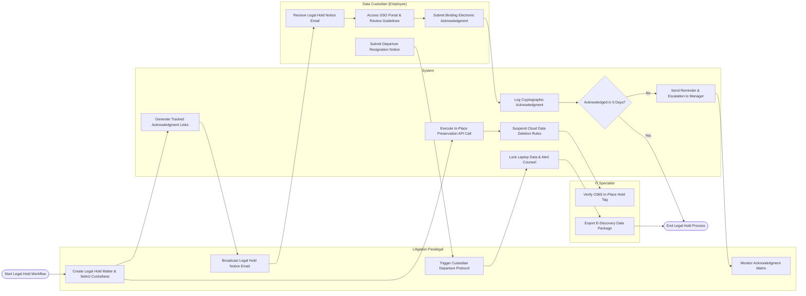

# Swimlane Diagram — Legal Hold & Litigation Support System

## Mermaid Code

## Flow Description | Mô tả luồng

| Lane | Actor | Role in Flow |
|------|-------|-------------|
| 1 | Litigation Paralegal | Creates new legal hold matter, defines target employee custodians, broadcasts legal hold notice emails, monitors compliance status, and manages departing custodian offboarding protocols. |
| 2 | System | Generates secure tracked links, calls cloud APIs (Office 365 / Google Vault) for in-place preservation, suspends automated deletion schedules, records cryptographic acknowledgments, and sends manager escalation alerts. |
| 3 | Data Custodian (Employee) | Receives legal hold notices, logs into SSO portal, reviews preservation scope, submits binding electronic acknowledgments, and flags impending departures. |
| 4 | IT Specialist | Verifies active in-place cloud preservation tags, monitors storage quotas, and exports defensible e-discovery data packages for external review. |
