# Action Tree — Legal Hold & Litigation Support System

## Mermaid Code

```mermaid
graph TD
    Root["Legal Hold & Litigation Support System"]

    Root --> M1["Matter & Hold Creation"]
    Root --> M2["Custodian Communication Engine"]
    Root --> M3["Electronic Data Preservation"]
    Root --> M4["Compliance Monitoring & Escalation"]
    Root --> M5["E-Discovery Export & Audit"]

    M1 --> A1["Create New Legal Hold Matter"]
    M1 --> A2["Map HRIS Custodian Directory"]
    M1 --> A3["Define Scope & Key Terms"]
    M1 --> A4["Authorize Legal Hold Release"]

    M2 --> B1["Broadcast Legal Hold Notice"]
    M2 --> B2["Capture SSO Electronic Acknowledgment"]
    M2 --> B3["Send 90-Day Re-Certification Notice"]
    M2 --> B4["Log Data Source Declarations"]

    M3 --> C1["Execute O365 In-Place Litigation Hold"]
    M3 --> C2["Suspend Auto-Deletion Retention Purge"]
    M3 --> C3["Freeze Google Workspace Mailboxes"]
    M3 --> C4["Lock Departing Custodian Devices"]

    M4 --> D1["Track Real-Time Acknowledgment %"]
    M4 --> D2["Trigger Automated Manager Escalation"]
    M4 --> D3["Monitor HRIS Resignation Alerts"]
    M4 --> D4["Assess Spoliation Exposure Risk"]

    M5 --> E1["Export EDRM Load Files & Metadata"]
    M5 --> E2["Generate Court Chain of Custody Log"]
    M5 --> E3["Export Custodian Compliance Metrics"]
    M5 --> E4["Archive Released Matter History"]
```

## Module Description | Mô tả Module

| # | Module | Description | Actions |
|---|--------|-------------|---------|
| 1 | Matter & Hold Creation | Centralized litigation matter setup, custodian group mapping, preservation scope definition, and counsel release authorization. | Create New Legal Hold Matter, Map HRIS Custodian Directory, Define Scope & Key Terms, Authorize Legal Hold Release |
| 2 | Custodian Communication Engine | Legal hold notice broadcasting, SSO electronic signature acknowledgment capture, 90-day re-certification, and data source survey logging. | Broadcast Legal Hold Notice, Capture SSO Electronic Acknowledgment, Send 90-Day Re-Certification Notice, Log Data Source Declarations |
| 3 | Electronic Data Preservation | Direct API cloud integration (Office 365, Google Vault) executing in-place litigation holds and auto-suspending deletion retention rules. | Execute O365 In-Place Litigation Hold, Suspend Auto-Deletion Retention Purge, Freeze Google Workspace Mailboxes, Lock Departing Custodian Devices |
| 4 | Compliance Monitoring & Escalation | Real-time acknowledgment tracking dashboards, manager escalation triggers, HRIS departure alerts, and spoliation risk modeling. | Track Real-Time Acknowledgment %, Trigger Automated Manager Escalation, Monitor HRIS Resignation Alerts, Assess Spoliation Exposure Risk |
| 5 | E-Discovery Export & Audit | Defensible EDRM load file dataset exporter, court-admissible chain of custody log generator, and release history archiving vault. | Export EDRM Load Files & Metadata, Generate Court Chain of Custody Log, Export Custodian Compliance Metrics, Archive Released Matter History |
