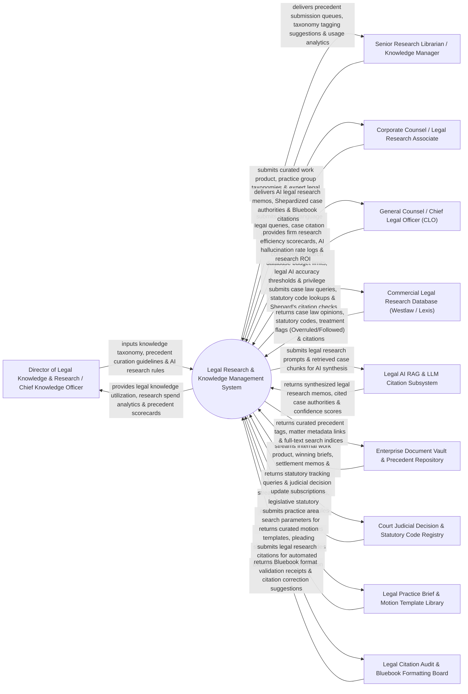

# Context Diagram — Legal Research & Knowledge Management System

## Mermaid Code

## Actor & Interaction Table | Bảng Actor & Tương tác

| # | Actor | Actor Type | Data Sent TO System | Data Received FROM System | Notes |
|---|-------|------------|---------------------|---------------------------|-------|
| 1 | Director of Legal Knowledge & Research / Chief Knowledge Officer | Primary | Legal knowledge taxonomy, precedent curation guidelines, AI research prompt rules, database budget allocations. | Legal knowledge utilization metrics, research spend analytics, precedent contribution scorecards, KM ROI. | Chief Knowledge Officer managing firm-wide legal knowledge, precedents, and research subscription budgets. |
| 2 | Senior Research Librarian / Knowledge Manager | Primary | Curated work product submissions, practice area taxonomy tags, expert legal summaries, matter classifications. | Precedent submission review queues, taxonomy tagging suggestions, work product usage analytics. | Knowledge manager reviewing internal legal briefs, tagging precedents, and curating knowledge banks. |
| 3 | Corporate Counsel / Legal Research Associate | Primary | Natural language legal research queries, case citation checks, draft research memos, search filters. | AI legal research memos, Shepardized case authorities (Overruled/Distinguished), Bluebook citations, visual case maps. | Attorney or research associate searching case law, verifying legal precedent treatment, and drafting research memos. |
| 4 | CLO | Primary | Legal research database budget caps, legal AI accuracy thresholds, privilege protection rules. | Firm research efficiency scorecards, AI hallucination rate logs, research database ROI, cost per query. | Executive monitoring research speed, legal AI accuracy, and commercial research database expenses. |
| 5 | Commercial Legal Research Database | Supporting | Case law judicial opinions, statutory codes (USC / State Codes), KeyCite / Shepard's treatment flags, headnotes. | Case law query strings, statutory citation lookups, Shepard's treatment verification requests. | Commercial research APIs (Thomson Reuters Westlaw / LexisNexis / Casetext API) supplying case law and statutes. |
| 6 | Legal AI RAG & LLM Citation Subsystem | Supporting | Synthesized legal research memos, verified case citations, semantic relevance scores, hallucination flags. | Legal research prompt payloads, retrieved case law text chunks, statutory code context embeddings. | AI RAG (Retrieval-Augmented Generation) engine synthesizing legal answers grounded in verified case authorities. |
| 7 | Enterprise Document Vault & Precedent Repository | Supporting | Internal winning briefs, summary judgment motions, settlement memos, expert witness transcripts, contract clauses. | Curated precedent metadata tags, matter linking IDs, full-text search index payloads. | Internal repository storing high-value firm work product, winning motions, and practice precedents. |
| 8 | Court Judicial Decision & Statutory Code Registry | Supporting | Court slip opinions, official legislative statutory amendments, procedural court rule updates. | Statutory tracking queries, judicial decision update feeds, court jurisdiction filters. | Public court registry streaming official appellate decisions, supreme court opinions, and statutory changes. |
| 9 | Legal Practice Brief & Motion Template Library | Supporting | Curated motion templates, pleading skeletons, practice area guides, procedural checklists. | Practice area search parameters, document assembly parameters, template usage logs. | Central library providing standardized motion templates, brief skeletons, and practice checklists. |
| 10 | Legal Citation Audit & Bluebook Formatting Board | Supporting / Regulatory | Bluebook format validation receipts, citation style guides (Bluebook 21st Ed / ALWD), syntax corrections. | Legal research draft citations, case citation text strings, Bluebook formatting queries. | Academic/legal board verifying legal citation syntax (The Bluebook: A Uniform System of Citation). |

## System Boundary Description | Mô tả Phạm vi Hệ thống

The **Legal Research & Knowledge Management System** is an enterprise legal research, AI RAG citation synthesis, internal precedent curation, Shepard's/KeyCite authority verification, and Bluebook citation formatting platform.

**Inside System Scope:**
- Natural language AI RAG legal research engine synthesizing legal answers grounded strictly in verified case law.
- Integration with Westlaw and LexisNexis APIs for real-time Shepard's/KeyCite treatment verification (Overruled / Caution).
- Curation and indexing of internal firm work product (winning briefs, summary judgment motions, settlement memos).
- Automated legal citation formatting and Bluebook syntax validation (21st Edition rules).
- Visual case law citation network mapping displaying judicial precedent relationships and treatment histories.

**Outside System Scope:**
- Direct physical rendering of oral legal arguments before judges (handled by Trial Litigators).
- Direct physical printing of law review books (handled by Legal Publishing Houses).
- Direct physical attendance at law school academic lectures (handled by Law Professors).
