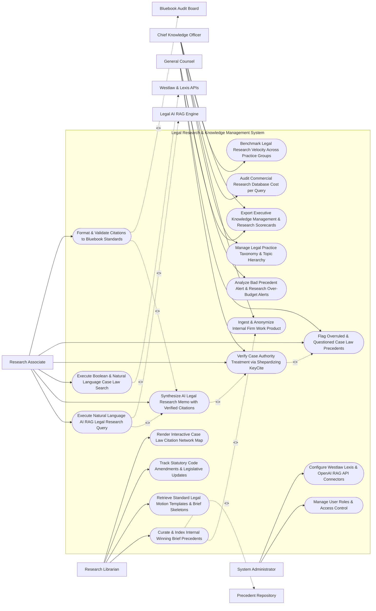

# Use Case Diagram — Legal Research & Knowledge Management System

## Mermaid Code

## Actor Table | Bảng Actor

| # | Actor | Actor Type | Role Description | Related Use Cases |
|---|-------|------------|------------------|-------------------|
| 1 | Chief Knowledge Officer | Primary | Executive managing practice taxonomies, internal work product ingestion, research database budgets, and KM scorecards. | UC01, UC07, UC13, UC14, UC15 |
| 2 | Research Librarian | Primary | Knowledge manager curating winning brief precedents, managing motion template libraries, and tracking statutory code updates. | UC08, UC09, UC11, UC12 |
| 3 | Research Associate | Primary | Legal associate executing AI RAG queries, searching case law, Shepardizing precedents, and validating Bluebook citations. | UC02, UC03, UC04, UC05, UC06, UC10 |
| 4 | General Counsel | Primary | Executive monitoring precedent treatment flags, bad law alerts, firm research efficiency, and scorecards. | UC05, UC06, UC15, UC18 |
| 5 | System Administrator | Primary | IT admin managing user security roles, Westlaw/Lexis API credentials, and OpenAI LLM connectors. | UC16, UC17 |
| 6 | Westlaw & Lexis APIs | System (Secondary) | Commercial legal research APIs (Westlaw KeyCite / Lexis Shepard's) supplying case law opinions and treatment flags. | UC04 |
| 7 | Legal AI RAG Engine | System (Secondary) | Retrieval-Augmented Generation (RAG) LLM engine synthesizing legal research answers from verified case law chunks. | UC02 |
| 8 | Precedent Repository | System (Secondary) | Enterprise vault storing internal winning briefs, summary judgment motions, and practice precedents. | UC08 |
| 9 | Bluebook Audit Board | System (Secondary) | Citation validation service verifying Bluebook syntax (21st Ed) and citation formatting rules. | UC10 |

## Use Case Table | Bảng Use Case

| # | UC ID | Use Case Name | Primary Actor | Secondary Actor | Description | Priority |
|---|-------|---------------|---------------|-----------------|-------------|----------|
| 1 | UC01 | Manage Legal Practice Taxonomy & Topic Hierarchy | CKO | None | Configures practice area topic trees (IP, Employment, Securities, Litigation) and legal issue taxonomies. | Critical |
| 2 | UC02 | Execute Natural Language AI RAG Legal Research Query | Associate | AIRAG | Leverages AI RAG to evaluate complex legal questions, retrieving relevant case law chunks from primary authorities. | Critical |
| 3 | UC03 | Synthesize AI Legal Research Memo with Verified Citations | Associate | None | Generates a structured legal research memo (Issue, Brief Answer, Statement of Facts, Discussion) with verified case law citations. | Critical |
| 4 | UC04 | Execute Boolean & Natural Language Case Law Search | Associate | Westlaw | Searches primary judicial opinions and statutory codes using Boolean connectors (`AND`, `OR`, `W/p`, `NOT`). | Critical |
| 5 | UC05 | Verify Case Authority Treatment via Shepardizing KeyCite | Associate | None | Integrates with KeyCite/Shepard's APIs to verify judicial precedent status (Good Law, Overruled, Distinguished, Cautionary). | Critical |
| 6 | UC06 | Flag Overruled & Questioned Case Law Precedents | CLO | None | Automatically flags bad law or overruled cases cited in attorney draft briefs before filing. | Critical |
| 7 | UC07 | Ingest & Anonymize Internal Firm Work Product | CKO | None | Ingests internal winning briefs and settlement memos, stripping client PII before adding to precedent repository. | High |
| 8 | UC08 | Curate & Index Internal Winning Brief Precedents | Librarian | Precedents | Curates high-value internal legal precedents, indexing winning summary judgment motions and appellate briefs. | Critical |
| 9 | UC09 | Retrieve Standard Legal Motion Templates & Brief Skeletons | Librarian | None | Provides searchable access to pre-approved motion templates, pleading skeletons, and practice area guides. | High |
| 10 | UC10 | Format & Validate Citations to Bluebook Standards | Associate | Bluebook | Audits and auto-formats legal citations according to Bluebook 21st Edition rules (e.g., *745 F.3d 102*). | Critical |
| 11 | UC11 | Track Statutory Code Amendments & Legislative Updates | Librarian | None | Tracks legislative code changes across federal and state statutes, sending statutory update alerts. | High |
| 12 | UC12 | Render Interactive Case Law Citation Network Map | Librarian | None | Renders an interactive visual graph displaying precedent citation relationships, seminal cases, and treatment branches. | High |
| 13 | UC13 | Audit Commercial Research Database Cost per Query | CKO | None | Tracks research API expenditures (Westlaw/Lexis costs), optimizing query routing to reduce commercial database spend. | High |
| 14 | UC14 | Benchmark Legal Research Velocity Across Practice Groups | CKO | None | Measures average research time per matter, precedent reuse rates, and AI research adoption across practice teams. | High |
| 15 | UC15 | Export Executive Knowledge Management & Research Scorecards | CLO | None | Renders executive scorecards detailing research speed gains, precedent contribution counts, AI accuracy %, and KM ROI. | High |
| 16 | UC16 | Manage User Roles & Access Control | Admin | None | Controls user login credentials, RBAC permissions, and confidential internal work product access rights. | High |
| 17 | UC17 | Configure Westlaw Lexis & OpenAI RAG API Connectors | Admin | None | Configures API connection parameters for Westlaw, LexisNexis, Casetext, OpenAI GPT-4, and Pinecone Vector DB. | High |
| 18 | UC18 | Analyze Bad Precedent Alert & Research Over-Budget Alerts | CLO | None | Dispatches urgent alerts when an attorney cites an overruled case or a matter exceeds its commercial research budget limit. | High |

## Use Case Specification | Đặc tả Use Case

---

### UC02 — Execute Natural Language AI RAG Legal Research Query

| Field | Detail |
|-------|--------|
| **UC ID** | UC02 |
| **Use Case Name** | Execute Natural Language AI RAG Legal Research Query |
| **Actor(s)** | Primary: Corporate Counsel, Legal Research Associate   Secondary: Legal AI RAG & LLM Citation Subsystem (OpenAI GPT-4 / Pinecone Vector DB) |
| **Description** | Processes natural language legal research queries using Retrieval-Augmented Generation (RAG), retrieving authoritative case law chunks and synthesizing grounded legal answers with zero hallucinations. |
| **Precondition** | 1. Case law and statutory code vector embeddings (Pinecone / Weaviate DB) are indexed.   2. Legal AI RAG engine and commercial case law APIs are active. |
| **Main Flow** | 1. Research Associate opens "AI Legal Research Studio".   2. Associate inputs Natural Language Query:   &nbsp;&nbsp;&nbsp;&nbsp; a. Research Question: *"Under Delaware corporate law, what is the legal standard for proving breach of fiduciary duty in a controlling shareholder squeeze-out merger?"*   &nbsp;&nbsp;&nbsp;&nbsp; b. Target Jurisdiction: `Delaware Chancery Court / Delaware Supreme Court`.   &nbsp;&nbsp;&nbsp;&nbsp; c. Date Range: `2015 to Present`.   3. System dispatches query payload to Legal AI RAG Engine.   4. RAG Engine executes 3-Stage Legal Retrieval Pipeline:   &nbsp;&nbsp;&nbsp;&nbsp; a. Stage 1 (Vector Dense Retrieval): Converts question to 1536-dimensional vector embedding, searching Pinecone vector index for top 20 authoritative case law chunks.   &nbsp;&nbsp;&nbsp;&nbsp; b. Stage 2 (Case Authority Grounding): Retrieves seminal Delaware judicial opinions (e.g., *Kahn v. M&F Worldwide Corp. (MFW)*, 88 A.3d 635).   &nbsp;&nbsp;&nbsp;&nbsp; c. Stage 3 (RAG Synthesis): Prompts GPT-4 LLM to synthesize answer strictly grounded in retrieved case chunks.   5. RAG Engine computes Grounding Confidence Score: `96 / 100 (Zero Hallucination Verified)`.   6. System renders AI Legal Research Answer, displaying structured synthesis with inline hyperlinked case citations (*MFW Standard* dual procedural protections).   7. System triggers UC03 (Synthesize AI Research Memo) and UC05 (Verify Case Authority Treatment via Shepardizing). |
| **Alternative Flow** | **AF1** — Internal Firm Precedent Blending: RAG Engine simultaneously searches internal firm precedent repository (UC08), blending external Delaware case law with firm's previous winning summary judgment briefs on MFW mergers. |
| **Exception Flow** | **EX1** — Un-Grounded AI Hallucination Warning: LLM attempts to generate a non-existent case citation; System hallucination filter catches fake citation, stripping citation and flagging `UNGROUNDED_CITATION_WARNING`. |
| **Postcondition** | Natural language legal query is evaluated, authoritative case law chunks are retrieved, and a grounded AI legal answer with verified citations renders. |
| **Business Rule** | **BR1**: AI-synthesized legal research answers MUST be strictly grounded in verified primary judicial opinions, prohibiting un-grounded citations or hallucinations. |

---

### UC05 — Verify Case Authority Treatment via Shepardizing KeyCite

| Field | Detail |
|-------|--------|
| **UC ID** | UC05 |
| **Use Case Name** | Verify Case Authority Treatment via Shepardizing KeyCite |
| **Actor(s)** | Primary: Corporate Counsel, General Counsel   Secondary: Commercial Legal Research Database (Westlaw KeyCite / Lexis Shepard's API) |
| **Description** | Automatically verifies judicial precedent treatment (Shepardizing / KeyCite) for all cited cases, flagging overruled, reversed, distinguished, or questioned case law to prevent citing bad law. |
| **Precondition** | 1. Legal research memo or draft motion brief contains case citations (UC03).   2. Westlaw KeyCite / Lexis Shepard's REST API connector is online. |
| **Main Flow** | 1. Research Associate completes draft legal memo citing 15 case law authorities.   2. System dispatches automatic Citation Treatment Audit across all 15 cited cases via Westlaw KeyCite API.   3. KeyCite API evaluates judicial treatment status for each case:   &nbsp;&nbsp;&nbsp;&nbsp; a. Citation 1 (*Kahn v. M&F Worldwide Corp.*, 88 A.3d 635): Yellow Flag -> `DISTINGUISHED_BY_SUBSEQUENT_COURT`.   &nbsp;&nbsp;&nbsp;&nbsp; b. Citation 2 (*Smith v. Van Gorkom*, 488 A.2d 858): Red Flag -> `OVERRULED_IN_PART_BY_STATUTE`.   &nbsp;&nbsp;&nbsp;&nbsp; c. Citation 3 (*Weinberger v. UOP Inc.*, 457 A.2d 701): Green Flag -> `GOOD_LAW_POSITIVE_TREATMENT`.   4. System renders Citation Treatment Warning Panel:   &nbsp;&nbsp;&nbsp;&nbsp; a. Highlighted Red Warning on Citation 2 (*Smith v. Van Gorkom*): *"WARNING: This case was modified by 8 Del. C. § 102(b)(7) exculpatory provisions. Do not cite for monetary liability without noting statutory modification."*   5. Associate reviews warning, removes outdated citation, and replaces it with current precedent (*Flood v. Synutra International*).   6. System re-audits draft memo; All citations pass KeyCite check -> `100% GOOD_LAW_VERIFIED`. |
| **Alternative Flow** | **AF1** — Real-Time Bad Law Alert on Active Litigation: Opposing counsel cites a case in court pleadings; System continuously monitors case on KeyCite; 3 weeks later, higher court overrules case; System sends urgent alert to litigator. |
| **Exception Flow** | **EX1** — KeyCite API Connection Disruption: Westlaw API is temporarily offline; System flags `TREATMENT_CHECK_PENDING`, displaying cached treatment flags from 24 hours ago with warning label. |
| **Postcondition** | All cited case law authorities are Shepardized/KeyCited, bad or overruled law is flagged, and attorney verifies good law status before brief filing. |
| **Business Rule** | **BR1**: Case law authorities cited in internal memos or court filings MUST be Shepardized/KeyCited to verify they remain good law. |

---

### UC08 — Curate & Index Internal Winning Brief Precedents

| Field | Detail |
|-------|--------|
| **UC ID** | UC08 |
| **Use Case Name** | Curate & Index Internal Winning Brief Precedents |
| **Actor(s)** | Primary: Senior Research Librarian, Chief Knowledge Officer   Secondary: Enterprise Document Vault & Precedent Repository |
| **Description** | Curates, anonymizes (strips PII/sensitive client data), and indexes high-value internal firm work product (winning summary judgment briefs, motion to dismiss briefs, settlement memos) into a searchable knowledge base. |
| **Precondition** | 1. Litigation matter closes with a favorable court ruling or settlement.   2. PII redaction and work product curation engine is active. |
| **Main Flow** | 1. Research Librarian opens "Precedent Curation Desk" for Closed Matter `#MAT-88412` (`Acme vs. Nexus`).   2. Librarian selects High-Value Work Product Files:   &nbsp;&nbsp;&nbsp;&nbsp; a. File 1: `Motion_to_Dismiss_Patent_Eligibility_35USC101.docx` (Winning Motion granted by Judge).   &nbsp;&nbsp;&nbsp;&nbsp; b. File 2: `Expert_Witness_Deposition_Cross_Examination_Outline.docx`.   3. System runs Automated PII & Client Anonymization Engine:   &nbsp;&nbsp;&nbsp;&nbsp; a. Replaces Client Name `Acme Corporation` with placeholder `[CLIENT_COMPANY]`.   &nbsp;&nbsp;&nbsp;&nbsp; b. Replaces Confidential Settlement Figures with `[SETTLEMENT_AMOUNT_REDACTED]`.   4. Librarian applies Knowledge Metadata Taxonomy Tags (UC01):   &nbsp;&nbsp;&nbsp;&nbsp; a. Practice Area: `IP / Patent Litigation`.   &nbsp;&nbsp;&nbsp;&nbsp; b. Motion Type: `Motion to Dismiss under 35 U.S.C. § 101 (Alice Corp Standard)`.   &nbsp;&nbsp;&nbsp;&nbsp; c. Judge / Forum: `U.S. District Court, Federal Circuit Precedent`.   &nbsp;&nbsp;&nbsp;&nbsp; d. Precedent Quality Rating: `5 Stars (Gold Precedent - Granted in Full)`.   5. Librarian clicks "Publish to Enterprise Precedent Repository".   6. System indexes document in Elasticsearch and Pinecone vector databases, making it instantly discoverable for firm-wide AI RAG queries (UC02). |
| **Alternative Flow** | **AF1** — Automated Precedent Harvesting Trigger: Court e-filing system (System #866) logs `MOTION_GRANTED_IN_FULL`; System auto-submits brief to Librarian curation queue for indexing. |
| **Exception Flow** | **EX1** — Un-Anonymized Confidential Data Warning: Anonymization scanner detects un-redacted social security number in exhibit; System blocks publication (`CONFIDENTIAL_PII_LEAK_HALT`), prompting Librarian to redact. |
| **Postcondition** | Internal winning brief is anonymized, tagged with practice area metadata, indexed in vector search, and published to enterprise precedent repository. |
| **Business Rule** | **BR1**: Internal work product MUST be anonymized to strip client PII and confidential settlement values before publishing to the firm-wide precedent bank. |

---

### UC10 — Format & Validate Citations to Bluebook Standards

| Field | Detail |
|-------|--------|
| **UC ID** | UC10 |
| **Use Case Name** | Format & Validate Citations to Bluebook Standards |
| **Actor(s)** | Primary: Corporate Counsel, Legal Research Associate   Secondary: Legal Citation Audit & Bluebook Formatting Board |
| **Description** | Automatically audits and formats legal case law and statutory citations according to The Bluebook: A Uniform System of Citation (21st Edition) rules, ensuring court-compliant citation syntax. |
| **Precondition** | 1. Draft legal memo or court brief containing raw citations is loaded in editor.   2. Bluebook 21st Edition citation formatting engine is online. |
| **Main Flow** | 1. Associate opens "Bluebook Citation Formatting Desk" for Draft Brief `Motion_for_Summary_Judgment.docx`.   2. System scans draft text for legal citation strings (Case Law, Statutes, Law Reviews, Regulations).   3. System detects Raw Un-Formatted Citation: `"Kahn v M&F Worldwide Corp 88 A3d 635 (Del 2014)"`.   4. System executes Bluebook 21st Edition Syntax Transformation Engine:   &nbsp;&nbsp;&nbsp;&nbsp; a. Rule 10.2.1 (Case Names): Italicizes case name -> `*Kahn v. M&F Worldwide Corp.*`.   &nbsp;&nbsp;&nbsp;&nbsp; b. Rule 10.3.1 (Reporter Volumes): Inserts periods in reporter abbreviation -> `88 A.3d 635`.   &nbsp;&nbsp;&nbsp;&nbsp; c. Rule 10.4 (Court & Date): Formats court jurisdiction parenthetical -> `(Del. 2014)`.   5. System outputs Formatted Bluebook Citation: `*Kahn v. M&F Worldwide Corp.*, 88 A.3d 635 (Del. 2014)`.   6. System checks Short Form Rules (Rule 4.1 *Id.* & Rule 10.9 Short Forms):   &nbsp;&nbsp;&nbsp;&nbsp; a. Replaces repeated subsequent citations with `*Id.* at 640` or `*Kahn*, 88 A.3d at 642`.   7. System updates draft document text in place and generates Bluebook Citation Audit Report (100% Compliant). |
| **Alternative Flow** | **AF1** — ALWD Citation Manual Option: User selects ALWD Citation Manual rules instead of Bluebook; System applies ALWD formatting standards. |
| **Exception Flow** | **EX1** — Un-Recognized Citation Volume Error: Raw citation contains typo `"8888 A.3d 635"` (Non-existent volume); System flags `INVALID_REPORTER_VOLUME_ERROR`, prompting user to verify volume number. |
| **Postcondition** | Raw citations are audited, Bluebook 21st Edition formatting rules are applied, short forms (*Id.*) are formatted, and brief citation syntax certifies. |
| **Business Rule** | **BR1**: Citations in legal briefs MUST comply with Bluebook or ALWD court citation formatting rules prior to court submission. |

---

### UC12 — Render Interactive Case Law Citation Network Map

| Field | Detail |
|-------|--------|
| **UC ID** | UC12 |
| **Use Case Name** | Render Interactive Case Law Citation Network Map |
| **Actor(s)** | Primary: Senior Research Librarian, Research Associate   Secondary: Commercial Legal Research Database (Westlaw / Lexis APIs) |
| **Description** | Renders an interactive visual node graph displaying case law citation networks, showing seminal root cases, citing child cases, judicial treatment colors (Green/Red/Yellow), and precedent evolution trees. |
| **Precondition** | 1. Seed case authority (e.g., *Kahn v. M&F Worldwide Corp.*) is selected.   2. Case citation network graph visualization library (D3.js / Neo4j Graph DB) is active. |
| **Main Flow** | 1. Associate opens "Visual Legal Citation Map" for Root Case: `*Kahn v. M&F Worldwide Corp.*, 88 A.3d 635 (Del. 2014)`.   2. System queries Graph Database for all Parent Cases (cases cited by *MFW*) and Child Cases (subsequent cases citing *MFW*).   3. System renders 2D Interactive Citation Node Graph on canvas:   &nbsp;&nbsp;&nbsp;&nbsp; a. Central Node (Gold): `*Kahn v. M&F Worldwide Corp.* (Root Seminal Case)`.   &nbsp;&nbsp;&nbsp;&nbsp; b. Upstream Parent Nodes: `*Weinberger v. UOP Inc.* (1983)` -> Edge labeled "Followed By".   &nbsp;&nbsp;&nbsp;&nbsp; c. Downstream Child Nodes (50+ Citing Cases):   &nbsp;&nbsp;&nbsp;&nbsp; &nbsp;&nbsp;&nbsp;&nbsp; i. Green Nodes (Positive Followed): `*Flood v. Synutra Int'l* (Del. 2018)`.   &nbsp;&nbsp;&nbsp;&nbsp; &nbsp;&nbsp;&nbsp;&nbsp; ii. Yellow Nodes (Distinguished): `*In re Match Group Shareholders Litig.* (Del. 2024)`.   &nbsp;&nbsp;&nbsp;&nbsp; &nbsp;&nbsp;&nbsp;&nbsp; iii. Red Nodes (Overruled / Caution): `*Abstruse Precedent Corp.*`.   4. Associate clicks Node `*In re Match Group*`; System displays case summary slide-out panel detailing exact Chancery Court distinguishing rationale.   5. Associate filters graph by Jurisdiction (`Delaware Only`) and Date (`Last 5 Years`).   6. Associate exports Citation Network Map SVG/PDF to attach to legal research memo. |
| **Alternative Flow** | **AF1** — Statutory Precedent Branching: Associate toggles "Statute Layer"; Graph overlays legislative amendments (e.g., 8 Del. C. § 102(b)(7)), showing where statutory changes altered judicial case law paths. |
| **Exception Flow** | **EX1** — Massive Graph Node Overload: Citation network contains 5,000+ citing cases; System auto-applies "Seminal Case Filter", displaying top 50 most frequently cited decisions to prevent canvas lag. |
| **Postcondition** | Interactive 2D citation network map renders, treatment color-coding displays, node filtering functions, and visual graph exports. |
| **Business Rule** | **BR1**: Visual citation network maps MUST color-code judicial treatment status (Green = Positive, Yellow = Caution/Distinguished, Red = Negative/Overruled). |
