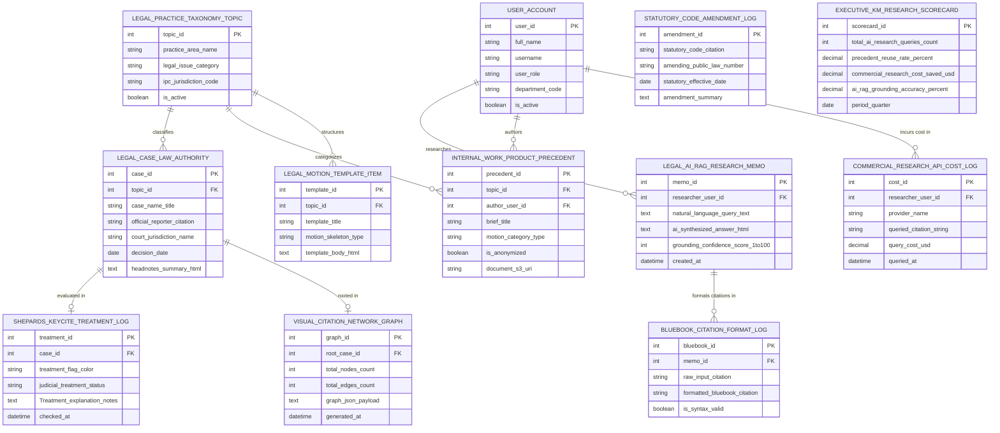

# Conceptual ERD — Legal Research & Knowledge Management System

## Mermaid Code

## Entity Description Table | Bảng mô tả Entity

| # | Entity Name | Vietnamese Name | Description | Key Attributes | Main Relationships |
|---|-------------|-----------------|-------------|----------------|-------------------|
| 1 | USER_ACCOUNT | Tài khoản Nguời dùng | System credentials and access roles for chief knowledge officers, research librarians, associates, and admins. | `user_id`, `username`, `user_role`, `department_code` | Researches `LEGAL_AI_RAG_RESEARCH_MEMO`, authors `INTERNAL_WORK_PRODUCT_PRECEDENT`, incurs cost in `COMMERCIAL_RESEARCH_API_COST_LOG`. |
| 2 | LEGAL_PRACTICE_TAXONOMY_TOPIC | Topic Phân loại Taxonomy | Legal practice area taxonomy and topic hierarchy entity storing practice area names, issue categories, and jurisdiction codes. | `topic_id`, `practice_area_name`, `legal_issue_category`, `ipc_jurisdiction_code`, `is_active` | Classifies `LEGAL_CASE_LAW_AUTHORITY`, categorizes `INTERNAL_WORK_PRODUCT_PRECEDENT`, structures `LEGAL_MOTION_TEMPLATE_ITEM`. |
| 3 | LEGAL_CASE_LAW_AUTHORITY | Án lệ Án tòa Case Law | Judicial case law authority record tracking case titles, official reporter citations (*88 A.3d 635*), court jurisdictions, and headnote summaries. | `case_id`, `topic_id`, `case_name_title`, `official_reporter_citation`, `court_jurisdiction_name`, `decision_date`, `headnotes_summary_html` | Classified by `LEGAL_PRACTICE_TAXONOMY_TOPIC`, evaluated in `SHEPARDS_KEYCITE_TREATMENT_LOG`, rooted in `VISUAL_CITATION_NETWORK_GRAPH`. |
| 4 | SHEPARDS_KEYCITE_TREATMENT_LOG | Nhật ký Treatment KeyCite | KeyCite / Shepard's precedent treatment log recording treatment flag colors (Green/Red/Yellow), treatment status (`OVERRULED/DISTINGUISHED`), and notes. | `treatment_id`, `case_id`, `treatment_flag_color`, `judicial_treatment_status`, `Treatment_explanation_notes` | Belongs to `LEGAL_CASE_LAW_AUTHORITY`. |
| 5 | LEGAL_AI_RAG_RESEARCH_MEMO | Memo Nghiên cứu Legal AI RAG | AI RAG legal research memo record storing natural language queries, synthesized grounded answers, and grounding confidence scores (1-100). | `memo_id`, `researcher_user_id`, `natural_language_query_text`, `ai_synthesized_answer_html`, `grounding_confidence_score_1to100` | Formats citations in `BLUEBOOK_CITATION_FORMAT_LOG`, researched by `USER_ACCOUNT`. |
| 6 | INTERNAL_WORK_PRODUCT_PRECEDENT | Precedent Tiền lệ Nội bộ | Curated internal firm work product precedent record storing brief titles, motion categories, anonymization status, and S3 document URIs. | `precedent_id`, `topic_id`, `author_user_id`, `brief_title`, `motion_category_type`, `is_anonymized`, `document_s3_uri` | Categorized by `LEGAL_PRACTICE_TAXONOMY_TOPIC`, authored by `USER_ACCOUNT`. |
| 7 | LEGAL_MOTION_TEMPLATE_ITEM | Template Mẫu Motion Pháp lý | Legal motion template record storing template titles, motion skeleton types, and default HTML template bodies. | `template_id`, `topic_id`, `template_title`, `motion_skeleton_type`, `template_body_html` | Structured by `LEGAL_PRACTICE_TAXONOMY_TOPIC`. |
| 8 | BLUEBOOK_CITATION_FORMAT_LOG | Nhật ký Format Citation Bluebook | Legal citation audit log recording raw input citations, formatted Bluebook 21st Edition citations, and syntax validity flags. | `bluebook_id`, `memo_id`, `raw_input_citation`, `formatted_bluebook_citation`, `is_syntax_valid` | Belongs to `LEGAL_AI_RAG_RESEARCH_MEMO`. |
| 9 | VISUAL_CITATION_NETWORK_GRAPH | Đồ thị Citation Network Visual | Interactive visual citation network graph record storing root case ID, node/edge counts, and graph JSON payloads. | `graph_id`, `root_case_id`, `total_nodes_count`, `total_edges_count`, `graph_json_payload` | Rooted in `LEGAL_CASE_LAW_AUTHORITY`. |
| 10 | COMMERCIAL_RESEARCH_API_COST_LOG | Nhật ký Chi phí Commercial API | Commercial legal research API cost log tracking provider names (Westlaw/Lexis), queried citations, and query costs USD. | `cost_id`, `researcher_user_id`, `provider_name`, `queried_citation_string`, `query_cost_usd` | Incurred by `USER_ACCOUNT`. |
| 11 | STATUTORY_CODE_AMENDMENT_LOG | Nhật ký Sửa đổi Statutory Code | Statutory legal code amendment record tracking statutory citations, public law numbers, effective dates, and amendment summaries. | `amendment_id`, `statutory_code_citation`, `amending_public_law_number`, `statutory_effective_date`, `amendment_summary` | Standalone statutory update entity. |
| 12 | EXECUTIVE_KM_RESEARCH_SCORECARD | Scorecard Executive KM | Executive knowledge management scorecard aggregating total AI research queries, precedent reuse rates %, research costs saved USD, and AI accuracy %. | `scorecard_id`, `total_ai_research_queries_count`, `precedent_reuse_rate_percent`, `commercial_research_cost_saved_usd`, `ai_rag_grounding_accuracy_percent` | Standalone executive performance entity. |

## Relationship Description | Mô tả Quan hệ

| # | From Entity | Cardinality | To Entity | Label | Business Explanation |
|---|-------------|-------------|-----------|-------|----------------------|
| 1 | LEGAL_PRACTICE_TAXONOMY_TOPIC | 1 to 0..N | LEGAL_CASE_LAW_AUTHORITY | classifies | A practice taxonomy topic classifies legal case law authorities. |
| 2 | LEGAL_PRACTICE_TAXONOMY_TOPIC | 1 to 0..N | INTERNAL_WORK_PRODUCT_PRECEDENT | categorizes | A practice taxonomy topic categorizes internal work product precedents. |
| 3 | LEGAL_PRACTICE_TAXONOMY_TOPIC | 1 to 0..N | LEGAL_MOTION_TEMPLATE_ITEM | structures | A practice taxonomy topic structures legal motion templates. |
| 4 | LEGAL_CASE_LAW_AUTHORITY | 1 to 0..1 | SHEPARDS_KEYCITE_TREATMENT_LOG | evaluated in | A legal case law authority is evaluated in KeyCite/Shepard's treatment logs. |
| 5 | LEGAL_CASE_LAW_AUTHORITY | 1 to 0..1 | VISUAL_CITATION_NETWORK_GRAPH | rooted in | A legal case law authority is rooted in a visual citation network graph. |
| 6 | LEGAL_AI_RAG_RESEARCH_MEMO | 1 to 0..N | BLUEBOOK_CITATION_FORMAT_LOG | formats citations in | A legal AI RAG research memo formats citations in Bluebook audit logs. |
| 7 | USER_ACCOUNT | 1 to 0..N | LEGAL_AI_RAG_RESEARCH_MEMO | researches | A research associate user account researches legal AI RAG memos. |
| 8 | USER_ACCOUNT | 1 to 0..N | INTERNAL_WORK_PRODUCT_PRECEDENT | authors | An attorney user account authors internal work product precedents. |
| 9 | USER_ACCOUNT | 1 to 0..N | COMMERCIAL_RESEARCH_API_COST_LOG | incurs cost in | A research associate user account incurs cost in commercial research API logs. |
