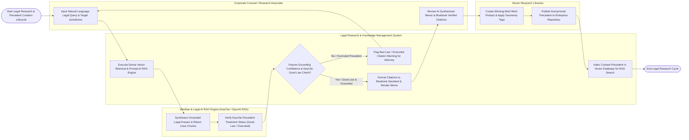

# Swimlane Diagram — Legal Research & Knowledge Management System

## Mermaid Code

## Flow Description | Mô tả luồng

| Lane | Actor | Role in Flow |
|------|-------|-------------|
| 1 | Corporate Counsel / Research Associate | Inputs natural language legal research queries, selects target jurisdictions, reviews AI-synthesized research memos, verifies Bluebook citations, and incorporates precedents into court briefs. |
| 2 | Senior Research Librarian | Curates high-value internal winning briefs, anonymizes client PII, applies legal practice area taxonomy tags, and publishes work product to the firm-wide precedent bank. |
| 3 | Legal Research & Knowledge Management System | Executes dense vector retrieval across case law embeddings, prompts the RAG LLM engine for grounded synthesis, checks KeyCite/Shepard's treatment flags, formats citations to Bluebook 21st Edition rules, indexes internal precedents in Pinecone vector DB, and tracks commercial API costs. |
| 4 | Westlaw & Legal AI RAG Engine (KeyCite / OpenAI RAG) | Retrieves authoritative case law text chunks, synthesizes grounded legal answers with zero hallucinations, and verifies judicial treatment status (Good Law, Overruled, Distinguished) via Westlaw KeyCite API. |
