# Action Tree — Legal Research & Knowledge Management System

## Mermaid Code

```mermaid
graph TD
    Root["Legal Research & Knowledge Management System"]

    Root --> M1["Natural Language AI RAG Research Engine"]
    Root --> M2["Case Law Authority & KeyCite/Shepardizing"]
    Root --> M3["Internal Precedent Curation & Work Product Bank"]
    Root --> M4["Bluebook Citation Audit & Motion Templates"]
    Root --> M5["Visual Citation Network Graphing & Search"]
    Root --> M6["API Cost Optimization & Executive Scorecards"]

    M1 --> A11["Execute Natural Language Queries using RAG Vector Dense Retrieval"]
    M1 --> A12["Retrieve Authoritative Case Law Chunks from Pinecone Vector Index"]
    M1 --> A13["Synthesize AI Legal Research Memos Grounded in Judicial Opinions"]
    M1 --> A14["Enforce Grounding Filters to Prevent AI Hallucinations & Fake Citations"]

    M2 --> A21["Execute Boolean Case Law Searches with Connectors (AND, OR, W/p, NOT)"]
    M2 --> A22["Verify Case Treatment Status via Westlaw KeyCite & Lexis Shepard's APIs"]
    M2 --> A23["Flag Overruled, Reversed or Questioned Case Law Precedents in Real-Time"]
    M2 --> A24["Track Federal & State Statutory Code Amendments and Legislative Updates"]

    M3 --> A31["Ingest Internal Winning Briefs, Summary Judgment Motions & Memos"]
    M3 --> A32["Execute Automated Client PII & Confidential Value Anonymization"]
    M3 --> A33["Apply Practice Area Taxonomy Tags (IP, Securities, Litigation)"]
    M3 --> A34["Index Anonymized Precedents into Enterprise Vector Search Repository"]

    M4 --> A41["Audit & Auto-Format Legal Citations to Bluebook 21st Edition Standards"]
    M4 --> A42["Format Short Form Citations (Id., Supra) according to Rule 10.9"]
    M4 --> A43["Provide Searchable Access to Pre-Approved Legal Motion Templates"]
    M4 --> A44["Generate Pleading Skeletons & Practice Area Procedural Checklists"]

    M5 --> A51["Render Interactive 2D Case Law Citation Network Node Graphs (D3.js)"]
    M5 --> A52["Color-Code Judicial Treatment Nodes (Green = Good Law, Red = Overruled)"]
    M5 --> A53["Filter Citation Network Graphs by Jurisdiction, Court Tier & Date Range"]
    M5 --> A54["Export High-Resolution Vector Citation Network Maps (SVG / PDF)"]

    M6 --> A61["Audit Commercial Legal Research Database Spend per Query (Westlaw/Lexis)"]
    M6 --> A62["Optimize Query Routing to Use Internal Precedents First to Cut Costs"]
    M6 --> A63["Benchmark Research Velocity & Precedent Reuse Rates across Practice Groups"]
    M6 --> A64["Export Executive Knowledge Management, AI Accuracy & KM Scorecards"]
```

## Module Description | Mô tả Module

| # | Module | Description | Actions |
|---|--------|-------------|---------|
| 1 | Natural Language AI RAG Research Engine | Executes natural language AI RAG queries, retrieves vector case law chunks, synthesizes grounded legal memos, and filters AI hallucinations. | Execute Natural Language RAG Vector Queries, Retrieve Authoritative Case Law Chunks, Synthesize Grounded AI Legal Research Memos, Enforce Grounding Filters to Prevent Hallucinations. |
| 2 | Case Law Authority & KeyCite/Shepardizing | Runs Boolean case law searches, verifies precedent treatment via KeyCite/Shepard's APIs, flags bad law in real time, and tracks statutory code changes. | Execute Boolean Case Law Searches, Verify Case Treatment via KeyCite/Shepard's APIs, Flag Overruled & Questioned Precedents, Track Statutory Code Amendments. |
| 3 | Internal Precedent Curation & Work Product Bank | Ingests internal winning briefs, anonymizes client PII, applies practice area taxonomy tags, and indexes precedents in enterprise vector search. | Ingest Internal Winning Briefs & Memos, Execute Automated Client PII Anonymization, Apply Practice Area Taxonomy Tags, Index Anonymized Precedents in Vector DB. |
| 4 | Bluebook Citation Audit & Motion Templates | Audits citations to Bluebook 21st Edition rules, formats short forms (*Id.*), provides pre-approved motion templates, and generates pleading skeletons. | Audit & Format Citations to Bluebook Standards, Format Short Form Citations (Id., Supra), Provide Access to Approved Motion Templates, Generate Pleading Skeletons & Checklists. |
| 5 | Visual Citation Network Graphing & Search | Renders interactive D3.js citation network node graphs, color-codes treatment status (Green/Red), filters graph nodes by jurisdiction, and exports SVG/PDF maps. | Render Interactive 2D Citation Network Graphs, Color-Code Judicial Treatment Nodes, Filter Citation Graphs by Jurisdiction & Date, Export Vector Citation Network Maps. |
| 6 | API Cost Optimization & Executive Scorecards | Audits commercial research API spend (Westlaw/Lexis), optimizes query routing to cut costs, benchmarks research velocity, and exports scorecards. | Audit Commercial Research API Cost per Query, Optimize Query Routing to Cut Costs, Benchmark Research Velocity across Divisions, Export Executive KM & AI Accuracy Scorecards. |
