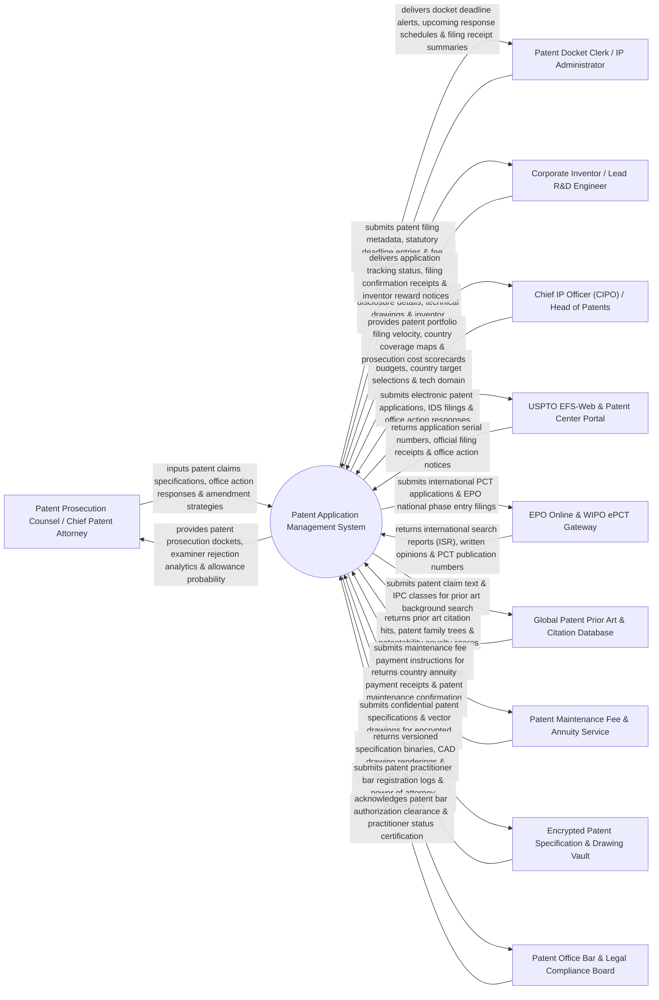

# Context Diagram — Patent Application Management System

## Mermaid Code

## Actor & Interaction Table | Bảng Actor & Tương tác

| # | Actor | Actor Type | Data Sent TO System | Data Received FROM System | Notes |
|---|-------|------------|---------------------|---------------------------|-------|
| 1 | Patent Prosecution Counsel / Chief Patent Attorney | Primary | Patent claims specifications, office action response arguments, claim amendment strategy notes, Information Disclosure Statements (IDS). | Patent prosecution dockets, examiner rejection analytics (35 U.S.C. 102/103), allowance probability scores. | Patent attorney managing patent prosecution, office action responses, and patent claim amendments. |
| 2 | Patent Docket Clerk / IP Administrator | Primary | Patent application filing metadata, statutory court/PTO deadline entries, fee payment receipts. | Docket deadline alerts, upcoming response schedules (3-Month Rule), filing receipt summaries. | Administrative clerk tracking patent dockets, statutory filing deadlines, and office action dates. |
| 3 | Corporate Inventor / Lead R&D Engineer | Primary | Invention disclosure details, technical CAD drawings, executed inventor oath/declaration forms. | Application tracking status, electronic filing confirmation receipts, inventor reward payout notices. | Corporate engineer submitting technical inventions and signing formal inventor declarations. |
| 4 | Chief IP Officer (CIPO) / Head of Patents | Primary | Patent filing budget caps, target country filing selections (PCT), technology domain priorities. | Patent portfolio filing velocity, country coverage heatmaps, prosecution cost scorecards, patent ROI. | Executive overseeing corporate patent strategy, international PCT filings, and patent budgets. |
| 5 | USPTO EFS-Web & Patent Center Portal | Supporting | Patent application serial numbers, official filing receipts, office action notices, Notice of Allowances. | Electronic patent applications (XML/PDF), IDS submissions, office action response packages, fee tokens. | US Patent Office gateway handling electronic patent application filings and prosecution documents. |
| 6 | EPO Online & WIPO ePCT Gateway | Supporting | International Search Reports (ISR), Written Opinions of ISA, PCT publication numbers, EPO grant notices. | International PCT applications, EPO national phase entry filings, priority claim documents. | European and international patent office gateways processing PCT applications and regional filings. |
| 7 | Global Patent Prior Art & Citation Database | Supporting | Prior art citation hits, classification cluster maps, patent family trees, AI patentability novelty scores. | Patent claim text streams, technical keyword queries, International Patent Classification (IPC) codes. | Database searching global patent literature (Derwent / Google Patents) for prior art citations. |
| 8 | Patent Maintenance Fee & Annuity Service | Supporting | Country annuity payment receipts, patent maintenance confirmation logs, renewal window status. | Maintenance fee payment instructions, granted patent renewal schedules. | Global annuity service (CPA Global) managing country-specific patent maintenance fee payments. |
| 9 | Encrypted Patent Specification & Drawing Vault | Supporting | Versioned specification binaries, CAD drawing renderings, access audit trails, check-out file locks. | Confidential draft patent briefs, high-resolution vector figures, secure download links. | AES-256 encrypted repository securing draft patent specifications and un-published technical drawings. |
| 10 | Patent Office Bar & Legal Compliance Board | Supporting / Regulatory | Patent practitioner bar registration numbers, power of attorney documents, ethical conduct logs. | Patent bar authorization clearance, practitioner standing certifications, USPTO OED compliance. | Regulatory body supervising patent attorney bar registrations, ethics, and power of attorney filings. |

## System Boundary Description | Mô tả Phạm vi Hệ thống

The **Patent Application Management System** is an enterprise patent application intake, claim specification drafting, EFS-Web e-filing, statutory docket deadline tracking, prior art citation, and international PCT national phase entry platform.

**Inside System Scope:**
- Patent application specification and claim drafting workflow with automated independent/dependent claim numbering.
- Integration with USPTO EFS-Web and WIPO ePCT APIs for electronic filing and automatic serial number ingestion.
- Statutory prosecution docketing calculating 3-month USPTO office action response deadlines and extension caps.
- Information Disclosure Statement (IDS) generator compiling prior art references for mandatory USPTO submission.
- International Patent Cooperation Treaty (PCT) timeline management tracking 30-month national phase entry deadlines.

**Outside System Scope:**
- Direct physical technical prototyping of hardware inventions (handled by R&D Hardware Labs).
- Direct physical examination of claims by patent examiners in government offices (handled by USPTO/EPO Examiners).
- Direct representation in Patent Trial and Appeal Board (PTAB) inter partes review hearings (handled by Trial Counsel).
