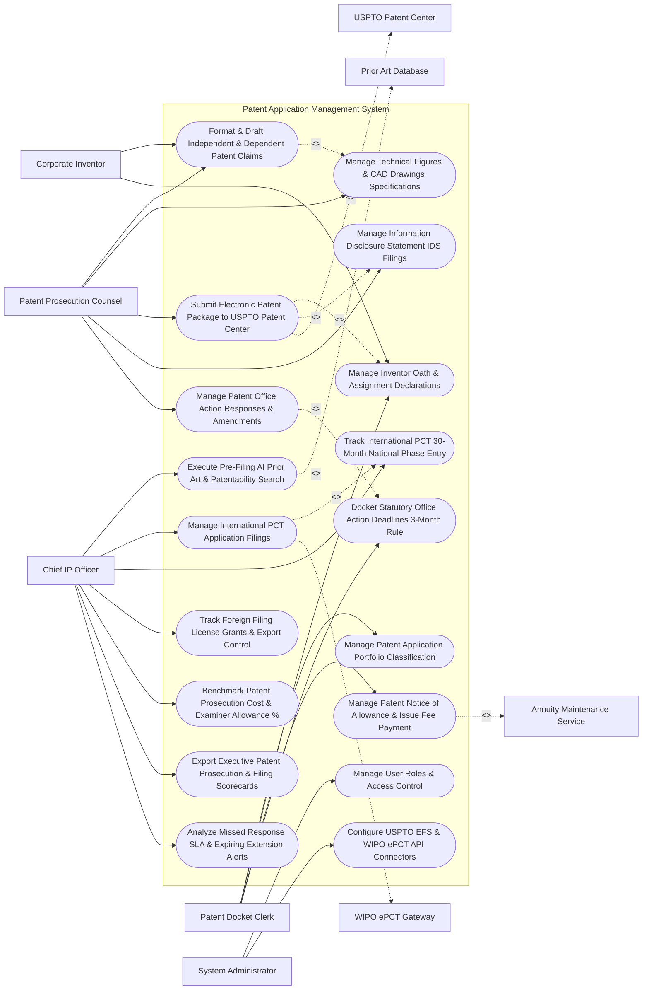

# Use Case Diagram — Patent Application Management System

## Mermaid Code

## Actor Table | Bảng Actor

| # | Actor | Actor Type | Role Description | Related Use Cases |
|---|-------|------------|------------------|-------------------|
| 1 | Patent Prosecution Counsel | Primary | Lead patent attorney drafting claims, attaching technical figures, submitting EFS-Web filings, and preparing IDS packages. | UC02, UC03, UC05, UC08, UC09 |
| 2 | Patent Docket Clerk | Primary | IP administrative clerk categorizing portfolio matters, tracking inventor oaths, managing issue fee payments, and docketing response deadlines. | UC01, UC07, UC11, UC12 |
| 3 | Corporate Inventor | Primary | R&D engineer reviewing technical claim drafts, validating figure accuracy, and executing digital inventor oath assignments. | UC02, UC07 |
| 4 | Chief IP Officer | Primary | Executive reviewing prior art searches, international PCT strategies, foreign filing licenses, prosecution costs, and scorecards. | UC04, UC06, UC10, UC13, UC14, UC15, UC18 |
| 5 | System Administrator | Primary | IT admin managing user security roles, USPTO EFS-Web credentials, and WIPO ePCT API connectors. | UC16, UC17 |
| 6 | USPTO Patent Center | System (Secondary) | Government patent portal processing electronic patent application packages and issuing official filing receipts. | UC05 |
| 7 | WIPO ePCT Gateway | System (Secondary) | International patent portal processing PCT filings and International Search Reports (ISR). | UC06 |
| 8 | Prior Art Database | System (Secondary) | Global patent search repository searching prior art literature and IPC classification codes. | UC04 |
| 9 | Annuity Maintenance Service | System (Secondary) | Patent fee service paying USPTO issue fees and global maintenance fees. | UC11 |

## Use Case Table | Bảng Use Case

| # | UC ID | Use Case Name | Primary Actor | Secondary Actor | Description | Priority |
|---|-------|---------------|---------------|-----------------|-------------|----------|
| 1 | UC01 | Manage Patent Application Portfolio Classification | Clerk | None | Organizes patent application files by technology domain, IPC classification, and client/entity ownership. | Critical |
| 2 | UC02 | Format & Draft Independent & Dependent Patent Claims | Counsel | None | Provides a specialized editor to format patent claim specifications, auto-numbering independent and dependent claims. | Critical |
| 3 | UC03 | Manage Technical Figures & CAD Drawings Specifications | Counsel | None | Manages high-resolution vector CAD figure drawings, generating line-numbered patent specification sheets. | High |
| 4 | UC04 | Execute Pre-Filing AI Prior Art & Patentability Search | CIPO | PriorArt | Runs AI vector searches across 100M+ global patents to evaluate claim novelty and prior art overlap prior to filing. | Critical |
| 5 | UC05 | Submit Electronic Patent Package to USPTO Patent Center | Counsel | USPTOPortal | Assembles XML/PDF application packages, validates document rules, and transmits filings via USPTO API. | Critical |
| 6 | UC06 | Manage International PCT Application Filings | CIPO | WIPOGateway | Prepares and submits international Patent Cooperation Treaty (PCT) applications, tracking International Search Reports (ISR). | Critical |
| 7 | UC07 | Manage Inventor Oath & Assignment Declarations | Clerk | None | Generates statutory USPTO Inventor Oath/Declaration forms and collects cryptographic digital signatures from co-inventors. | High |
| 8 | UC08 | Manage Information Disclosure Statement IDS Filings | Counsel | None | Auto-assembles Form PTO/SB/08 Information Disclosure Statements (IDS), listing all known prior art citations. | Critical |
| 9 | UC09 | Manage Patent Office Action Responses & Amendments | Counsel | None | Parses USPTO office action rejections (35 U.S.C. 102/103), formatting claim amendment response packages. | Critical |
| 10 | UC10 | Track International PCT 30-Month National Phase Entry | CIPO | None | Monitors 30-month PCT national phase entry deadlines, generating country selection worksheets for global protection. | Critical |
| 11 | UC11 | Manage Patent Notice of Allowance & Issue Fee Payment | Clerk | Annuity | Ingests USPTO Notice of Allowance, processing 3-month issue fee payments and verifying patent grant issuance. | High |
| 12 | UC12 | Docket Statutory Office Action Deadlines 3-Month Rule | Clerk | None | Auto-dockets statutory response deadlines (3-Month Rule) for all office actions, tracking 1-to-3 month extension caps. | Critical |
| 13 | UC13 | Track Foreign Filing License Grants & Export Control | CIPO | None | Verifies foreign filing license grants from USPTO before transmitting invention technical data outside the country. | High |
| 14 | UC14 | Benchmark Patent Prosecution Cost & Examiner Allowance % | CIPO | None | Analyzes patent prosecution spend per matter and tracks USPTO patent examiner allowance rates and average cycle time. | High |
| 15 | UC15 | Export Executive Patent Prosecution & Filing Scorecards | CIPO | None | Renders executive scorecards detailing filed application counts, grant rates %, PCT coverage, and prosecution spend. | High |
| 16 | UC16 | Manage User Roles & Access Control | Admin | None | Controls user login credentials, RBAC permissions, and confidential patent draft access clearances. | High |
| 17 | UC17 | Configure USPTO EFS & WIPO ePCT API Connectors | Admin | None | Configures API connection parameters for USPTO EFS-Web, Patent Center, WIPO ePCT, and EPO Online. | High |
| 18 | UC18 | Analyze Missed Response SLA & Expiring Extension Alerts | CIPO | None | Dispatches urgent alerts when a statutory office action response deadline is within 14 days or an extension cap is reached. | High |

## Use Case Specification | Đặc tả Use Case

---

### UC02 — Format & Draft Independent & Dependent Patent Claims

| Field | Detail |
|-------|--------|
| **UC ID** | UC02 |
| **Use Case Name** | Format & Draft Independent & Dependent Patent Claims |
| **Actor(s)** | Primary: Patent Prosecution Counsel, Corporate Inventor   Secondary: Encrypted Patent Specification & Drawing Vault |
| **Description** | Provides a specialized legal editor for drafting patent claim specifications, automatically maintaining antecedent basis rules, independent/dependent claim numbering, and claim dependency trees. |
| **Precondition** | 1. Invention disclosure details are approved for patent drafting.   2. Patent application draft container is initialized. |
| **Main Flow** | 1. Patent Counsel opens "Patent Claim Specification Editor" for Application `#APP-2026-88412`.   2. Counsel inputs Independent Claim 1 (System Claim):   &nbsp;&nbsp;&nbsp;&nbsp; a. Preamble: `"A semiconductor processing apparatus for accelerating neural network execution, comprising:"`.   &nbsp;&nbsp;&nbsp;&nbsp; b. Element A: `"a matrix multiplication array comprising a plurality of processing elements;"`.   &nbsp;&nbsp;&nbsp;&nbsp; c. Element B: `"a dynamic quantization pipeline coupled to the matrix multiplication array...;"`.   3. Counsel inputs Dependent Claim 2 (Method Claim depending on Claim 1):   &nbsp;&nbsp;&nbsp;&nbsp; a. Dependency: `"The apparatus of claim 1, wherein the dynamic quantization pipeline operates at 8-bit integer precision."`   4. System executes Automated Claim Validation Engine:   &nbsp;&nbsp;&nbsp;&nbsp; a. Numbering Check: Auto-numbers Claims 1 to 25 -> `VALID`.   &nbsp;&nbsp;&nbsp;&nbsp; b. Antecedent Basis Check: Verifies that `"the dynamic quantization pipeline"` in Claim 2 has proper antecedent basis `"a dynamic quantization pipeline"` in Claim 1 -> `ANTECEDENT_BASIS_VERIFIED`.   &nbsp;&nbsp;&nbsp;&nbsp; c. Multiple Dependent Claim Check: Verifies no illegal multiple dependencies exist.   5. Corporate Inventor reviews claim draft in portal, verifying technical accuracy.   6. System saves claim specification version `v1.0_Claims.docx` to Encrypted Document Vault. |
| **Alternative Flow** | **AF1** — Automated Claim Re-Numbering: Counsel deletes Claim 3; System automatically re-numbers all subsequent claims (Claims 4-25 become Claims 3-24) and updates all dependent claim references instantly. |
| **Exception Flow** | **EX1** — Missing Antecedent Basis Error: Counsel introduces term `"the memory controller"` in Claim 5 without prior introduction `"a memory controller"`; System flags `MISSING_ANTECEDENT_BASIS_WARNING`, highlighting term in red. |
| **Postcondition** | Patent claims are drafted, antecedent basis and dependency rules are verified, claim numbering auto-updates, and draft saves to vault. |
| **Business Rule** | **BR1**: Patent claim specifications MUST pass automated antecedent basis and claim dependency checks prior to electronic filing. |

---

### UC05 — Submit Electronic Patent Package to USPTO Patent Center

| Field | Detail |
|-------|--------|
| **UC ID** | UC05 |
| **Use Case Name** | Submit Electronic Patent Package to USPTO Patent Center |
| **Actor(s)** | Primary: Patent Prosecution Counsel   Secondary: USPTO EFS-Web & Patent Center Portal |
| **Description** | Assembles final XML/PDF patent application packages (Specification, Claims, Abstract, CAD Drawings, Oath, Fee Worksheet), validates USPTO document rules, and dispatches electronic filings to the USPTO. |
| **Precondition** | 1. Patent claims (UC02), specification, vector drawings (UC03), and inventor declarations (UC07) are finalized.   2. USPTO Patent Center API credentials and bar registration numbers are authenticated. |
| **Main Flow** | 1. Counsel opens "USPTO EFS-Web Electronic Filing Desk" for Application `#APP-2026-88412`.   2. System retrieves Application Package Components:   &nbsp;&nbsp;&nbsp;&nbsp; a. Utility Patent Specification & Claims: `Specification_Claims.pdf` (PDF/A Format).   &nbsp;&nbsp;&nbsp;&nbsp; b. Technical Figures: `Figures_1_to_8.pdf` (300 DPI Vector Drawings).   &nbsp;&nbsp;&nbsp;&nbsp; c. Executed Oath/Declaration: `Inventor_Declaration_Signed.pdf` (UC07).   &nbsp;&nbsp;&nbsp;&nbsp; d. Application Data Sheet (ADS): `Form_PTO_AIA_14.xml`.   &nbsp;&nbsp;&nbsp;&nbsp; e. Information Disclosure Statement (IDS): `Form_PTO_SB_08.pdf` (UC08).   3. System dispatches Pre-Filing Technical Validation Check:   &nbsp;&nbsp;&nbsp;&nbsp; a. PDF Page Size Check: $8.5 \times 11 \text{ inches}$ with $1\text{-inch}$ margins -> `VALID`.   &nbsp;&nbsp;&nbsp;&nbsp; b. Embedded Fonts Check: All fonts embedded -> `VALID`.   &nbsp;&nbsp;&nbsp;&nbsp; c. Fee Calculation: Micro/Small/Large Entity Fee calculated -> `$1,820.00 Filing Fee`.   4. Counsel signs package using Cryptographic Patent Bar Digital Signature.   5. System transmits HTTPS REST API payload to USPTO Patent Center Gateway API (`POST /api/v1/applications/submit`).   6. USPTO Gateway accepts filing and returns Official Electronic Filing Receipt:   &nbsp;&nbsp;&nbsp;&nbsp; a. USPTO Application Serial #: `US 18/884,120`.   &nbsp;&nbsp;&nbsp;&nbsp; b. Confirmation #: `8841`.   &nbsp;&nbsp;&nbsp;&nbsp; c. Official Filing Date: `October 30, 2026 at 04:45:00 PM EST`.   7. System attaches electronic filing receipt to patent record and updates docket schedule (UC12). |
| **Alternative Flow** | **AF1** — EFS-Web Provisional Patent Application Filing: Application is a Provisional Patent; System formats simplified specification, attaches drawings, pays $320 provisional fee, and obtains Provisional Serial # `US 63/884,120`. |
| **Exception Flow** | **EX1** — USPTO PDF Validation Rejection: Technical figure PDF contains non-embedded font; USPTO API returns `VALIDATION_FAILED_NON_EMBEDDED_FONT`, prompting counsel to re-distill PDF before submitting. |
| **Postcondition** | Patent package is validated, digitally signed, submitted to USPTO Patent Center, official serial number and filing date are issued, and docketing updates. |
| **Business Rule** | **BR1**: Patent application packages MUST pass automated USPTO PDF margin, font embedding, and ADS XML validation checks prior to transmission. |

---

### UC08 — Manage Information Disclosure Statement (IDS) Filings

| Field | Detail |
|-------|--------|
| **UC ID** | UC08 |
| **Use Case Name** | Manage Information Disclosure Statement (IDS) Filings |
| **Actor(s)** | Primary: Patent Prosecution Counsel   Secondary: Global Patent Prior Art & Citation Database |
| **Description** | Auto-compiles Form PTO/SB/08 Information Disclosure Statements (IDS), listing all known prior art patent and non-patent literature citations to fulfill the duty of candor (37 CFR 1.56) before the USPTO. |
| **Precondition** | 1. Patent application serial number `US 18/884,120` is assigned (UC05).   2. Prior art search results (UC04) and related patent family citations are indexed. |
| **Main Flow** | 1. Counsel opens "IDS Filing Generator Studio" for Application `US 18/884,120`.   2. System retrieves all known prior art citations associated with matter:   &nbsp;&nbsp;&nbsp;&nbsp; a. US Patent Documents: 5 Granted US Patents (e.g., `US 11,884,120 B2`).   &nbsp;&nbsp;&nbsp;&nbsp; b. Foreign Patent Documents: 3 Foreign Applications (e.g., `EP 3884120 A1`).   &nbsp;&nbsp;&nbsp;&nbsp; c. Non-Patent Literature (NPL): 2 IEEE Academic Papers (e.g., *"Neural Acceleration Architecture, IEEE 2025"*).   3. System checks Citation Cross-Filing Rules across Patent Family:   &nbsp;&nbsp;&nbsp;&nbsp; a. Automatically pulls prior art cited in co-pending PCT application `PCT/US2026/088412` -> Adds 2 new citations to IDS list.   4. System auto-populates Form PTO/SB/08 (Information Disclosure Statement):   &nbsp;&nbsp;&nbsp;&nbsp; a. Fills Applicant Name, Serial # `18/884,120`, Filing Date, Group Art Unit `2142`.   &nbsp;&nbsp;&nbsp;&nbsp; b. Formats 10 Citations into US Patent, Foreign Patent, and NPL tables.   5. System attaches PDF copies of foreign patents and NPL articles as required by USPTO rules.   6. Counsel reviews IDS package, signs form, and submits IDS package electronically to USPTO (UC05).   7. System updates Duty of Candor Log: `IDS_FILED_10_CITATIONS_OCT2026`. |
| **Alternative Flow** | **AF1** — Supplemental IDS Filing: Examiner issues office action citing new prior art; Counsel files Supplemental IDS within 3 months, attaching new citations and paying $260 IDS fee. |
| **Exception Flow** | **EX1** — Missing NPL PDF Attachment Error: IDS contains IEEE paper citation without attached PDF file; System flags `MISSING_NPL_ATTACHMENT_ERROR`, blocking submission until PDF is attached. |
| **Postcondition** | Form PTO/SB/08 IDS is auto-compiled, prior art citations and NPL attachments are packaged, and IDS is submitted to USPTO. |
| **Business Rule** | **BR1**: Information Disclosure Statements (IDS) MUST list all known prior art citations across co-pending patent family members to comply with 37 CFR 1.56. |

---

### UC10 — Track International PCT 30-Month National Phase Entry

| Field | Detail |
|-------|--------|
| **UC ID** | UC10 |
| **Use Case Name** | Track International PCT 30-Month National Phase Entry |
| **Actor(s)** | Primary: Chief IP Officer, Patent Prosecution Counsel   Secondary: WIPO ePCT Gateway |
| **Description** | Monitors Patent Cooperation Treaty (PCT) international timeline triggers, tracking statutory 30-month (or 31-month) national phase entry deadlines, and generating country selection worksheets for global filings. |
| **Precondition** | 1. International PCT application (`PCT/US2026/088412`) is filed with WIPO (UC06).   2. Priority filing date (`November 15, 2025`) is set. |
| **Main Flow** | 1. System logs PCT Application `PCT/US2026/088412` in International Timeline Tracker:   &nbsp;&nbsp;&nbsp;&nbsp; a. Priority Date: `November 15, 2025`.   &nbsp;&nbsp;&nbsp;&nbsp; b. International Filing Date: `November 10, 2026` (12 Months from Priority).   &nbsp;&nbsp;&nbsp;&nbsp; c. WIPO Publication Date: `May 20, 2027` (18 Months from Priority).   &nbsp;&nbsp;&nbsp;&nbsp; d. Statutory National Phase Entry Deadline: `May 15, 2028` (30 Months from Priority - 31 Months for EPO/Japan).   2. System initializes Advance Warning Timers:   &nbsp;&nbsp;&nbsp;&nbsp; a. Sets 6-Month Advance Warning Trigger: `November 15, 2027` (24 Months from Priority).   3. On `November 15, 2027`, System triggers National Phase Selection Alert:   &nbsp;&nbsp;&nbsp;&nbsp; a. Dispatches alert to CIPO and Chief Patent Counsel: *"PCT ACTION REQUIRED: Application PCT/US2026/088412 National Phase Entry due in 6 Months (May 15, 2028). Select target countries."*   4. CIPO opens "Global Country Selection Worksheet":   &nbsp;&nbsp;&nbsp;&nbsp; a. Selects Target Jurisdictions: `European Patent Office (EPO)`, `Japan (JPO)`, `China (CNIPA)`, `South Korea (KIPO)`.   &nbsp;&nbsp;&nbsp;&nbsp; b. System calculates Estimated Filing & Translation Costs: `$28,500.00 Total Estimated Cost`.   5. CIPO approves country selection package and assigns local foreign associate law firms.   6. System dispatches national phase entry instructions to foreign associates via WIPO ePCT API. |
| **Alternative Flow** | **AF1** — Direct PCT Abandonment: CIPO decides technology is commercialized only in the US; CIPO tags PCT application as `ABANDON_PCT_NATIONAL_PHASE`, suppressing foreign filing tasks and saving $28.5k. |
| **Exception Flow** | **EX1** — 30-Day Critical National Phase SLA Warning: National phase entry deadline is 30 days away and no country selections are made; System sends urgent SMS alert to CIPO to prevent loss of international rights. |
| **Postcondition** | International PCT 30-month national phase entry deadlines are tracked, target country selection worksheets generate, and foreign filings initialize. |
| **Business Rule** | **BR1**: PCT national phase entry deadlines MUST trigger automated advance notifications at 6 months, 3 months, and 30 days prior to the 30/31-month statutory deadline. |

---

### UC12 — Docket Statutory Office Action Deadlines (3-Month Rule)

| Field | Detail |
|-------|--------|
| **UC ID** | UC12 |
| **Use Case Name** | Docket Statutory Office Action Deadlines (3-Month Rule) |
| **Actor(s)** | Primary: Patent Docket Clerk, Patent Prosecution Counsel   Secondary: USPTO EFS-Web & Patent Center Portal |
| **Description** | Ingests official patent office action notices, automatically calculating 3-month statutory response deadlines, 1-to-3 month extension fee caps, and dispatching multi-stage docket warning alerts. |
| **Precondition** | 1. Official office action (e.g., Non-Final Rejection) is received from USPTO (UC05).   2. Office action mailing date is extracted. |
| **Main Flow** | 1. System ingests USPTO Non-Final Office Action for Application `US 18/884,120`:   &nbsp;&nbsp;&nbsp;&nbsp; a. USPTO Mailing Date: `October 15, 2026`.   &nbsp;&nbsp;&nbsp;&nbsp; b. Office Action Type: `Non-Final Rejection (35 U.S.C. 103)`.   2. System auto-calculates Statutory Response Schedule:   &nbsp;&nbsp;&nbsp;&nbsp; a. Statutory Response Deadline (3-Month Rule): `January 15, 2027` (No Extension Fee Required).   &nbsp;&nbsp;&nbsp;&nbsp; b. 1-Month Extension Deadline: `February 15, 2027` (Requires $220 Extension Fee).   &nbsp;&nbsp;&nbsp;&nbsp; c. 2-Month Extension Deadline: `March 15, 2027` (Requires $640 Extension Fee).   &nbsp;&nbsp;&nbsp;&nbsp; d. 3-Month Extension Statutory Cap (6-Month Maximum): `April 15, 2027` (Requires $1,480 Extension Fee - Absolute Abandonment Cap).   3. System creates Master Docket Record `#DOCK-88412` and assigns response to Lead Attorney Sarah Jenkins.   4. System initializes Multi-Stage Alert Schedule:   &nbsp;&nbsp;&nbsp;&nbsp; a. Stage 1 (60 Days Remaining): Email reminder to Lead Attorney.   &nbsp;&nbsp;&nbsp;&nbsp; b. Stage 2 (30 Days Remaining): High-priority dashboard alert.   &nbsp;&nbsp;&nbsp;&nbsp; c. Stage 3 (14 Days Remaining): Urgent notification to Attorney & Managing Partner.   5. On `January 05, 2027` (10 Days before 3-month deadline), Attorney Sarah Jenkins files response (UC09).   6. System ingests filing confirmation, marks Docket `#DOCK-88412` as `CLOSED_RESPONSED`, and cancels remaining alerts. |
| **Alternative Flow** | **AF1** — Extension Fee Execution: Attorney cannot complete response by Jan 15; Attorney files Response on Feb 10 with 1-Month Extension Form PTO/SB/23; System logs $220 extension fee and clears docket. |
| **Exception Flow** | **EX1** — Abandonment Warning (6-Month Cap Reached): 6-month statutory cap (April 15) is reached without filing; System flags `CRITICAL_PATENT_ABANDONMENT_IMMINENT`, dispatching emergency phone alert to CIPO. |
| **Postcondition** | Office action mailing date is parsed, 3-month statutory response deadlines and extension caps are docketed, and multi-stage alerts initialize. |
| **Business Rule** | **BR1**: Docketing response deadlines MUST enforce the USPTO 3-month statutory rule and maximum 6-month statutory abandonment cap. |
