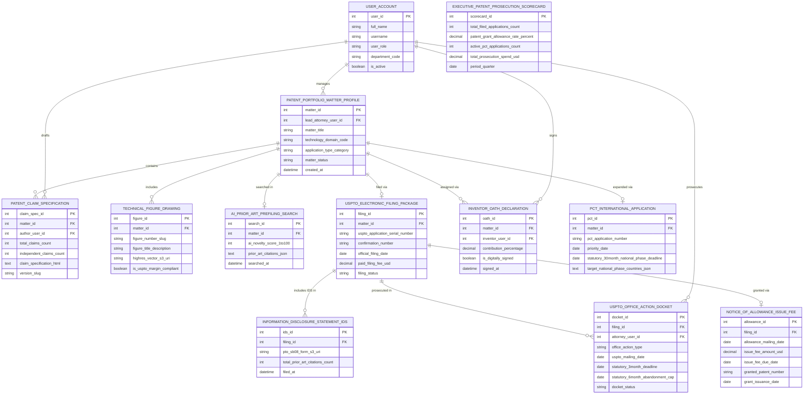

# Conceptual ERD — Patent Application Management System

## Mermaid Code

## Entity Description Table | Bảng mô tả Entity

| # | Entity Name | Vietnamese Name | Description | Key Attributes | Main Relationships |
|---|-------------|-----------------|-------------|----------------|-------------------|
| 1 | USER_ACCOUNT | Tài khoản Nguời dùng | System credentials and access roles for patent prosecution counsel, docket clerks, inventors, and CIPOs. | `user_id`, `username`, `user_role`, `department_code` | Manages `PATENT_PORTFOLIO_MATTER_PROFILE`, drafts `PATENT_CLAIM_SPECIFICATION`, signs `INVENTOR_OATH_DECLARATION`, prosecutes `USPTO_OFFICE_ACTION_DOCKET`. |
| 2 | PATENT_PORTFOLIO_MATTER_PROFILE | Profile Application Patent | Central patent application matter record tracking titles, technology domains, application categories (Utility/Provisional), and status. | `matter_id`, `lead_attorney_user_id`, `matter_title`, `technology_domain_code`, `application_type_category`, `matter_status` | Contains `PATENT_CLAIM_SPECIFICATION`, includes `TECHNICAL_FIGURE_DRAWING`, searched in `AI_PRIOR_ART_PREFILING_SEARCH`, filed via `USPTO_ELECTRONIC_FILING_PACKAGE`, assigned via `INVENTOR_OATH_DECLARATION`, expanded via `PCT_INTERNATIONAL_APPLICATION`, managed by `USER_ACCOUNT`. |
| 3 | PATENT_CLAIM_SPECIFICATION | Specification Claim Patent | Patent claim specification record storing claim counts, independent claim counts, HTML claim text, and version slugs. | `claim_spec_id`, `matter_id`, `author_user_id`, `total_claims_count`, `independent_claims_count`, `claim_specification_html`, `version_slug` | Belongs to `PATENT_PORTFOLIO_MATTER_PROFILE`, drafted by `USER_ACCOUNT`. |
| 4 | TECHNICAL_FIGURE_DRAWING | Drawing CAD Kỹ thuật Patent | Technical CAD drawing record storing figure numbers, description titles, high-res vector S3 URIs, and USPTO margin compliance flags. | `figure_id`, `matter_id`, `figure_number_slug`, `figure_title_description`, `highres_vector_s3_uri`, `is_uspto_margin_compliant` | Belongs to `PATENT_PORTFOLIO_MATTER_PROFILE`. |
| 5 | AI_PRIOR_ART_PREFILING_SEARCH | Prior Art Search Pre-Filing | Pre-filing AI prior art search log recording AI novelty scores (1-100), prior art citations JSON, and search timestamps. | `search_id`, `matter_id`, `ai_novelty_score_1to100`, `prior_art_citations_json`, `searched_at` | Belongs to `PATENT_PORTFOLIO_MATTER_PROFILE`. |
| 6 | USPTO_ELECTRONIC_FILING_PACKAGE | Package Filing USPTO EFS | USPTO EFS-Web electronic filing record tracking application serial numbers (`US 18/884,120`), confirmation numbers, filing dates, and fees paid. | `filing_id`, `matter_id`, `uspto_application_serial_number`, `confirmation_number`, `official_filing_date`, `paid_filing_fee_usd`, `filing_status` | Belongs to `PATENT_PORTFOLIO_MATTER_PROFILE`, includes IDS in `INFORMATION_DISCLOSURE_STATEMENT_IDS`, prosecuted in `USPTO_OFFICE_ACTION_DOCKET`, granted via `NOTICE_OF_ALLOWANCE_ISSUE_FEE`. |
| 7 | INVENTOR_OATH_DECLARATION | Tuyên bố Oath Inventor | Statutory USPTO Inventor Oath/Declaration record tracking inventor contribution %, digital signature flags, and timestamps. | `oath_id`, `matter_id`, `inventor_user_id`, `contribution_percentage`, `is_digitally_signed`, `signed_at` | Belongs to `PATENT_PORTFOLIO_MATTER_PROFILE`, signed by `USER_ACCOUNT`. |
| 8 | INFORMATION_DISCLOSURE_STATEMENT_IDS | Filing Form PTO SB 08 IDS | Form PTO/SB/08 Information Disclosure Statement (IDS) filing record tracking form S3 URIs, citation counts, and filing timestamps. | `ids_id`, `filing_id`, `pto_sb08_form_s3_uri`, `total_prior_art_citations_count`, `filed_at` | Belongs to `USPTO_ELECTRONIC_FILING_PACKAGE`. |
| 9 | USPTO_OFFICE_ACTION_DOCKET | Docket Office Action USPTO | USPTO office action docket record tracking office action types, mailing dates, 3-month statutory deadlines, 6-month abandonment caps, and status. | `docket_id`, `filing_id`, `attorney_user_id`, `office_action_type`, `uspto_mailing_date`, `statutory_3month_deadline`, `statutory_6month_abandonment_cap` | Belongs to `USPTO_ELECTRONIC_FILING_PACKAGE`, prosecuted by `USER_ACCOUNT`. |
| 10 | PCT_INTERNATIONAL_APPLICATION | Đơn PCT Quốc tế | Patent Cooperation Treaty (PCT) international filing record tracking PCT numbers, priority dates, 30-month national phase deadlines, and target country JSONs. | `pct_id`, `matter_id`, `pct_application_number`, `priority_date`, `statutory_30month_national_phase_deadline`, `target_national_phase_countries_json` | Belongs to `PATENT_PORTFOLIO_MATTER_PROFILE`. |
| 11 | NOTICE_OF_ALLOWANCE_ISSUE_FEE | Thông báo Notice of Allowance | USPTO Notice of Allowance record tracking allowance dates, issue fee amounts USD, granted patent numbers, and grant issuance dates. | `allowance_id`, `filing_id`, `allowance_mailing_date`, `issue_fee_amount_usd`, `issue_fee_due_date`, `granted_patent_number`, `grant_issuance_date` | Belongs to `USPTO_ELECTRONIC_FILING_PACKAGE`. |
| 12 | EXECUTIVE_PATENT_PROSECUTION_SCORECARD | Scorecard Executive Prosecution | Executive patent prosecution scorecard aggregating filed application counts, grant allowance rates %, active PCT count, and prosecution spend. | `scorecard_id`, `total_filed_applications_count`, `patent_grant_allowance_rate_percent`, `active_pct_applications_count`, `total_prosecution_spend_usd` | Standalone executive performance entity. |

## Relationship Description | Mô tả Quan hệ

| # | From Entity | Cardinality | To Entity | Label | Business Explanation |
|---|-------------|-------------|-----------|-------|----------------------|
| 1 | PATENT_PORTFOLIO_MATTER_PROFILE | 1 to 1..N | PATENT_CLAIM_SPECIFICATION | contains | A patent application matter profile contains patent claim specifications. |
| 2 | PATENT_PORTFOLIO_MATTER_PROFILE | 1 to 0..N | TECHNICAL_FIGURE_DRAWING | includes | A patent application matter profile includes technical figure CAD drawings. |
| 3 | PATENT_PORTFOLIO_MATTER_PROFILE | 1 to 0..1 | AI_PRIOR_ART_PREFILING_SEARCH | searched in | A patent application matter profile is searched in pre-filing prior art searches. |
| 4 | PATENT_PORTFOLIO_MATTER_PROFILE | 1 to 0..1 | USPTO_ELECTRONIC_FILING_PACKAGE | filed via | A patent application matter profile is filed via USPTO electronic filing packages. |
| 5 | PATENT_PORTFOLIO_MATTER_PROFILE | 1 to 1..N | INVENTOR_OATH_DECLARATION | assigned via | A patent application matter profile is assigned via inventor oath declarations. |
| 6 | PATENT_PORTFOLIO_MATTER_PROFILE | 1 to 0..1 | PCT_INTERNATIONAL_APPLICATION | expanded via | A patent application matter profile is expanded via PCT international filings. |
| 7 | USPTO_ELECTRONIC_FILING_PACKAGE | 1 to 0..N | INFORMATION_DISCLOSURE_STATEMENT_IDS | includes IDS in | A USPTO filing package includes Information Disclosure Statements (IDS). |
| 8 | USPTO_ELECTRONIC_FILING_PACKAGE | 1 to 0..N | USPTO_OFFICE_ACTION_DOCKET | prosecuted in | A USPTO filing package is prosecuted in office action dockets. |
| 9 | USPTO_ELECTRONIC_FILING_PACKAGE | 1 to 0..1 | NOTICE_OF_ALLOWANCE_ISSUE_FEE | granted via | A USPTO filing package is granted via a Notice of Allowance and issue fee payment. |
| 10 | USER_ACCOUNT | 1 to 0..N | PATENT_PORTFOLIO_MATTER_PROFILE | manages | A patent prosecution counsel user account manages patent application matter profiles. |
| 11 | USER_ACCOUNT | 1 to 0..N | PATENT_CLAIM_SPECIFICATION | drafts | A patent attorney user account drafts patent claim specifications. |
| 12 | USER_ACCOUNT | 1 to 0..N | INVENTOR_OATH_DECLARATION | signs | A corporate inventor user account signs inventor oath declarations. |
| 13 | USER_ACCOUNT | 1 to 0..N | USPTO_OFFICE_ACTION_DOCKET | prosecutes | A patent attorney user account prosecutes office action dockets. |
