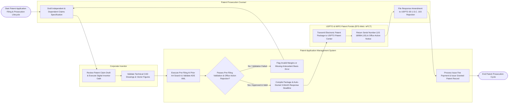

# Swimlane Diagram — Patent Application Management System

## Mermaid Code

## Flow Description | Mô tả luồng

| Lane | Actor | Role in Flow |
|------|-------|-------------|
| 1 | Corporate Inventor | Reviews technical patent claim drafts, validates vector CAD figure drawings, signs statutory USPTO Inventor Oath/Declaration forms, and verifies invention disclosures. |
| 2 | Patent Prosecution Counsel | Drafts independent and dependent patent claim specifications, verifies antecedent basis rules, compiles Information Disclosure Statements (IDS), amends claims in response to USPTO examiner rejections, and files prosecution responses. |
| 3 | Patent Application Management System | Executes pre-filing AI prior art searches, validates PDF page margins/embedded fonts, generates Application Data Sheet (ADS) XML, auto-dockets 3-month statutory office action deadlines, tracks 30-month PCT national phase timelines, and updates prosecution scorecards. |
| 4 | USPTO & WIPO Patent Portals (EFS-Web / ePCT) | Ingests electronic XML/PDF patent application packages via REST APIs, issues official serial numbers (`US 18/884,120`) and filing receipts, transmits office action notices, and issues patent grant certificates. |
