# Action Tree — Patent Application Management System

## Mermaid Code

```mermaid
graph TD
    Root["Patent Application Management System"]

    Root --> M1["Patent Claims Drafting & Vector Figure Management"]
    Root --> M2["Pre-Filing AI Prior Art & Novelty Scoring"]
    Root --> M3["USPTO EFS-Web E-Filing & ADS Generation"]
    Root --> M4["IDS Filings & Duty of Candor Compliance"]
    Root --> M5["USPTO Office Action Prosecution & Docketing"]
    Root --> M6["PCT International Phase & Patent Grant Scorecards"]

    M1 --> A11["Draft Independent & Dependent Patent Claim Specifications"]
    M1 --> A12["Enforce Automated Claim Antecedent Basis & Dependency Tree Checks"]
    M1 --> A13["Manage Technical CAD Figures & Vector Drawing Margin Rules"]
    M1 --> A14["Collect Cryptographic Digital Signatures on Inventor Oath Declarations"]

    M2 --> A21["Execute Pre-Filing AI Vector Prior Art Searches across 100M+ Patents"]
    M2 --> A22["Calculate AI Patentability Novelty Scores (Scale 0 to 100)"]
    M2 --> A23["Identify Prior Art Overlaps & Highlight Un-Cited Novel Features"]
    M2 --> A24["Generate Pre-Filing Patentability Risk & Prior Art Summary Reports"]

    M3 --> A31["Format Patent Application Packages into PDF/A & XML Standards"]
    M3 --> A32["Auto-Generate Application Data Sheet ADS XML (Form PTO/AIA/14)"]
    M3 --> A33["Validate PDF Page Margins, 300 DPI Figures & Embedded Fonts"]
    M3 --> A34["Transmit Electronic Patent Packages to USPTO Patent Center API"]

    M4 --> A41["Auto-Compile Form PTO/SB/08 Information Disclosure Statements (IDS)"]
    M4 --> A42["Cross-Cite Prior Art References across Co-Pending Patent Family Members"]
    M4 --> A43["Attach Required PDF Copies of Foreign Patents & Non-Patent Literature"]
    M4 --> A44["Maintain Immutable Duty of Candor Compliance Logs (37 CFR 1.56)"]

    M5 --> A51["Ingest Electronic USPTO Non-Final & Final Office Action Rejections"]
    M5 --> A52["Auto-Docket Statutory 3-Month Response Deadlines & 6-Month Caps"]
    M5 --> A53["Draft Claim Amendments in Response to 35 U.S.C. 102/103 Rejections"]
    M5 --> A54["Trigger 14-Day Overdue Response SLA & Extension Fee Warning Alerts"]

    M6 --> A61["Track International PCT 30-Month National Phase Entry Timelines"]
    M6 --> A62["Generate Global Country Selection Worksheets & Translation Costing"]
    M6 --> A63["Process USPTO Notice of Allowance Issue Fees & Verify Patent Grants"]
    M6 --> A64["Export Executive Patent Prosecution Velocity, Allowance % & Cost Scorecards"]
```

## Module Description | Mô tả Module

| # | Module | Description | Actions |
|---|--------|-------------|---------|
| 1 | Patent Claims Drafting & Vector Figure Management | Formats claim specifications, enforces antecedent basis rules, manages vector CAD drawings, and collects digital inventor oath signatures. | Draft Independent & Dependent Patent Claims, Enforce Antecedent Basis & Dependency Rules, Manage CAD Figures & Vector Drawing Margins, Collect Digital Signatures on Inventor Oaths. |
| 2 | Pre-Filing AI Prior Art & Novelty Scoring | Runs pre-filing AI vector searches across global patent databases, computes AI Novelty Scores (0-100), and highlights un-cited novel features. | Execute Pre-Filing AI Vector Prior Art Searches, Calculate AI Patentability Novelty Scores, Identify Prior Art Overlaps & Un-Cited Novel Features, Generate Pre-Filing Patentability Reports. |
| 3 | USPTO EFS-Web E-Filing & ADS Generation | Builds PDF/A packages, auto-generates Application Data Sheet (ADS) XML, validates PDF margins/fonts, and submits filings to USPTO Patent Center. | Format Application Packages into PDF/A & XML, Auto-Generate ADS XML (Form PTO/AIA/14), Validate PDF Page Margins & Embedded Fonts, Transmit Packages to USPTO Patent Center API. |
| 4 | IDS Filings & Duty of Candor Compliance | Auto-compiles Form PTO/SB/08 Information Disclosure Statements (IDS), cross-cites references across patent families, and attaches NPL literature. | Auto-Compile Form PTO/SB/08 IDS Statements, Cross-Cite Prior Art across Patent Families, Attach Foreign Patents & Non-Patent Literature PDFs, Maintain Duty of Candor Compliance Logs. |
| 5 | USPTO Office Action Prosecution & Docketing | Ingests office actions, auto-dockets 3-month statutory response deadlines, tracks claim amendments, and dispatches 14-day extension alerts. | Ingest USPTO Office Action Rejections, Auto-Docket Statutory 3-Month Response Deadlines, Draft Claim Amendments to 102/103 Rejections, Trigger 14-Day Overdue SLA Warning Alerts. |
| 6 | PCT International Phase & Patent Grant Scorecards | Tracks PCT 30-month national phase entry deadlines, calculates foreign translation costs, processes issue fees, and exports prosecution scorecards. | Track International PCT 30-Month National Phase Entry, Generate Global Country Selection Worksheets, Process USPTO Notice of Allowance Issue Fees, Export Executive Patent Prosecution Scorecards. |
