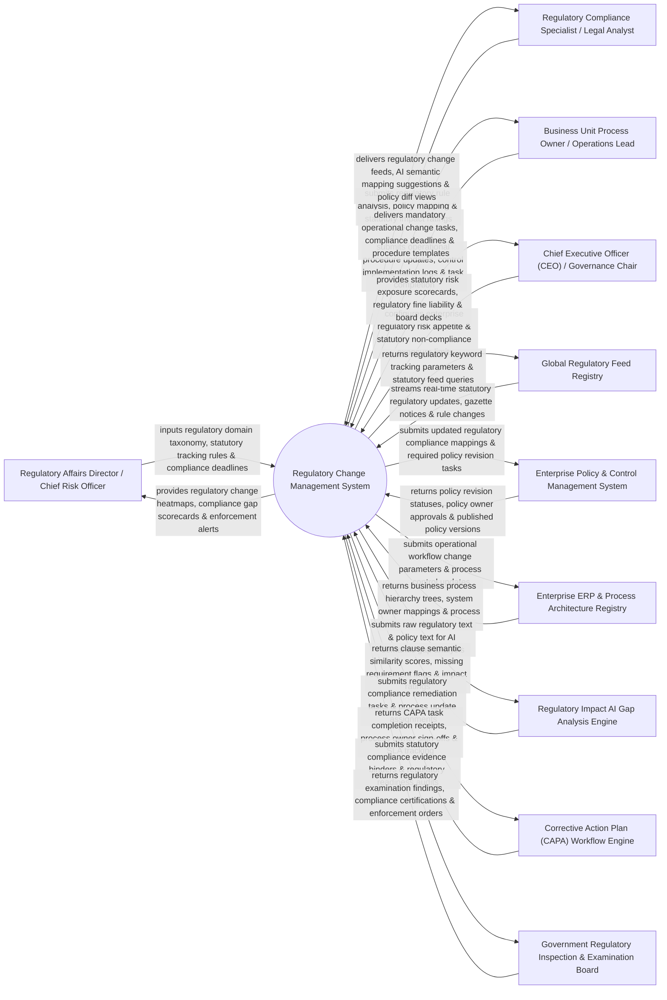

# Context Diagram — Regulatory Change Management System

## Mermaid Code

## Actor & Interaction Table | Bảng Actor & Tương tác

| # | Actor | Actor Type | Data Sent TO System | Data Received FROM System | Notes |
|---|-------|------------|---------------------|---------------------------|-------|
| 1 | Regulatory Affairs Director / Chief Risk Officer | Primary | Regulatory domain taxonomy, statutory tracking rules, mandatory compliance deadlines, risk thresholds. | Regulatory change heatmaps, compliance gap scorecards, statutory enforcement alerts, regulatory ROI. | Executive leading regulatory intelligence, risk management, and statutory compliance strategy. |
| 2 | Regulatory Compliance Specialist / Legal Analyst | Primary | Regulatory rule impact analysis, policy mapping tags, statutory impact ratings (High/Med/Low), legal notes. | Regulatory change feeds, AI semantic mapping suggestions, policy diff views, statutory alert digests. | Compliance analyst evaluating new regulations, mapping rules to policies, and defining operational changes. |
| 3 | Business Unit Process Owner / Operations Lead | Primary | Operational procedure updates, control implementation evidence logs, task completion sign-offs. | Mandatory operational change tasks, compliance deadlines, updated procedure templates, SLA alerts. | Operations manager executing process changes in business units to comply with new regulations. |
| 4 | CEO | Primary | Enterprise regulatory risk appetite limits, maximum allowable fine exposure, governance committee guidelines. | Statutory risk exposure scorecards, regulatory fine liability forecasts, executive board decks. | Executive monitoring global regulatory compliance exposure, fine prevention, and statutory readiness. |
| 5 | Global Regulatory Feed Registry | Supporting | Real-time statutory regulatory updates (Thomson Reuters / LexisNexis), government gazette notices, legal amendments. | Regulatory keyword tracking parameters, statutory feed queries, jurisdiction subscription filters. | External regulatory intelligence provider streaming global statutory rule changes and legal updates. |
| 6 | Enterprise Policy & Control Management System | Supporting | Policy revision statuses, policy owner approval logs, published policy versions, control IDs. | Updated regulatory compliance mappings, required policy revision tasks, statutory rule diff payloads. | Policy governance system managing corporate policies, operating procedures, and internal controls. |
| 7 | Enterprise ERP & Process Architecture Registry | Supporting | Business process hierarchy trees, system owner mappings, process architecture logs, IT application IDs. | Operational workflow change parameters, process control updates, statutory compliance tags. | ERP process architecture registry (SAP / Signavio) mapping corporate business processes and systems. |
| 8 | Regulatory Impact AI Gap Analysis Engine | Supporting | Clause semantic similarity scores, missing requirement flags, AI impact ratings (High/Med/Low). | Raw regulatory text streams, internal policy text streams, prompt extraction parameters. | AI NLP engine comparing statutory legal text against internal policies to identify compliance gaps. |
| 9 | Corrective Action Plan (CAPA) Workflow Engine | Supporting | CAPA task completion receipts, process owner sign-offs, SLA tracking logs, re-test verifications. | Regulatory compliance remediation tasks, process update assignments, operational deadline timers. | Workflow engine orchestrating corrective action tasks across business units to implement regulatory changes. |
| 10 | Government Regulatory Inspection & Examination Board | Supporting / Regulatory | Regulatory examination findings, compliance audit certifications, statutory enforcement orders, administrative fines. | Statutory compliance evidence binders, regulatory readiness audit reports, compliance proof files. | Government regulatory bodies (FDA, SEC, FINRA, BaFin, EPA) inspecting corporate regulatory compliance. |

## System Boundary Description | Mô tả Phạm vi Hệ thống

The **Regulatory Change Management System** is an enterprise regulatory intelligence, AI semantic gap analysis, policy-to-rule mapping, operational change tasking, and statutory compliance readiness platform built for global regulated industries.

**Inside System Scope:**
- Ingestion of real-time regulatory feeds from Thomson Reuters, LexisNexis, and government gazettes across global jurisdictions.
- AI NLP semantic gap analysis comparing statutory rule changes against internal corporate policies and operating procedures.
- Policy-to-rule traceability matrix mapping legal citations (e.g., EU AI Act Art 13) to specific internal policies.
- Automated operational change tasking dispatches CAPA remediation tasks to business unit process owners.
- Executive regulatory risk heatmaps and statutory compliance readiness scorecards.

**Outside System Scope:**
- Direct physical modification of factory machinery hardware (handled by Plant Engineering Teams).
- Direct lobbying or drafting of new government legislation (handled by Government Relations Teams).
- Direct physical representation in regulatory court hearings (handled by External Litigation Counsel).
