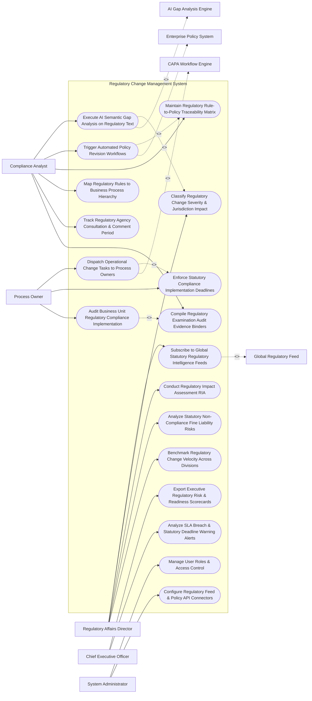

# Use Case Diagram — Regulatory Change Management System

## Mermaid Code

## Actor Table | Bảng Actor

| # | Actor | Actor Type | Role Description | Related Use Cases |
|---|-------|------------|------------------|-------------------|
| 1 | Regulatory Affairs Director | Primary | Executive managing regulatory subscriptions, severity classifications, impact assessments, fine liabilities, and benchmarking. | UC01, UC03, UC07, UC13, UC14 |
| 2 | Compliance Analyst | Primary | Legal analyst evaluating AI gap analysis, triggering policy revisions, maintaining traceability matrices, and assembling audit binders. | UC02, UC04, UC05, UC06, UC11, UC12 |
| 3 | Process Owner | Primary | Operations manager executing operational change tasks, meeting compliance deadlines, and proving control implementation. | UC08, UC09, UC10 |
| 4 | Chief Executive Officer | Primary | Executive reviewing regulatory risk scorecards, fine liabilities, and SLA breach alerts. | UC15, UC18 |
| 5 | System Administrator | Primary | IT admin managing user security roles, regulatory feed API keys, and enterprise policy connectors. | UC16, UC17 |
| 6 | Global Regulatory Feed | System (Secondary) | Intelligence provider (Thomson Reuters/LexisNexis) streaming real-time statutory rule changes. | UC01 |
| 7 | AI Gap Analysis Engine | System (Secondary) | AI NLP engine comparing statutory text against internal policies to identify compliance gaps. | UC02 |
| 8 | Enterprise Policy System | System (Secondary) | Corporate policy system receiving policy update tasks and tracking policy approvals. | UC04 |
| 9 | CAPA Workflow Engine | System (Secondary) | Workflow engine orchestrating corrective action remediation tasks across business units. | UC08 |

## Use Case Table | Bảng Use Case

| # | UC ID | Use Case Name | Primary Actor | Secondary Actor | Description | Priority |
|---|-------|---------------|---------------|-----------------|-------------|----------|
| 1 | UC01 | Subscribe to Global Statutory Regulatory Intelligence Feeds | Director | RegFeed | Configures real-time regulatory intelligence subscriptions across jurisdictions (EU, US Federal, Asia-Pacific). | Critical |
| 2 | UC02 | Execute AI Semantic Gap Analysis on Regulatory Text | Analyst | AIEngine | Leverages AI NLP to analyze new statutory legal text, comparing it against internal policies to flag compliance gaps. | Critical |
| 3 | UC03 | Classify Regulatory Change Severity & Jurisdiction Impact | Director | None | Classifies regulatory update severity (Critical, High, Medium) and affected operating business units. | Critical |
| 4 | UC04 | Trigger Automated Policy Revision Workflows | Analyst | PolicySys | Automatically creates policy revision draft tasks in the enterprise policy system when gaps are detected. | Critical |
| 5 | UC05 | Maintain Regulatory Rule-to-Policy Traceability Matrix | Analyst | None | Maps statutory legal citations (e.g., EU AI Act Art 13) directly to specific corporate policy paragraphs. | Critical |
| 6 | UC06 | Map Regulatory Rules to Business Process Hierarchy | Analyst | None | Maps regulatory rules to operational business processes (e.g., Accounts Payable, Customer Onboarding). | High |
| 7 | UC07 | Conduct Regulatory Impact Assessment RIA | Director | None | Evaluates financial cost, IT system impact, and operational changes required to comply with new regulations. | High |
| 8 | UC08 | Dispatch Operational Change Tasks to Process Owners | Owner | CAPASys | Dispatches CAPA remediation tasks to operations leads to update business procedures and controls. | Critical |
| 9 | UC09 | Enforce Statutory Compliance Implementation Deadlines | Owner | None | Enforces statutory compliance effective dates, tracking operational implementation progress against SLAs. | Critical |
| 10 | UC10 | Audit Business Unit Regulatory Compliance Implementation | Owner | None | Audits business unit operational changes, verifying that updated controls comply with statutory rules. | High |
| 11 | UC11 | Track Regulatory Agency Consultation & Comment Period | Analyst | None | Monitors proposed government rule-making notices and manages corporate public comment submissions. | High |
| 12 | UC12 | Compile Regulatory Examination Audit Evidence Binders | Analyst | None | Auto-assembles comprehensive evidence binders proving regulatory compliance for government inspectors. | High |
| 13 | UC13 | Analyze Statutory Non-Compliance Fine Liability Risks | Director | None | Calculates potential statutory fine liabilities ($Fine = \text{Global Revenue} \times 4\%$) for non-compliance. | High |
| 14 | UC14 | Benchmark Regulatory Change Velocity Across Divisions | Director | None | Measures average time-to-compliance across regional divisions and tracks regulatory change volume. | High |
| 15 | UC15 | Export Executive Regulatory Risk & Readiness Scorecards | CEO | None | Renders executive scorecards detailing statutory readiness %, open policy gap counts, and fine liability. | High |
| 16 | UC16 | Manage User Roles & Access Control | Admin | None | Controls user login credentials, RBAC permissions, and regulatory domain access rights. | High |
| 17 | UC17 | Configure Regulatory Feed & Policy API Connectors | Admin | None | Configures API connectors for Thomson Reuters, LexisNexis, SAP Signavio, and OneTrust. | High |
| 18 | UC18 | Analyze SLA Breach & Statutory Deadline Warning Alerts | CEO | None | Dispatches urgent alerts when a statutory compliance effective date is within 30 days and tasks remain incomplete. | High |

## Use Case Specification | Đặc tả Use Case

---

### UC02 — Execute AI Semantic Gap Analysis on Regulatory Text

| Field | Detail |
|-------|--------|
| **UC ID** | UC02 |
| **Use Case Name** | Execute AI Semantic Gap Analysis on Regulatory Text |
| **Actor(s)** | Primary: Regulatory Compliance Specialist, Regulatory Affairs Director   Secondary: Regulatory Impact AI Gap Analysis Engine |
| **Description** | Ingests new statutory regulatory legal text, utilizing AI NLP semantic similarity models to compare statutory requirements against internal corporate policies and identify missing compliance controls. |
| **Precondition** | 1. Statutory regulatory update (e.g., `EU AI Act Compliance Regulation 2026`) is ingested from regulatory feed (UC01).   2. Corporate policy catalog and operating procedures are indexed in vector search database. |
| **Main Flow** | 1. Compliance Analyst opens "AI Regulatory Gap Analysis Studio" for New Regulation: `EU AI Act Article 13 (Transparency Directives)`.   2. System dispatches statutory legal text stream to AI Gap Analysis Engine.   3. AI Engine executes Dual Analysis Pipeline:   &nbsp;&nbsp;&nbsp;&nbsp; a. Keyword & Legal Citation Extraction: Extracts core mandatory legal directives (`"shall provide clear instructions for use"`, `"shall declare human oversight mechanisms"`).   &nbsp;&nbsp;&nbsp;&nbsp; b. Dense Vector Semantic Search: Compares statutory directives against 250 internal corporate policies.   4. AI Engine computes Policy Semantic Similarity Scores:   &nbsp;&nbsp;&nbsp;&nbsp; a. Matched Policy: `Policy #POL-402 (Enterprise Data & AI Governance Policy)` -> `78% Semantic Match`.   5. AI Engine evaluates Statutory Compliance Gap:   &nbsp;&nbsp;&nbsp;&nbsp; a. Finding 1: Policy #POL-402 contains human oversight rules -> `COMPLIANT`.   &nbsp;&nbsp;&nbsp;&nbsp; b. Finding 2: Policy #POL-402 lacks mandatory user AI transparency disclosure templates -> `COMPLIANCE_GAP_DETECTED`.   6. System generates AI Regulatory Gap Summary Report `#GAP-2026-88412`, scoring Gap Severity as `HIGH_RISK`.   7. Analyst approves gap findings, initiating UC04 (Trigger Automated Policy Revision) and UC05 (Maintain Traceability Matrix). |
| **Alternative Flow** | **AF1** — Zero Gap Full Compliance: AI Engine determines internal policies already fully satisfy new regulation (100% semantic coverage); System marks regulation as `FULLY_COMPLIANT_NO_ACTION_REQUIRED`. |
| **Exception Flow** | **EX1** — Un-Indexed Policy Database Error: Corporate policy database index is outdated; System halts analysis, triggering automated vector re-indexing before running semantic gap analysis. |
| **Postcondition** | Statutory text is analyzed against internal policies using AI NLP, compliance gaps are identified, gap severity is scored, and policy revision workflows trigger. |
| **Business Rule** | **BR1**: AI semantic gap analysis MUST be executed on all new high-severity statutory regulatory updates within <= 24 hours of ingestion. |

---

### UC05 — Maintain Regulatory Rule-to-Policy Traceability Matrix

| Field | Detail |
|-------|--------|
| **UC ID** | UC05 |
| **Use Case Name** | Maintain Regulatory Rule-to-Policy Traceability Matrix |
| **Actor(s)** | Primary: Regulatory Compliance Specialist, Regulatory Affairs Director   Secondary: Enterprise Policy & Control Management System |
| **Description** | Establishes and maintains bi-directional audit-proof traceability links connecting statutory legal citations (e.g., 21 CFR Part 11 / EU AI Act Art 13) directly to specific internal policy paragraphs and control IDs. |
| **Precondition** | 1. Regulatory gap analysis is complete (UC02).   2. Statutory rule citations and internal policy IDs are cataloged. |
| **Main Flow** | 1. Compliance Analyst opens "Regulatory Traceability Matrix Studio".   2. Analyst selects Statutory Regulation: `EU AI Act (Regulation EU 2026/884)`.   3. System displays Statutory Rule Hierarchy:   &nbsp;&nbsp;&nbsp;&nbsp; a. Citation: `Article 13, Paragraph 2(a) - Human Oversight Requirements`.   4. Analyst maps Citation to Internal Policy & Control:   &nbsp;&nbsp;&nbsp;&nbsp; a. Target Policy: `Policy #POL-402 (AI Governance Policy), Section 4.2`.   &nbsp;&nbsp;&nbsp;&nbsp; b. Target Control ID: `Control #CTRL-AI-010 (Mandatory Human Intervention Override)`.   5. System establishes Bi-Directional Traceability Link:   &nbsp;&nbsp;&nbsp;&nbsp; a. Forward Link: `Statute EU 2026/884 Art 13 -> Policy POL-402 Sec 4.2 -> Control CTRL-AI-010`.   &nbsp;&nbsp;&nbsp;&nbsp; b. Reverse Link: `Control CTRL-AI-010 -> Justified by Statute EU 2026/884 Art 13`.   6. System checks Traceability Coverage Rate: `EU AI Act Traceability = 94% Covered (6% Unmapped Gap remaining)`.   7. System updates Regulatory Traceability Ledger, generating audit-proof evidence for government inspectors (UC12). |
| **Alternative Flow** | **AF1** — Multi-Regulatory Mapping: Analyst maps single internal control (#CTRL-SEC-01) to multiple global regulations (SOX 404, ISO 27001 Sec 9, GDPR Art 32), creating unified multi-regulatory compliance mapping. |
| **Exception Flow** | **EX1** — Broken Traceability Link Alert: Target policy paragraph is deleted in Policy System; System flags `BROKEN_TRACEABILITY_LINK`, alerting analyst to update legal citation mapping. |
| **Postcondition** | Bi-directional traceability links between statutory legal citations and internal policies/controls are logged and audit-proof coverage rates update. |
| **Business Rule** | **BR1**: Every mandatory statutory regulatory directive MUST be linked to at least one internal policy paragraph and operational control ID. |

---

### UC08 — Dispatch Operational Change Tasks to Process Owners

| Field | Detail |
|-------|--------|
| **UC ID** | UC08 |
| **Use Case Name** | Dispatch Operational Change Tasks to Process Owners |
| **Actor(s)** | Primary: Business Unit Process Owner, Compliance Specialist   Secondary: Corrective Action Plan (CAPA) Workflow Engine |
| **Description** | Generates and dispatches mandatory operational change tasks to business unit process owners when a new regulation requires updates to operational procedures, IT systems, or workflow controls. |
| **Precondition** | 1. Regulatory gap analysis (UC02) identifies operational process changes required.   2. Statutory compliance effective date (e.g., December 01, 2026) is set. |
| **Main Flow** | 1. Compliance Analyst opens "Regulatory Operational Change Manager".   2. Analyst creates Operational Change Project: `EU AI Act Art 13 Operational Readiness`.   3. Analyst defines Operational Tasks & Assignees:   &nbsp;&nbsp;&nbsp;&nbsp; a. Task 1: `Update AI Model Transparency Disclosure UI in Customer Portal` (Assigned: Lead Product Manager Dave Miller).   &nbsp;&nbsp;&nbsp;&nbsp; b. Task 2: `Re-configure Accounts Payable Fraud Screening Thresholds` (Assigned: AP Director Sarah Jenkins).   &nbsp;&nbsp;&nbsp;&nbsp; c. Implementation Deadline: `November 15, 2026` (15 days prior to statutory effective date Dec 01).   4. System dispatches CAPA Remediation Tasks via CAPA Workflow Engine to assignees.   5. Process Owner Dave Miller receives notification: *"Action Required: Implement EU AI Act Art 13 UI Changes by Nov 15, 2026 (Mandatory Statutory Deadline)"*.   6. Dave Miller updates portal UI, uploads Implementation Evidence (Release Notes + Screenshots), and clicks "Submit Task Completion".   7. System routes evidence to Compliance Analyst for verification audit (UC10).   8. Analyst approves evidence; System marks Task 1 `COMPLETED_VERIFIED` and updates project completion meter to 50%. |
| **Alternative Flow** | **AF1** — Operational Deadline Extension Request: Process owner requests 7-day extension due to IT deployment sprint schedule; Regulatory Affairs Director approves extension, provided it precedes statutory effective date. |
| **Exception Flow** | **EX1** — Overdue Implementation SLA Warning: Task 1 remains incomplete 10 days before statutory effective date; System triggers UC18 (Analyze SLA Alerts), escalating alert to CEO and CISO. |
| **Postcondition** | Operational change tasks are dispatched to process owners, implementation evidence is submitted, analyst verifies control execution, and compliance status updates. |
| **Business Rule** | **BR1**: Operational change tasks for statutory compliance MUST be scheduled for completion at least 15 days prior to the statutory effective date. |

---

### UC12 — Compile Regulatory Examination Audit Evidence Binders

| Field | Detail |
|-------|--------|
| **UC ID** | UC12 |
| **Use Case Name** | Compile Regulatory Examination Audit Evidence Binders |
| **Actor(s)** | Primary: Regulatory Compliance Specialist, Regulatory Affairs Director   Secondary: Government Regulatory Inspection & Examination Board |
| **Description** | Automatically compiles comprehensive, audit-proof regulatory evidence binders containing rule-to-policy matrices, operational implementation proofs, and audit logs for government regulatory inspectors. |
| **Precondition** | 1. Government regulatory inspection (FDA, SEC, FINRA, BaFin examination) is announced.   2. Statutory compliance tasks and policy mappings are completed (UC05, UC08). |
| **Main Flow** | 1. Compliance Analyst opens "Regulatory Examination Audit Desk".   2. Analyst selects Target Regulatory Audit: `FDA 21 CFR Part 11 Electronic Records Inspection 2026`.   3. Analyst selects Scope Parameters:   &nbsp;&nbsp;&nbsp;&nbsp; a. Applicable Regulation: `21 CFR Part 11 (Electronic Signatures & Audit Trails)`.   &nbsp;&nbsp;&nbsp;&nbsp; b. Audit Period: `January 01, 2025 to October 30, 2026`.   4. System executes Automated Evidence Binder Compilation:   &nbsp;&nbsp;&nbsp;&nbsp; a. Section 1 (Traceability Matrix): Auto-generates 21 CFR Part 11 Rule-to-Policy Traceability Table (UC05).   &nbsp;&nbsp;&nbsp;&nbsp; b. Section 2 (Corporate Policies): Attaches approved Policy #POL-102 (Electronic Signature Policy v3.0).   &nbsp;&nbsp;&nbsp;&nbsp; c. Section 3 (Operational Proofs): Attaches 45 system validation execution logs, user access review receipts, and CAPA closure reports.   &nbsp;&nbsp;&nbsp;&nbsp; d. Section 4 (Audit Telemetry): Attaches system audit trail logs proving zero unauthorized policy edits.   5. System compiles PDF/A Audit Binder (`FDA_21CFR11_Audit_Binder_2026.pdf` - 450 Pages) with hyperlinked table of contents and Bates numbering.   6. Regulatory Affairs Director reviews binder, applies digital signature certification, and delivers binder to FDA Regulatory Inspection Board. |
| **Alternative Flow** | **AF1** — Direct Inspector Portal Access: Government inspector is granted secure, time-bound read-only portal access to inspect evidence binder online with search capabilities. |
| **Exception Flow** | **EX1** — Missing Operational Proof Warning: Evidence binder compilation detects missing validation sign-off for Control #CTRL-VAL-02; System flags `MISSING_EVIDENCE_WARNING`, prompting analyst to attach proof before binder export. |
| **Postcondition** | Comprehensive regulatory evidence binder is compiled, policy mappings and operational proofs are verified, DPO signs certification, and binder delivers to inspectors. |
| **Business Rule** | **BR1**: Regulatory examination evidence binders MUST include bi-directional rule-to-policy traceability matrices and verified operational execution proofs. |
