# Conceptual ERD — Regulatory Change Management System

## Mermaid Code

```mermaid
erDiagram
    USER_ACCOUNT {
        int user_id PK
        string full_name
        string username
        string user_role
        string department_code
        boolean is_active
    }

    STATUTORY_REGULATION_FEED_ITEM {
        int reg_item_id PK
        string regulation_title
        string issuing_regulatory_body
        string legal_jurisdiction_code
        date publication_date
        date statutory_effective_date
        string severity_level
    }

    AI_REGULATORY_GAP_ANALYSIS {
        int gap_id PK
        int reg_item_id FK
        int evaluated_by_user_id FK
        text statutory_directive_text
        int semantic_similarity_score_percent
        string compliance_gap_status
        datetime evaluated_at
    }

    REGULATORY_RULE_CITATION {
        int citation_id PK
        int reg_item_id FK
        string citation_article_section_number
        text mandatory_rule_text
    }

    POLICY_TRACEABILITY_MATRIX_LINK {
        int link_id PK
        int citation_id FK
        int target_policy_id_fk
        int target_control_id_fk
        string mapping_verification_status
    }

    REGULATORY_IMPACT_ASSESSMENT {
        int ria_id PK
        int reg_item_id FK
        int director_user_id FK
        decimal estimated_compliance_cost_usd
        string business_unit_impact_scope
        string overall_impact_tier
    }

    OPERATIONAL_CHANGE_TASK_CAPA {
        int task_id PK
        int reg_item_id FK
        int process_owner_user_id FK
        string task_title_description
        date implementation_deadline_date
        string task_status
    }

    PROCESS_OWNER_IMPLEMENTATION_PROOF {
        int proof_id PK
        int task_id FK
        string evidence_document_s3_uri
        boolean is_verified_by_analyst
        datetime submitted_at
    }

    REGULATORY_AGENCY_COMMENT_PERIOD {
        int comment_id PK
        int reg_item_id FK
        date public_comment_deadline_date
        text submitted_corporate_comment_text
        string agency_response_status
    }

    REGULATORY_EXAMINATION_EVIDENCE_BINDER {
        int binder_id PK
        int reg_item_id FK
        int compiled_by_user_id FK
        string binder_title
        string pdfa_binder_document_s3_uri
        datetime certified_at
    }

    NONCOMPLIANCE_FINE_LIABILITY_LOG {
        int fine_id PK
        int reg_item_id FK
        decimal maximum_statutory_fine_usd
        decimal fine_percentage_global_turnover
        string risk_exposure_level
    }

    EXECUTIVE_REGULATORY_SCORECARD {
        int scorecard_id PK
        decimal statutory_readiness_percent
        int open_policy_gaps_count
        int pending_operational_tasks_count
        decimal total_estimated_fine_exposure_usd
        date period_quarter
    }

    STATUTORY_REGULATION_FEED_ITEM ||--o| AI_REGULATORY_GAP_ANALYSIS : "analyzed in"
    STATUTORY_REGULATION_FEED_ITEM ||--o{ REGULATORY_RULE_CITATION : "contains"
    STATUTORY_REGULATION_FEED_ITEM ||--o| REGULATORY_IMPACT_ASSESSMENT : "evaluated in"
    STATUTORY_REGULATION_FEED_ITEM ||--o{ OPERATIONAL_CHANGE_TASK_CAPA : "triggers"
    STATUTORY_REGULATION_FEED_ITEM ||--o{ REGULATORY_AGENCY_COMMENT_PERIOD : "commented on in"
    STATUTORY_REGULATION_FEED_ITEM ||--o{ REGULATORY_EXAMINATION_EVIDENCE_BINDER : "proven in"
    STATUTORY_REGULATION_FEED_ITEM ||--o| NONCOMPLIANCE_FINE_LIABILITY_LOG : "assessed for fine in"
    REGULATORY_RULE_CITATION ||--o{ POLICY_TRACEABILITY_MATRIX_LINK : "mapped in"
    OPERATIONAL_CHANGE_TASK_CAPA ||--o| PROCESS_OWNER_IMPLEMENTATION_PROOF : "verified by"
    USER_ACCOUNT ||--o{ AI_REGULATORY_GAP_ANALYSIS : "evaluates"
    USER_ACCOUNT ||--o{ REGULATORY_IMPACT_ASSESSMENT : "assesses"
    USER_ACCOUNT ||--o{ OPERATIONAL_CHANGE_TASK_CAPA : "owns task in"
    USER_ACCOUNT ||--o{ REGULATORY_EXAMINATION_EVIDENCE_BINDER : "compiles"
```

## Entity Description Table | Bảng mô tả Entity

| # | Entity Name | Vietnamese Name | Description | Key Attributes | Main Relationships |
|---|-------------|-----------------|-------------|----------------|-------------------|
| 1 | USER_ACCOUNT | Tài khoản Nguời dùng | System credentials and access roles for regulatory directors, compliance analysts, process owners, and admins. | `user_id`, `username`, `user_role`, `department_code` | Evaluates `AI_REGULATORY_GAP_ANALYSIS`, assesses `REGULATORY_IMPACT_ASSESSMENT`, owns task in `OPERATIONAL_CHANGE_TASK_CAPA`, compiles `REGULATORY_EXAMINATION_EVIDENCE_BINDER`. |
| 2 | STATUTORY_REGULATION_FEED_ITEM | Mục Feed Quy định Pháp lý | Statutory regulatory update record tracking regulation title, issuing body, jurisdiction, effective date, and severity. | `reg_item_id`, `regulation_title`, `issuing_regulatory_body`, `legal_jurisdiction_code`, `statutory_effective_date`, `severity_level` | Analyzed in `AI_REGULATORY_GAP_ANALYSIS`, contains `REGULATORY_RULE_CITATION`, evaluated in `REGULATORY_IMPACT_ASSESSMENT`, triggers `OPERATIONAL_CHANGE_TASK_CAPA`, commented on in `REGULATORY_AGENCY_COMMENT_PERIOD`, proven in `REGULATORY_EXAMINATION_EVIDENCE_BINDER`, assessed in `NONCOMPLIANCE_FINE_LIABILITY_LOG`. |
| 3 | AI_REGULATORY_GAP_ANALYSIS | Đánh giá Gap Regulatory AI | AI NLP semantic gap analysis log recording statutory directive text, semantic similarity scores %, and compliance gap status. | `gap_id`, `reg_item_id`, `evaluated_by_user_id`, `statutory_directive_text`, `semantic_similarity_score_percent`, `compliance_gap_status` | Belongs to `STATUTORY_REGULATION_FEED_ITEM`, evaluated by `USER_ACCOUNT`. |
| 4 | REGULATORY_RULE_CITATION | Trích dẫn Điều khoản Quy định | Statutory legal citation record storing article/section numbers (e.g., EU AI Act Art 13) and mandatory rule text. | `citation_id`, `reg_item_id`, `citation_article_section_number`, `mandatory_rule_text` | Belongs to `STATUTORY_REGULATION_FEED_ITEM`, mapped in `POLICY_TRACEABILITY_MATRIX_LINK`. |
| 5 | POLICY_TRACEABILITY_MATRIX_LINK | Link Ma trận Traceability | Bi-directional traceability link connecting statutory legal citations to internal policy IDs and control IDs. | `link_id`, `citation_id`, `target_policy_id_fk`, `target_control_id_fk`, `mapping_verification_status` | Belongs to `REGULATORY_RULE_CITATION`. |
| 6 | REGULATORY_IMPACT_ASSESSMENT | Đánh giá Tác động Regulatory | Regulatory Impact Assessment (RIA) record tracking estimated compliance costs USD, affected business units, and overall impact tier. | `ria_id`, `reg_item_id`, `director_user_id`, `estimated_compliance_cost_usd`, `business_unit_impact_scope`, `overall_impact_tier` | Belongs to `STATUTORY_REGULATION_FEED_ITEM`, assessed by `USER_ACCOUNT`. |
| 7 | OPERATIONAL_CHANGE_TASK_CAPA | Task Thay đổi Vận hành CAPA | Operational change task record assigning CAPA remediation steps, implementation deadlines, process owners, and status. | `task_id`, `reg_item_id`, `process_owner_user_id`, `task_title_description`, `implementation_deadline_date`, `task_status` | Belongs to `STATUTORY_REGULATION_FEED_ITEM`, verified by `PROCESS_OWNER_IMPLEMENTATION_PROOF`, owned by `USER_ACCOUNT`. |
| 8 | PROCESS_OWNER_IMPLEMENTATION_PROOF | Bằng chứng Triển khai Vận hành | Implementation proof record storing evidence document S3 URIs, analyst verification flags, and submission timestamps. | `proof_id`, `task_id`, `evidence_document_s3_uri`, `is_verified_by_analyst`, `submitted_at` | Belongs to `OPERATIONAL_CHANGE_TASK_CAPA`. |
| 9 | REGULATORY_AGENCY_COMMENT_PERIOD | Đợt Góp ý Cơ quan Quy định | Regulatory agency notice-and-comment log tracking public comment deadlines, submitted corporate comments, and agency responses. | `comment_id`, `reg_item_id`, `public_comment_deadline_date`, `submitted_corporate_comment_text`, `agency_response_status` | Belongs to `STATUTORY_REGULATION_FEED_ITEM`. |
| 10 | REGULATORY_EXAMINATION_EVIDENCE_BINDER | Binder Bằng chứng Thanh tra | Audit evidence binder record storing PDF/A document S3 URIs, compiled by user ID, and digital certification timestamps. | `binder_id`, `reg_item_id`, `compiled_by_user_id`, `binder_title`, `pdfa_binder_document_s3_uri`, `certified_at` | Belongs to `STATUTORY_REGULATION_FEED_ITEM`, compiled by `USER_ACCOUNT`. |
| 11 | NONCOMPLIANCE_FINE_LIABILITY_LOG | Nhật ký Fine Risk Phạt | Statutory non-compliance fine risk log tracking maximum statutory fines USD, global turnover % penalties, and risk levels. | `fine_id`, `reg_item_id`, `maximum_statutory_fine_usd`, `fine_percentage_global_turnover`, `risk_exposure_level` | Belongs to `STATUTORY_REGULATION_FEED_ITEM`. |
| 12 | EXECUTIVE_REGULATORY_SCORECARD | Scorecard Executive Regulatory | Executive regulatory scorecard aggregating statutory readiness %, open policy gaps, pending operational tasks, and fine exposure. | `scorecard_id`, `statutory_readiness_percent`, `open_policy_gaps_count`, `pending_operational_tasks_count`, `total_estimated_fine_exposure_usd` | Standalone executive performance entity. |

## Relationship Description | Mô tả Quan hệ

| # | From Entity | Cardinality | To Entity | Label | Business Explanation |
|---|-------------|-------------|-----------|-------|----------------------|
| 1 | STATUTORY_REGULATION_FEED_ITEM | 1 to 0..1 | AI_REGULATORY_GAP_ANALYSIS | analyzed in | A statutory regulation item is analyzed in AI regulatory gap analysis logs. |
| 2 | STATUTORY_REGULATION_FEED_ITEM | 1 to 1..N | REGULATORY_RULE_CITATION | contains | A statutory regulation item contains regulatory rule citations. |
| 3 | STATUTORY_REGULATION_FEED_ITEM | 1 to 0..1 | REGULATORY_IMPACT_ASSESSMENT | evaluated in | A statutory regulation item is evaluated in Regulatory Impact Assessments. |
| 4 | STATUTORY_REGULATION_FEED_ITEM | 1 to 0..N | OPERATIONAL_CHANGE_TASK_CAPA | triggers | A statutory regulation item triggers operational change tasks for process owners. |
| 5 | STATUTORY_REGULATION_FEED_ITEM | 1 to 0..N | REGULATORY_AGENCY_COMMENT_PERIOD | commented on in | A statutory regulation item is commented on in agency public comment periods. |
| 6 | STATUTORY_REGULATION_FEED_ITEM | 1 to 0..N | REGULATORY_EXAMINATION_EVIDENCE_BINDER | proven in | A statutory regulation item is proven in regulatory examination evidence binders. |
| 7 | STATUTORY_REGULATION_FEED_ITEM | 1 to 0..1 | NONCOMPLIANCE_FINE_LIABILITY_LOG | assessed for fine in | A statutory regulation item is assessed for non-compliance fine liabilities. |
| 8 | REGULATORY_RULE_CITATION | 1 to 0..N | POLICY_TRACEABILITY_MATRIX_LINK | mapped in | A regulatory rule citation is mapped in policy traceability matrix links. |
| 9 | OPERATIONAL_CHANGE_TASK_CAPA | 1 to 0..1 | PROCESS_OWNER_IMPLEMENTATION_PROOF | verified by | An operational change task is verified by process owner implementation proofs. |
| 10 | USER_ACCOUNT | 1 to 0..N | AI_REGULATORY_GAP_ANALYSIS | evaluates | A compliance analyst user account evaluates AI regulatory gap analysis. |
| 11 | USER_ACCOUNT | 1 to 0..N | REGULATORY_IMPACT_ASSESSMENT | assesses | A regulatory affairs director user account assesses Regulatory Impact Assessments. |
| 12 | USER_ACCOUNT | 1 to 0..N | OPERATIONAL_CHANGE_TASK_CAPA | owns task in | A process owner user account owns operational change tasks. |
| 13 | USER_ACCOUNT | 1 to 0..N | REGULATORY_EXAMINATION_EVIDENCE_BINDER | compiles | A compliance analyst user account compiles regulatory examination evidence binders. |
