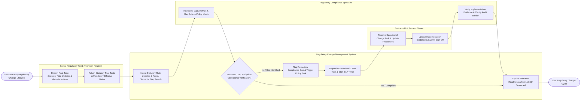

# Swimlane Diagram — Regulatory Change Management System

## Mermaid Code

## Flow Description | Mô tả luồng

| Lane | Actor | Role in Flow |
|------|-------|-------------|
| 1 | Business Unit Process Owner | Receives mandatory operational change tasks, updates business unit procedures and controls, uploads implementation evidence logs, and submits task completion sign-offs. |
| 2 | Regulatory Compliance Specialist | Reviews AI semantic gap analysis reports, maintains bi-directional rule-to-policy traceability matrices, triggers policy revisions, verifies process owner implementation evidence, and certifies audit evidence binders. |
| 3 | Regulatory Change Management System | Ingests real-time statutory regulatory updates, runs AI NLP semantic gap searches against internal policy vector embeddings, flags compliance gaps, dispatches CAPA operational change tasks, tracks statutory compliance deadlines, and computes non-compliance fine liability scorecards. |
| 4 | Global Regulatory Feed (Thomson Reuters) | Streams real-time statutory regulatory intelligence updates, government gazette notices, legal amendments, and mandatory statutory effective dates. |
